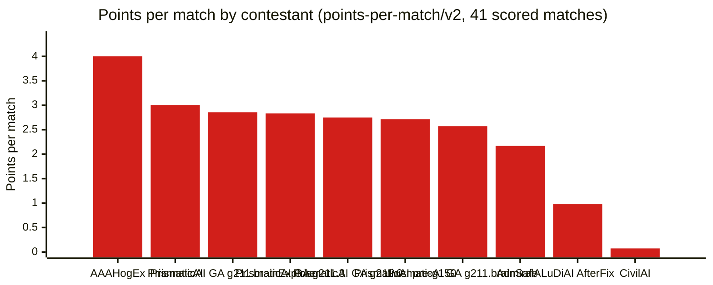
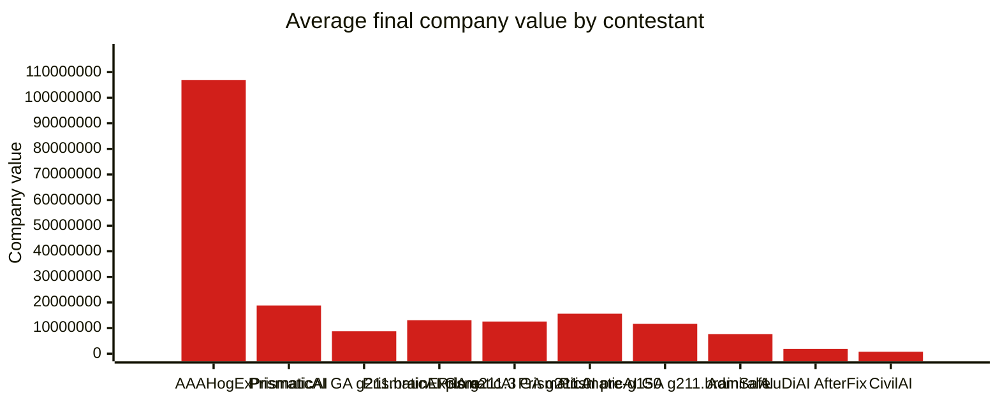
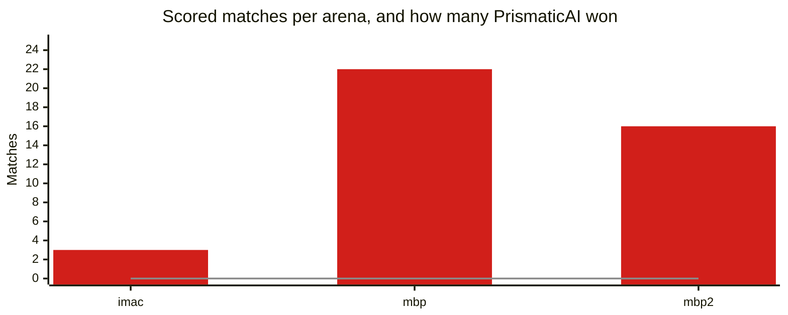

# battle-20261121T013316-21150eab

Derived from `battle-20261121T013316-21150eab.json` by `tools/research/ai-battle/battle.py report`; do not edit.

- Edition `21150eabdbfc72c2`: PrismaticAI and referee at `962699034c20d90baeb9f617789ea6558cc6ff52`, base set `opengfx-8.0.tar`
- 20-year free-for-all from 1960, map 256x256 temperate, breakdowns 1
- 41 scored match(es) on `imac` (20261119-master-gdf1e05e7d8), `mbp` (20261120-master-m17653b726e), `mbp2` (20261119-master-gdf1e05e7d8)
- Replays: 1 of 1 identical to their original on another arena

| # | Contestant | Played | Wins | Points | Points/match | Avg rank | Avg final value | Squirrel errors | Matches with anomalies |
|---|---|---|---|---|---|---|---|---|---|
| 1 | AAAHogEx | 41 | 41 | 164 | 4.0 | 1.0 | 106.9 M | 0 | 0 |
| 2 | PrismaticAI | 6 | 0 | 18 | 3.0 | 2.0 | 18.8 M | 0 | 0 |
| 3 | PrismaticAI GA g211.brainExplore | 7 | 0 | 20 | 2.857 | 2.14 | 8.7 M | 0 | 3 |
| 4 | PrismaticAI GA g211.3 | 6 | 0 | 17 | 2.833 | 2.17 | 13.1 M | 0 | 0 |
| 5 | PrismaticAI GA g211.0 | 8 | 0 | 22 | 2.75 | 2.25 | 12.6 M | 0 | 0 |
| 6 | PrismaticAI pre-g150 | 7 | 0 | 19 | 2.714 | 2.29 | 15.6 M | 0 | 3 |
| 7 | PrismaticAI GA g211.brainSafe | 7 | 0 | 18 | 2.571 | 2.43 | 11.6 M | 0 | 5 |
| 8 | AdmiralAI | 41 | 0 | 89 | 2.171 | 2.83 | 7.6 M | 0 | 1 |
| 9 | LuDiAI AfterFix | 41 | 0 | 40 | 0.976 | 4.02 | 1.8 M | 0 | 0 |
| 10 | CivilAI | 41 | 0 | 3 | 0.073 | 4.93 | 756.0 k | 0 | 4 |

```mermaid
---
config:
  xyChart:
    width: 900
    height: 360
  themeVariables:
    xyChart:
      plotColorPalette: "#d11f1a, #8a8a8a, #0b0b0b, #ece4d6"
---
xychart-beta
    title "Final company value per scored match: winner vs best PrismaticAI"
    x-axis ["m-0001", "m-0002", "m-0003", "m-0004", "m-0005", "m-0006", "m-0007", "m-0008", "m-0009", "m-0010", "m-0011", "m-0012", "m-0013", "m-0014", "m-0015", "m-0016", "m-0017", "m-0018", "m-0019", "m-0020", "m-0021", "m-0022", "m-0023", "m-0024", "m-0025", "m-0026", "m-0027", "m-0028", "m-0036", "m-0037", "m-0038", "m-0039", "m-0040", "m-0041", "m-0042", "m-0043", "m-0044", "m-0045", "m-0046", "m-0047", "m-0050"]
    %% series: Winner | Best PrismaticAI
    %% links: battle-20261121T013316-21150eab.md?col=Match&filter=m-0001 | battle-20261121T013316-21150eab.md?col=Match&filter=m-0002 | battle-20261121T013316-21150eab.md?col=Match&filter=m-0003 | battle-20261121T013316-21150eab.md?col=Match&filter=m-0004 | battle-20261121T013316-21150eab.md?col=Match&filter=m-0005 | battle-20261121T013316-21150eab.md?col=Match&filter=m-0006 | battle-20261121T013316-21150eab.md?col=Match&filter=m-0007 | battle-20261121T013316-21150eab.md?col=Match&filter=m-0008 | battle-20261121T013316-21150eab.md?col=Match&filter=m-0009 | battle-20261121T013316-21150eab.md?col=Match&filter=m-0010 | battle-20261121T013316-21150eab.md?col=Match&filter=m-0011 | battle-20261121T013316-21150eab.md?col=Match&filter=m-0012 | battle-20261121T013316-21150eab.md?col=Match&filter=m-0013 | battle-20261121T013316-21150eab.md?col=Match&filter=m-0014 | battle-20261121T013316-21150eab.md?col=Match&filter=m-0015 | battle-20261121T013316-21150eab.md?col=Match&filter=m-0016 | battle-20261121T013316-21150eab.md?col=Match&filter=m-0017 | battle-20261121T013316-21150eab.md?col=Match&filter=m-0018 | battle-20261121T013316-21150eab.md?col=Match&filter=m-0019 | battle-20261121T013316-21150eab.md?col=Match&filter=m-0020 | battle-20261121T013316-21150eab.md?col=Match&filter=m-0021 | battle-20261121T013316-21150eab.md?col=Match&filter=m-0022 | battle-20261121T013316-21150eab.md?col=Match&filter=m-0023 | battle-20261121T013316-21150eab.md?col=Match&filter=m-0024 | battle-20261121T013316-21150eab.md?col=Match&filter=m-0025 | battle-20261121T013316-21150eab.md?col=Match&filter=m-0026 | battle-20261121T013316-21150eab.md?col=Match&filter=m-0027 | battle-20261121T013316-21150eab.md?col=Match&filter=m-0028 | battle-20261121T013316-21150eab.md?col=Match&filter=m-0036 | battle-20261121T013316-21150eab.md?col=Match&filter=m-0037 | battle-20261121T013316-21150eab.md?col=Match&filter=m-0038 | battle-20261121T013316-21150eab.md?col=Match&filter=m-0039 | battle-20261121T013316-21150eab.md?col=Match&filter=m-0040 | battle-20261121T013316-21150eab.md?col=Match&filter=m-0041 | battle-20261121T013316-21150eab.md?col=Match&filter=m-0042 | battle-20261121T013316-21150eab.md?col=Match&filter=m-0043 | battle-20261121T013316-21150eab.md?col=Match&filter=m-0044 | battle-20261121T013316-21150eab.md?col=Match&filter=m-0045 | battle-20261121T013316-21150eab.md?col=Match&filter=m-0046 | battle-20261121T013316-21150eab.md?col=Match&filter=m-0047 | battle-20261121T013316-21150eab.md?col=Match&filter=m-0050
    y-axis "Company value" 0 --> 168000000
    bar [115704035, 120604228, 122378457, 107493947, 92705370, 78025923, 98660277, 121748276, 85817382, 93351022, 93631417, 117443725, 94420923, 105564832, 108663323, 109148091, 111061854, 111861655, 128184942, 113870428, 126409812, 153063256, 134086971, 91326045, 106236429, 108040281, 96377106, 82116355, 104308841, 123487048, 105271916, 117754064, 111923345, 117731756, 83399098, 98000173, 102848662, 100433837, 86788477, 92788800, 108532509]
    line [9846043, 15848876, 8762561, 5622303, 12382269, 20481929, 22993017, 19397029, 18022926, 2131314, 11282551, 19904390, 15800986, 13944896, 13017899, 9040826, 15904805, 25709226, 28144038, 15006197, 15173340, 8305623, 15221263, 19322354, 8160400, 9362839, 13482879, 13465213, 22893126, 16828783, 9512336, 10514678, 12169003, 19262959, 4640408, 7510308, 7492646, 2549201, 10426329, 4268886, 9884367]
```

<!-- battle-charts:begin -->
<!-- derived from battle-20261121T013316-21150eab.json by `battle.py render`; `battle.py check` fails when it is stale -->

<!-- battle-charts:end -->

| Seed | Original | Replay | Arenas | Identical |
|---|---|---|---|---|
| 627467 | m-0024 | m-0048 | mbp2 / mbp | yes |

| Match | Arena | Seed | Winner | Value | Last | Anomalies |
|---|---|---|---|---|---|---|
| m-0001 | mbp | 127761750 | AAAHogEx | 115.7 M | CivilAI | CivilAI: fleet_drop:35->14 |
| m-0002 | mbp | 127761750 | AAAHogEx | 120.6 M | CivilAI | - |
| m-0003 | mbp | 127761750 | AAAHogEx | 122.4 M | CivilAI | PrismaticAI GA g211.brainSafe: fleet_drop:84->55; CivilAI: fleet_drop:13->6 |
| m-0004 | mbp | 127761750 | AAAHogEx | 107.5 M | CivilAI | - |
| m-0005 | mbp | 127761750 | AAAHogEx | 92.7 M | CivilAI | - |
| m-0006 | mbp | 1995152879 | AAAHogEx | 78.0 M | LuDiAI AfterFix | - |
| m-0007 | mbp | 1995152879 | AAAHogEx | 98.7 M | CivilAI | - |
| m-0008 | mbp | 1995152879 | AAAHogEx | 121.7 M | LuDiAI AfterFix | - |
| m-0009 | mbp | 1995152879 | AAAHogEx | 85.8 M | CivilAI | - |
| m-0010 | imac | 1995152879 | AAAHogEx | 93.4 M | LuDiAI AfterFix | PrismaticAI GA g211.brainExplore: fleet_drop:39->16 |
| m-0011 | imac | 1995152879 | AAAHogEx | 93.6 M | CivilAI | - |
| m-0012 | imac | 1616811586 | AAAHogEx | 117.4 M | CivilAI | - |
| m-0013 | mbp2 | 1616811586 | AAAHogEx | 94.4 M | CivilAI | PrismaticAI pre-g150: fleet_drop:120->80 |
| m-0014 | mbp2 | 1616811586 | AAAHogEx | 105.6 M | CivilAI | - |
| m-0015 | mbp2 | 1616811586 | AAAHogEx | 108.7 M | CivilAI | PrismaticAI GA g211.brainSafe: fleet_drop:105->73 |
| m-0016 | mbp2 | 1616811586 | AAAHogEx | 109.1 M | CivilAI | PrismaticAI GA g211.brainExplore: fleet_drop:187->75 |
| m-0017 | mbp2 | 1616811586 | AAAHogEx | 111.1 M | CivilAI | - |
| m-0018 | mbp2 | 3017563 | AAAHogEx | 111.9 M | CivilAI | - |
| m-0019 | mbp2 | 3017563 | AAAHogEx | 128.2 M | CivilAI | - |
| m-0020 | mbp2 | 3017563 | AAAHogEx | 113.9 M | CivilAI | - |
| m-0021 | mbp2 | 3017563 | AAAHogEx | 126.4 M | CivilAI | PrismaticAI GA g211.brainSafe: fleet_drop:93->54 |
| m-0022 | mbp2 | 3017563 | AAAHogEx | 153.1 M | CivilAI | - |
| m-0023 | mbp2 | 3017563 | AAAHogEx | 134.1 M | CivilAI | - |
| m-0024 | mbp2 | 627467 | AAAHogEx | 91.3 M | CivilAI | - |
| m-0025 | mbp2 | 627467 | AAAHogEx | 106.2 M | CivilAI | PrismaticAI pre-g150: fleet_drop:61->37 |
| m-0026 | mbp2 | 627467 | AAAHogEx | 108.0 M | CivilAI | CivilAI: fleet_drop:53->31 |
| m-0027 | mbp2 | 627467 | AAAHogEx | 96.4 M | CivilAI | - |
| m-0028 | mbp2 | 627467 | AAAHogEx | 82.1 M | CivilAI | - |
| m-0036 | mbp | 1035706099 | AAAHogEx | 104.3 M | CivilAI | - |
| m-0037 | mbp | 1035706099 | AAAHogEx | 123.5 M | CivilAI | PrismaticAI pre-g150: fleet_drop:79->28; CivilAI: fleet_drop:110->54 |
| m-0038 | mbp | 1035706099 | AAAHogEx | 105.3 M | CivilAI | - |
| m-0039 | mbp | 1035706099 | AAAHogEx | 117.8 M | CivilAI | PrismaticAI GA g211.brainSafe: fleet_drop:73->32 |
| m-0040 | mbp | 1035706099 | AAAHogEx | 111.9 M | CivilAI | - |
| m-0041 | mbp | 1035706099 | AAAHogEx | 117.7 M | CivilAI | - |
| m-0042 | mbp | 967698390 | AAAHogEx | 83.4 M | CivilAI | - |
| m-0043 | mbp | 967698390 | AAAHogEx | 98.0 M | CivilAI | - |
| m-0044 | mbp | 967698390 | AAAHogEx | 102.8 M | CivilAI | AdmiralAI: fleet_drop:332->160 |
| m-0045 | mbp | 967698390 | AAAHogEx | 100.4 M | CivilAI | PrismaticAI GA g211.brainSafe: fleet_drop:42->26 |
| m-0046 | mbp | 967698390 | AAAHogEx | 86.8 M | CivilAI | PrismaticAI GA g211.brainExplore: fleet_drop:109->72 |
| m-0047 | mbp | 967698390 | AAAHogEx | 92.8 M | CivilAI | - |
| m-0048 (replay) | mbp | 627467 | AAAHogEx | 91.3 M | CivilAI | - |
| m-0050 | mbp | 557930917 | AAAHogEx | 108.5 M | CivilAI | - |
