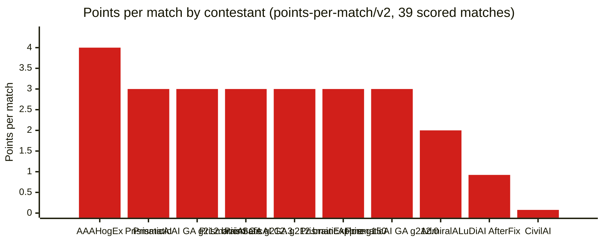
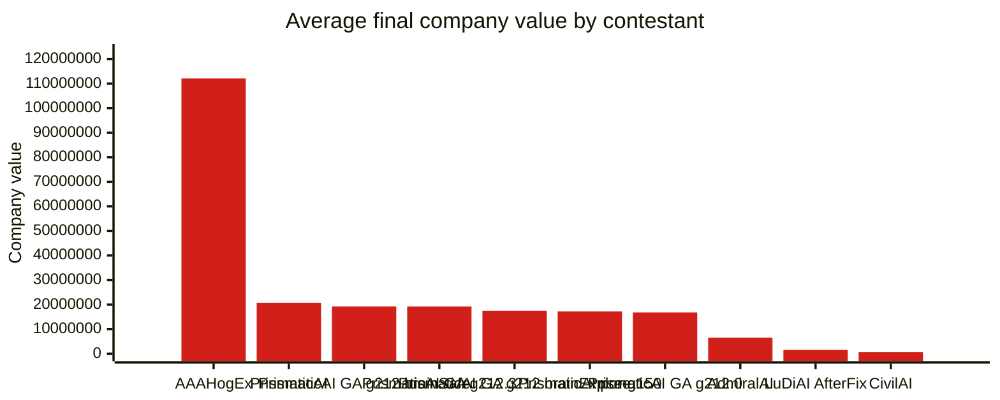
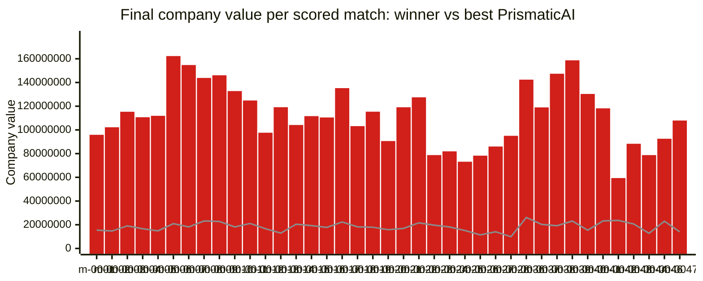
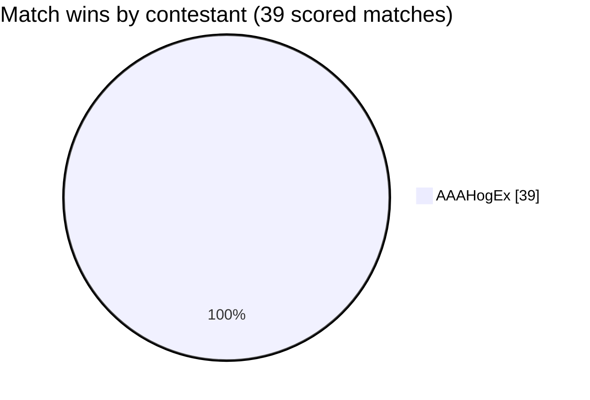
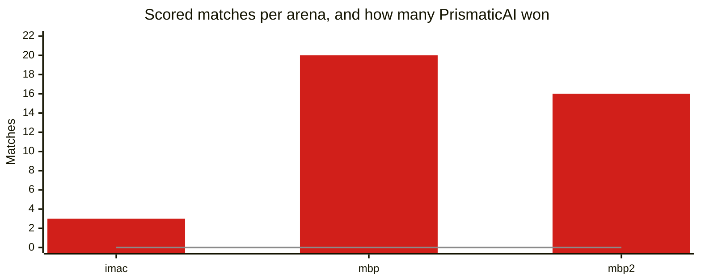

# battle-20261121T014312-0afdf822

Derived from `battle-20261121T014312-0afdf822.json` by `tools/research/ai-battle/battle.py report`; do not edit.

- Edition `0afdf82227291937`: PrismaticAI and referee at `962699034c20d90baeb9f617789ea6558cc6ff52`, base set `opengfx-8.0.tar`
- 20-year free-for-all from 1960, map 256x256 temperate, breakdowns 1
- 39 scored match(es) on `imac` (20261119-master-gdf1e05e7d8), `mbp` (20261120-master-m17653b726e), `mbp2` (20261119-master-gdf1e05e7d8)
- Replays: 0 of 0 identical to their original on another arena

| # | Contestant | Played | Wins | Points | Points/match | Avg rank | Avg final value | Squirrel errors | Matches with anomalies |
|---|---|---|---|---|---|---|---|---|---|
| 1 | AAAHogEx | 39 | 39 | 156 | 4.0 | 1.0 | 112.1 M | 0 | 0 |
| 2 | PrismaticAI | 6 | 0 | 18 | 3.0 | 2.0 | 20.6 M | 0 | 0 |
| 3 | PrismaticAI GA g212.brainSafe | 6 | 0 | 18 | 3.0 | 2.0 | 19.2 M | 0 | 1 |
| 4 | PrismaticAI GA g212.3 | 6 | 0 | 18 | 3.0 | 2.0 | 19.2 M | 0 | 0 |
| 5 | PrismaticAI GA g212.brainExplore | 7 | 0 | 21 | 3.0 | 2.0 | 17.5 M | 0 | 0 |
| 6 | PrismaticAI pre-g150 | 7 | 0 | 21 | 3.0 | 2.0 | 17.2 M | 0 | 2 |
| 7 | PrismaticAI GA g212.0 | 7 | 0 | 21 | 3.0 | 2.0 | 16.8 M | 0 | 0 |
| 8 | AdmiralAI | 39 | 0 | 78 | 2.0 | 3.0 | 6.5 M | 102 | 2 |
| 9 | LuDiAI AfterFix | 39 | 0 | 36 | 0.923 | 4.08 | 1.6 M | 0 | 1 |
| 10 | CivilAI | 39 | 0 | 3 | 0.077 | 4.92 | 576.0 k | 0 | 7 |

<!-- battle-charts:begin -->
<!-- derived from battle-20261121T014312-0afdf822.json by `battle.py render`; `battle.py check` fails when it is stale -->

<!-- battle-charts:end -->

| Match | Arena | Seed | Winner | Value | Last | Anomalies |
|---|---|---|---|---|---|---|
| m-0001 | mbp | 811249678 | AAAHogEx | 95.9 M | CivilAI | - |
| m-0002 | mbp | 811249678 | AAAHogEx | 102.2 M | CivilAI | - |
| m-0003 | mbp | 811249678 | AAAHogEx | 115.3 M | LuDiAI AfterFix | - |
| m-0004 | mbp | 811249678 | AAAHogEx | 110.7 M | CivilAI | - |
| m-0005 | mbp | 811249678 | AAAHogEx | 111.9 M | CivilAI | - |
| m-0006 | mbp | 1054948364 | AAAHogEx | 162.3 M | CivilAI | - |
| m-0007 | mbp | 1054948364 | AAAHogEx | 154.7 M | CivilAI | PrismaticAI pre-g150: fleet_drop:142->73; CivilAI: fleet_drop:50->18 |
| m-0008 | mbp | 1054948364 | AAAHogEx | 143.8 M | CivilAI | - |
| m-0009 | mbp | 1054948364 | AAAHogEx | 146.1 M | CivilAI | CivilAI: fleet_drop:37->14 |
| m-0010 | imac | 1054948364 | AAAHogEx | 132.8 M | CivilAI | - |
| m-0011 | imac | 1054948364 | AAAHogEx | 124.8 M | CivilAI | - |
| m-0012 | imac | 1092719813 | AAAHogEx | 97.6 M | CivilAI | - |
| m-0013 | mbp2 | 1092719813 | AAAHogEx | 119.2 M | CivilAI | - |
| m-0014 | mbp2 | 1092719813 | AAAHogEx | 104.1 M | CivilAI | - |
| m-0015 | mbp2 | 1092719813 | AAAHogEx | 111.6 M | CivilAI | - |
| m-0016 | mbp2 | 1092719813 | AAAHogEx | 110.5 M | CivilAI | CivilAI: fleet_drop:49->20 |
| m-0017 | mbp2 | 1092719813 | AAAHogEx | 135.2 M | CivilAI | - |
| m-0018 | mbp2 | 930381907 | AAAHogEx | 103.2 M | CivilAI | - |
| m-0019 | mbp2 | 930381907 | AAAHogEx | 115.4 M | LuDiAI AfterFix | - |
| m-0020 | mbp2 | 930381907 | AAAHogEx | 90.6 M | CivilAI | - |
| m-0021 | mbp2 | 930381907 | AAAHogEx | 119.1 M | CivilAI | - |
| m-0022 | mbp2 | 930381907 | AAAHogEx | 127.5 M | CivilAI | AdmiralAI: squirrel_errors:45 |
| m-0023 | mbp2 | 930381907 | AAAHogEx | 78.8 M | CivilAI | - |
| m-0024 | mbp2 | 897591978 | AAAHogEx | 81.9 M | CivilAI | CivilAI: no_vehicles |
| m-0025 | mbp2 | 897591978 | AAAHogEx | 73.2 M | CivilAI | - |
| m-0026 | mbp2 | 897591978 | AAAHogEx | 78.3 M | CivilAI | - |
| m-0027 | mbp2 | 897591978 | AAAHogEx | 86.0 M | CivilAI | - |
| m-0028 | mbp2 | 897591978 | AAAHogEx | 95.0 M | CivilAI | CivilAI: no_vehicles |
| m-0036 | mbp | 77245830 | AAAHogEx | 142.4 M | CivilAI | LuDiAI AfterFix: fleet_drop:116->75 |
| m-0037 | mbp | 77245830 | AAAHogEx | 119.0 M | CivilAI | PrismaticAI pre-g150: fleet_drop:121->65; AdmiralAI: squirrel_errors:57 |
| m-0038 | mbp | 77245830 | AAAHogEx | 147.4 M | CivilAI | - |
| m-0039 | mbp | 77245830 | AAAHogEx | 158.7 M | CivilAI | PrismaticAI GA g212.brainSafe: fleet_drop:142->79 |
| m-0040 | mbp | 77245830 | AAAHogEx | 130.3 M | CivilAI | CivilAI: fleet_drop:81->48 |
| m-0041 | mbp | 77245830 | AAAHogEx | 118.2 M | CivilAI | - |
| m-0042 | mbp | 1359834221 | AAAHogEx | 59.4 M | CivilAI | - |
| m-0043 | mbp | 1359834221 | AAAHogEx | 88.3 M | CivilAI | - |
| m-0044 | mbp | 1359834221 | AAAHogEx | 78.8 M | CivilAI | CivilAI: fleet_drop:43->30 |
| m-0046 | mbp | 1359834221 | AAAHogEx | 92.5 M | CivilAI | - |
| m-0047 | mbp | 1359834221 | AAAHogEx | 107.9 M | LuDiAI AfterFix | - |
