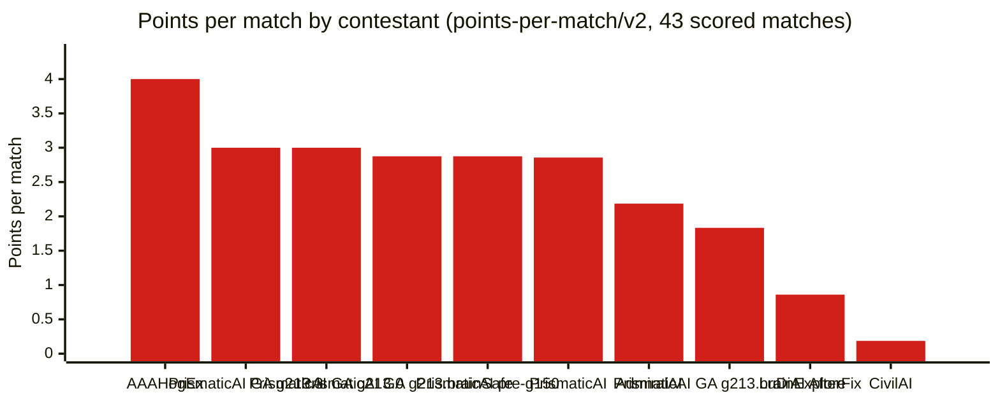
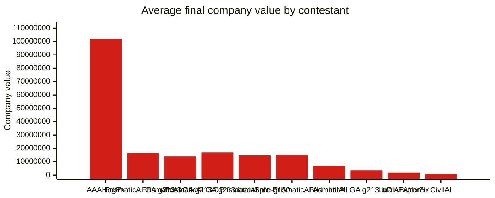
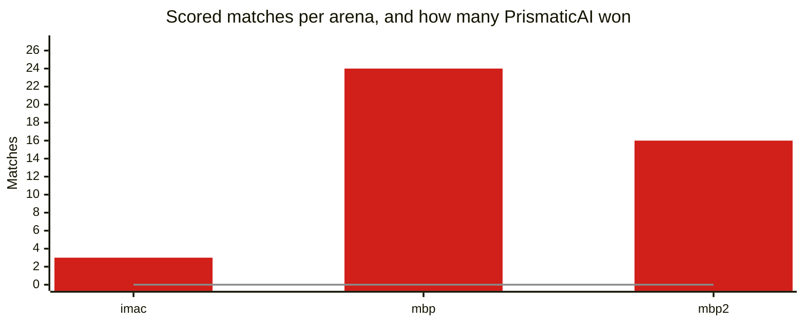

# battle-20261121T015341-620a03c8

Derived from `battle-20261121T015341-620a03c8.json` by `tools/research/ai-battle/battle.py report`; do not edit.

- Edition `620a03c867bf996a`: PrismaticAI and referee at `962699034c20d90baeb9f617789ea6558cc6ff52`, base set `opengfx-8.0.tar`
- 20-year free-for-all from 1960, map 256x256 temperate, breakdowns 1
- 43 scored match(es) on `imac` (20261119-master-gdf1e05e7d8), `mbp` (20261120-master-m17653b726e), `mbp2` (20261119-master-gdf1e05e7d8)
- Replays: 0 of 1 identical to their original on another arena

| # | Contestant | Played | Wins | Points | Points/match | Avg rank | Avg final value | Squirrel errors | Matches with anomalies |
|---|---|---|---|---|---|---|---|---|---|
| 1 | AAAHogEx | 43 | 43 | 172 | 4.0 | 1.0 | 102.0 M | 0 | 0 |
| 2 | PrismaticAI GA g213.3 | 7 | 0 | 21 | 3.0 | 2.0 | 16.5 M | 0 | 1 |
| 3 | PrismaticAI GA g213.0 | 7 | 0 | 21 | 3.0 | 2.0 | 14.0 M | 0 | 0 |
| 4 | PrismaticAI GA g213.brainSafe | 8 | 0 | 23 | 2.875 | 2.12 | 17.0 M | 0 | 1 |
| 5 | PrismaticAI pre-g150 | 8 | 0 | 23 | 2.875 | 2.12 | 14.7 M | 0 | 4 |
| 6 | PrismaticAI | 7 | 0 | 20 | 2.857 | 2.14 | 15.0 M | 0 | 0 |
| 7 | AdmiralAI | 43 | 0 | 94 | 2.186 | 2.81 | 6.9 M | 94 | 2 |
| 8 | PrismaticAI GA g213.brainExplore | 6 | 0 | 11 | 1.833 | 3.17 | 3.5 M | 0 | 3 |
| 9 | LuDiAI AfterFix | 43 | 0 | 37 | 0.86 | 4.14 | 1.8 M | 0 | 0 |
| 10 | CivilAI | 43 | 0 | 8 | 0.186 | 4.81 | 739.3 k | 0 | 5 |

```mermaid
---
config:
  xyChart:
    width: 900
    height: 360
  themeVariables:
    xyChart:
      plotColorPalette: "#d11f1a, #8a8a8a, #0b0b0b, #ece4d6"
---
xychart-beta
    title "Final company value per scored match: winner vs best PrismaticAI"
    x-axis ["m-0001", "m-0002", "m-0003", "m-0004", "m-0005", "m-0006", "m-0007", "m-0008", "m-0009", "m-0010", "m-0011", "m-0012", "m-0013", "m-0014", "m-0015", "m-0016", "m-0017", "m-0018", "m-0019", "m-0020", "m-0021", "m-0022", "m-0023", "m-0024", "m-0025", "m-0026", "m-0027", "m-0028", "m-0036", "m-0037", "m-0038", "m-0039", "m-0040", "m-0041", "m-0042", "m-0043", "m-0044", "m-0045", "m-0047", "m-0049", "m-0051", "m-0053", "m-0054"]
    %% series: Winner | Best PrismaticAI
    %% links: battle-20261121T015341-620a03c8.md?col=Match&filter=m-0001 | battle-20261121T015341-620a03c8.md?col=Match&filter=m-0002 | battle-20261121T015341-620a03c8.md?col=Match&filter=m-0003 | battle-20261121T015341-620a03c8.md?col=Match&filter=m-0004 | battle-20261121T015341-620a03c8.md?col=Match&filter=m-0005 | battle-20261121T015341-620a03c8.md?col=Match&filter=m-0006 | battle-20261121T015341-620a03c8.md?col=Match&filter=m-0007 | battle-20261121T015341-620a03c8.md?col=Match&filter=m-0008 | battle-20261121T015341-620a03c8.md?col=Match&filter=m-0009 | battle-20261121T015341-620a03c8.md?col=Match&filter=m-0010 | battle-20261121T015341-620a03c8.md?col=Match&filter=m-0011 | battle-20261121T015341-620a03c8.md?col=Match&filter=m-0012 | battle-20261121T015341-620a03c8.md?col=Match&filter=m-0013 | battle-20261121T015341-620a03c8.md?col=Match&filter=m-0014 | battle-20261121T015341-620a03c8.md?col=Match&filter=m-0015 | battle-20261121T015341-620a03c8.md?col=Match&filter=m-0016 | battle-20261121T015341-620a03c8.md?col=Match&filter=m-0017 | battle-20261121T015341-620a03c8.md?col=Match&filter=m-0018 | battle-20261121T015341-620a03c8.md?col=Match&filter=m-0019 | battle-20261121T015341-620a03c8.md?col=Match&filter=m-0020 | battle-20261121T015341-620a03c8.md?col=Match&filter=m-0021 | battle-20261121T015341-620a03c8.md?col=Match&filter=m-0022 | battle-20261121T015341-620a03c8.md?col=Match&filter=m-0023 | battle-20261121T015341-620a03c8.md?col=Match&filter=m-0024 | battle-20261121T015341-620a03c8.md?col=Match&filter=m-0025 | battle-20261121T015341-620a03c8.md?col=Match&filter=m-0026 | battle-20261121T015341-620a03c8.md?col=Match&filter=m-0027 | battle-20261121T015341-620a03c8.md?col=Match&filter=m-0028 | battle-20261121T015341-620a03c8.md?col=Match&filter=m-0036 | battle-20261121T015341-620a03c8.md?col=Match&filter=m-0037 | battle-20261121T015341-620a03c8.md?col=Match&filter=m-0038 | battle-20261121T015341-620a03c8.md?col=Match&filter=m-0039 | battle-20261121T015341-620a03c8.md?col=Match&filter=m-0040 | battle-20261121T015341-620a03c8.md?col=Match&filter=m-0041 | battle-20261121T015341-620a03c8.md?col=Match&filter=m-0042 | battle-20261121T015341-620a03c8.md?col=Match&filter=m-0043 | battle-20261121T015341-620a03c8.md?col=Match&filter=m-0044 | battle-20261121T015341-620a03c8.md?col=Match&filter=m-0045 | battle-20261121T015341-620a03c8.md?col=Match&filter=m-0047 | battle-20261121T015341-620a03c8.md?col=Match&filter=m-0049 | battle-20261121T015341-620a03c8.md?col=Match&filter=m-0051 | battle-20261121T015341-620a03c8.md?col=Match&filter=m-0053 | battle-20261121T015341-620a03c8.md?col=Match&filter=m-0054
    y-axis "Company value" 0 --> 176000000
    bar [113154682, 122609098, 144125898, 132000832, 112844208, 68104261, 50263538, 81842260, 58394059, 77028351, 54562961, 123595444, 112327392, 128996941, 114626946, 160363348, 123926482, 109239378, 108250468, 96560836, 107362718, 109287343, 94791155, 103045021, 103708386, 125210772, 129184287, 146744479, 90950089, 89580599, 89569437, 82107735, 96552450, 76662960, 108281096, 73506493, 104528211, 103361689, 93753724, 91676754, 100524416, 96550141, 74116458]
    line [16803527, 13651422, 17581280, 3150505, 21226062, 9490761, 6559716, 10686883, 4489476, 1596535, 8545291, 17497025, 19288425, 12346272, 23086082, 2795382, 21931666, 11158688, 16791085, 14073629, 22546280, 3025157, 17387468, 18629301, 15386933, 16322850, 20219311, 7964003, 13374377, 13651022, 14022479, 14281103, 2766453, 16322422, 14808732, 14606135, 16585044, 15874157, 16038579, 14673778, 17981144, 14239847, 20166450]
```

<!-- battle-charts:begin -->
<!-- derived from battle-20261121T015341-620a03c8.json by `battle.py render`; `battle.py check` fails when it is stale -->

<!-- battle-charts:end -->

| Seed | Original | Replay | Arenas | Identical |
|---|---|---|---|---|
| 197029781 | m-0010 | m-0048 | imac / mbp | NO |

| Match | Arena | Seed | Winner | Value | Last | Anomalies |
|---|---|---|---|---|---|---|
| m-0001 | mbp | 225387606 | AAAHogEx | 113.2 M | LuDiAI AfterFix | - |
| m-0002 | mbp | 225387606 | AAAHogEx | 122.6 M | CivilAI | - |
| m-0003 | mbp | 225387606 | AAAHogEx | 144.1 M | CivilAI | - |
| m-0004 | mbp | 225387606 | AAAHogEx | 132.0 M | CivilAI | - |
| m-0005 | mbp | 225387606 | AAAHogEx | 112.8 M | CivilAI | - |
| m-0006 | mbp | 197029781 | AAAHogEx | 68.1 M | CivilAI | - |
| m-0007 | mbp | 197029781 | AAAHogEx | 50.3 M | CivilAI | - |
| m-0008 | mbp | 197029781 | AAAHogEx | 81.8 M | CivilAI | - |
| m-0009 | mbp | 197029781 | AAAHogEx | 58.4 M | CivilAI | - |
| m-0010 | imac | 197029781 | AAAHogEx | 77.0 M | CivilAI | PrismaticAI GA g213.brainExplore: fleet_drop:40->25 |
| m-0011 | imac | 197029781 | AAAHogEx | 54.6 M | CivilAI | PrismaticAI GA g213.3: fleet_drop:74->50 |
| m-0012 | imac | 146947478 | AAAHogEx | 123.6 M | CivilAI | CivilAI: fleet_drop:41->22 |
| m-0013 | mbp2 | 146947478 | AAAHogEx | 112.3 M | LuDiAI AfterFix | PrismaticAI pre-g150: fleet_drop:85->59 |
| m-0014 | mbp2 | 146947478 | AAAHogEx | 129.0 M | CivilAI | AdmiralAI: squirrel_errors:47 |
| m-0015 | mbp2 | 146947478 | AAAHogEx | 114.6 M | CivilAI | PrismaticAI GA g213.brainSafe: fleet_drop:150->76 |
| m-0016 | mbp2 | 146947478 | AAAHogEx | 160.4 M | CivilAI | - |
| m-0017 | mbp2 | 146947478 | AAAHogEx | 123.9 M | LuDiAI AfterFix | - |
| m-0018 | mbp2 | 1780624262 | AAAHogEx | 109.2 M | CivilAI | - |
| m-0019 | mbp2 | 1780624262 | AAAHogEx | 108.3 M | CivilAI | - |
| m-0020 | mbp2 | 1780624262 | AAAHogEx | 96.6 M | CivilAI | - |
| m-0021 | mbp2 | 1780624262 | AAAHogEx | 107.4 M | CivilAI | - |
| m-0022 | mbp2 | 1780624262 | AAAHogEx | 109.3 M | CivilAI | PrismaticAI GA g213.brainExplore: fleet_drop:107->56; CivilAI: fleet_drop:44->27 |
| m-0023 | mbp2 | 1780624262 | AAAHogEx | 94.8 M | CivilAI | - |
| m-0024 | mbp2 | 255863018 | AAAHogEx | 103.0 M | CivilAI | - |
| m-0025 | mbp2 | 255863018 | AAAHogEx | 103.7 M | CivilAI | PrismaticAI pre-g150: fleet_drop:80->44; CivilAI: fleet_drop:38->20 |
| m-0026 | mbp2 | 255863018 | AAAHogEx | 125.2 M | CivilAI | - |
| m-0027 | mbp2 | 255863018 | AAAHogEx | 129.2 M | CivilAI | - |
| m-0028 | mbp2 | 255863018 | AAAHogEx | 146.7 M | CivilAI | - |
| m-0036 | mbp | 824437096 | AAAHogEx | 91.0 M | CivilAI | CivilAI: fleet_drop:10->6 |
| m-0037 | mbp | 824437096 | AAAHogEx | 89.6 M | CivilAI | PrismaticAI pre-g150: fleet_drop:45->29 |
| m-0038 | mbp | 824437096 | AAAHogEx | 89.6 M | CivilAI | - |
| m-0039 | mbp | 824437096 | AAAHogEx | 82.1 M | LuDiAI AfterFix | CivilAI: fleet_drop:16->11 |
| m-0040 | mbp | 824437096 | AAAHogEx | 96.6 M | CivilAI | PrismaticAI GA g213.brainExplore: fleet_drop:43->27 |
| m-0041 | mbp | 824437096 | AAAHogEx | 76.7 M | CivilAI | - |
| m-0042 | mbp | 903871099 | AAAHogEx | 108.3 M | LuDiAI AfterFix | - |
| m-0043 | mbp | 903871099 | AAAHogEx | 73.5 M | CivilAI | - |
| m-0044 | mbp | 903871099 | AAAHogEx | 104.5 M | LuDiAI AfterFix | - |
| m-0045 | mbp | 903871099 | AAAHogEx | 103.4 M | LuDiAI AfterFix | - |
| m-0047 | mbp | 903871099 | AAAHogEx | 93.8 M | CivilAI | - |
| m-0048 (replay) | mbp | 197029781 | AAAHogEx | 77.4 M | CivilAI | PrismaticAI GA g213.brainExplore: fleet_drop:40->24 |
| m-0049 | mbp | 136438281 | AAAHogEx | 91.7 M | LuDiAI AfterFix | PrismaticAI pre-g150: fleet_drop:77->47 |
| m-0051 | mbp | 136438281 | AAAHogEx | 100.5 M | CivilAI | AdmiralAI: squirrel_errors:47 |
| m-0053 | mbp | 136438281 | AAAHogEx | 96.6 M | CivilAI | - |
| m-0054 | mbp | 1003307215 | AAAHogEx | 74.1 M | CivilAI | - |
