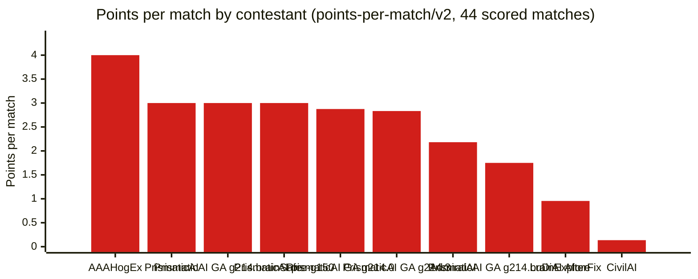
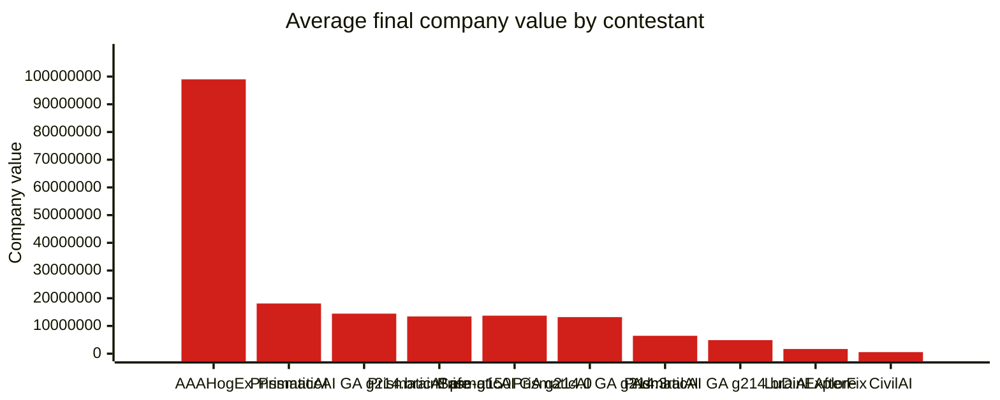
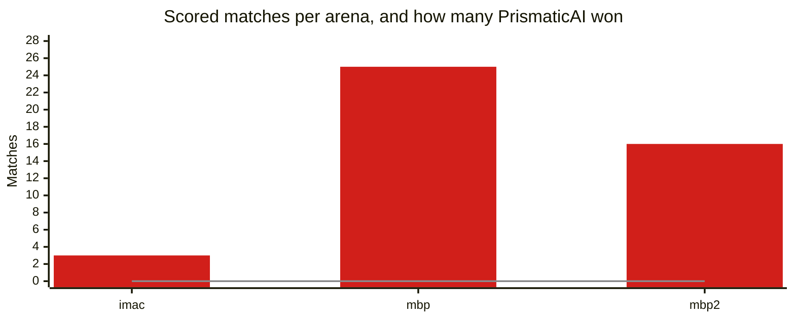

# battle-20261121T020503-d3217f01

Derived from `battle-20261121T020503-d3217f01.json` by `tools/research/ai-battle/battle.py report`; do not edit.

- Edition `d3217f010b6a2f0d`: PrismaticAI and referee at `962699034c20d90baeb9f617789ea6558cc6ff52`, base set `opengfx-8.0.tar`
- 20-year free-for-all from 1960, map 256x256 temperate, breakdowns 1
- 44 scored match(es) on `imac` (20261119-master-gdf1e05e7d8), `mbp` (20261120-master-m17653b726e), `mbp2` (20261119-master-gdf1e05e7d8)
- Replays: 0 of 0 identical to their original on another arena

| # | Contestant | Played | Wins | Points | Points/match | Avg rank | Avg final value | Squirrel errors | Matches with anomalies |
|---|---|---|---|---|---|---|---|---|---|
| 1 | AAAHogEx | 44 | 44 | 176 | 4.0 | 1.0 | 99.0 M | 0 | 0 |
| 2 | PrismaticAI | 8 | 0 | 24 | 3.0 | 2.0 | 18.1 M | 0 | 0 |
| 3 | PrismaticAI GA g214.brainSafe | 7 | 0 | 21 | 3.0 | 2.0 | 14.4 M | 0 | 2 |
| 4 | PrismaticAI pre-g150 | 7 | 0 | 21 | 3.0 | 2.0 | 13.4 M | 0 | 3 |
| 5 | PrismaticAI GA g214.0 | 8 | 0 | 23 | 2.875 | 2.12 | 13.7 M | 0 | 2 |
| 6 | PrismaticAI GA g214.3 | 6 | 0 | 17 | 2.833 | 2.17 | 13.2 M | 0 | 0 |
| 7 | AdmiralAI | 44 | 0 | 96 | 2.182 | 2.82 | 6.4 M | 32 | 5 |
| 8 | PrismaticAI GA g214.brainExplore | 8 | 0 | 14 | 1.75 | 3.25 | 4.9 M | 0 | 4 |
| 9 | LuDiAI AfterFix | 44 | 0 | 42 | 0.955 | 4.05 | 1.7 M | 0 | 3 |
| 10 | CivilAI | 44 | 0 | 6 | 0.136 | 4.86 | 559.9 k | 0 | 7 |

```mermaid
---
config:
  xyChart:
    width: 900
    height: 360
  themeVariables:
    xyChart:
      plotColorPalette: "#d11f1a, #8a8a8a, #0b0b0b, #ece4d6"
---
xychart-beta
    title "Final company value per scored match: winner vs best PrismaticAI"
    x-axis ["m-0001", "m-0002", "m-0003", "m-0004", "m-0005", "m-0006", "m-0007", "m-0008", "m-0009", "m-0010", "m-0011", "m-0012", "m-0013", "m-0014", "m-0015", "m-0016", "m-0017", "m-0018", "m-0019", "m-0020", "m-0021", "m-0022", "m-0023", "m-0024", "m-0025", "m-0026", "m-0027", "m-0028", "m-0036", "m-0037", "m-0038", "m-0039", "m-0040", "m-0041", "m-0042", "m-0043", "m-0044", "m-0046", "m-0050", "m-0051", "m-0052", "m-0053", "m-0054", "m-0066"]
    %% series: Winner | Best PrismaticAI
    %% links: battle-20261121T020503-d3217f01.md?col=Match&filter=m-0001 | battle-20261121T020503-d3217f01.md?col=Match&filter=m-0002 | battle-20261121T020503-d3217f01.md?col=Match&filter=m-0003 | battle-20261121T020503-d3217f01.md?col=Match&filter=m-0004 | battle-20261121T020503-d3217f01.md?col=Match&filter=m-0005 | battle-20261121T020503-d3217f01.md?col=Match&filter=m-0006 | battle-20261121T020503-d3217f01.md?col=Match&filter=m-0007 | battle-20261121T020503-d3217f01.md?col=Match&filter=m-0008 | battle-20261121T020503-d3217f01.md?col=Match&filter=m-0009 | battle-20261121T020503-d3217f01.md?col=Match&filter=m-0010 | battle-20261121T020503-d3217f01.md?col=Match&filter=m-0011 | battle-20261121T020503-d3217f01.md?col=Match&filter=m-0012 | battle-20261121T020503-d3217f01.md?col=Match&filter=m-0013 | battle-20261121T020503-d3217f01.md?col=Match&filter=m-0014 | battle-20261121T020503-d3217f01.md?col=Match&filter=m-0015 | battle-20261121T020503-d3217f01.md?col=Match&filter=m-0016 | battle-20261121T020503-d3217f01.md?col=Match&filter=m-0017 | battle-20261121T020503-d3217f01.md?col=Match&filter=m-0018 | battle-20261121T020503-d3217f01.md?col=Match&filter=m-0019 | battle-20261121T020503-d3217f01.md?col=Match&filter=m-0020 | battle-20261121T020503-d3217f01.md?col=Match&filter=m-0021 | battle-20261121T020503-d3217f01.md?col=Match&filter=m-0022 | battle-20261121T020503-d3217f01.md?col=Match&filter=m-0023 | battle-20261121T020503-d3217f01.md?col=Match&filter=m-0024 | battle-20261121T020503-d3217f01.md?col=Match&filter=m-0025 | battle-20261121T020503-d3217f01.md?col=Match&filter=m-0026 | battle-20261121T020503-d3217f01.md?col=Match&filter=m-0027 | battle-20261121T020503-d3217f01.md?col=Match&filter=m-0028 | battle-20261121T020503-d3217f01.md?col=Match&filter=m-0036 | battle-20261121T020503-d3217f01.md?col=Match&filter=m-0037 | battle-20261121T020503-d3217f01.md?col=Match&filter=m-0038 | battle-20261121T020503-d3217f01.md?col=Match&filter=m-0039 | battle-20261121T020503-d3217f01.md?col=Match&filter=m-0040 | battle-20261121T020503-d3217f01.md?col=Match&filter=m-0041 | battle-20261121T020503-d3217f01.md?col=Match&filter=m-0042 | battle-20261121T020503-d3217f01.md?col=Match&filter=m-0043 | battle-20261121T020503-d3217f01.md?col=Match&filter=m-0044 | battle-20261121T020503-d3217f01.md?col=Match&filter=m-0046 | battle-20261121T020503-d3217f01.md?col=Match&filter=m-0050 | battle-20261121T020503-d3217f01.md?col=Match&filter=m-0051 | battle-20261121T020503-d3217f01.md?col=Match&filter=m-0052 | battle-20261121T020503-d3217f01.md?col=Match&filter=m-0053 | battle-20261121T020503-d3217f01.md?col=Match&filter=m-0054 | battle-20261121T020503-d3217f01.md?col=Match&filter=m-0066
    y-axis "Company value" 0 --> 164000000
    bar [115235898, 99321205, 95291417, 124659459, 102169318, 88629119, 69687887, 95682427, 98090195, 101915338, 80607755, 99328925, 121991904, 102441372, 85871988, 148918372, 87945275, 97699106, 66745267, 102456738, 99681911, 92150091, 95488479, 75719487, 76419628, 85603695, 91569252, 95912520, 96842225, 104083700, 81842626, 87275778, 96311556, 96194797, 101444806, 96775102, 88579481, 91053434, 122127240, 129804742, 117964474, 140650000, 99177878, 108770211]
    line [12784934, 21754631, 17467897, 6695229, 12404408, 17664197, 14370867, 13439815, 15089574, 7487656, 12685189, 24219177, 13389813, 13632090, 14868993, 7799127, 16821901, 15036382, 13486316, 7012132, 8815159, 3561001, 6035925, 14389219, 11473411, 15248021, 9710679, 151104, 17315207, 15121632, 18496061, 18612024, 7872850, 14954036, 14677410, 13431435, 9417489, 2542868, 10716236, 16541989, 2959754, 16286723, 17223378, 24346527]
```

<!-- battle-charts:begin -->
<!-- derived from battle-20261121T020503-d3217f01.json by `battle.py render`; `battle.py check` fails when it is stale -->

<!-- battle-charts:end -->

| Match | Arena | Seed | Winner | Value | Last | Anomalies |
|---|---|---|---|---|---|---|
| m-0001 | mbp | 1575687009 | AAAHogEx | 115.2 M | CivilAI | PrismaticAI pre-g150: fleet_drop:134->51 |
| m-0002 | mbp | 1575687009 | AAAHogEx | 99.3 M | LuDiAI AfterFix | - |
| m-0003 | mbp | 1575687009 | AAAHogEx | 95.3 M | CivilAI | CivilAI: fleet_drop:23->3 |
| m-0004 | mbp | 1575687009 | AAAHogEx | 124.7 M | CivilAI | PrismaticAI GA g214.brainExplore: fleet_drop:63->35; LuDiAI AfterFix: fleet_drop:109->68 |
| m-0005 | mbp | 1575687009 | AAAHogEx | 102.2 M | CivilAI | - |
| m-0006 | mbp | 1291595295 | AAAHogEx | 88.6 M | CivilAI | - |
| m-0007 | mbp | 1291595295 | AAAHogEx | 69.7 M | CivilAI | PrismaticAI pre-g150: fleet_drop:53->34; LuDiAI AfterFix: fleet_drop:19->8 |
| m-0008 | mbp | 1291595295 | AAAHogEx | 95.7 M | LuDiAI AfterFix | - |
| m-0009 | mbp | 1291595295 | AAAHogEx | 98.1 M | CivilAI | - |
| m-0010 | imac | 1291595295 | AAAHogEx | 101.9 M | CivilAI | PrismaticAI GA g214.brainExplore: fleet_drop:69->46; CivilAI: fleet_drop:31->20 |
| m-0011 | imac | 1291595295 | AAAHogEx | 80.6 M | CivilAI | - |
| m-0012 | imac | 693827451 | AAAHogEx | 99.3 M | CivilAI | - |
| m-0013 | mbp2 | 693827451 | AAAHogEx | 122.0 M | CivilAI | CivilAI: fleet_drop:86->37 |
| m-0014 | mbp2 | 693827451 | AAAHogEx | 102.4 M | CivilAI | LuDiAI AfterFix: fleet_drop:140->91 |
| m-0015 | mbp2 | 693827451 | AAAHogEx | 85.9 M | LuDiAI AfterFix | PrismaticAI GA g214.brainSafe: fleet_drop:111->64 |
| m-0016 | mbp2 | 693827451 | AAAHogEx | 148.9 M | CivilAI | PrismaticAI GA g214.brainExplore: fleet_drop:37->20 |
| m-0017 | mbp2 | 693827451 | AAAHogEx | 87.9 M | CivilAI | AdmiralAI: fleet_drop:309->209 |
| m-0018 | mbp2 | 414110561 | AAAHogEx | 97.7 M | LuDiAI AfterFix | - |
| m-0019 | mbp2 | 414110561 | AAAHogEx | 66.7 M | CivilAI | - |
| m-0020 | mbp2 | 414110561 | AAAHogEx | 102.5 M | CivilAI | PrismaticAI GA g214.0: fleet_drop:76->45 |
| m-0021 | mbp2 | 414110561 | AAAHogEx | 99.7 M | CivilAI | - |
| m-0022 | mbp2 | 414110561 | AAAHogEx | 92.2 M | CivilAI | - |
| m-0023 | mbp2 | 414110561 | AAAHogEx | 95.5 M | CivilAI | - |
| m-0024 | mbp2 | 1584183573 | AAAHogEx | 75.7 M | CivilAI | - |
| m-0025 | mbp2 | 1584183573 | AAAHogEx | 76.4 M | CivilAI | - |
| m-0026 | mbp2 | 1584183573 | AAAHogEx | 85.6 M | CivilAI | - |
| m-0027 | mbp2 | 1584183573 | AAAHogEx | 91.6 M | CivilAI | PrismaticAI GA g214.brainSafe: fleet_drop:78->37 |
| m-0028 | mbp2 | 1584183573 | AAAHogEx | 95.9 M | PrismaticAI GA g214.brainExplore | PrismaticAI GA g214.brainExplore: fleet_drop:25->12 |
| m-0036 | mbp | 1458782260 | AAAHogEx | 96.8 M | LuDiAI AfterFix | AdmiralAI: fleet_drop:453->308 |
| m-0037 | mbp | 1458782260 | AAAHogEx | 104.1 M | CivilAI | - |
| m-0038 | mbp | 1458782260 | AAAHogEx | 81.8 M | CivilAI | - |
| m-0039 | mbp | 1458782260 | AAAHogEx | 87.3 M | CivilAI | AdmiralAI: fleet_drop:254->172 |
| m-0040 | mbp | 1458782260 | AAAHogEx | 96.3 M | CivilAI | - |
| m-0041 | mbp | 1458782260 | AAAHogEx | 96.2 M | CivilAI | - |
| m-0042 | mbp | 1986892121 | AAAHogEx | 101.4 M | CivilAI | - |
| m-0043 | mbp | 1986892121 | AAAHogEx | 96.8 M | CivilAI | PrismaticAI pre-g150: fleet_drop:91->60 |
| m-0044 | mbp | 1986892121 | AAAHogEx | 88.6 M | CivilAI | PrismaticAI GA g214.0: fleet_drop:71->45; CivilAI: no_vehicles |
| m-0046 | mbp | 1986892121 | AAAHogEx | 91.1 M | CivilAI | - |
| m-0050 | mbp | 989882460 | AAAHogEx | 122.1 M | CivilAI | AdmiralAI: squirrel_errors:32 |
| m-0051 | mbp | 989882460 | AAAHogEx | 129.8 M | CivilAI | CivilAI: fleet_drop:52->34 |
| m-0052 | mbp | 989882460 | AAAHogEx | 118.0 M | CivilAI | - |
| m-0053 | mbp | 989882460 | AAAHogEx | 140.7 M | CivilAI | CivilAI: fleet_drop:58->40 |
| m-0054 | mbp | 1810573369 | AAAHogEx | 99.2 M | CivilAI | CivilAI: no_vehicles |
| m-0066 | mbp | 189741358 | AAAHogEx | 108.8 M | CivilAI | AdmiralAI: fleet_drop:137->53 |
