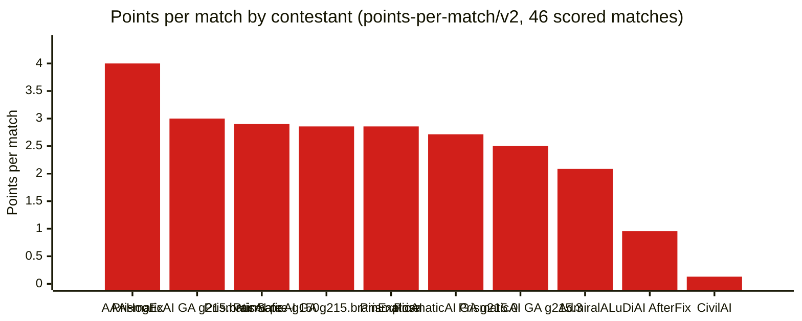
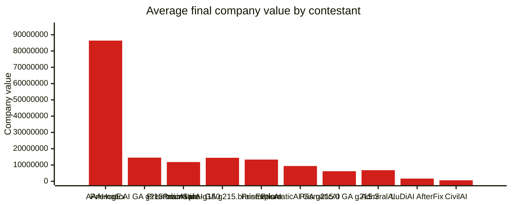
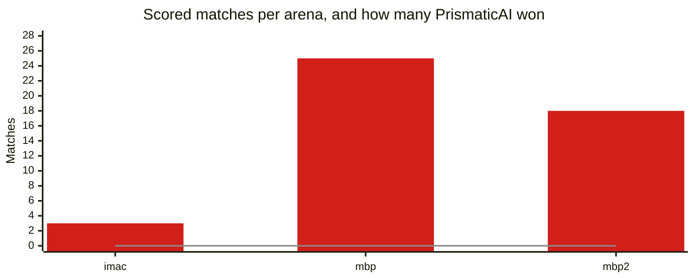

# battle-20261121T021842-149b0d13

Derived from `battle-20261121T021842-149b0d13.json` by `tools/research/ai-battle/battle.py report`; do not edit.

- Edition `149b0d1393783806`: PrismaticAI and referee at `962699034c20d90baeb9f617789ea6558cc6ff52`, base set `opengfx-8.0.tar`
- 20-year free-for-all from 1960, map 256x256 temperate, breakdowns 1
- 46 scored match(es) on `imac` (20261119-master-gdf1e05e7d8), `mbp` (20261120-master-m17653b726e), `mbp2` (20261119-master-gdf1e05e7d8)
- Replays: 1 of 4 identical to their original on another arena

| # | Contestant | Played | Wins | Points | Points/match | Avg rank | Avg final value | Squirrel errors | Matches with anomalies |
|---|---|---|---|---|---|---|---|---|---|
| 1 | AAAHogEx | 46 | 46 | 184 | 4.0 | 1.0 | 86.4 M | 0 | 0 |
| 2 | PrismaticAI GA g215.brainSafe | 9 | 0 | 27 | 3.0 | 2.0 | 14.5 M | 0 | 0 |
| 3 | PrismaticAI pre-g150 | 10 | 0 | 29 | 2.9 | 2.1 | 11.8 M | 0 | 1 |
| 4 | PrismaticAI GA g215.brainExplore | 7 | 0 | 20 | 2.857 | 2.14 | 14.4 M | 0 | 0 |
| 5 | PrismaticAI | 7 | 0 | 20 | 2.857 | 2.14 | 13.3 M | 0 | 0 |
| 6 | PrismaticAI GA g215.0 | 7 | 0 | 19 | 2.714 | 2.29 | 9.4 M | 0 | 1 |
| 7 | PrismaticAI GA g215.3 | 6 | 0 | 15 | 2.5 | 2.5 | 6.2 M | 0 | 1 |
| 8 | AdmiralAI | 46 | 0 | 96 | 2.087 | 2.91 | 6.8 M | 72 | 2 |
| 9 | LuDiAI AfterFix | 46 | 0 | 44 | 0.957 | 4.04 | 1.6 M | 0 | 1 |
| 10 | CivilAI | 46 | 0 | 6 | 0.13 | 4.87 | 595.6 k | 0 | 5 |

```mermaid
---
config:
  xyChart:
    width: 900
    height: 360
  themeVariables:
    xyChart:
      plotColorPalette: "#d11f1a, #8a8a8a, #0b0b0b, #ece4d6"
---
xychart-beta
    title "Final company value per scored match: winner vs best PrismaticAI"
    x-axis ["m-0001", "m-0002", "m-0003", "m-0004", "m-0005", "m-0006", "m-0007", "m-0008", "m-0009", "m-0010", "m-0011", "m-0012", "m-0013", "m-0014", "m-0015", "m-0016", "m-0017", "m-0018", "m-0019", "m-0020", "m-0021", "m-0022", "m-0023", "m-0024", "m-0025", "m-0026", "m-0027", "m-0028", "m-0036", "m-0037", "m-0038", "m-0039", "m-0040", "m-0041", "m-0042", "m-0043", "m-0044", "m-0045", "m-0047", "m-0054", "m-0055", "m-0057", "m-0058", "m-0061", "m-0063", "m-0067"]
    %% series: Winner | Best PrismaticAI
    %% links: battle-20261121T021842-149b0d13.md?col=Match&filter=m-0001 | battle-20261121T021842-149b0d13.md?col=Match&filter=m-0002 | battle-20261121T021842-149b0d13.md?col=Match&filter=m-0003 | battle-20261121T021842-149b0d13.md?col=Match&filter=m-0004 | battle-20261121T021842-149b0d13.md?col=Match&filter=m-0005 | battle-20261121T021842-149b0d13.md?col=Match&filter=m-0006 | battle-20261121T021842-149b0d13.md?col=Match&filter=m-0007 | battle-20261121T021842-149b0d13.md?col=Match&filter=m-0008 | battle-20261121T021842-149b0d13.md?col=Match&filter=m-0009 | battle-20261121T021842-149b0d13.md?col=Match&filter=m-0010 | battle-20261121T021842-149b0d13.md?col=Match&filter=m-0011 | battle-20261121T021842-149b0d13.md?col=Match&filter=m-0012 | battle-20261121T021842-149b0d13.md?col=Match&filter=m-0013 | battle-20261121T021842-149b0d13.md?col=Match&filter=m-0014 | battle-20261121T021842-149b0d13.md?col=Match&filter=m-0015 | battle-20261121T021842-149b0d13.md?col=Match&filter=m-0016 | battle-20261121T021842-149b0d13.md?col=Match&filter=m-0017 | battle-20261121T021842-149b0d13.md?col=Match&filter=m-0018 | battle-20261121T021842-149b0d13.md?col=Match&filter=m-0019 | battle-20261121T021842-149b0d13.md?col=Match&filter=m-0020 | battle-20261121T021842-149b0d13.md?col=Match&filter=m-0021 | battle-20261121T021842-149b0d13.md?col=Match&filter=m-0022 | battle-20261121T021842-149b0d13.md?col=Match&filter=m-0023 | battle-20261121T021842-149b0d13.md?col=Match&filter=m-0024 | battle-20261121T021842-149b0d13.md?col=Match&filter=m-0025 | battle-20261121T021842-149b0d13.md?col=Match&filter=m-0026 | battle-20261121T021842-149b0d13.md?col=Match&filter=m-0027 | battle-20261121T021842-149b0d13.md?col=Match&filter=m-0028 | battle-20261121T021842-149b0d13.md?col=Match&filter=m-0036 | battle-20261121T021842-149b0d13.md?col=Match&filter=m-0037 | battle-20261121T021842-149b0d13.md?col=Match&filter=m-0038 | battle-20261121T021842-149b0d13.md?col=Match&filter=m-0039 | battle-20261121T021842-149b0d13.md?col=Match&filter=m-0040 | battle-20261121T021842-149b0d13.md?col=Match&filter=m-0041 | battle-20261121T021842-149b0d13.md?col=Match&filter=m-0042 | battle-20261121T021842-149b0d13.md?col=Match&filter=m-0043 | battle-20261121T021842-149b0d13.md?col=Match&filter=m-0044 | battle-20261121T021842-149b0d13.md?col=Match&filter=m-0045 | battle-20261121T021842-149b0d13.md?col=Match&filter=m-0047 | battle-20261121T021842-149b0d13.md?col=Match&filter=m-0054 | battle-20261121T021842-149b0d13.md?col=Match&filter=m-0055 | battle-20261121T021842-149b0d13.md?col=Match&filter=m-0057 | battle-20261121T021842-149b0d13.md?col=Match&filter=m-0058 | battle-20261121T021842-149b0d13.md?col=Match&filter=m-0061 | battle-20261121T021842-149b0d13.md?col=Match&filter=m-0063 | battle-20261121T021842-149b0d13.md?col=Match&filter=m-0067
    y-axis "Company value" 0 --> 156000000
    bar [100645833, 106844867, 122111698, 79942364, 105082701, 48071273, 83447834, 56543107, 60737839, 58853496, 58892270, 88298600, 64016533, 103811508, 90262321, 87356952, 97121255, 87119336, 40130322, 60295159, 59615365, 56909618, 60463939, 71625446, 62736928, 79444405, 91972908, 75356337, 82105752, 75663733, 98098603, 84053199, 86015929, 107470353, 121969211, 111647073, 141574673, 139083706, 126639385, 105211867, 107702773, 99737211, 112340049, 56602469, 72977416, 88315674]
    line [14169158, 8987125, 12932297, 15162348, 7727475, 15098693, 10628727, 6987819, 8668536, 7973594, 6586536, 18122489, 12628106, 4946794, 13629523, 13607687, 1009350, 11615074, 11823260, 12329602, 8685600, 12628195, 7090291, 14056559, 16487320, 11030241, 22620631, 16163760, 19519611, 15191793, 12845156, 23663223, 15673253, 9409728, 6524072, 6649294, 8393147, 15218587, 5116156, 8264552, 6420073, 18518116, 19720478, 13871915, 6687365, 10178714]
```

<!-- battle-charts:begin -->
<!-- derived from battle-20261121T021842-149b0d13.json by `battle.py render`; `battle.py check` fails when it is stale -->

<!-- battle-charts:end -->

| Seed | Original | Replay | Arenas | Identical |
|---|---|---|---|---|
| 855078403 | m-0012 | m-0048 | imac / mbp | NO |
| 11738917 | m-0010 | m-0056 | imac / mbp | NO |
| 11738917 | m-0011 | m-0064 | imac / mbp | NO |
| 855078403 | m-0013 | m-0072 | mbp2 / mbp | yes |

| Match | Arena | Seed | Winner | Value | Last | Anomalies |
|---|---|---|---|---|---|---|
| m-0001 | mbp | 1713511183 | AAAHogEx | 100.6 M | CivilAI | CivilAI: fleet_drop:70->37 |
| m-0002 | mbp | 1713511183 | AAAHogEx | 106.8 M | CivilAI | CivilAI: fleet_drop:16->11 |
| m-0003 | mbp | 1713511183 | AAAHogEx | 122.1 M | CivilAI | - |
| m-0004 | mbp | 1713511183 | AAAHogEx | 79.9 M | CivilAI | - |
| m-0005 | mbp | 1713511183 | AAAHogEx | 105.1 M | CivilAI | - |
| m-0006 | mbp | 11738917 | AAAHogEx | 48.1 M | CivilAI | - |
| m-0007 | mbp | 11738917 | AAAHogEx | 83.4 M | CivilAI | CivilAI: no_vehicles |
| m-0008 | mbp | 11738917 | AAAHogEx | 56.5 M | CivilAI | - |
| m-0009 | mbp | 11738917 | AAAHogEx | 60.7 M | LuDiAI AfterFix | - |
| m-0010 | imac | 11738917 | AAAHogEx | 58.9 M | CivilAI | - |
| m-0011 | imac | 11738917 | AAAHogEx | 58.9 M | CivilAI | CivilAI: no_vehicles |
| m-0012 | imac | 855078403 | AAAHogEx | 88.3 M | LuDiAI AfterFix | - |
| m-0013 | mbp2 | 855078403 | AAAHogEx | 64.0 M | CivilAI | - |
| m-0014 | mbp2 | 855078403 | AAAHogEx | 103.8 M | LuDiAI AfterFix | PrismaticAI GA g215.0: fleet_drop:81->50 |
| m-0015 | mbp2 | 855078403 | AAAHogEx | 90.3 M | CivilAI | - |
| m-0016 | mbp2 | 855078403 | AAAHogEx | 87.4 M | CivilAI | - |
| m-0017 | mbp2 | 855078403 | AAAHogEx | 97.1 M | CivilAI | - |
| m-0018 | mbp2 | 337968806 | AAAHogEx | 87.1 M | CivilAI | - |
| m-0019 | mbp2 | 337968806 | AAAHogEx | 40.1 M | CivilAI | - |
| m-0020 | mbp2 | 337968806 | AAAHogEx | 60.3 M | CivilAI | - |
| m-0021 | mbp2 | 337968806 | AAAHogEx | 59.6 M | LuDiAI AfterFix | - |
| m-0022 | mbp2 | 337968806 | AAAHogEx | 56.9 M | CivilAI | - |
| m-0023 | mbp2 | 337968806 | AAAHogEx | 60.5 M | CivilAI | - |
| m-0024 | mbp2 | 1475882708 | AAAHogEx | 71.6 M | CivilAI | - |
| m-0025 | mbp2 | 1475882708 | AAAHogEx | 62.7 M | CivilAI | - |
| m-0026 | mbp2 | 1475882708 | AAAHogEx | 79.4 M | CivilAI | - |
| m-0027 | mbp2 | 1475882708 | AAAHogEx | 92.0 M | CivilAI | AdmiralAI: squirrel_errors:72 |
| m-0028 | mbp2 | 1475882708 | AAAHogEx | 75.4 M | CivilAI | - |
| m-0036 | mbp | 27847476 | AAAHogEx | 82.1 M | CivilAI | - |
| m-0037 | mbp | 27847476 | AAAHogEx | 75.7 M | CivilAI | - |
| m-0038 | mbp | 27847476 | AAAHogEx | 98.1 M | CivilAI | - |
| m-0039 | mbp | 27847476 | AAAHogEx | 84.1 M | CivilAI | AdmiralAI: fleet_drop:141->70 |
| m-0040 | mbp | 27847476 | AAAHogEx | 86.0 M | CivilAI | - |
| m-0041 | mbp | 27847476 | AAAHogEx | 107.5 M | CivilAI | - |
| m-0042 | mbp | 206908376 | AAAHogEx | 122.0 M | CivilAI | - |
| m-0043 | mbp | 206908376 | AAAHogEx | 111.6 M | LuDiAI AfterFix | - |
| m-0044 | mbp | 206908376 | AAAHogEx | 141.6 M | CivilAI | - |
| m-0045 | mbp | 206908376 | AAAHogEx | 139.1 M | CivilAI | - |
| m-0047 | mbp2 | 206908376 | AAAHogEx | 126.6 M | CivilAI | PrismaticAI GA g215.3: fleet_drop:116->78 |
| m-0048 (replay) | mbp | 855078403 | AAAHogEx | 86.3 M | CivilAI | - |
| m-0054 | mbp | 1727130045 | AAAHogEx | 105.2 M | CivilAI | - |
| m-0055 | mbp | 1727130045 | AAAHogEx | 107.7 M | CivilAI | - |
| m-0056 (replay) | mbp | 11738917 | AAAHogEx | 61.1 M | CivilAI | - |
| m-0057 | mbp | 1727130045 | AAAHogEx | 99.7 M | CivilAI | - |
| m-0058 | mbp | 1727130045 | AAAHogEx | 112.3 M | CivilAI | LuDiAI AfterFix: fleet_drop:34->16 |
| m-0061 | mbp2 | 1375607621 | AAAHogEx | 56.6 M | LuDiAI AfterFix | CivilAI: fleet_drop:29->6 |
| m-0063 | mbp | 1375607621 | AAAHogEx | 73.0 M | CivilAI | - |
| m-0064 (replay) | mbp | 11738917 | AAAHogEx | 63.7 M | CivilAI | - |
| m-0067 | mbp | 185797593 | AAAHogEx | 88.3 M | CivilAI | PrismaticAI pre-g150: fleet_drop:110->67 |
| m-0072 (replay) | mbp | 855078403 | AAAHogEx | 64.0 M | CivilAI | - |
