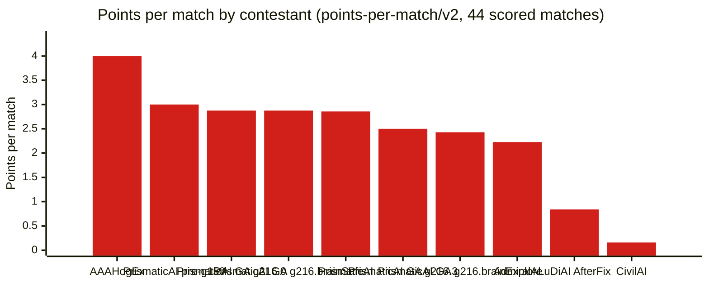
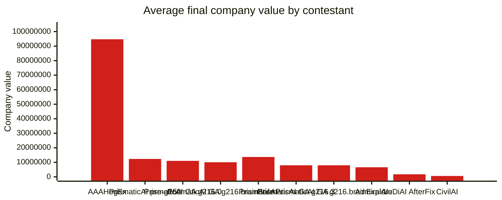
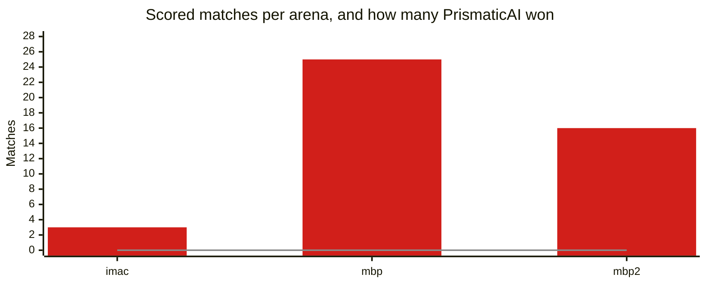

# battle-20261121T022954-4d06a390

Derived from `battle-20261121T022954-4d06a390.json` by `tools/research/ai-battle/battle.py report`; do not edit.

- Edition `4d06a3908124bd79`: PrismaticAI and referee at `962699034c20d90baeb9f617789ea6558cc6ff52`, base set `opengfx-8.0.tar`
- 20-year free-for-all from 1960, map 256x256 temperate, breakdowns 1
- 44 scored match(es) on `imac` (20261119-master-gdf1e05e7d8), `mbp` (20261120-master-m17653b726e), `mbp2` (20261119-master-gdf1e05e7d8)
- Replays: 0 of 0 identical to their original on another arena

| # | Contestant | Played | Wins | Points | Points/match | Avg rank | Avg final value | Squirrel errors | Matches with anomalies |
|---|---|---|---|---|---|---|---|---|---|
| 1 | AAAHogEx | 44 | 44 | 176 | 4.0 | 1.0 | 94.7 M | 0 | 0 |
| 2 | PrismaticAI pre-g150 | 8 | 0 | 24 | 3.0 | 2.0 | 12.3 M | 0 | 0 |
| 3 | PrismaticAI GA g216.0 | 8 | 0 | 23 | 2.875 | 2.12 | 11.0 M | 0 | 0 |
| 4 | PrismaticAI GA g216.brainSafe | 8 | 0 | 23 | 2.875 | 2.12 | 10.0 M | 0 | 0 |
| 5 | PrismaticAI | 7 | 0 | 20 | 2.857 | 2.14 | 13.7 M | 0 | 0 |
| 6 | PrismaticAI GA g216.3 | 6 | 0 | 15 | 2.5 | 2.5 | 7.9 M | 0 | 1 |
| 7 | PrismaticAI GA g216.brainExplore | 7 | 0 | 17 | 2.429 | 2.57 | 7.9 M | 0 | 1 |
| 8 | AdmiralAI | 44 | 0 | 98 | 2.227 | 2.77 | 6.6 M | 0 | 0 |
| 9 | LuDiAI AfterFix | 44 | 0 | 37 | 0.841 | 4.16 | 1.7 M | 0 | 1 |
| 10 | CivilAI | 44 | 0 | 7 | 0.159 | 4.84 | 579.2 k | 0 | 9 |

```mermaid
---
config:
  xyChart:
    width: 900
    height: 360
  themeVariables:
    xyChart:
      plotColorPalette: "#d11f1a, #8a8a8a, #0b0b0b, #ece4d6"
---
xychart-beta
    title "Final company value per scored match: winner vs best PrismaticAI"
    x-axis ["m-0001", "m-0002", "m-0003", "m-0004", "m-0005", "m-0006", "m-0007", "m-0008", "m-0009", "m-0010", "m-0011", "m-0012", "m-0013", "m-0014", "m-0015", "m-0016", "m-0017", "m-0018", "m-0019", "m-0020", "m-0021", "m-0022", "m-0023", "m-0024", "m-0025", "m-0026", "m-0027", "m-0028", "m-0036", "m-0037", "m-0038", "m-0039", "m-0040", "m-0041", "m-0042", "m-0043", "m-0044", "m-0045", "m-0046", "m-0047", "m-0048", "m-0049", "m-0050", "m-0051"]
    %% series: Winner | Best PrismaticAI
    %% links: battle-20261121T022954-4d06a390.md?col=Match&filter=m-0001 | battle-20261121T022954-4d06a390.md?col=Match&filter=m-0002 | battle-20261121T022954-4d06a390.md?col=Match&filter=m-0003 | battle-20261121T022954-4d06a390.md?col=Match&filter=m-0004 | battle-20261121T022954-4d06a390.md?col=Match&filter=m-0005 | battle-20261121T022954-4d06a390.md?col=Match&filter=m-0006 | battle-20261121T022954-4d06a390.md?col=Match&filter=m-0007 | battle-20261121T022954-4d06a390.md?col=Match&filter=m-0008 | battle-20261121T022954-4d06a390.md?col=Match&filter=m-0009 | battle-20261121T022954-4d06a390.md?col=Match&filter=m-0010 | battle-20261121T022954-4d06a390.md?col=Match&filter=m-0011 | battle-20261121T022954-4d06a390.md?col=Match&filter=m-0012 | battle-20261121T022954-4d06a390.md?col=Match&filter=m-0013 | battle-20261121T022954-4d06a390.md?col=Match&filter=m-0014 | battle-20261121T022954-4d06a390.md?col=Match&filter=m-0015 | battle-20261121T022954-4d06a390.md?col=Match&filter=m-0016 | battle-20261121T022954-4d06a390.md?col=Match&filter=m-0017 | battle-20261121T022954-4d06a390.md?col=Match&filter=m-0018 | battle-20261121T022954-4d06a390.md?col=Match&filter=m-0019 | battle-20261121T022954-4d06a390.md?col=Match&filter=m-0020 | battle-20261121T022954-4d06a390.md?col=Match&filter=m-0021 | battle-20261121T022954-4d06a390.md?col=Match&filter=m-0022 | battle-20261121T022954-4d06a390.md?col=Match&filter=m-0023 | battle-20261121T022954-4d06a390.md?col=Match&filter=m-0024 | battle-20261121T022954-4d06a390.md?col=Match&filter=m-0025 | battle-20261121T022954-4d06a390.md?col=Match&filter=m-0026 | battle-20261121T022954-4d06a390.md?col=Match&filter=m-0027 | battle-20261121T022954-4d06a390.md?col=Match&filter=m-0028 | battle-20261121T022954-4d06a390.md?col=Match&filter=m-0036 | battle-20261121T022954-4d06a390.md?col=Match&filter=m-0037 | battle-20261121T022954-4d06a390.md?col=Match&filter=m-0038 | battle-20261121T022954-4d06a390.md?col=Match&filter=m-0039 | battle-20261121T022954-4d06a390.md?col=Match&filter=m-0040 | battle-20261121T022954-4d06a390.md?col=Match&filter=m-0041 | battle-20261121T022954-4d06a390.md?col=Match&filter=m-0042 | battle-20261121T022954-4d06a390.md?col=Match&filter=m-0043 | battle-20261121T022954-4d06a390.md?col=Match&filter=m-0044 | battle-20261121T022954-4d06a390.md?col=Match&filter=m-0045 | battle-20261121T022954-4d06a390.md?col=Match&filter=m-0046 | battle-20261121T022954-4d06a390.md?col=Match&filter=m-0047 | battle-20261121T022954-4d06a390.md?col=Match&filter=m-0048 | battle-20261121T022954-4d06a390.md?col=Match&filter=m-0049 | battle-20261121T022954-4d06a390.md?col=Match&filter=m-0050 | battle-20261121T022954-4d06a390.md?col=Match&filter=m-0051
    y-axis "Company value" 0 --> 135000000
    bar [110433354, 86883724, 97179257, 102783509, 93820227, 114210392, 90478539, 99682782, 105035672, 122651371, 99639819, 86487284, 100147723, 87511560, 100390688, 92743356, 75556191, 90699426, 60523045, 78697211, 95375698, 81163295, 76886363, 106485864, 107561724, 89883405, 103997826, 101795574, 77737640, 89597331, 94894779, 84696732, 92446215, 83095263, 94604192, 97300821, 104054846, 100687988, 86802614, 104714556, 105931717, 99522729, 98552253, 94779031]
    line [10002111, 10984606, 8829104, 9059295, 8145649, 12593758, 10803114, 5447761, 7892069, 8876075, 4955209, 13577613, 8663447, 10122564, 7836583, 8084632, 7282307, 19096829, 20413675, 15947619, 14484067, 8091904, 11164209, 15488903, 9286168, 10096476, 4781162, 7312972, 12069197, 12875642, 5788270, 9206977, 5189510, 5212640, 9841184, 13493482, 16000558, 9507555, 8954311, 10840866, 12999583, 13088489, 13580593, 17823012]
```

<!-- battle-charts:begin -->
<!-- derived from battle-20261121T022954-4d06a390.json by `battle.py render`; `battle.py check` fails when it is stale -->

<!-- battle-charts:end -->

| Match | Arena | Seed | Winner | Value | Last | Anomalies |
|---|---|---|---|---|---|---|
| m-0001 | mbp | 1074863350 | AAAHogEx | 110.4 M | CivilAI | CivilAI: no_vehicles |
| m-0002 | mbp | 1074863350 | AAAHogEx | 86.9 M | CivilAI | - |
| m-0003 | mbp | 1074863350 | AAAHogEx | 97.2 M | CivilAI | CivilAI: no_vehicles |
| m-0004 | mbp | 1074863350 | AAAHogEx | 102.8 M | CivilAI | - |
| m-0005 | mbp | 1074863350 | AAAHogEx | 93.8 M | CivilAI | LuDiAI AfterFix: fleet_drop:70->44 |
| m-0006 | mbp | 279410709 | AAAHogEx | 114.2 M | CivilAI | - |
| m-0007 | mbp | 279410709 | AAAHogEx | 90.5 M | CivilAI | - |
| m-0008 | mbp | 279410709 | AAAHogEx | 99.7 M | CivilAI | CivilAI: fleet_drop:11->7 |
| m-0009 | mbp | 279410709 | AAAHogEx | 105.0 M | CivilAI | - |
| m-0010 | imac | 279410709 | AAAHogEx | 122.7 M | CivilAI | - |
| m-0011 | imac | 279410709 | AAAHogEx | 99.6 M | CivilAI | - |
| m-0012 | imac | 1416907714 | AAAHogEx | 86.5 M | CivilAI | - |
| m-0013 | mbp2 | 1416907714 | AAAHogEx | 100.1 M | CivilAI | - |
| m-0014 | mbp2 | 1416907714 | AAAHogEx | 87.5 M | CivilAI | CivilAI: fleet_drop:12->8 |
| m-0015 | mbp2 | 1416907714 | AAAHogEx | 100.4 M | CivilAI | - |
| m-0016 | mbp2 | 1416907714 | AAAHogEx | 92.7 M | CivilAI | - |
| m-0017 | mbp2 | 1416907714 | AAAHogEx | 75.6 M | CivilAI | - |
| m-0018 | mbp2 | 681203864 | AAAHogEx | 90.7 M | CivilAI | - |
| m-0019 | mbp2 | 681203864 | AAAHogEx | 60.5 M | CivilAI | - |
| m-0020 | mbp2 | 681203864 | AAAHogEx | 78.7 M | CivilAI | - |
| m-0021 | mbp2 | 681203864 | AAAHogEx | 95.4 M | LuDiAI AfterFix | CivilAI: fleet_drop:93->64 |
| m-0022 | mbp2 | 681203864 | AAAHogEx | 81.2 M | CivilAI | - |
| m-0023 | mbp2 | 681203864 | AAAHogEx | 76.9 M | LuDiAI AfterFix | - |
| m-0024 | mbp2 | 568883067 | AAAHogEx | 106.5 M | CivilAI | CivilAI: fleet_drop:37->16 |
| m-0025 | mbp2 | 568883067 | AAAHogEx | 107.6 M | LuDiAI AfterFix | - |
| m-0026 | mbp2 | 568883067 | AAAHogEx | 89.9 M | CivilAI | - |
| m-0027 | mbp2 | 568883067 | AAAHogEx | 104.0 M | LuDiAI AfterFix | - |
| m-0028 | mbp2 | 568883067 | AAAHogEx | 101.8 M | CivilAI | PrismaticAI GA g216.brainExplore: fleet_drop:105->54 |
| m-0036 | mbp | 1539903985 | AAAHogEx | 77.7 M | LuDiAI AfterFix | - |
| m-0037 | mbp | 1539903985 | AAAHogEx | 89.6 M | CivilAI | - |
| m-0038 | mbp | 1539903985 | AAAHogEx | 94.9 M | CivilAI | - |
| m-0039 | mbp | 1539903985 | AAAHogEx | 84.7 M | CivilAI | - |
| m-0040 | mbp | 1539903985 | AAAHogEx | 92.4 M | CivilAI | - |
| m-0041 | mbp | 1539903985 | AAAHogEx | 83.1 M | LuDiAI AfterFix | - |
| m-0042 | mbp | 186079425 | AAAHogEx | 94.6 M | LuDiAI AfterFix | CivilAI: fleet_drop:24->14 |
| m-0043 | mbp | 186079425 | AAAHogEx | 97.3 M | CivilAI | - |
| m-0044 | mbp | 186079425 | AAAHogEx | 104.1 M | CivilAI | - |
| m-0045 | mbp | 186079425 | AAAHogEx | 100.7 M | CivilAI | CivilAI: fleet_drop:38->17 |
| m-0046 | mbp | 186079425 | AAAHogEx | 86.8 M | CivilAI | - |
| m-0047 | mbp | 186079425 | AAAHogEx | 104.7 M | CivilAI | PrismaticAI GA g216.3: fleet_drop:85->57 |
| m-0048 | mbp | 583879231 | AAAHogEx | 105.9 M | CivilAI | - |
| m-0049 | mbp | 583879231 | AAAHogEx | 99.5 M | CivilAI | - |
| m-0050 | mbp | 583879231 | AAAHogEx | 98.6 M | CivilAI | - |
| m-0051 | mbp | 583879231 | AAAHogEx | 94.8 M | CivilAI | CivilAI: fleet_drop:31->16 |
