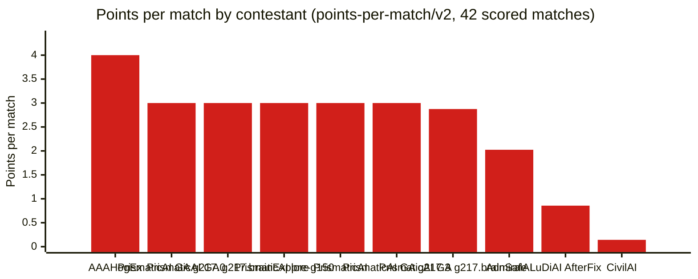
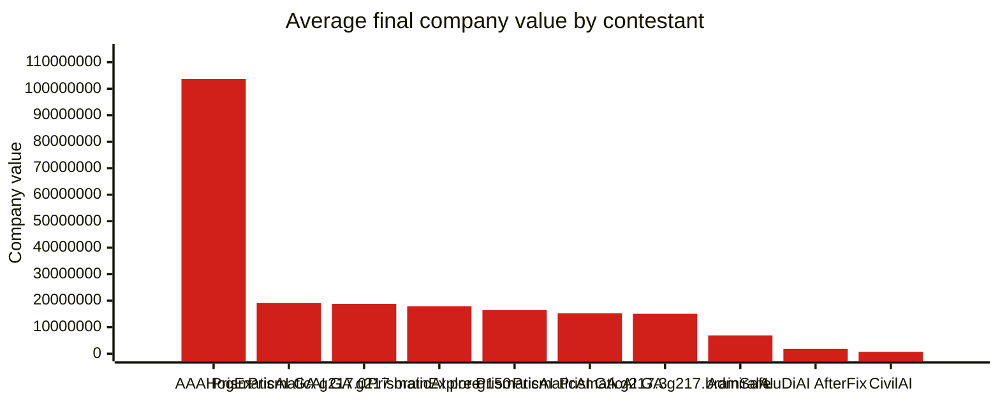
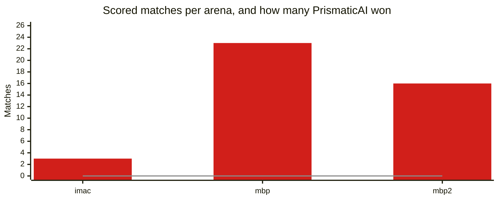

# battle-20261121T024102-81de3206

Derived from `battle-20261121T024102-81de3206.json` by `tools/research/ai-battle/battle.py report`; do not edit.

- Edition `81de3206b935c073`: PrismaticAI and referee at `962699034c20d90baeb9f617789ea6558cc6ff52`, base set `opengfx-8.0.tar`
- 20-year free-for-all from 1960, map 256x256 temperate, breakdowns 1
- 42 scored match(es) on `imac` (20261119-master-gdf1e05e7d8), `mbp` (20261120-master-m17653b726e), `mbp2` (20261119-master-gdf1e05e7d8)
- Replays: 0 of 1 identical to their original on another arena

| # | Contestant | Played | Wins | Points | Points/match | Avg rank | Avg final value | Squirrel errors | Matches with anomalies |
|---|---|---|---|---|---|---|---|---|---|
| 1 | AAAHogEx | 42 | 42 | 168 | 4.0 | 1.0 | 103.7 M | 0 | 0 |
| 2 | PrismaticAI GA g217.0 | 8 | 0 | 24 | 3.0 | 2.0 | 19.1 M | 0 | 0 |
| 3 | PrismaticAI GA g217.brainExplore | 6 | 0 | 18 | 3.0 | 2.0 | 18.8 M | 0 | 1 |
| 4 | PrismaticAI pre-g150 | 8 | 0 | 24 | 3.0 | 2.0 | 17.9 M | 0 | 4 |
| 5 | PrismaticAI | 6 | 0 | 18 | 3.0 | 2.0 | 16.5 M | 0 | 0 |
| 6 | PrismaticAI GA g217.3 | 6 | 0 | 18 | 3.0 | 2.0 | 15.2 M | 0 | 0 |
| 7 | PrismaticAI GA g217.brainSafe | 8 | 0 | 23 | 2.875 | 2.12 | 15.1 M | 0 | 0 |
| 8 | AdmiralAI | 42 | 0 | 85 | 2.024 | 2.98 | 6.9 M | 44 | 1 |
| 9 | LuDiAI AfterFix | 42 | 0 | 36 | 0.857 | 4.14 | 1.8 M | 0 | 2 |
| 10 | CivilAI | 42 | 0 | 6 | 0.143 | 4.86 | 663.8 k | 0 | 6 |

```mermaid
---
config:
  xyChart:
    width: 900
    height: 360
  themeVariables:
    xyChart:
      plotColorPalette: "#d11f1a, #8a8a8a, #0b0b0b, #ece4d6"
---
xychart-beta
    title "Final company value per scored match: winner vs best PrismaticAI"
    x-axis ["m-0001", "m-0002", "m-0003", "m-0004", "m-0005", "m-0006", "m-0007", "m-0008", "m-0009", "m-0010", "m-0011", "m-0012", "m-0013", "m-0014", "m-0015", "m-0016", "m-0017", "m-0018", "m-0019", "m-0020", "m-0021", "m-0022", "m-0023", "m-0024", "m-0025", "m-0026", "m-0027", "m-0028", "m-0036", "m-0037", "m-0038", "m-0039", "m-0040", "m-0041", "m-0042", "m-0043", "m-0044", "m-0045", "m-0047", "m-0049", "m-0050", "m-0051"]
    %% series: Winner | Best PrismaticAI
    %% links: battle-20261121T024102-81de3206.md?col=Match&filter=m-0001 | battle-20261121T024102-81de3206.md?col=Match&filter=m-0002 | battle-20261121T024102-81de3206.md?col=Match&filter=m-0003 | battle-20261121T024102-81de3206.md?col=Match&filter=m-0004 | battle-20261121T024102-81de3206.md?col=Match&filter=m-0005 | battle-20261121T024102-81de3206.md?col=Match&filter=m-0006 | battle-20261121T024102-81de3206.md?col=Match&filter=m-0007 | battle-20261121T024102-81de3206.md?col=Match&filter=m-0008 | battle-20261121T024102-81de3206.md?col=Match&filter=m-0009 | battle-20261121T024102-81de3206.md?col=Match&filter=m-0010 | battle-20261121T024102-81de3206.md?col=Match&filter=m-0011 | battle-20261121T024102-81de3206.md?col=Match&filter=m-0012 | battle-20261121T024102-81de3206.md?col=Match&filter=m-0013 | battle-20261121T024102-81de3206.md?col=Match&filter=m-0014 | battle-20261121T024102-81de3206.md?col=Match&filter=m-0015 | battle-20261121T024102-81de3206.md?col=Match&filter=m-0016 | battle-20261121T024102-81de3206.md?col=Match&filter=m-0017 | battle-20261121T024102-81de3206.md?col=Match&filter=m-0018 | battle-20261121T024102-81de3206.md?col=Match&filter=m-0019 | battle-20261121T024102-81de3206.md?col=Match&filter=m-0020 | battle-20261121T024102-81de3206.md?col=Match&filter=m-0021 | battle-20261121T024102-81de3206.md?col=Match&filter=m-0022 | battle-20261121T024102-81de3206.md?col=Match&filter=m-0023 | battle-20261121T024102-81de3206.md?col=Match&filter=m-0024 | battle-20261121T024102-81de3206.md?col=Match&filter=m-0025 | battle-20261121T024102-81de3206.md?col=Match&filter=m-0026 | battle-20261121T024102-81de3206.md?col=Match&filter=m-0027 | battle-20261121T024102-81de3206.md?col=Match&filter=m-0028 | battle-20261121T024102-81de3206.md?col=Match&filter=m-0036 | battle-20261121T024102-81de3206.md?col=Match&filter=m-0037 | battle-20261121T024102-81de3206.md?col=Match&filter=m-0038 | battle-20261121T024102-81de3206.md?col=Match&filter=m-0039 | battle-20261121T024102-81de3206.md?col=Match&filter=m-0040 | battle-20261121T024102-81de3206.md?col=Match&filter=m-0041 | battle-20261121T024102-81de3206.md?col=Match&filter=m-0042 | battle-20261121T024102-81de3206.md?col=Match&filter=m-0043 | battle-20261121T024102-81de3206.md?col=Match&filter=m-0044 | battle-20261121T024102-81de3206.md?col=Match&filter=m-0045 | battle-20261121T024102-81de3206.md?col=Match&filter=m-0047 | battle-20261121T024102-81de3206.md?col=Match&filter=m-0049 | battle-20261121T024102-81de3206.md?col=Match&filter=m-0050 | battle-20261121T024102-81de3206.md?col=Match&filter=m-0051
    y-axis "Company value" 0 --> 160000000
    bar [128958034, 135818530, 120171799, 140459251, 111108482, 121629172, 109509513, 98953655, 107620840, 92572290, 102698542, 106511616, 115856434, 92855802, 145787093, 100629975, 83380264, 73041344, 70331178, 63923048, 79381660, 100251410, 71657176, 135583503, 103601708, 129045327, 109771858, 144610036, 117188151, 82877642, 71548913, 87789379, 116293860, 87100241, 92276948, 107372636, 98734327, 114652512, 120001083, 79206547, 98159649, 86310407]
    line [24028320, 26231837, 20230748, 25980495, 25731412, 20712658, 17062106, 23412137, 13130925, 21464502, 11736450, 18870498, 12483368, 14209770, 11325194, 16682505, 15972197, 11571750, 13060734, 7217778, 11335561, 8513213, 10338441, 13902631, 25320385, 30921014, 21708774, 21139207, 17170392, 14579721, 19616502, 12485789, 19095615, 15421265, 16474337, 18291046, 16932632, 16905819, 12236145, 18168445, 14304810, 13305961]
```

<!-- battle-charts:begin -->
<!-- derived from battle-20261121T024102-81de3206.json by `battle.py render`; `battle.py check` fails when it is stale -->

<!-- battle-charts:end -->

| Seed | Original | Replay | Arenas | Identical |
|---|---|---|---|---|
| 143298352 | m-0011 | m-0048 | imac / mbp | NO |

| Match | Arena | Seed | Winner | Value | Last | Anomalies |
|---|---|---|---|---|---|---|
| m-0001 | mbp | 184581128 | AAAHogEx | 129.0 M | CivilAI | PrismaticAI pre-g150: fleet_drop:89->62 |
| m-0002 | mbp | 184581128 | AAAHogEx | 135.8 M | CivilAI | - |
| m-0003 | mbp | 184581128 | AAAHogEx | 120.2 M | CivilAI | - |
| m-0004 | mbp | 184581128 | AAAHogEx | 140.5 M | CivilAI | - |
| m-0005 | mbp | 184581128 | AAAHogEx | 111.1 M | CivilAI | CivilAI: fleet_drop:48->24 |
| m-0006 | mbp | 143298352 | AAAHogEx | 121.6 M | CivilAI | - |
| m-0007 | mbp | 143298352 | AAAHogEx | 109.5 M | CivilAI | PrismaticAI pre-g150: fleet_drop:98->62 |
| m-0008 | mbp | 143298352 | AAAHogEx | 99.0 M | CivilAI | - |
| m-0009 | mbp | 143298352 | AAAHogEx | 107.6 M | CivilAI | CivilAI: fleet_drop:37->12 |
| m-0010 | imac | 143298352 | AAAHogEx | 92.6 M | CivilAI | - |
| m-0011 | imac | 143298352 | AAAHogEx | 102.7 M | CivilAI | - |
| m-0012 | imac | 252433476 | AAAHogEx | 106.5 M | CivilAI | AdmiralAI: squirrel_errors:44 |
| m-0013 | mbp2 | 252433476 | AAAHogEx | 115.9 M | CivilAI | - |
| m-0014 | mbp2 | 252433476 | AAAHogEx | 92.9 M | CivilAI | CivilAI: fleet_drop:41->20 |
| m-0015 | mbp2 | 252433476 | AAAHogEx | 145.8 M | LuDiAI AfterFix | LuDiAI AfterFix: fleet_drop:30->9 |
| m-0016 | mbp2 | 252433476 | AAAHogEx | 100.6 M | CivilAI | - |
| m-0017 | mbp2 | 252433476 | AAAHogEx | 83.4 M | CivilAI | - |
| m-0018 | mbp2 | 1494242055 | AAAHogEx | 73.0 M | CivilAI | CivilAI: fleet_drop:86->55 |
| m-0019 | mbp2 | 1494242055 | AAAHogEx | 70.3 M | CivilAI | PrismaticAI pre-g150: fleet_drop:98->64 |
| m-0020 | mbp2 | 1494242055 | AAAHogEx | 63.9 M | CivilAI | LuDiAI AfterFix: fleet_drop:104->70 |
| m-0021 | mbp2 | 1494242055 | AAAHogEx | 79.4 M | CivilAI | - |
| m-0022 | mbp2 | 1494242055 | AAAHogEx | 100.3 M | CivilAI | CivilAI: fleet_drop:39->12 |
| m-0023 | mbp2 | 1494242055 | AAAHogEx | 71.7 M | CivilAI | - |
| m-0024 | mbp2 | 1611623083 | AAAHogEx | 135.6 M | CivilAI | CivilAI: fleet_drop:67->45 |
| m-0025 | mbp2 | 1611623083 | AAAHogEx | 103.6 M | CivilAI | - |
| m-0026 | mbp2 | 1611623083 | AAAHogEx | 129.0 M | LuDiAI AfterFix | - |
| m-0027 | mbp2 | 1611623083 | AAAHogEx | 109.8 M | CivilAI | - |
| m-0028 | mbp2 | 1611623083 | AAAHogEx | 144.6 M | CivilAI | PrismaticAI GA g217.brainExplore: fleet_drop:96->65 |
| m-0036 | mbp | 1768075947 | AAAHogEx | 117.2 M | CivilAI | - |
| m-0037 | mbp | 1768075947 | AAAHogEx | 82.9 M | CivilAI | - |
| m-0038 | mbp | 1768075947 | AAAHogEx | 71.5 M | CivilAI | - |
| m-0039 | mbp | 1768075947 | AAAHogEx | 87.8 M | LuDiAI AfterFix | - |
| m-0040 | mbp | 1768075947 | AAAHogEx | 116.3 M | LuDiAI AfterFix | - |
| m-0041 | mbp | 1768075947 | AAAHogEx | 87.1 M | CivilAI | - |
| m-0042 | mbp | 1907521600 | AAAHogEx | 92.3 M | CivilAI | - |
| m-0043 | mbp | 1907521600 | AAAHogEx | 107.4 M | CivilAI | - |
| m-0044 | mbp | 1907521600 | AAAHogEx | 98.7 M | LuDiAI AfterFix | - |
| m-0045 | mbp | 1907521600 | AAAHogEx | 114.7 M | CivilAI | - |
| m-0047 | mbp | 1907521600 | AAAHogEx | 120.0 M | CivilAI | - |
| m-0048 (replay) | mbp | 143298352 | AAAHogEx | 106.0 M | CivilAI | - |
| m-0049 | mbp | 1863729209 | AAAHogEx | 79.2 M | CivilAI | PrismaticAI pre-g150: fleet_drop:85->53 |
| m-0050 | mbp | 1863729209 | AAAHogEx | 98.2 M | CivilAI | - |
| m-0051 | mbp | 1863729209 | AAAHogEx | 86.3 M | LuDiAI AfterFix | - |
