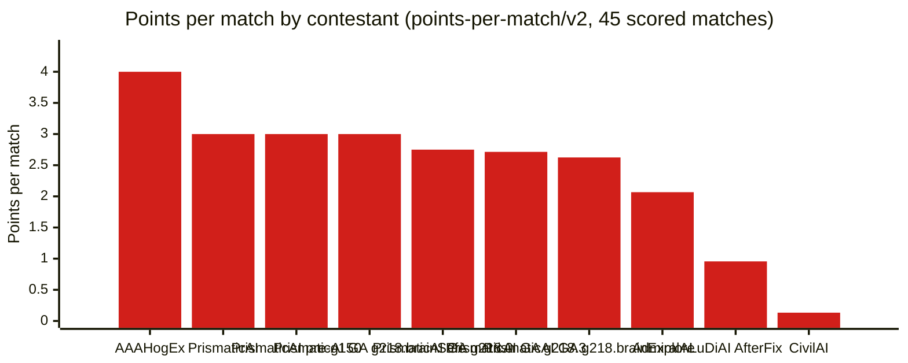
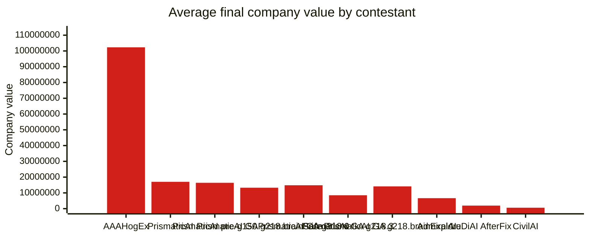
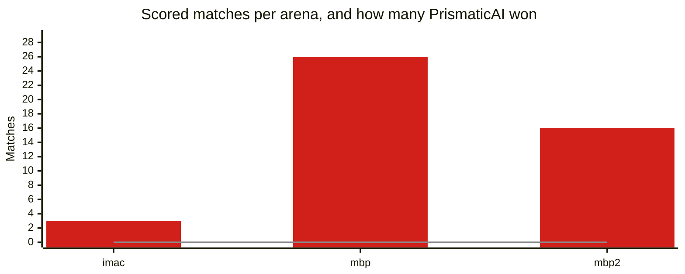

# battle-20261121T025312-d33376c3

Derived from `battle-20261121T025312-d33376c3.json` by `tools/research/ai-battle/battle.py report`; do not edit.

- Edition `d33376c3253bbbf2`: PrismaticAI and referee at `962699034c20d90baeb9f617789ea6558cc6ff52`, base set `opengfx-8.0.tar`
- 20-year free-for-all from 1960, map 256x256 temperate, breakdowns 1
- 45 scored match(es) on `imac` (20261119-master-gdf1e05e7d8), `mbp` (20261120-master-m17653b726e), `mbp2` (20261119-master-gdf1e05e7d8)
- Replays: 0 of 1 identical to their original on another arena

| # | Contestant | Played | Wins | Points | Points/match | Avg rank | Avg final value | Squirrel errors | Matches with anomalies |
|---|---|---|---|---|---|---|---|---|---|
| 1 | AAAHogEx | 45 | 45 | 180 | 4.0 | 1.0 | 102.3 M | 0 | 0 |
| 2 | PrismaticAI | 6 | 0 | 18 | 3.0 | 2.0 | 17.0 M | 0 | 0 |
| 3 | PrismaticAI pre-g150 | 8 | 0 | 24 | 3.0 | 2.0 | 16.4 M | 0 | 3 |
| 4 | PrismaticAI GA g218.brainSafe | 8 | 0 | 24 | 3.0 | 2.0 | 13.3 M | 0 | 4 |
| 5 | PrismaticAI GA g218.0 | 8 | 0 | 22 | 2.75 | 2.25 | 14.8 M | 0 | 0 |
| 6 | PrismaticAI GA g218.3 | 7 | 0 | 19 | 2.714 | 2.29 | 8.5 M | 0 | 1 |
| 7 | PrismaticAI GA g218.brainExplore | 8 | 0 | 21 | 2.625 | 2.38 | 14.1 M | 0 | 3 |
| 8 | AdmiralAI | 45 | 0 | 93 | 2.067 | 2.93 | 6.7 M | 116 | 3 |
| 9 | LuDiAI AfterFix | 45 | 0 | 43 | 0.956 | 4.04 | 1.9 M | 0 | 1 |
| 10 | CivilAI | 45 | 0 | 6 | 0.133 | 4.87 | 597.4 k | 0 | 7 |

```mermaid
---
config:
  xyChart:
    width: 900
    height: 360
  themeVariables:
    xyChart:
      plotColorPalette: "#d11f1a, #8a8a8a, #0b0b0b, #ece4d6"
---
xychart-beta
    title "Final company value per scored match: winner vs best PrismaticAI"
    x-axis ["m-0001", "m-0002", "m-0003", "m-0004", "m-0005", "m-0006", "m-0007", "m-0008", "m-0009", "m-0010", "m-0011", "m-0012", "m-0013", "m-0014", "m-0015", "m-0016", "m-0017", "m-0018", "m-0019", "m-0020", "m-0021", "m-0022", "m-0023", "m-0024", "m-0025", "m-0026", "m-0027", "m-0028", "m-0036", "m-0037", "m-0038", "m-0039", "m-0040", "m-0041", "m-0042", "m-0043", "m-0044", "m-0045", "m-0046", "m-0047", "m-0049", "m-0050", "m-0051", "m-0052", "m-0059"]
    %% series: Winner | Best PrismaticAI
    %% links: battle-20261121T025312-d33376c3.md?col=Match&filter=m-0001 | battle-20261121T025312-d33376c3.md?col=Match&filter=m-0002 | battle-20261121T025312-d33376c3.md?col=Match&filter=m-0003 | battle-20261121T025312-d33376c3.md?col=Match&filter=m-0004 | battle-20261121T025312-d33376c3.md?col=Match&filter=m-0005 | battle-20261121T025312-d33376c3.md?col=Match&filter=m-0006 | battle-20261121T025312-d33376c3.md?col=Match&filter=m-0007 | battle-20261121T025312-d33376c3.md?col=Match&filter=m-0008 | battle-20261121T025312-d33376c3.md?col=Match&filter=m-0009 | battle-20261121T025312-d33376c3.md?col=Match&filter=m-0010 | battle-20261121T025312-d33376c3.md?col=Match&filter=m-0011 | battle-20261121T025312-d33376c3.md?col=Match&filter=m-0012 | battle-20261121T025312-d33376c3.md?col=Match&filter=m-0013 | battle-20261121T025312-d33376c3.md?col=Match&filter=m-0014 | battle-20261121T025312-d33376c3.md?col=Match&filter=m-0015 | battle-20261121T025312-d33376c3.md?col=Match&filter=m-0016 | battle-20261121T025312-d33376c3.md?col=Match&filter=m-0017 | battle-20261121T025312-d33376c3.md?col=Match&filter=m-0018 | battle-20261121T025312-d33376c3.md?col=Match&filter=m-0019 | battle-20261121T025312-d33376c3.md?col=Match&filter=m-0020 | battle-20261121T025312-d33376c3.md?col=Match&filter=m-0021 | battle-20261121T025312-d33376c3.md?col=Match&filter=m-0022 | battle-20261121T025312-d33376c3.md?col=Match&filter=m-0023 | battle-20261121T025312-d33376c3.md?col=Match&filter=m-0024 | battle-20261121T025312-d33376c3.md?col=Match&filter=m-0025 | battle-20261121T025312-d33376c3.md?col=Match&filter=m-0026 | battle-20261121T025312-d33376c3.md?col=Match&filter=m-0027 | battle-20261121T025312-d33376c3.md?col=Match&filter=m-0028 | battle-20261121T025312-d33376c3.md?col=Match&filter=m-0036 | battle-20261121T025312-d33376c3.md?col=Match&filter=m-0037 | battle-20261121T025312-d33376c3.md?col=Match&filter=m-0038 | battle-20261121T025312-d33376c3.md?col=Match&filter=m-0039 | battle-20261121T025312-d33376c3.md?col=Match&filter=m-0040 | battle-20261121T025312-d33376c3.md?col=Match&filter=m-0041 | battle-20261121T025312-d33376c3.md?col=Match&filter=m-0042 | battle-20261121T025312-d33376c3.md?col=Match&filter=m-0043 | battle-20261121T025312-d33376c3.md?col=Match&filter=m-0044 | battle-20261121T025312-d33376c3.md?col=Match&filter=m-0045 | battle-20261121T025312-d33376c3.md?col=Match&filter=m-0046 | battle-20261121T025312-d33376c3.md?col=Match&filter=m-0047 | battle-20261121T025312-d33376c3.md?col=Match&filter=m-0049 | battle-20261121T025312-d33376c3.md?col=Match&filter=m-0050 | battle-20261121T025312-d33376c3.md?col=Match&filter=m-0051 | battle-20261121T025312-d33376c3.md?col=Match&filter=m-0052 | battle-20261121T025312-d33376c3.md?col=Match&filter=m-0059
    y-axis "Company value" 0 --> 163000000
    bar [76604144, 96333422, 59769233, 60716984, 53622416, 91633705, 50557875, 71583593, 70150474, 68968047, 66593445, 112356803, 123973537, 94078512, 88811649, 78482053, 104030179, 104690319, 124333451, 124740511, 95582255, 117274160, 125243292, 115386914, 104309121, 98238752, 130512863, 89834554, 148250950, 125174778, 138878198, 139594540, 146952336, 120012297, 144643605, 102563230, 109202954, 132910518, 103044650, 102431553, 105488068, 121158770, 96285049, 97489863, 71240017]
    line [20147599, 15155470, 11428233, 13905823, 7381655, 17679201, 13740535, 13580139, 14443771, 13449934, 7024894, 17115765, 18899489, 16238893, 12165199, 20007304, 14054009, 16823211, 10064189, 12395867, 13571601, 11238384, 6674414, 21859017, 14966645, 20787199, 17982540, 17580196, 15579244, 16951469, 7457053, 7463284, 1056487, 5662582, 13155696, 19090933, 17248573, 15079725, 18139393, 7780967, 17326457, 15853029, 14177670, 17533003, 10988469]
```

<!-- battle-charts:begin -->
<!-- derived from battle-20261121T025312-d33376c3.json by `battle.py render`; `battle.py check` fails when it is stale -->

<!-- battle-charts:end -->

| Seed | Original | Replay | Arenas | Identical |
|---|---|---|---|---|
| 807575399 | m-0012 | m-0048 | imac / mbp | NO |

| Match | Arena | Seed | Winner | Value | Last | Anomalies |
|---|---|---|---|---|---|---|
| m-0001 | mbp | 1828160567 | AAAHogEx | 76.6 M | CivilAI | - |
| m-0002 | mbp | 1828160567 | AAAHogEx | 96.3 M | CivilAI | CivilAI: fleet_drop:134->51 |
| m-0003 | mbp | 1828160567 | AAAHogEx | 59.8 M | CivilAI | - |
| m-0004 | mbp | 1828160567 | AAAHogEx | 60.7 M | CivilAI | AdmiralAI: squirrel_errors:44 |
| m-0005 | mbp | 1828160567 | AAAHogEx | 53.6 M | CivilAI | - |
| m-0006 | mbp | 1916189393 | AAAHogEx | 91.6 M | CivilAI | CivilAI: no_vehicles |
| m-0007 | mbp | 1916189393 | AAAHogEx | 50.6 M | CivilAI | - |
| m-0008 | mbp | 1916189393 | AAAHogEx | 71.6 M | CivilAI | - |
| m-0009 | mbp | 1916189393 | AAAHogEx | 70.2 M | CivilAI | PrismaticAI GA g218.brainSafe: fleet_drop:133->87 |
| m-0010 | imac | 1916189393 | AAAHogEx | 69.0 M | CivilAI | PrismaticAI GA g218.brainExplore: fleet_drop:50->31 |
| m-0011 | imac | 1916189393 | AAAHogEx | 66.6 M | CivilAI | - |
| m-0012 | imac | 807575399 | AAAHogEx | 112.4 M | CivilAI | - |
| m-0013 | mbp2 | 807575399 | AAAHogEx | 124.0 M | CivilAI | PrismaticAI pre-g150: fleet_drop:104->50 |
| m-0014 | mbp2 | 807575399 | AAAHogEx | 94.1 M | CivilAI | - |
| m-0015 | mbp2 | 807575399 | AAAHogEx | 88.8 M | CivilAI | PrismaticAI GA g218.brainSafe: fleet_drop:104->50 |
| m-0016 | mbp2 | 807575399 | AAAHogEx | 78.5 M | CivilAI | - |
| m-0017 | mbp2 | 807575399 | AAAHogEx | 104.0 M | CivilAI | - |
| m-0018 | mbp2 | 718342732 | AAAHogEx | 104.7 M | CivilAI | AdmiralAI: squirrel_errors:72 |
| m-0019 | mbp2 | 718342732 | AAAHogEx | 124.3 M | CivilAI | PrismaticAI pre-g150: fleet_drop:73->42 |
| m-0020 | mbp2 | 718342732 | AAAHogEx | 124.7 M | CivilAI | - |
| m-0021 | mbp2 | 718342732 | AAAHogEx | 95.6 M | CivilAI | - |
| m-0022 | mbp2 | 718342732 | AAAHogEx | 117.3 M | CivilAI | PrismaticAI GA g218.brainExplore: fleet_drop:46->26 |
| m-0023 | mbp2 | 718342732 | AAAHogEx | 125.2 M | CivilAI | PrismaticAI GA g218.3: fleet_drop:69->41 |
| m-0024 | mbp2 | 115533741 | AAAHogEx | 115.4 M | CivilAI | - |
| m-0025 | mbp2 | 115533741 | AAAHogEx | 104.3 M | LuDiAI AfterFix | - |
| m-0026 | mbp2 | 115533741 | AAAHogEx | 98.2 M | CivilAI | CivilAI: fleet_drop:43->19 |
| m-0027 | mbp2 | 115533741 | AAAHogEx | 130.5 M | CivilAI | PrismaticAI GA g218.brainSafe: fleet_drop:118->70; CivilAI: fleet_drop:51->20 |
| m-0028 | mbp2 | 115533741 | AAAHogEx | 89.8 M | CivilAI | PrismaticAI GA g218.brainExplore: fleet_drop:80->51; LuDiAI AfterFix: fleet_drop:62->32 |
| m-0036 | mbp | 519105894 | AAAHogEx | 148.3 M | LuDiAI AfterFix | - |
| m-0037 | mbp | 519105894 | AAAHogEx | 125.2 M | CivilAI | - |
| m-0038 | mbp | 519105894 | AAAHogEx | 138.9 M | CivilAI | - |
| m-0039 | mbp | 519105894 | AAAHogEx | 139.6 M | CivilAI | CivilAI: fleet_drop:21->14 |
| m-0040 | mbp | 519105894 | AAAHogEx | 147.0 M | PrismaticAI GA g218.brainExplore | - |
| m-0041 | mbp | 519105894 | AAAHogEx | 120.0 M | CivilAI | CivilAI: fleet_drop:19->12 |
| m-0042 | mbp | 531835230 | AAAHogEx | 144.6 M | CivilAI | AdmiralAI: fleet_drop:204->141 |
| m-0043 | mbp | 531835230 | AAAHogEx | 102.6 M | CivilAI | PrismaticAI pre-g150: fleet_drop:112->58 |
| m-0044 | mbp | 531835230 | AAAHogEx | 109.2 M | CivilAI | - |
| m-0045 | mbp | 531835230 | AAAHogEx | 132.9 M | CivilAI | PrismaticAI GA g218.brainSafe: fleet_drop:145->51 |
| m-0046 | mbp | 531835230 | AAAHogEx | 103.0 M | CivilAI | CivilAI: fleet_drop:13->4 |
| m-0047 | mbp | 531835230 | AAAHogEx | 102.4 M | CivilAI | - |
| m-0048 (replay) | mbp | 807575399 | AAAHogEx | 112.7 M | CivilAI | - |
| m-0049 | mbp | 405067111 | AAAHogEx | 105.5 M | CivilAI | - |
| m-0050 | mbp | 405067111 | AAAHogEx | 121.2 M | LuDiAI AfterFix | - |
| m-0051 | mbp | 405067111 | AAAHogEx | 96.3 M | LuDiAI AfterFix | - |
| m-0052 | mbp | 405067111 | AAAHogEx | 97.5 M | CivilAI | - |
| m-0059 | mbp | 1097884118 | AAAHogEx | 71.2 M | CivilAI | - |
