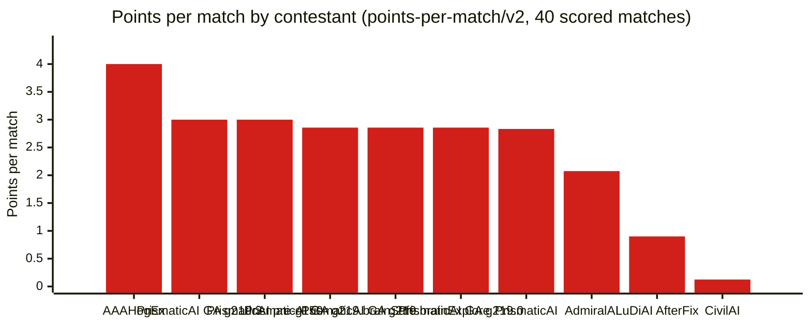
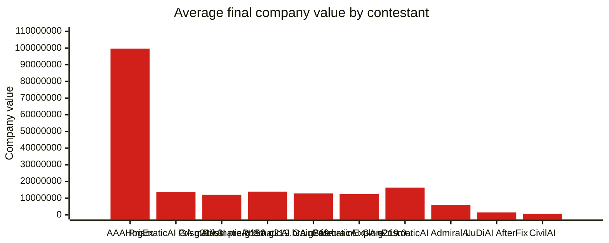
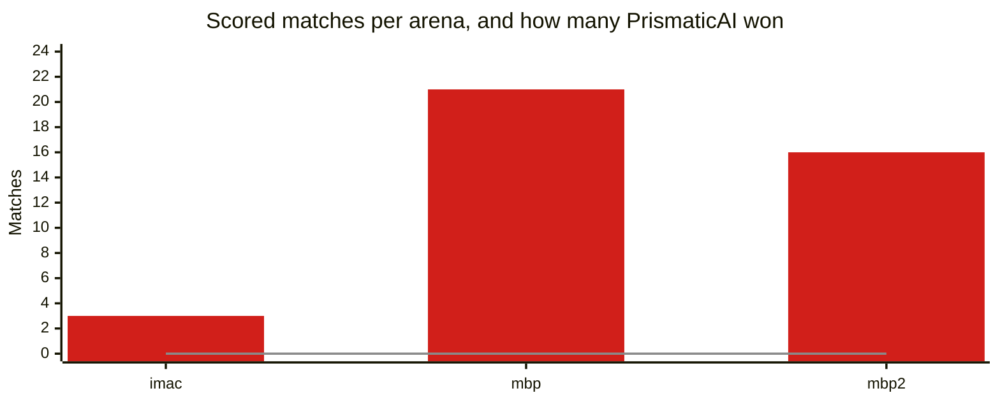

# battle-20261121T030325-5e25a90c

Derived from `battle-20261121T030325-5e25a90c.json` by `tools/research/ai-battle/battle.py report`; do not edit.

- Edition `5e25a90c8887f837`: PrismaticAI and referee at `962699034c20d90baeb9f617789ea6558cc6ff52`, base set `opengfx-8.0.tar`
- 20-year free-for-all from 1960, map 256x256 temperate, breakdowns 1
- 40 scored match(es) on `imac` (20261119-master-gdf1e05e7d8), `mbp` (20261120-master-m17653b726e), `mbp2` (20261119-master-gdf1e05e7d8)
- Replays: 0 of 0 identical to their original on another arena

| # | Contestant | Played | Wins | Points | Points/match | Avg rank | Avg final value | Squirrel errors | Matches with anomalies |
|---|---|---|---|---|---|---|---|---|---|
| 1 | AAAHogEx | 40 | 40 | 160 | 4.0 | 1.0 | 99.6 M | 0 | 0 |
| 2 | PrismaticAI GA g219.3 | 6 | 0 | 18 | 3.0 | 2.0 | 13.5 M | 0 | 2 |
| 3 | PrismaticAI pre-g150 | 7 | 0 | 21 | 3.0 | 2.0 | 12.0 M | 0 | 3 |
| 4 | PrismaticAI GA g219.brainSafe | 7 | 0 | 20 | 2.857 | 2.14 | 13.9 M | 0 | 6 |
| 5 | PrismaticAI GA g219.brainExplore | 7 | 0 | 20 | 2.857 | 2.14 | 12.8 M | 0 | 2 |
| 6 | PrismaticAI GA g219.0 | 7 | 0 | 20 | 2.857 | 2.14 | 12.4 M | 0 | 3 |
| 7 | PrismaticAI | 6 | 0 | 17 | 2.833 | 2.17 | 16.4 M | 0 | 0 |
| 8 | AdmiralAI | 40 | 0 | 83 | 2.075 | 2.92 | 6.1 M | 0 | 0 |
| 9 | LuDiAI AfterFix | 40 | 0 | 36 | 0.9 | 4.1 | 1.4 M | 0 | 0 |
| 10 | CivilAI | 40 | 0 | 5 | 0.125 | 4.88 | 581.8 k | 0 | 11 |

```mermaid
---
config:
  xyChart:
    width: 900
    height: 360
  themeVariables:
    xyChart:
      plotColorPalette: "#d11f1a, #8a8a8a, #0b0b0b, #ece4d6"
---
xychart-beta
    title "Final company value per scored match: winner vs best PrismaticAI"
    x-axis ["m-0001", "m-0002", "m-0003", "m-0004", "m-0005", "m-0006", "m-0007", "m-0008", "m-0009", "m-0010", "m-0011", "m-0012", "m-0013", "m-0014", "m-0015", "m-0016", "m-0017", "m-0018", "m-0019", "m-0020", "m-0021", "m-0022", "m-0023", "m-0024", "m-0025", "m-0026", "m-0027", "m-0028", "m-0036", "m-0037", "m-0038", "m-0039", "m-0040", "m-0041", "m-0042", "m-0043", "m-0044", "m-0045", "m-0046", "m-0047"]
    %% series: Winner | Best PrismaticAI
    %% links: battle-20261121T030325-5e25a90c.md?col=Match&filter=m-0001 | battle-20261121T030325-5e25a90c.md?col=Match&filter=m-0002 | battle-20261121T030325-5e25a90c.md?col=Match&filter=m-0003 | battle-20261121T030325-5e25a90c.md?col=Match&filter=m-0004 | battle-20261121T030325-5e25a90c.md?col=Match&filter=m-0005 | battle-20261121T030325-5e25a90c.md?col=Match&filter=m-0006 | battle-20261121T030325-5e25a90c.md?col=Match&filter=m-0007 | battle-20261121T030325-5e25a90c.md?col=Match&filter=m-0008 | battle-20261121T030325-5e25a90c.md?col=Match&filter=m-0009 | battle-20261121T030325-5e25a90c.md?col=Match&filter=m-0010 | battle-20261121T030325-5e25a90c.md?col=Match&filter=m-0011 | battle-20261121T030325-5e25a90c.md?col=Match&filter=m-0012 | battle-20261121T030325-5e25a90c.md?col=Match&filter=m-0013 | battle-20261121T030325-5e25a90c.md?col=Match&filter=m-0014 | battle-20261121T030325-5e25a90c.md?col=Match&filter=m-0015 | battle-20261121T030325-5e25a90c.md?col=Match&filter=m-0016 | battle-20261121T030325-5e25a90c.md?col=Match&filter=m-0017 | battle-20261121T030325-5e25a90c.md?col=Match&filter=m-0018 | battle-20261121T030325-5e25a90c.md?col=Match&filter=m-0019 | battle-20261121T030325-5e25a90c.md?col=Match&filter=m-0020 | battle-20261121T030325-5e25a90c.md?col=Match&filter=m-0021 | battle-20261121T030325-5e25a90c.md?col=Match&filter=m-0022 | battle-20261121T030325-5e25a90c.md?col=Match&filter=m-0023 | battle-20261121T030325-5e25a90c.md?col=Match&filter=m-0024 | battle-20261121T030325-5e25a90c.md?col=Match&filter=m-0025 | battle-20261121T030325-5e25a90c.md?col=Match&filter=m-0026 | battle-20261121T030325-5e25a90c.md?col=Match&filter=m-0027 | battle-20261121T030325-5e25a90c.md?col=Match&filter=m-0028 | battle-20261121T030325-5e25a90c.md?col=Match&filter=m-0036 | battle-20261121T030325-5e25a90c.md?col=Match&filter=m-0037 | battle-20261121T030325-5e25a90c.md?col=Match&filter=m-0038 | battle-20261121T030325-5e25a90c.md?col=Match&filter=m-0039 | battle-20261121T030325-5e25a90c.md?col=Match&filter=m-0040 | battle-20261121T030325-5e25a90c.md?col=Match&filter=m-0041 | battle-20261121T030325-5e25a90c.md?col=Match&filter=m-0042 | battle-20261121T030325-5e25a90c.md?col=Match&filter=m-0043 | battle-20261121T030325-5e25a90c.md?col=Match&filter=m-0044 | battle-20261121T030325-5e25a90c.md?col=Match&filter=m-0045 | battle-20261121T030325-5e25a90c.md?col=Match&filter=m-0046 | battle-20261121T030325-5e25a90c.md?col=Match&filter=m-0047
    y-axis "Company value" 0 --> 162000000
    bar [146849113, 130200535, 108458139, 98508456, 85352896, 82785893, 73884318, 104426124, 67366717, 107188813, 70375148, 90227455, 92189977, 99624508, 115104949, 72361680, 99321098, 95864800, 128864744, 111477510, 105316002, 103013593, 121470125, 137725720, 123817963, 123989420, 125378944, 130698134, 67270311, 79544216, 71537442, 80453468, 97373982, 118384382, 89398004, 82369693, 93361916, 57095103, 91347755, 105887218]
    line [7546613, 19885897, 24316628, 19969759, 20983558, 10956714, 10954135, 7637576, 6292428, 5028047, 10339259, 11862885, 10323748, 15308189, 16939708, 14757636, 10333820, 16326175, 10181846, 11648680, 15278273, 12328393, 16092276, 23441646, 19986586, 10482389, 12970727, 14295722, 16719425, 12099680, 8746595, 11431000, 11383004, 11426765, 18801829, 13203353, 13067641, 9878590, 12149593, 12076828]
```

<!-- battle-charts:begin -->
<!-- derived from battle-20261121T030325-5e25a90c.json by `battle.py render`; `battle.py check` fails when it is stale -->

<!-- battle-charts:end -->

| Match | Arena | Seed | Winner | Value | Last | Anomalies |
|---|---|---|---|---|---|---|
| m-0001 | mbp | 1847668752 | AAAHogEx | 146.8 M | CivilAI | CivilAI: fleet_drop:56->30 |
| m-0002 | mbp | 1847668752 | AAAHogEx | 130.2 M | CivilAI | CivilAI: fleet_drop:44->26 |
| m-0003 | mbp | 1847668752 | AAAHogEx | 108.5 M | CivilAI | - |
| m-0004 | mbp | 1847668752 | AAAHogEx | 98.5 M | CivilAI | CivilAI: fleet_drop:69->44 |
| m-0005 | mbp | 1847668752 | AAAHogEx | 85.4 M | CivilAI | - |
| m-0006 | mbp | 154014499 | AAAHogEx | 82.8 M | CivilAI | - |
| m-0007 | mbp | 154014499 | AAAHogEx | 73.9 M | CivilAI | PrismaticAI pre-g150: fleet_drop:68->45 |
| m-0008 | mbp | 154014499 | AAAHogEx | 104.4 M | CivilAI | PrismaticAI GA g219.0: fleet_drop:75->40 |
| m-0009 | mbp | 154014499 | AAAHogEx | 67.4 M | CivilAI | PrismaticAI GA g219.brainSafe: fleet_drop:70->44; CivilAI: fleet_drop:33->10 |
| m-0010 | imac | 154014499 | AAAHogEx | 107.2 M | CivilAI | PrismaticAI GA g219.brainExplore: fleet_drop:42->26 |
| m-0011 | imac | 154014499 | AAAHogEx | 70.4 M | CivilAI | PrismaticAI GA g219.3: fleet_drop:95->36 |
| m-0012 | imac | 1101171941 | AAAHogEx | 90.2 M | CivilAI | - |
| m-0013 | mbp2 | 1101171941 | AAAHogEx | 92.2 M | LuDiAI AfterFix | PrismaticAI pre-g150: fleet_drop:80->48 |
| m-0014 | mbp2 | 1101171941 | AAAHogEx | 99.6 M | CivilAI | PrismaticAI GA g219.0: fleet_drop:155->67; CivilAI: fleet_drop:41->16 |
| m-0015 | mbp2 | 1101171941 | AAAHogEx | 115.1 M | CivilAI | PrismaticAI GA g219.brainSafe: fleet_drop:123->75; CivilAI: fleet_drop:15->7 |
| m-0016 | mbp2 | 1101171941 | AAAHogEx | 72.4 M | CivilAI | - |
| m-0017 | mbp2 | 1101171941 | AAAHogEx | 99.3 M | CivilAI | - |
| m-0018 | mbp2 | 1950316595 | AAAHogEx | 95.9 M | LuDiAI AfterFix | - |
| m-0019 | mbp2 | 1950316595 | AAAHogEx | 128.9 M | CivilAI | PrismaticAI pre-g150: fleet_drop:95->62 |
| m-0020 | mbp2 | 1950316595 | AAAHogEx | 111.5 M | LuDiAI AfterFix | - |
| m-0021 | mbp2 | 1950316595 | AAAHogEx | 105.3 M | CivilAI | PrismaticAI GA g219.brainSafe: fleet_drop:92->57 |
| m-0022 | mbp2 | 1950316595 | AAAHogEx | 103.0 M | LuDiAI AfterFix | - |
| m-0023 | mbp2 | 1950316595 | AAAHogEx | 121.5 M | CivilAI | CivilAI: fleet_drop:86->47 |
| m-0024 | mbp2 | 330670282 | AAAHogEx | 137.7 M | CivilAI | - |
| m-0025 | mbp2 | 330670282 | AAAHogEx | 123.8 M | CivilAI | - |
| m-0026 | mbp2 | 330670282 | AAAHogEx | 124.0 M | CivilAI | - |
| m-0027 | mbp2 | 330670282 | AAAHogEx | 125.4 M | CivilAI | PrismaticAI GA g219.brainSafe: fleet_drop:120->75 |
| m-0028 | mbp2 | 330670282 | AAAHogEx | 130.7 M | CivilAI | - |
| m-0036 | mbp | 377789493 | AAAHogEx | 67.3 M | CivilAI | - |
| m-0037 | mbp | 377789493 | AAAHogEx | 79.5 M | CivilAI | - |
| m-0038 | mbp | 377789493 | AAAHogEx | 71.5 M | CivilAI | PrismaticAI GA g219.0: fleet_drop:79->47 |
| m-0039 | mbp | 377789493 | AAAHogEx | 80.5 M | CivilAI | PrismaticAI GA g219.brainSafe: fleet_drop:94->39 |
| m-0040 | mbp | 377789493 | AAAHogEx | 97.4 M | CivilAI | PrismaticAI GA g219.brainExplore: fleet_drop:71->49; CivilAI: no_vehicles |
| m-0041 | mbp | 377789493 | AAAHogEx | 118.4 M | CivilAI | - |
| m-0042 | mbp | 76516614 | AAAHogEx | 89.4 M | CivilAI | CivilAI: fleet_drop:10->6 |
| m-0043 | mbp | 76516614 | AAAHogEx | 82.4 M | CivilAI | - |
| m-0044 | mbp | 76516614 | AAAHogEx | 93.4 M | LuDiAI AfterFix | - |
| m-0045 | mbp | 76516614 | AAAHogEx | 57.1 M | CivilAI | PrismaticAI GA g219.brainSafe: fleet_drop:58->35; CivilAI: no_vehicles |
| m-0046 | mbp | 76516614 | AAAHogEx | 91.3 M | CivilAI | CivilAI: no_vehicles |
| m-0047 | mbp | 76516614 | AAAHogEx | 105.9 M | CivilAI | PrismaticAI GA g219.3: fleet_drop:123->64 |
