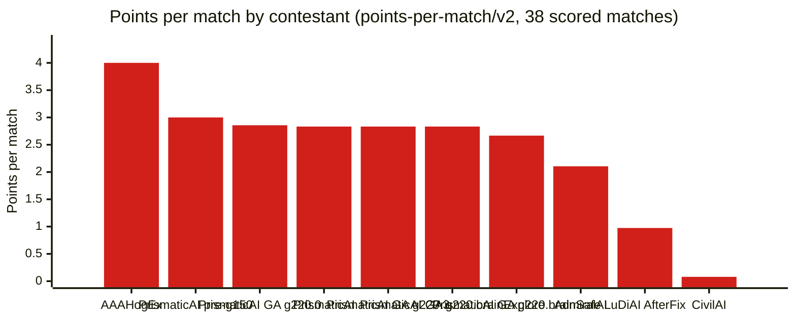
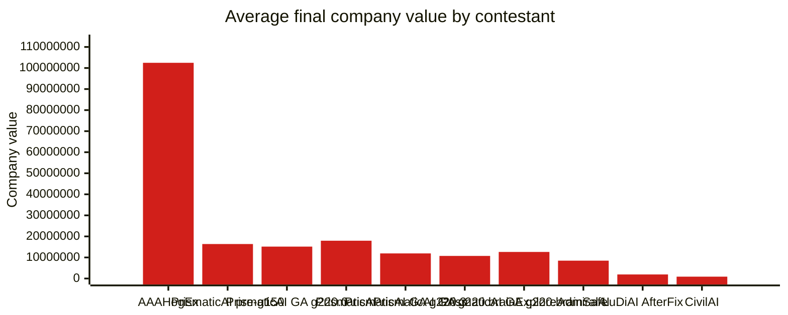
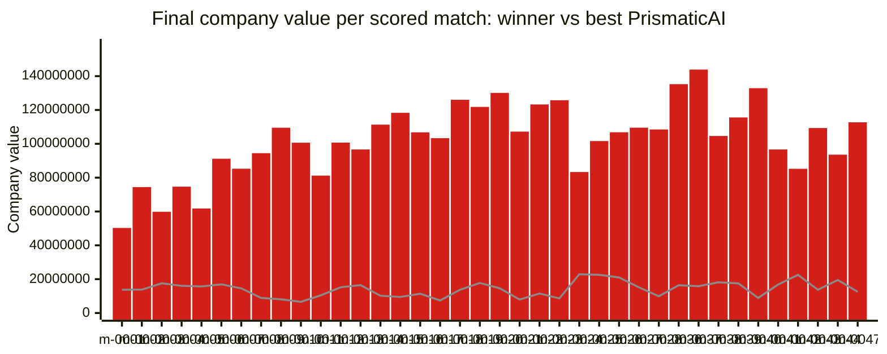
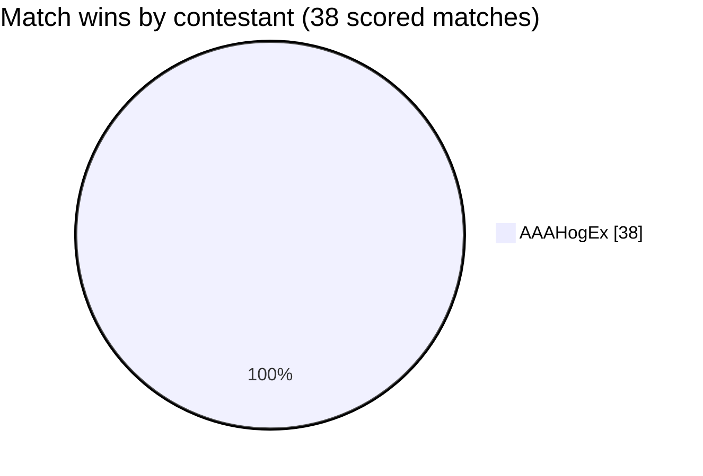
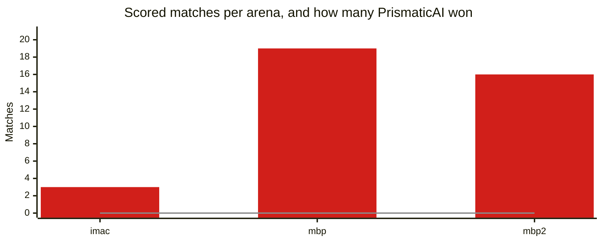

# battle-20261121T031346-85b81ada

Derived from `battle-20261121T031346-85b81ada.json` by `tools/research/ai-battle/battle.py report`; do not edit.

- Edition `85b81ada6940be6a`: PrismaticAI and referee at `962699034c20d90baeb9f617789ea6558cc6ff52`, base set `opengfx-8.0.tar`
- 20-year free-for-all from 1960, map 256x256 temperate, breakdowns 1
- 38 scored match(es) on `imac` (20261119-master-gdf1e05e7d8), `mbp` (20261120-master-m17653b726e), `mbp2` (20261119-master-gdf1e05e7d8)
- Replays: 0 of 0 identical to their original on another arena

| # | Contestant | Played | Wins | Points | Points/match | Avg rank | Avg final value | Squirrel errors | Matches with anomalies |
|---|---|---|---|---|---|---|---|---|---|
| 1 | AAAHogEx | 38 | 38 | 152 | 4.0 | 1.0 | 102.5 M | 0 | 0 |
| 2 | PrismaticAI pre-g150 | 7 | 0 | 21 | 3.0 | 2.0 | 16.4 M | 0 | 4 |
| 3 | PrismaticAI GA g220.0 | 7 | 0 | 20 | 2.857 | 2.14 | 15.2 M | 0 | 2 |
| 4 | PrismaticAI | 6 | 0 | 17 | 2.833 | 2.17 | 18.0 M | 0 | 0 |
| 5 | PrismaticAI GA g220.3 | 6 | 0 | 17 | 2.833 | 2.17 | 11.9 M | 0 | 1 |
| 6 | PrismaticAI GA g220.brainExplore | 6 | 0 | 17 | 2.833 | 2.17 | 10.7 M | 0 | 1 |
| 7 | PrismaticAI GA g220.brainSafe | 6 | 0 | 16 | 2.667 | 2.33 | 12.6 M | 0 | 0 |
| 8 | AdmiralAI | 38 | 0 | 80 | 2.105 | 2.89 | 8.5 M | 0 | 1 |
| 9 | LuDiAI AfterFix | 38 | 0 | 37 | 0.974 | 4.03 | 1.9 M | 0 | 0 |
| 10 | CivilAI | 38 | 0 | 3 | 0.079 | 4.92 | 882.6 k | 0 | 3 |

<!-- battle-charts:begin -->
<!-- derived from battle-20261121T031346-85b81ada.json by `battle.py render`; `battle.py check` fails when it is stale -->

<!-- battle-charts:end -->

| Match | Arena | Seed | Winner | Value | Last | Anomalies |
|---|---|---|---|---|---|---|
| m-0001 | mbp | 1375836295 | AAAHogEx | 50.3 M | CivilAI | PrismaticAI pre-g150: fleet_drop:96->64 |
| m-0002 | mbp | 1375836295 | AAAHogEx | 74.4 M | LuDiAI AfterFix | - |
| m-0003 | mbp | 1375836295 | AAAHogEx | 59.8 M | CivilAI | AdmiralAI: fleet_drop:80->54 |
| m-0004 | mbp | 1375836295 | AAAHogEx | 74.7 M | AdmiralAI | CivilAI: fleet_drop:37->21 |
| m-0005 | mbp | 1375836295 | AAAHogEx | 61.8 M | CivilAI | - |
| m-0006 | mbp | 1352515109 | AAAHogEx | 91.2 M | CivilAI | - |
| m-0007 | mbp | 1352515109 | AAAHogEx | 85.3 M | CivilAI | - |
| m-0008 | mbp | 1352515109 | AAAHogEx | 94.5 M | CivilAI | - |
| m-0009 | mbp | 1352515109 | AAAHogEx | 109.5 M | CivilAI | - |
| m-0010 | imac | 1352515109 | AAAHogEx | 100.7 M | CivilAI | - |
| m-0011 | imac | 1352515109 | AAAHogEx | 81.2 M | CivilAI | - |
| m-0012 | imac | 598649082 | AAAHogEx | 100.7 M | CivilAI | - |
| m-0013 | mbp2 | 598649082 | AAAHogEx | 96.7 M | CivilAI | PrismaticAI pre-g150: fleet_drop:120->66 |
| m-0014 | mbp2 | 598649082 | AAAHogEx | 111.3 M | CivilAI | - |
| m-0015 | mbp2 | 598649082 | AAAHogEx | 118.3 M | CivilAI | - |
| m-0016 | mbp2 | 598649082 | AAAHogEx | 106.8 M | CivilAI | PrismaticAI GA g220.brainExplore: fleet_drop:113->76 |
| m-0017 | mbp2 | 598649082 | AAAHogEx | 103.3 M | CivilAI | - |
| m-0018 | mbp2 | 705435485 | AAAHogEx | 126.0 M | CivilAI | - |
| m-0019 | mbp2 | 705435485 | AAAHogEx | 121.8 M | CivilAI | PrismaticAI pre-g150: fleet_drop:101->47 |
| m-0020 | mbp2 | 705435485 | AAAHogEx | 130.1 M | CivilAI | PrismaticAI GA g220.0: fleet_drop:122->80 |
| m-0021 | mbp2 | 705435485 | AAAHogEx | 107.2 M | LuDiAI AfterFix | - |
| m-0022 | mbp2 | 705435485 | AAAHogEx | 123.3 M | CivilAI | - |
| m-0023 | mbp2 | 705435485 | AAAHogEx | 125.7 M | CivilAI | PrismaticAI GA g220.3: fleet_drop:57->38 |
| m-0024 | mbp2 | 1221499090 | AAAHogEx | 83.3 M | CivilAI | - |
| m-0025 | mbp2 | 1221499090 | AAAHogEx | 101.6 M | CivilAI | PrismaticAI pre-g150: fleet_drop:133->93 |
| m-0026 | mbp2 | 1221499090 | AAAHogEx | 106.8 M | CivilAI | PrismaticAI GA g220.0: fleet_drop:213->113 |
| m-0027 | mbp2 | 1221499090 | AAAHogEx | 109.5 M | CivilAI | - |
| m-0028 | mbp2 | 1221499090 | AAAHogEx | 108.5 M | CivilAI | - |
| m-0036 | mbp | 888440056 | AAAHogEx | 135.3 M | CivilAI | - |
| m-0037 | mbp | 888440056 | AAAHogEx | 143.9 M | CivilAI | - |
| m-0038 | mbp | 888440056 | AAAHogEx | 104.6 M | CivilAI | - |
| m-0039 | mbp | 888440056 | AAAHogEx | 115.6 M | CivilAI | CivilAI: fleet_drop:63->43 |
| m-0040 | mbp | 888440056 | AAAHogEx | 132.9 M | CivilAI | - |
| m-0041 | mbp | 888440056 | AAAHogEx | 96.7 M | CivilAI | - |
| m-0042 | mbp | 176477048 | AAAHogEx | 85.2 M | CivilAI | - |
| m-0043 | mbp | 176477048 | AAAHogEx | 109.3 M | CivilAI | - |
| m-0044 | mbp | 176477048 | AAAHogEx | 93.6 M | CivilAI | CivilAI: fleet_drop:28->14 |
| m-0047 | mbp | 176477048 | AAAHogEx | 112.7 M | CivilAI | - |
