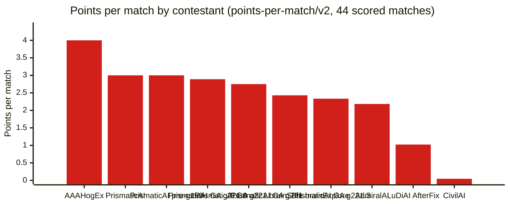
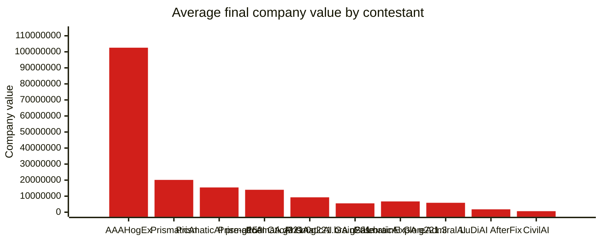
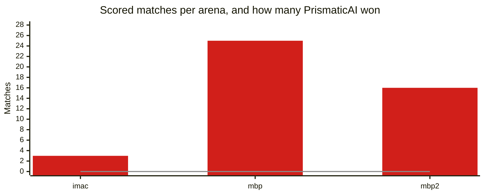

# battle-20261121T032611-bb594ded

Derived from `battle-20261121T032611-bb594ded.json` by `tools/research/ai-battle/battle.py report`; do not edit.

- Edition `bb594ded43ecda47`: PrismaticAI and referee at `962699034c20d90baeb9f617789ea6558cc6ff52`, base set `opengfx-8.0.tar`
- 20-year free-for-all from 1960, map 256x256 temperate, breakdowns 1
- 44 scored match(es) on `imac` (20261119-master-gdf1e05e7d8), `mbp` (20261120-master-m17653b726e), `mbp2` (20261119-master-gdf1e05e7d8)
- Replays: 0 of 1 identical to their original on another arena

| # | Contestant | Played | Wins | Points | Points/match | Avg rank | Avg final value | Squirrel errors | Matches with anomalies |
|---|---|---|---|---|---|---|---|---|---|
| 1 | AAAHogEx | 44 | 44 | 176 | 4.0 | 1.0 | 102.6 M | 0 | 0 |
| 2 | PrismaticAI | 6 | 0 | 18 | 3.0 | 2.0 | 20.1 M | 0 | 0 |
| 3 | PrismaticAI pre-g150 | 8 | 0 | 24 | 3.0 | 2.0 | 15.4 M | 0 | 4 |
| 4 | PrismaticAI GA g221.0 | 9 | 0 | 26 | 2.889 | 2.11 | 14.0 M | 0 | 7 |
| 5 | PrismaticAI GA g221.brainSafe | 8 | 0 | 22 | 2.75 | 2.25 | 9.3 M | 0 | 0 |
| 6 | PrismaticAI GA g221.brainExplore | 7 | 0 | 17 | 2.429 | 2.57 | 5.5 M | 0 | 2 |
| 7 | PrismaticAI GA g221.3 | 6 | 0 | 14 | 2.333 | 2.67 | 6.7 M | 0 | 2 |
| 8 | AdmiralAI | 44 | 0 | 96 | 2.182 | 2.82 | 5.9 M | 166 | 6 |
| 9 | LuDiAI AfterFix | 44 | 0 | 45 | 1.023 | 3.98 | 1.8 M | 0 | 0 |
| 10 | CivilAI | 44 | 0 | 2 | 0.045 | 4.95 | 642.3 k | 3865 | 7 |

```mermaid
---
config:
  xyChart:
    width: 900
    height: 360
  themeVariables:
    xyChart:
      plotColorPalette: "#d11f1a, #8a8a8a, #0b0b0b, #ece4d6"
---
xychart-beta
    title "Final company value per scored match: winner vs best PrismaticAI"
    x-axis ["m-0001", "m-0002", "m-0003", "m-0004", "m-0005", "m-0006", "m-0007", "m-0008", "m-0009", "m-0010", "m-0011", "m-0012", "m-0013", "m-0014", "m-0015", "m-0016", "m-0017", "m-0018", "m-0019", "m-0020", "m-0021", "m-0022", "m-0023", "m-0024", "m-0025", "m-0026", "m-0027", "m-0028", "m-0036", "m-0037", "m-0038", "m-0039", "m-0040", "m-0041", "m-0042", "m-0043", "m-0044", "m-0045", "m-0047", "m-0049", "m-0050", "m-0051", "m-0052", "m-0062"]
    %% series: Winner | Best PrismaticAI
    %% links: battle-20261121T032611-bb594ded.md?col=Match&filter=m-0001 | battle-20261121T032611-bb594ded.md?col=Match&filter=m-0002 | battle-20261121T032611-bb594ded.md?col=Match&filter=m-0003 | battle-20261121T032611-bb594ded.md?col=Match&filter=m-0004 | battle-20261121T032611-bb594ded.md?col=Match&filter=m-0005 | battle-20261121T032611-bb594ded.md?col=Match&filter=m-0006 | battle-20261121T032611-bb594ded.md?col=Match&filter=m-0007 | battle-20261121T032611-bb594ded.md?col=Match&filter=m-0008 | battle-20261121T032611-bb594ded.md?col=Match&filter=m-0009 | battle-20261121T032611-bb594ded.md?col=Match&filter=m-0010 | battle-20261121T032611-bb594ded.md?col=Match&filter=m-0011 | battle-20261121T032611-bb594ded.md?col=Match&filter=m-0012 | battle-20261121T032611-bb594ded.md?col=Match&filter=m-0013 | battle-20261121T032611-bb594ded.md?col=Match&filter=m-0014 | battle-20261121T032611-bb594ded.md?col=Match&filter=m-0015 | battle-20261121T032611-bb594ded.md?col=Match&filter=m-0016 | battle-20261121T032611-bb594ded.md?col=Match&filter=m-0017 | battle-20261121T032611-bb594ded.md?col=Match&filter=m-0018 | battle-20261121T032611-bb594ded.md?col=Match&filter=m-0019 | battle-20261121T032611-bb594ded.md?col=Match&filter=m-0020 | battle-20261121T032611-bb594ded.md?col=Match&filter=m-0021 | battle-20261121T032611-bb594ded.md?col=Match&filter=m-0022 | battle-20261121T032611-bb594ded.md?col=Match&filter=m-0023 | battle-20261121T032611-bb594ded.md?col=Match&filter=m-0024 | battle-20261121T032611-bb594ded.md?col=Match&filter=m-0025 | battle-20261121T032611-bb594ded.md?col=Match&filter=m-0026 | battle-20261121T032611-bb594ded.md?col=Match&filter=m-0027 | battle-20261121T032611-bb594ded.md?col=Match&filter=m-0028 | battle-20261121T032611-bb594ded.md?col=Match&filter=m-0036 | battle-20261121T032611-bb594ded.md?col=Match&filter=m-0037 | battle-20261121T032611-bb594ded.md?col=Match&filter=m-0038 | battle-20261121T032611-bb594ded.md?col=Match&filter=m-0039 | battle-20261121T032611-bb594ded.md?col=Match&filter=m-0040 | battle-20261121T032611-bb594ded.md?col=Match&filter=m-0041 | battle-20261121T032611-bb594ded.md?col=Match&filter=m-0042 | battle-20261121T032611-bb594ded.md?col=Match&filter=m-0043 | battle-20261121T032611-bb594ded.md?col=Match&filter=m-0044 | battle-20261121T032611-bb594ded.md?col=Match&filter=m-0045 | battle-20261121T032611-bb594ded.md?col=Match&filter=m-0047 | battle-20261121T032611-bb594ded.md?col=Match&filter=m-0049 | battle-20261121T032611-bb594ded.md?col=Match&filter=m-0050 | battle-20261121T032611-bb594ded.md?col=Match&filter=m-0051 | battle-20261121T032611-bb594ded.md?col=Match&filter=m-0052 | battle-20261121T032611-bb594ded.md?col=Match&filter=m-0062
    y-axis "Company value" 0 --> 159000000
    bar [113986371, 106142681, 75442715, 121492255, 139237011, 100728227, 138021294, 115046188, 103179913, 139577922, 141534551, 125996153, 102649098, 112490704, 110346852, 93212816, 95697685, 64749837, 67769028, 59667410, 65540741, 61021619, 70404440, 78189759, 76621448, 96402463, 83174886, 102173236, 105555797, 115685951, 94502351, 105740858, 96639829, 101006951, 131951062, 130918258, 123913505, 114858527, 144363126, 105865001, 115985034, 105360530, 75775171, 84595430]
    line [16893149, 11004785, 9290252, 8026005, 2155343, 22744890, 17420028, 21141000, 9067121, 2599197, 10916824, 23962610, 17151796, 18158842, 15596971, 7688049, 9727839, 14634404, 11723303, 13996434, 8045325, 7642219, 4506770, 25859290, 13924320, 3038879, 3741915, 7249074, 14849474, 16030237, 12651461, 12069816, 3137954, 3142599, 18793064, 19004336, 17715181, 13308378, 9825707, 11317147, 11538392, 3115047, 2262934, 16602633]
```

<!-- battle-charts:begin -->
<!-- derived from battle-20261121T032611-bb594ded.json by `battle.py render`; `battle.py check` fails when it is stale -->

<!-- battle-charts:end -->

| Seed | Original | Replay | Arenas | Identical |
|---|---|---|---|---|
| 1665113779 | m-0011 | m-0048 | imac / mbp | NO |

| Match | Arena | Seed | Winner | Value | Last | Anomalies |
|---|---|---|---|---|---|---|
| m-0001 | mbp | 752277248 | AAAHogEx | 114.0 M | CivilAI | PrismaticAI pre-g150: fleet_drop:119->64 |
| m-0002 | mbp | 752277248 | AAAHogEx | 106.1 M | CivilAI | PrismaticAI GA g221.0: fleet_drop:110->50 |
| m-0003 | mbp | 752277248 | AAAHogEx | 75.4 M | CivilAI | - |
| m-0004 | mbp | 752277248 | AAAHogEx | 121.5 M | CivilAI | PrismaticAI GA g221.brainExplore: fleet_drop:138->91 |
| m-0005 | mbp | 752277248 | AAAHogEx | 139.2 M | CivilAI | CivilAI: no_vehicles |
| m-0006 | mbp | 1665113779 | AAAHogEx | 100.7 M | CivilAI | - |
| m-0007 | mbp | 1665113779 | AAAHogEx | 138.0 M | CivilAI | PrismaticAI pre-g150: fleet_drop:106->71 |
| m-0008 | mbp | 1665113779 | AAAHogEx | 115.0 M | CivilAI | - |
| m-0009 | mbp | 1665113779 | AAAHogEx | 103.2 M | CivilAI | - |
| m-0010 | imac | 1665113779 | AAAHogEx | 139.6 M | CivilAI | - |
| m-0011 | imac | 1665113779 | AAAHogEx | 141.5 M | CivilAI | - |
| m-0012 | imac | 1603762792 | AAAHogEx | 126.0 M | CivilAI | - |
| m-0013 | mbp2 | 1603762792 | AAAHogEx | 102.6 M | CivilAI | - |
| m-0014 | mbp2 | 1603762792 | AAAHogEx | 112.5 M | LuDiAI AfterFix | PrismaticAI GA g221.0: fleet_drop:142->64 |
| m-0015 | mbp2 | 1603762792 | AAAHogEx | 110.3 M | CivilAI | AdmiralAI: fleet_drop:97->67 |
| m-0016 | mbp2 | 1603762792 | AAAHogEx | 93.2 M | CivilAI | - |
| m-0017 | mbp2 | 1603762792 | AAAHogEx | 95.7 M | CivilAI | PrismaticAI GA g221.3: fleet_drop:220->146; CivilAI: fleet_drop:51->35 |
| m-0018 | mbp2 | 25477942 | AAAHogEx | 64.7 M | CivilAI | - |
| m-0019 | mbp2 | 25477942 | AAAHogEx | 67.8 M | LuDiAI AfterFix | - |
| m-0020 | mbp2 | 25477942 | AAAHogEx | 59.7 M | CivilAI | PrismaticAI GA g221.0: fleet_drop:112->77 |
| m-0021 | mbp2 | 25477942 | AAAHogEx | 65.5 M | CivilAI | CivilAI: fleet_drop:87->52 |
| m-0022 | mbp2 | 25477942 | AAAHogEx | 61.0 M | CivilAI | PrismaticAI GA g221.brainExplore: fleet_drop:95->63; AdmiralAI: fleet_drop:263->150; CivilAI: no_vehicles |
| m-0023 | mbp2 | 25477942 | AAAHogEx | 70.4 M | CivilAI | - |
| m-0024 | mbp2 | 1476853600 | AAAHogEx | 78.2 M | CivilAI | CivilAI: squirrel_errors:3865 |
| m-0025 | mbp2 | 1476853600 | AAAHogEx | 76.6 M | CivilAI | AdmiralAI: fleet_drop:255->153 |
| m-0026 | mbp2 | 1476853600 | AAAHogEx | 96.4 M | CivilAI | PrismaticAI GA g221.0: fleet_drop:113->74 |
| m-0027 | mbp2 | 1476853600 | AAAHogEx | 83.2 M | CivilAI | - |
| m-0028 | mbp2 | 1476853600 | AAAHogEx | 102.2 M | CivilAI | - |
| m-0036 | mbp | 916132381 | AAAHogEx | 105.6 M | CivilAI | - |
| m-0037 | mbp | 916132381 | AAAHogEx | 115.7 M | CivilAI | PrismaticAI pre-g150: fleet_drop:111->42; AdmiralAI: squirrel_errors:47 |
| m-0038 | mbp | 916132381 | AAAHogEx | 94.5 M | CivilAI | PrismaticAI GA g221.0: fleet_drop:215->81 |
| m-0039 | mbp | 916132381 | AAAHogEx | 105.7 M | CivilAI | - |
| m-0040 | mbp | 916132381 | AAAHogEx | 96.6 M | CivilAI | - |
| m-0041 | mbp | 916132381 | AAAHogEx | 101.0 M | CivilAI | - |
| m-0042 | mbp | 1864869931 | AAAHogEx | 132.0 M | CivilAI | - |
| m-0043 | mbp | 1864869931 | AAAHogEx | 130.9 M | CivilAI | PrismaticAI pre-g150: fleet_drop:138->57 |
| m-0044 | mbp | 1864869931 | AAAHogEx | 123.9 M | CivilAI | PrismaticAI GA g221.0: fleet_drop:146->81; AdmiralAI: squirrel_errors:62 |
| m-0045 | mbp | 1864869931 | AAAHogEx | 114.9 M | CivilAI | - |
| m-0047 | mbp | 1864869931 | AAAHogEx | 144.4 M | CivilAI | PrismaticAI GA g221.3: fleet_drop:230->150; CivilAI: fleet_drop:55->11 |
| m-0048 (replay) | mbp | 1665113779 | AAAHogEx | 137.3 M | CivilAI | PrismaticAI GA g221.3: fleet_drop:170->115 |
| m-0049 | mbp | 181108464 | AAAHogEx | 105.9 M | CivilAI | AdmiralAI: squirrel_errors:57 |
| m-0050 | mbp | 181108464 | AAAHogEx | 116.0 M | CivilAI | CivilAI: fleet_drop:57->20 |
| m-0051 | mbp | 181108464 | AAAHogEx | 105.4 M | CivilAI | - |
| m-0052 | mbp | 181108464 | AAAHogEx | 75.8 M | CivilAI | - |
| m-0062 | mbp | 463682076 | AAAHogEx | 84.6 M | CivilAI | PrismaticAI GA g221.0: fleet_drop:106->54 |
