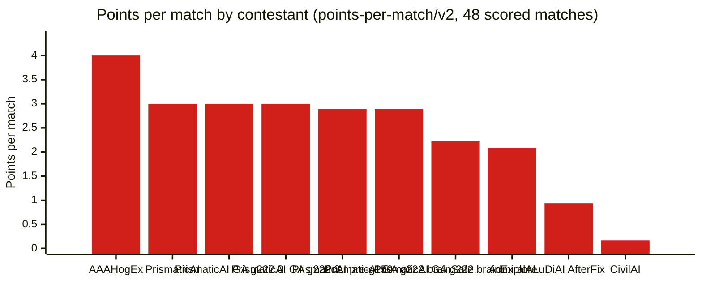
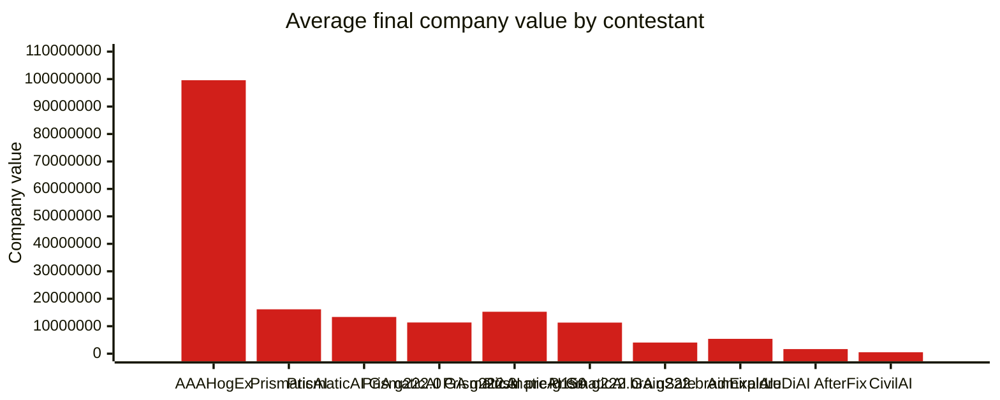
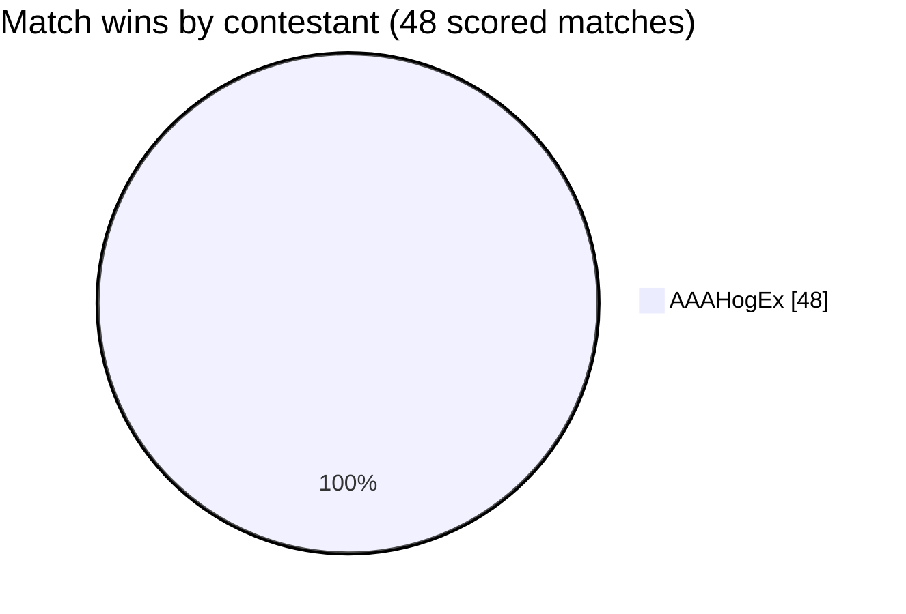
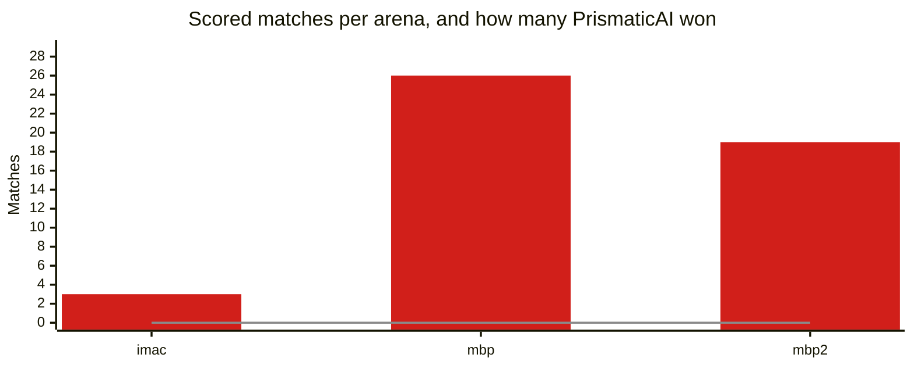

# battle-20261121T033944-c110dc22

Derived from `battle-20261121T033944-c110dc22.json` by `tools/research/ai-battle/battle.py report`; do not edit.

- Edition `c110dc22f26933ee`: PrismaticAI and referee at `962699034c20d90baeb9f617789ea6558cc6ff52`, base set `opengfx-8.0.tar`
- 20-year free-for-all from 1960, map 256x256 temperate, breakdowns 1
- 48 scored match(es) on `imac` (20261119-master-gdf1e05e7d8), `mbp` (20261120-master-m17653b726e), `mbp2` (20261119-master-gdf1e05e7d8)
- Replays: 1 of 2 identical to their original on another arena

| # | Contestant | Played | Wins | Points | Points/match | Avg rank | Avg final value | Squirrel errors | Matches with anomalies |
|---|---|---|---|---|---|---|---|---|---|
| 1 | AAAHogEx | 48 | 48 | 192 | 4.0 | 1.0 | 99.6 M | 0 | 0 |
| 2 | PrismaticAI | 7 | 0 | 21 | 3.0 | 2.0 | 16.2 M | 0 | 0 |
| 3 | PrismaticAI GA g222.0 | 8 | 0 | 24 | 3.0 | 2.0 | 13.4 M | 0 | 5 |
| 4 | PrismaticAI GA g222.3 | 6 | 0 | 18 | 3.0 | 2.0 | 11.4 M | 0 | 1 |
| 5 | PrismaticAI pre-g150 | 9 | 0 | 26 | 2.889 | 2.11 | 15.3 M | 0 | 4 |
| 6 | PrismaticAI GA g222.brainSafe | 9 | 0 | 26 | 2.889 | 2.11 | 11.3 M | 0 | 0 |
| 7 | PrismaticAI GA g222.brainExplore | 9 | 0 | 20 | 2.222 | 2.78 | 4.1 M | 0 | 1 |
| 8 | AdmiralAI | 48 | 0 | 100 | 2.083 | 2.92 | 5.4 M | 0 | 3 |
| 9 | LuDiAI AfterFix | 48 | 0 | 45 | 0.938 | 4.06 | 1.7 M | 0 | 4 |
| 10 | CivilAI | 48 | 0 | 8 | 0.167 | 4.83 | 510.7 k | 3695 | 8 |

```mermaid
---
config:
  xyChart:
    width: 900
    height: 360
  themeVariables:
    xyChart:
      plotColorPalette: "#d11f1a, #8a8a8a, #0b0b0b, #ece4d6"
---
xychart-beta
    title "Final company value per scored match: winner vs best PrismaticAI"
    x-axis ["m-0001", "m-0002", "m-0003", "m-0004", "m-0005", "m-0006", "m-0007", "m-0008", "m-0009", "m-0010", "m-0011", "m-0012", "m-0013", "m-0014", "m-0015", "m-0016", "m-0017", "m-0018", "m-0019", "m-0020", "m-0021", "m-0022", "m-0023", "m-0024", "m-0025", "m-0026", "m-0027", "m-0028", "m-0036", "m-0037", "m-0038", "m-0039", "m-0040", "m-0041", "m-0042", "m-0043", "m-0044", "m-0045", "m-0046", "m-0047", "m-0049", "m-0050", "m-0051", "m-0052", "m-0054", "m-0055", "m-0057", "m-0070"]
    %% series: Winner | Best PrismaticAI
    %% links: battle-20261121T033944-c110dc22.md?col=Match&filter=m-0001 | battle-20261121T033944-c110dc22.md?col=Match&filter=m-0002 | battle-20261121T033944-c110dc22.md?col=Match&filter=m-0003 | battle-20261121T033944-c110dc22.md?col=Match&filter=m-0004 | battle-20261121T033944-c110dc22.md?col=Match&filter=m-0005 | battle-20261121T033944-c110dc22.md?col=Match&filter=m-0006 | battle-20261121T033944-c110dc22.md?col=Match&filter=m-0007 | battle-20261121T033944-c110dc22.md?col=Match&filter=m-0008 | battle-20261121T033944-c110dc22.md?col=Match&filter=m-0009 | battle-20261121T033944-c110dc22.md?col=Match&filter=m-0010 | battle-20261121T033944-c110dc22.md?col=Match&filter=m-0011 | battle-20261121T033944-c110dc22.md?col=Match&filter=m-0012 | battle-20261121T033944-c110dc22.md?col=Match&filter=m-0013 | battle-20261121T033944-c110dc22.md?col=Match&filter=m-0014 | battle-20261121T033944-c110dc22.md?col=Match&filter=m-0015 | battle-20261121T033944-c110dc22.md?col=Match&filter=m-0016 | battle-20261121T033944-c110dc22.md?col=Match&filter=m-0017 | battle-20261121T033944-c110dc22.md?col=Match&filter=m-0018 | battle-20261121T033944-c110dc22.md?col=Match&filter=m-0019 | battle-20261121T033944-c110dc22.md?col=Match&filter=m-0020 | battle-20261121T033944-c110dc22.md?col=Match&filter=m-0021 | battle-20261121T033944-c110dc22.md?col=Match&filter=m-0022 | battle-20261121T033944-c110dc22.md?col=Match&filter=m-0023 | battle-20261121T033944-c110dc22.md?col=Match&filter=m-0024 | battle-20261121T033944-c110dc22.md?col=Match&filter=m-0025 | battle-20261121T033944-c110dc22.md?col=Match&filter=m-0026 | battle-20261121T033944-c110dc22.md?col=Match&filter=m-0027 | battle-20261121T033944-c110dc22.md?col=Match&filter=m-0028 | battle-20261121T033944-c110dc22.md?col=Match&filter=m-0036 | battle-20261121T033944-c110dc22.md?col=Match&filter=m-0037 | battle-20261121T033944-c110dc22.md?col=Match&filter=m-0038 | battle-20261121T033944-c110dc22.md?col=Match&filter=m-0039 | battle-20261121T033944-c110dc22.md?col=Match&filter=m-0040 | battle-20261121T033944-c110dc22.md?col=Match&filter=m-0041 | battle-20261121T033944-c110dc22.md?col=Match&filter=m-0042 | battle-20261121T033944-c110dc22.md?col=Match&filter=m-0043 | battle-20261121T033944-c110dc22.md?col=Match&filter=m-0044 | battle-20261121T033944-c110dc22.md?col=Match&filter=m-0045 | battle-20261121T033944-c110dc22.md?col=Match&filter=m-0046 | battle-20261121T033944-c110dc22.md?col=Match&filter=m-0047 | battle-20261121T033944-c110dc22.md?col=Match&filter=m-0049 | battle-20261121T033944-c110dc22.md?col=Match&filter=m-0050 | battle-20261121T033944-c110dc22.md?col=Match&filter=m-0051 | battle-20261121T033944-c110dc22.md?col=Match&filter=m-0052 | battle-20261121T033944-c110dc22.md?col=Match&filter=m-0054 | battle-20261121T033944-c110dc22.md?col=Match&filter=m-0055 | battle-20261121T033944-c110dc22.md?col=Match&filter=m-0057 | battle-20261121T033944-c110dc22.md?col=Match&filter=m-0070
    y-axis "Company value" 0 --> 171000000
    bar [109654260, 134523058, 97196935, 124406063, 110425169, 121557582, 155403525, 124583342, 103544795, 150656859, 135216154, 135349246, 123387647, 112092078, 116489492, 137185601, 140205557, 99250972, 105039417, 124295656, 96699628, 121556920, 105897488, 75730515, 77472582, 60849590, 75030068, 80061897, 93695664, 86083109, 79545790, 94206807, 76807195, 52610570, 58683717, 58594184, 81071742, 75717361, 65169177, 95049042, 70023124, 117705943, 69748767, 89456110, 90099391, 97171261, 64142976, 110956358]
    line [14188927, 14072369, 13959776, 4019342, 10954380, 18585494, 14615537, 15658271, 10456791, 2350941, 6865963, 17158478, 19704176, 15502604, 13794246, 3486750, 12667547, 17029130, 18693137, 13716946, 8496430, 7937932, 15767223, 20538274, 9843743, 16404535, 6631940, 4503743, 13716691, 15771040, 6146772, 7495704, 2051732, 6214049, 16933636, 17554789, 15963512, 17143132, 5972419, 15682507, 20124003, 9461402, 13660873, 4196134, 9106461, 6891096, 10203317, 1946835]
```

<!-- battle-charts:begin -->
<!-- derived from battle-20261121T033944-c110dc22.json by `battle.py render`; `battle.py check` fails when it is stale -->

<!-- battle-charts:end -->

| Seed | Original | Replay | Arenas | Identical |
|---|---|---|---|---|
| 2082218 | m-0025 | m-0048 | mbp2 / mbp | yes |
| 678449201 | m-0010 | m-0056 | imac / mbp | NO |

| Match | Arena | Seed | Winner | Value | Last | Anomalies |
|---|---|---|---|---|---|---|
| m-0001 | mbp | 626367389 | AAAHogEx | 109.7 M | CivilAI | - |
| m-0002 | mbp | 626367389 | AAAHogEx | 134.5 M | CivilAI | PrismaticAI GA g222.0: fleet_drop:153->41 |
| m-0003 | mbp | 626367389 | AAAHogEx | 97.2 M | CivilAI | CivilAI: squirrel_errors:3695 |
| m-0004 | mbp | 626367389 | AAAHogEx | 124.4 M | CivilAI | - |
| m-0005 | mbp | 626367389 | AAAHogEx | 110.4 M | CivilAI | - |
| m-0006 | mbp | 678449201 | AAAHogEx | 121.6 M | CivilAI | - |
| m-0007 | mbp | 678449201 | AAAHogEx | 155.4 M | CivilAI | PrismaticAI pre-g150: fleet_drop:123->65 |
| m-0008 | mbp | 678449201 | AAAHogEx | 124.6 M | CivilAI | PrismaticAI GA g222.0: fleet_drop:161->90; CivilAI: fleet_drop:17->11 |
| m-0009 | mbp | 678449201 | AAAHogEx | 103.5 M | CivilAI | CivilAI: fleet_drop:37->19 |
| m-0010 | imac | 678449201 | AAAHogEx | 150.7 M | CivilAI | - |
| m-0011 | imac | 678449201 | AAAHogEx | 135.2 M | CivilAI | PrismaticAI GA g222.3: fleet_drop:183->121; AdmiralAI: fleet_drop:196->110 |
| m-0012 | imac | 1177126408 | AAAHogEx | 135.3 M | CivilAI | - |
| m-0013 | mbp2 | 1177126408 | AAAHogEx | 123.4 M | CivilAI | PrismaticAI pre-g150: fleet_drop:99->69 |
| m-0014 | mbp2 | 1177126408 | AAAHogEx | 112.1 M | LuDiAI AfterFix | PrismaticAI GA g222.0: fleet_drop:140->80 |
| m-0015 | mbp2 | 1177126408 | AAAHogEx | 116.5 M | CivilAI | CivilAI: fleet_drop:56->27 |
| m-0016 | mbp2 | 1177126408 | AAAHogEx | 137.2 M | CivilAI | - |
| m-0017 | mbp2 | 1177126408 | AAAHogEx | 140.2 M | CivilAI | - |
| m-0018 | mbp2 | 1409904264 | AAAHogEx | 99.3 M | CivilAI | - |
| m-0019 | mbp2 | 1409904264 | AAAHogEx | 105.0 M | CivilAI | LuDiAI AfterFix: fleet_drop:59->39 |
| m-0020 | mbp2 | 1409904264 | AAAHogEx | 124.3 M | CivilAI | PrismaticAI GA g222.0: fleet_drop:158->85 |
| m-0021 | mbp2 | 1409904264 | AAAHogEx | 96.7 M | CivilAI | - |
| m-0022 | mbp2 | 1409904264 | AAAHogEx | 121.6 M | CivilAI | PrismaticAI GA g222.brainExplore: fleet_drop:134->74 |
| m-0023 | mbp2 | 1409904264 | AAAHogEx | 105.9 M | CivilAI | AdmiralAI: fleet_drop:281->179 |
| m-0024 | mbp2 | 2082218 | AAAHogEx | 75.7 M | CivilAI | CivilAI: fleet_drop:42->11 |
| m-0025 | mbp2 | 2082218 | AAAHogEx | 77.5 M | CivilAI | PrismaticAI pre-g150: fleet_drop:52->25 |
| m-0026 | mbp2 | 2082218 | AAAHogEx | 60.8 M | CivilAI | - |
| m-0027 | mbp2 | 2082218 | AAAHogEx | 75.0 M | CivilAI | - |
| m-0028 | mbp2 | 2082218 | AAAHogEx | 80.1 M | CivilAI | - |
| m-0036 | mbp | 1073972591 | AAAHogEx | 93.7 M | CivilAI | LuDiAI AfterFix: fleet_drop:84->40; CivilAI: fleet_drop:45->18 |
| m-0037 | mbp | 1073972591 | AAAHogEx | 86.1 M | LuDiAI AfterFix | CivilAI: fleet_drop:54->29; LuDiAI AfterFix: fleet_drop:42->20 |
| m-0038 | mbp | 1073972591 | AAAHogEx | 79.5 M | CivilAI | - |
| m-0039 | mbp | 1073972591 | AAAHogEx | 94.2 M | CivilAI | - |
| m-0040 | mbp | 1073972591 | AAAHogEx | 76.8 M | LuDiAI AfterFix | - |
| m-0041 | mbp | 1073972591 | AAAHogEx | 52.6 M | LuDiAI AfterFix | - |
| m-0042 | mbp | 47057752 | AAAHogEx | 58.7 M | CivilAI | AdmiralAI: fleet_drop:216->145 |
| m-0043 | mbp | 47057752 | AAAHogEx | 58.6 M | AdmiralAI | - |
| m-0044 | mbp | 47057752 | AAAHogEx | 81.1 M | CivilAI | CivilAI: fleet_drop:12->4 |
| m-0045 | mbp2 | 47057752 | AAAHogEx | 75.7 M | CivilAI | - |
| m-0046 | mbp | 47057752 | AAAHogEx | 65.2 M | CivilAI | - |
| m-0047 | mbp2 | 47057752 | AAAHogEx | 95.0 M | CivilAI | - |
| m-0048 (replay) | mbp | 2082218 | AAAHogEx | 77.5 M | CivilAI | PrismaticAI pre-g150: fleet_drop:52->25 |
| m-0049 | mbp | 1718957394 | AAAHogEx | 70.0 M | CivilAI | - |
| m-0050 | mbp | 1718957394 | AAAHogEx | 117.7 M | CivilAI | PrismaticAI GA g222.0: fleet_drop:77->40; LuDiAI AfterFix: fleet_drop:56->39 |
| m-0051 | mbp | 1718957394 | AAAHogEx | 69.7 M | CivilAI | - |
| m-0052 | mbp | 1718957394 | AAAHogEx | 89.5 M | CivilAI | - |
| m-0054 | mbp2 | 995624365 | AAAHogEx | 90.1 M | LuDiAI AfterFix | - |
| m-0055 | mbp | 995624365 | AAAHogEx | 97.2 M | LuDiAI AfterFix | PrismaticAI pre-g150: fleet_drop:70->38 |
| m-0056 (replay) | mbp | 678449201 | AAAHogEx | 134.0 M | CivilAI | - |
| m-0057 | mbp | 995624365 | AAAHogEx | 64.1 M | LuDiAI AfterFix | - |
| m-0070 | mbp | 4417460 | AAAHogEx | 111.0 M | CivilAI | - |
