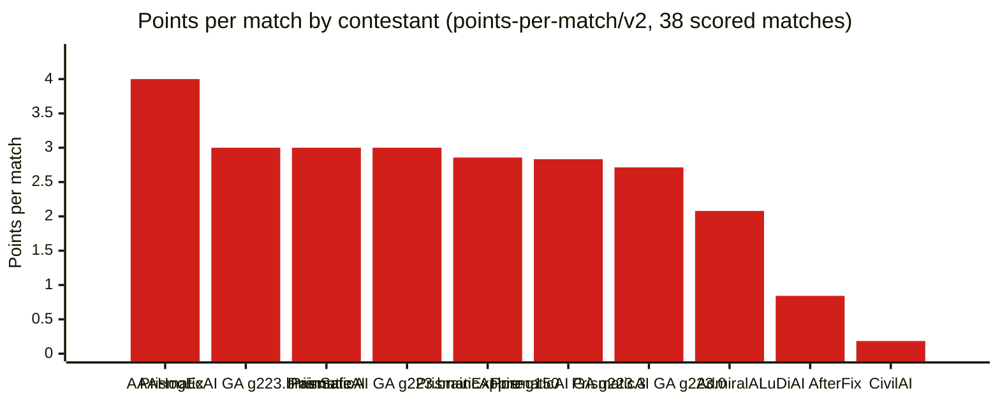
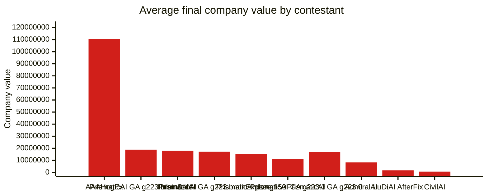
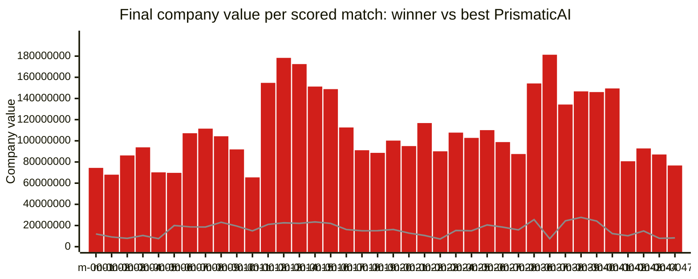
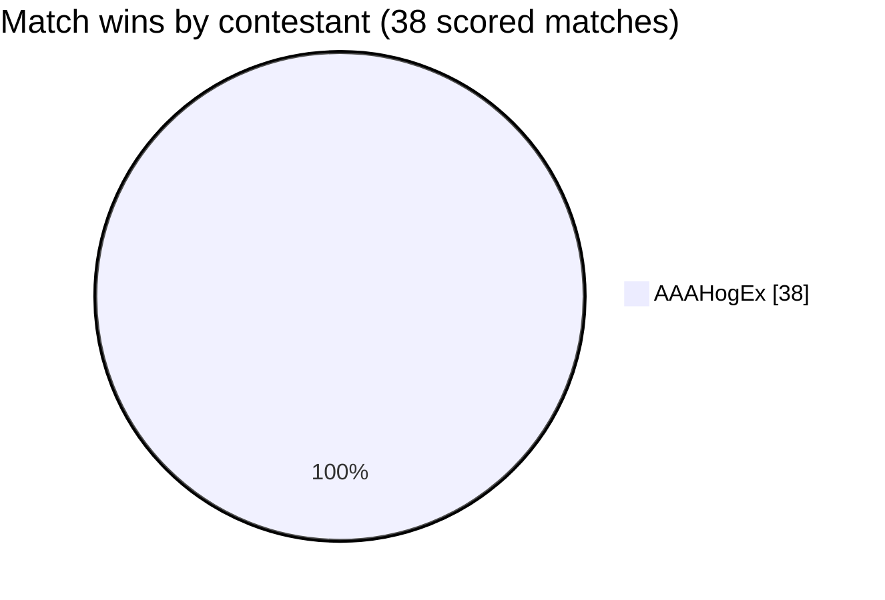
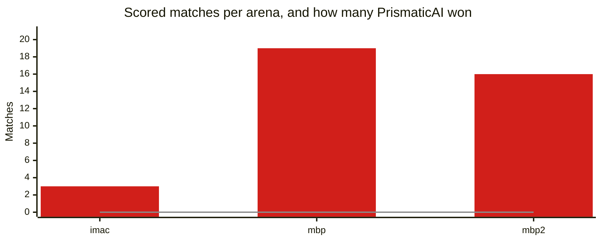

# battle-20261121T035018-fc6a785d

Derived from `battle-20261121T035018-fc6a785d.json` by `tools/research/ai-battle/battle.py report`; do not edit.

- Edition `fc6a785dc49f32b7`: PrismaticAI and referee at `962699034c20d90baeb9f617789ea6558cc6ff52`, base set `opengfx-8.0.tar`
- 20-year free-for-all from 1960, map 256x256 temperate, breakdowns 1
- 38 scored match(es) on `imac` (20261119-master-gdf1e05e7d8), `mbp` (20261120-master-m17653b726e), `mbp2` (20261119-master-gdf1e05e7d8)
- Replays: 0 of 1 identical to their original on another arena

| # | Contestant | Played | Wins | Points | Points/match | Avg rank | Avg final value | Squirrel errors | Matches with anomalies |
|---|---|---|---|---|---|---|---|---|---|
| 1 | AAAHogEx | 38 | 38 | 152 | 4.0 | 1.0 | 110.5 M | 0 | 0 |
| 2 | PrismaticAI GA g223.brainSafe | 6 | 0 | 18 | 3.0 | 2.0 | 18.9 M | 0 | 0 |
| 3 | PrismaticAI | 6 | 0 | 18 | 3.0 | 2.0 | 17.9 M | 0 | 0 |
| 4 | PrismaticAI GA g223.brainExplore | 6 | 0 | 18 | 3.0 | 2.0 | 17.1 M | 0 | 0 |
| 5 | PrismaticAI pre-g150 | 7 | 0 | 20 | 2.857 | 2.14 | 15.1 M | 0 | 1 |
| 6 | PrismaticAI GA g223.3 | 6 | 0 | 17 | 2.833 | 2.17 | 11.1 M | 0 | 1 |
| 7 | PrismaticAI GA g223.0 | 7 | 0 | 19 | 2.714 | 2.29 | 17.0 M | 0 | 3 |
| 8 | AdmiralAI | 38 | 0 | 79 | 2.079 | 2.92 | 8.3 M | 0 | 0 |
| 9 | LuDiAI AfterFix | 38 | 0 | 32 | 0.842 | 4.16 | 1.7 M | 0 | 2 |
| 10 | CivilAI | 38 | 0 | 7 | 0.184 | 4.82 | 657.2 k | 0 | 10 |

<!-- battle-charts:begin -->
<!-- derived from battle-20261121T035018-fc6a785d.json by `battle.py render`; `battle.py check` fails when it is stale -->

<!-- battle-charts:end -->

| Seed | Original | Replay | Arenas | Identical |
|---|---|---|---|---|
| 1457360863 | m-0010 | m-0048 | imac / mbp | NO |

| Match | Arena | Seed | Winner | Value | Last | Anomalies |
|---|---|---|---|---|---|---|
| m-0001 | mbp | 501258654 | AAAHogEx | 74.4 M | CivilAI | - |
| m-0002 | mbp | 501258654 | AAAHogEx | 68.0 M | CivilAI | PrismaticAI GA g223.0: fleet_drop:133->88 |
| m-0003 | mbp | 501258654 | AAAHogEx | 86.2 M | CivilAI | - |
| m-0004 | mbp | 501258654 | AAAHogEx | 93.9 M | CivilAI | - |
| m-0005 | mbp | 501258654 | AAAHogEx | 70.2 M | LuDiAI AfterFix | - |
| m-0006 | mbp | 1457360863 | AAAHogEx | 69.7 M | LuDiAI AfterFix | CivilAI: fleet_drop:65->34 |
| m-0007 | mbp | 1457360863 | AAAHogEx | 107.2 M | CivilAI | - |
| m-0008 | mbp | 1457360863 | AAAHogEx | 111.5 M | LuDiAI AfterFix | CivilAI: fleet_drop:12->7 |
| m-0009 | mbp | 1457360863 | AAAHogEx | 104.3 M | CivilAI | LuDiAI AfterFix: fleet_drop:193->129 |
| m-0010 | imac | 1457360863 | AAAHogEx | 91.9 M | CivilAI | - |
| m-0011 | imac | 1457360863 | AAAHogEx | 65.5 M | CivilAI | - |
| m-0012 | imac | 913456261 | AAAHogEx | 154.7 M | CivilAI | - |
| m-0013 | mbp2 | 913456261 | AAAHogEx | 178.3 M | CivilAI | - |
| m-0014 | mbp2 | 913456261 | AAAHogEx | 172.5 M | CivilAI | - |
| m-0015 | mbp2 | 913456261 | AAAHogEx | 151.3 M | CivilAI | - |
| m-0016 | mbp2 | 913456261 | AAAHogEx | 148.8 M | CivilAI | - |
| m-0017 | mbp2 | 913456261 | AAAHogEx | 112.6 M | CivilAI | - |
| m-0018 | mbp2 | 234167346 | AAAHogEx | 91.1 M | CivilAI | CivilAI: no_vehicles |
| m-0019 | mbp2 | 234167346 | AAAHogEx | 88.6 M | CivilAI | PrismaticAI pre-g150: fleet_drop:65->37; CivilAI: fleet_drop:59->26 |
| m-0020 | mbp2 | 234167346 | AAAHogEx | 100.2 M | CivilAI | PrismaticAI GA g223.0: fleet_drop:130->42 |
| m-0021 | mbp2 | 234167346 | AAAHogEx | 95.0 M | CivilAI | CivilAI: fleet_drop:24->7 |
| m-0022 | mbp2 | 234167346 | AAAHogEx | 116.8 M | CivilAI | CivilAI: no_vehicles |
| m-0023 | mbp2 | 234167346 | AAAHogEx | 90.1 M | CivilAI | PrismaticAI GA g223.3: fleet_drop:114->66 |
| m-0024 | mbp2 | 785112644 | AAAHogEx | 107.7 M | CivilAI | - |
| m-0025 | mbp2 | 785112644 | AAAHogEx | 102.8 M | CivilAI | - |
| m-0026 | mbp2 | 785112644 | AAAHogEx | 110.1 M | CivilAI | PrismaticAI GA g223.0: fleet_drop:98->61; CivilAI: fleet_drop:12->5 |
| m-0027 | mbp2 | 785112644 | AAAHogEx | 98.8 M | CivilAI | CivilAI: fleet_drop:18->11 |
| m-0028 | mbp2 | 785112644 | AAAHogEx | 87.5 M | CivilAI | - |
| m-0036 | mbp | 1080216714 | AAAHogEx | 154.2 M | LuDiAI AfterFix | - |
| m-0037 | mbp | 1080216714 | AAAHogEx | 181.3 M | CivilAI | - |
| m-0038 | mbp | 1080216714 | AAAHogEx | 134.3 M | LuDiAI AfterFix | - |
| m-0039 | mbp | 1080216714 | AAAHogEx | 146.7 M | LuDiAI AfterFix | - |
| m-0040 | mbp | 1080216714 | AAAHogEx | 146.0 M | CivilAI | - |
| m-0041 | mbp | 1080216714 | AAAHogEx | 149.5 M | LuDiAI AfterFix | LuDiAI AfterFix: fleet_drop:16->4 |
| m-0042 | mbp | 235228410 | AAAHogEx | 80.7 M | CivilAI | - |
| m-0043 | mbp | 235228410 | AAAHogEx | 92.8 M | CivilAI | CivilAI: fleet_drop:24->15 |
| m-0044 | mbp | 235228410 | AAAHogEx | 87.1 M | CivilAI | CivilAI: fleet_drop:34->16 |
| m-0047 | mbp | 235228410 | AAAHogEx | 76.7 M | CivilAI | - |
| m-0048 (replay) | mbp | 1457360863 | AAAHogEx | 82.7 M | CivilAI | - |
