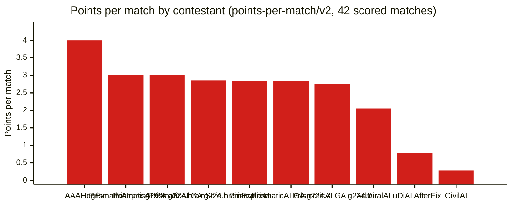
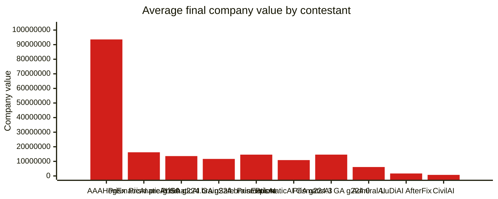
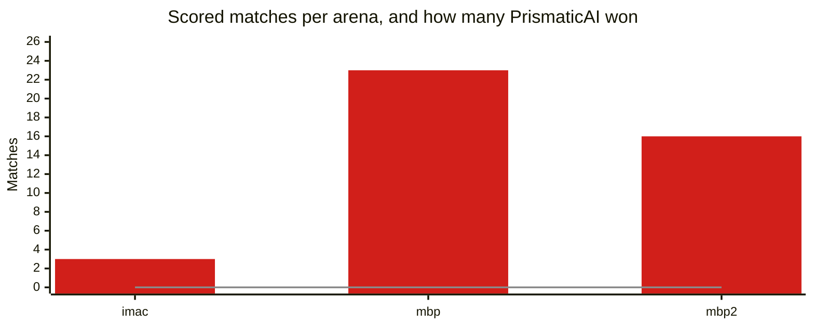

# battle-20261121T040207-3e07b3ca

Derived from `battle-20261121T040207-3e07b3ca.json` by `tools/research/ai-battle/battle.py report`; do not edit.

- Edition `3e07b3ca025f406b`: PrismaticAI and referee at `962699034c20d90baeb9f617789ea6558cc6ff52`, base set `opengfx-8.0.tar`
- 20-year free-for-all from 1960, map 256x256 temperate, breakdowns 1
- 42 scored match(es) on `imac` (20261119-master-gdf1e05e7d8), `mbp` (20261120-master-m17653b726e), `mbp2` (20261119-master-gdf1e05e7d8)
- Replays: 0 of 2 identical to their original on another arena

| # | Contestant | Played | Wins | Points | Points/match | Avg rank | Avg final value | Squirrel errors | Matches with anomalies |
|---|---|---|---|---|---|---|---|---|---|
| 1 | AAAHogEx | 42 | 42 | 168 | 4.0 | 1.0 | 93.6 M | 0 | 0 |
| 2 | PrismaticAI pre-g150 | 8 | 0 | 24 | 3.0 | 2.0 | 16.2 M | 0 | 5 |
| 3 | PrismaticAI GA g224.brainSafe | 7 | 0 | 21 | 3.0 | 2.0 | 13.6 M | 0 | 0 |
| 4 | PrismaticAI GA g224.brainExplore | 7 | 0 | 20 | 2.857 | 2.14 | 11.7 M | 0 | 0 |
| 5 | PrismaticAI | 6 | 0 | 17 | 2.833 | 2.17 | 14.6 M | 0 | 0 |
| 6 | PrismaticAI GA g224.3 | 6 | 0 | 17 | 2.833 | 2.17 | 10.9 M | 0 | 0 |
| 7 | PrismaticAI GA g224.0 | 8 | 0 | 22 | 2.75 | 2.25 | 14.6 M | 0 | 0 |
| 8 | AdmiralAI | 42 | 0 | 86 | 2.048 | 2.95 | 6.1 M | 0 | 2 |
| 9 | LuDiAI AfterFix | 42 | 0 | 33 | 0.786 | 4.21 | 1.7 M | 0 | 0 |
| 10 | CivilAI | 42 | 0 | 12 | 0.286 | 4.71 | 731.9 k | 0 | 6 |

```mermaid
---
config:
  xyChart:
    width: 900
    height: 360
  themeVariables:
    xyChart:
      plotColorPalette: "#d11f1a, #8a8a8a, #0b0b0b, #ece4d6"
---
xychart-beta
    title "Final company value per scored match: winner vs best PrismaticAI"
    x-axis ["m-0001", "m-0002", "m-0003", "m-0004", "m-0005", "m-0006", "m-0007", "m-0008", "m-0009", "m-0010", "m-0011", "m-0012", "m-0013", "m-0014", "m-0015", "m-0016", "m-0017", "m-0018", "m-0019", "m-0020", "m-0021", "m-0022", "m-0023", "m-0024", "m-0025", "m-0026", "m-0027", "m-0028", "m-0036", "m-0037", "m-0038", "m-0039", "m-0040", "m-0041", "m-0042", "m-0043", "m-0044", "m-0045", "m-0046", "m-0047", "m-0049", "m-0050"]
    %% series: Winner | Best PrismaticAI
    %% links: battle-20261121T040207-3e07b3ca.md?col=Match&filter=m-0001 | battle-20261121T040207-3e07b3ca.md?col=Match&filter=m-0002 | battle-20261121T040207-3e07b3ca.md?col=Match&filter=m-0003 | battle-20261121T040207-3e07b3ca.md?col=Match&filter=m-0004 | battle-20261121T040207-3e07b3ca.md?col=Match&filter=m-0005 | battle-20261121T040207-3e07b3ca.md?col=Match&filter=m-0006 | battle-20261121T040207-3e07b3ca.md?col=Match&filter=m-0007 | battle-20261121T040207-3e07b3ca.md?col=Match&filter=m-0008 | battle-20261121T040207-3e07b3ca.md?col=Match&filter=m-0009 | battle-20261121T040207-3e07b3ca.md?col=Match&filter=m-0010 | battle-20261121T040207-3e07b3ca.md?col=Match&filter=m-0011 | battle-20261121T040207-3e07b3ca.md?col=Match&filter=m-0012 | battle-20261121T040207-3e07b3ca.md?col=Match&filter=m-0013 | battle-20261121T040207-3e07b3ca.md?col=Match&filter=m-0014 | battle-20261121T040207-3e07b3ca.md?col=Match&filter=m-0015 | battle-20261121T040207-3e07b3ca.md?col=Match&filter=m-0016 | battle-20261121T040207-3e07b3ca.md?col=Match&filter=m-0017 | battle-20261121T040207-3e07b3ca.md?col=Match&filter=m-0018 | battle-20261121T040207-3e07b3ca.md?col=Match&filter=m-0019 | battle-20261121T040207-3e07b3ca.md?col=Match&filter=m-0020 | battle-20261121T040207-3e07b3ca.md?col=Match&filter=m-0021 | battle-20261121T040207-3e07b3ca.md?col=Match&filter=m-0022 | battle-20261121T040207-3e07b3ca.md?col=Match&filter=m-0023 | battle-20261121T040207-3e07b3ca.md?col=Match&filter=m-0024 | battle-20261121T040207-3e07b3ca.md?col=Match&filter=m-0025 | battle-20261121T040207-3e07b3ca.md?col=Match&filter=m-0026 | battle-20261121T040207-3e07b3ca.md?col=Match&filter=m-0027 | battle-20261121T040207-3e07b3ca.md?col=Match&filter=m-0028 | battle-20261121T040207-3e07b3ca.md?col=Match&filter=m-0036 | battle-20261121T040207-3e07b3ca.md?col=Match&filter=m-0037 | battle-20261121T040207-3e07b3ca.md?col=Match&filter=m-0038 | battle-20261121T040207-3e07b3ca.md?col=Match&filter=m-0039 | battle-20261121T040207-3e07b3ca.md?col=Match&filter=m-0040 | battle-20261121T040207-3e07b3ca.md?col=Match&filter=m-0041 | battle-20261121T040207-3e07b3ca.md?col=Match&filter=m-0042 | battle-20261121T040207-3e07b3ca.md?col=Match&filter=m-0043 | battle-20261121T040207-3e07b3ca.md?col=Match&filter=m-0044 | battle-20261121T040207-3e07b3ca.md?col=Match&filter=m-0045 | battle-20261121T040207-3e07b3ca.md?col=Match&filter=m-0046 | battle-20261121T040207-3e07b3ca.md?col=Match&filter=m-0047 | battle-20261121T040207-3e07b3ca.md?col=Match&filter=m-0049 | battle-20261121T040207-3e07b3ca.md?col=Match&filter=m-0050
    y-axis "Company value" 0 --> 160000000
    bar [80888747, 74359582, 77824980, 78701724, 71943796, 63263906, 67115589, 63095348, 67205727, 54071246, 77233487, 87114858, 124185663, 113576331, 145554191, 111688286, 114013360, 101113954, 76455357, 113201090, 113763857, 88679200, 85158186, 125692090, 111921809, 122041268, 128030813, 110374678, 62197021, 67682707, 82017441, 75612661, 64591182, 80098087, 124240075, 102735370, 109357605, 89684906, 113915855, 114924214, 103391455, 91376806]
    line [16839242, 11533160, 17125328, 11839641, 7334013, 15484999, 11913087, 14451748, 14814309, 9574365, 17468217, 9217196, 18128125, 5371835, 6698138, 9791964, 7297479, 15679748, 13167918, 11498941, 12596414, 14208948, 9450309, 19388488, 30249741, 30107146, 20849479, 16428507, 11303339, 12021279, 7493358, 7088549, 8500215, 9691687, 16554099, 14945071, 13332203, 16152330, 11379145, 13980601, 12518881, 23163914]
```

<!-- battle-charts:begin -->
<!-- derived from battle-20261121T040207-3e07b3ca.json by `battle.py render`; `battle.py check` fails when it is stale -->

<!-- battle-charts:end -->

| Seed | Original | Replay | Arenas | Identical |
|---|---|---|---|---|
| 1038302733 | m-0010 | m-0048 | imac / mbp | NO |
| 1038302733 | m-0011 | m-0056 | imac / mbp | NO |

| Match | Arena | Seed | Winner | Value | Last | Anomalies |
|---|---|---|---|---|---|---|
| m-0001 | mbp | 463671911 | AAAHogEx | 80.9 M | CivilAI | PrismaticAI pre-g150: fleet_drop:99->53 |
| m-0002 | mbp | 463671911 | AAAHogEx | 74.4 M | CivilAI | - |
| m-0003 | mbp | 463671911 | AAAHogEx | 77.8 M | CivilAI | - |
| m-0004 | mbp | 463671911 | AAAHogEx | 78.7 M | CivilAI | - |
| m-0005 | mbp | 463671911 | AAAHogEx | 71.9 M | CivilAI | - |
| m-0006 | mbp | 1038302733 | AAAHogEx | 63.3 M | CivilAI | - |
| m-0007 | mbp | 1038302733 | AAAHogEx | 67.1 M | LuDiAI AfterFix | - |
| m-0008 | mbp | 1038302733 | AAAHogEx | 63.1 M | CivilAI | CivilAI: fleet_drop:21->12 |
| m-0009 | mbp | 1038302733 | AAAHogEx | 67.2 M | LuDiAI AfterFix | - |
| m-0010 | imac | 1038302733 | AAAHogEx | 54.1 M | CivilAI | - |
| m-0011 | imac | 1038302733 | AAAHogEx | 77.2 M | CivilAI | - |
| m-0012 | imac | 875239904 | AAAHogEx | 87.1 M | CivilAI | - |
| m-0013 | mbp2 | 875239904 | AAAHogEx | 124.2 M | CivilAI | - |
| m-0014 | mbp2 | 875239904 | AAAHogEx | 113.6 M | LuDiAI AfterFix | - |
| m-0015 | mbp2 | 875239904 | AAAHogEx | 145.6 M | LuDiAI AfterFix | - |
| m-0016 | mbp2 | 875239904 | AAAHogEx | 111.7 M | LuDiAI AfterFix | - |
| m-0017 | mbp2 | 875239904 | AAAHogEx | 114.0 M | CivilAI | - |
| m-0018 | mbp2 | 450265089 | AAAHogEx | 101.1 M | LuDiAI AfterFix | - |
| m-0019 | mbp2 | 450265089 | AAAHogEx | 76.5 M | CivilAI | PrismaticAI pre-g150: fleet_drop:119->63 |
| m-0020 | mbp2 | 450265089 | AAAHogEx | 113.2 M | CivilAI | CivilAI: fleet_drop:58->34 |
| m-0021 | mbp2 | 450265089 | AAAHogEx | 113.8 M | CivilAI | - |
| m-0022 | mbp2 | 450265089 | AAAHogEx | 88.7 M | CivilAI | - |
| m-0023 | mbp2 | 450265089 | AAAHogEx | 85.2 M | CivilAI | - |
| m-0024 | mbp2 | 174007476 | AAAHogEx | 125.7 M | CivilAI | - |
| m-0025 | mbp2 | 174007476 | AAAHogEx | 111.9 M | CivilAI | PrismaticAI pre-g150: fleet_drop:147->100 |
| m-0026 | mbp2 | 174007476 | AAAHogEx | 122.0 M | CivilAI | - |
| m-0027 | mbp2 | 174007476 | AAAHogEx | 128.0 M | AdmiralAI | - |
| m-0028 | mbp2 | 174007476 | AAAHogEx | 110.4 M | CivilAI | - |
| m-0036 | mbp | 282095482 | AAAHogEx | 62.2 M | LuDiAI AfterFix | - |
| m-0037 | mbp | 282095482 | AAAHogEx | 67.7 M | CivilAI | CivilAI: fleet_drop:12->8 |
| m-0038 | mbp | 282095482 | AAAHogEx | 82.0 M | CivilAI | - |
| m-0039 | mbp | 282095482 | AAAHogEx | 75.6 M | CivilAI | - |
| m-0040 | mbp | 282095482 | AAAHogEx | 64.6 M | LuDiAI AfterFix | - |
| m-0041 | mbp | 282095482 | AAAHogEx | 80.1 M | CivilAI | - |
| m-0042 | mbp | 1984220822 | AAAHogEx | 124.2 M | LuDiAI AfterFix | - |
| m-0043 | mbp | 1984220822 | AAAHogEx | 102.7 M | CivilAI | PrismaticAI pre-g150: fleet_drop:106->70 |
| m-0044 | mbp | 1984220822 | AAAHogEx | 109.4 M | CivilAI | AdmiralAI: fleet_drop:225->157; CivilAI: fleet_drop:23->14 |
| m-0045 | mbp | 1984220822 | AAAHogEx | 89.7 M | LuDiAI AfterFix | - |
| m-0046 | mbp | 1984220822 | AAAHogEx | 113.9 M | CivilAI | CivilAI: fleet_drop:34->17 |
| m-0047 | mbp | 1984220822 | AAAHogEx | 114.9 M | CivilAI | AdmiralAI: fleet_drop:219->139 |
| m-0048 (replay) | mbp | 1038302733 | AAAHogEx | 57.9 M | LuDiAI AfterFix | - |
| m-0049 | mbp | 121491108 | AAAHogEx | 103.4 M | CivilAI | PrismaticAI pre-g150: fleet_drop:57->36; CivilAI: fleet_drop:47->29 |
| m-0050 | mbp | 121491108 | AAAHogEx | 91.4 M | LuDiAI AfterFix | - |
| m-0056 (replay) | mbp | 1038302733 | AAAHogEx | 79.2 M | LuDiAI AfterFix | CivilAI: fleet_drop:19->10 |
