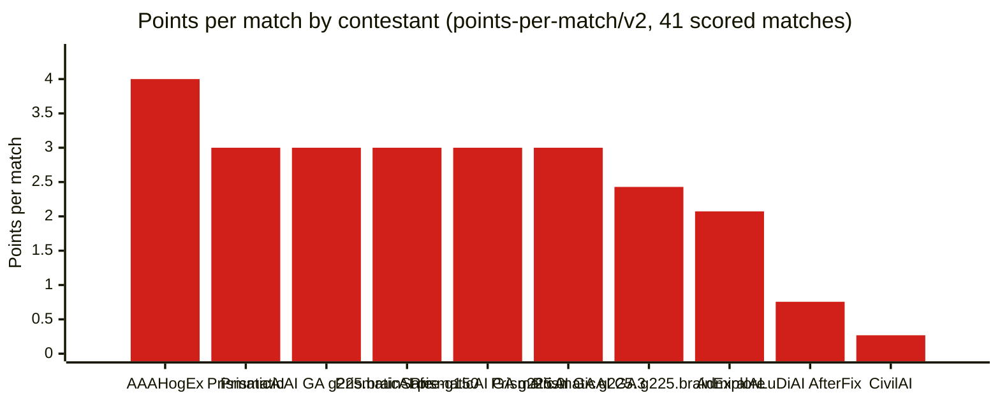
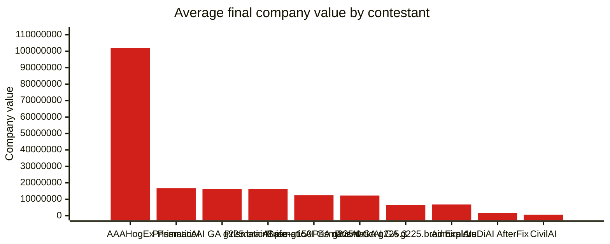
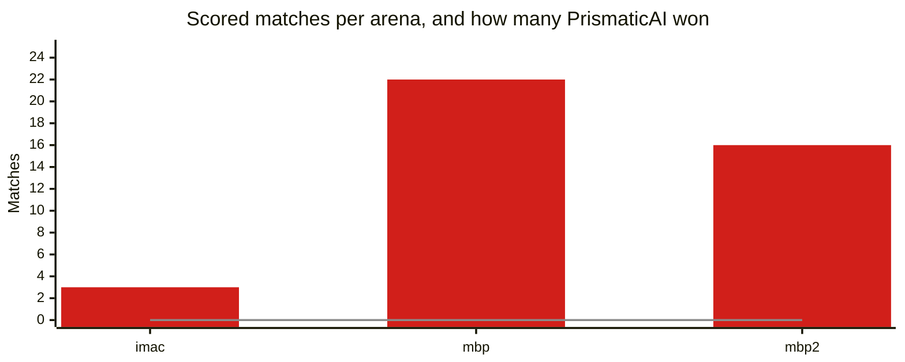

# battle-20261121T041236-666b5f4b

Derived from `battle-20261121T041236-666b5f4b.json` by `tools/research/ai-battle/battle.py report`; do not edit.

- Edition `666b5f4b094a7f7e`: PrismaticAI and referee at `962699034c20d90baeb9f617789ea6558cc6ff52`, base set `opengfx-8.0.tar`
- 20-year free-for-all from 1960, map 256x256 temperate, breakdowns 1
- 41 scored match(es) on `imac` (20261119-master-gdf1e05e7d8), `mbp` (20261120-master-m17653b726e), `mbp2` (20261119-master-gdf1e05e7d8)
- Replays: 1 of 1 identical to their original on another arena

| # | Contestant | Played | Wins | Points | Points/match | Avg rank | Avg final value | Squirrel errors | Matches with anomalies |
|---|---|---|---|---|---|---|---|---|---|
| 1 | AAAHogEx | 41 | 41 | 164 | 4.0 | 1.0 | 102.0 M | 0 | 0 |
| 2 | PrismaticAI | 6 | 0 | 18 | 3.0 | 2.0 | 16.8 M | 0 | 0 |
| 3 | PrismaticAI GA g225.brainSafe | 7 | 0 | 21 | 3.0 | 2.0 | 16.2 M | 0 | 1 |
| 4 | PrismaticAI pre-g150 | 8 | 0 | 24 | 3.0 | 2.0 | 16.1 M | 0 | 3 |
| 5 | PrismaticAI GA g225.0 | 7 | 0 | 21 | 3.0 | 2.0 | 12.5 M | 0 | 1 |
| 6 | PrismaticAI GA g225.3 | 6 | 0 | 18 | 3.0 | 2.0 | 12.3 M | 0 | 0 |
| 7 | PrismaticAI GA g225.brainExplore | 7 | 0 | 17 | 2.429 | 2.57 | 6.6 M | 0 | 3 |
| 8 | AdmiralAI | 41 | 0 | 85 | 2.073 | 2.93 | 6.8 M | 0 | 0 |
| 9 | LuDiAI AfterFix | 41 | 0 | 31 | 0.756 | 4.24 | 1.6 M | 0 | 1 |
| 10 | CivilAI | 41 | 0 | 11 | 0.268 | 4.73 | 595.5 k | 3680 | 9 |

```mermaid
---
config:
  xyChart:
    width: 900
    height: 360
  themeVariables:
    xyChart:
      plotColorPalette: "#d11f1a, #8a8a8a, #0b0b0b, #ece4d6"
---
xychart-beta
    title "Final company value per scored match: winner vs best PrismaticAI"
    x-axis ["m-0001", "m-0002", "m-0003", "m-0004", "m-0005", "m-0006", "m-0007", "m-0008", "m-0009", "m-0010", "m-0011", "m-0012", "m-0013", "m-0014", "m-0015", "m-0016", "m-0017", "m-0018", "m-0019", "m-0020", "m-0021", "m-0022", "m-0023", "m-0024", "m-0025", "m-0026", "m-0027", "m-0028", "m-0036", "m-0037", "m-0038", "m-0039", "m-0040", "m-0041", "m-0042", "m-0043", "m-0044", "m-0045", "m-0046", "m-0047", "m-0049"]
    %% series: Winner | Best PrismaticAI
    %% links: battle-20261121T041236-666b5f4b.md?col=Match&filter=m-0001 | battle-20261121T041236-666b5f4b.md?col=Match&filter=m-0002 | battle-20261121T041236-666b5f4b.md?col=Match&filter=m-0003 | battle-20261121T041236-666b5f4b.md?col=Match&filter=m-0004 | battle-20261121T041236-666b5f4b.md?col=Match&filter=m-0005 | battle-20261121T041236-666b5f4b.md?col=Match&filter=m-0006 | battle-20261121T041236-666b5f4b.md?col=Match&filter=m-0007 | battle-20261121T041236-666b5f4b.md?col=Match&filter=m-0008 | battle-20261121T041236-666b5f4b.md?col=Match&filter=m-0009 | battle-20261121T041236-666b5f4b.md?col=Match&filter=m-0010 | battle-20261121T041236-666b5f4b.md?col=Match&filter=m-0011 | battle-20261121T041236-666b5f4b.md?col=Match&filter=m-0012 | battle-20261121T041236-666b5f4b.md?col=Match&filter=m-0013 | battle-20261121T041236-666b5f4b.md?col=Match&filter=m-0014 | battle-20261121T041236-666b5f4b.md?col=Match&filter=m-0015 | battle-20261121T041236-666b5f4b.md?col=Match&filter=m-0016 | battle-20261121T041236-666b5f4b.md?col=Match&filter=m-0017 | battle-20261121T041236-666b5f4b.md?col=Match&filter=m-0018 | battle-20261121T041236-666b5f4b.md?col=Match&filter=m-0019 | battle-20261121T041236-666b5f4b.md?col=Match&filter=m-0020 | battle-20261121T041236-666b5f4b.md?col=Match&filter=m-0021 | battle-20261121T041236-666b5f4b.md?col=Match&filter=m-0022 | battle-20261121T041236-666b5f4b.md?col=Match&filter=m-0023 | battle-20261121T041236-666b5f4b.md?col=Match&filter=m-0024 | battle-20261121T041236-666b5f4b.md?col=Match&filter=m-0025 | battle-20261121T041236-666b5f4b.md?col=Match&filter=m-0026 | battle-20261121T041236-666b5f4b.md?col=Match&filter=m-0027 | battle-20261121T041236-666b5f4b.md?col=Match&filter=m-0028 | battle-20261121T041236-666b5f4b.md?col=Match&filter=m-0036 | battle-20261121T041236-666b5f4b.md?col=Match&filter=m-0037 | battle-20261121T041236-666b5f4b.md?col=Match&filter=m-0038 | battle-20261121T041236-666b5f4b.md?col=Match&filter=m-0039 | battle-20261121T041236-666b5f4b.md?col=Match&filter=m-0040 | battle-20261121T041236-666b5f4b.md?col=Match&filter=m-0041 | battle-20261121T041236-666b5f4b.md?col=Match&filter=m-0042 | battle-20261121T041236-666b5f4b.md?col=Match&filter=m-0043 | battle-20261121T041236-666b5f4b.md?col=Match&filter=m-0044 | battle-20261121T041236-666b5f4b.md?col=Match&filter=m-0045 | battle-20261121T041236-666b5f4b.md?col=Match&filter=m-0046 | battle-20261121T041236-666b5f4b.md?col=Match&filter=m-0047 | battle-20261121T041236-666b5f4b.md?col=Match&filter=m-0049
    y-axis "Company value" 0 --> 158000000
    bar [84268948, 87882727, 70652928, 106282755, 89162854, 77777954, 82433667, 107487050, 78759616, 98605175, 81174276, 121067324, 102556616, 107304829, 112347369, 106361061, 111970518, 96728604, 134597722, 101379346, 105666712, 138036732, 94865306, 101842654, 85799550, 91290314, 117794572, 116151252, 101156648, 96213841, 115350258, 110870384, 100227081, 109390276, 83212911, 107376537, 83561370, 100045339, 117038619, 104751586, 143411427]
    line [15274423, 10980658, 14270954, 7331391, 7353170, 19726765, 16094004, 10219790, 14305413, 2664770, 13060488, 25170592, 17732925, 14328834, 19163722, 12101591, 14624641, 18543594, 15927370, 12908535, 25240299, 3412081, 13947932, 15639301, 16655134, 15464717, 15481328, 6566055, 15494893, 16307070, 14340844, 9403715, 11028201, 12992854, 6049664, 11183683, 9369103, 15289471, 3209531, 11541097, 19965765]
```

<!-- battle-charts:begin -->
<!-- derived from battle-20261121T041236-666b5f4b.json by `battle.py render`; `battle.py check` fails when it is stale -->

<!-- battle-charts:end -->

| Seed | Original | Replay | Arenas | Identical |
|---|---|---|---|---|
| 164187311 | m-0014 | m-0048 | mbp2 / mbp | yes |

| Match | Arena | Seed | Winner | Value | Last | Anomalies |
|---|---|---|---|---|---|---|
| m-0001 | mbp | 1563590913 | AAAHogEx | 84.3 M | CivilAI | - |
| m-0002 | mbp | 1563590913 | AAAHogEx | 87.9 M | CivilAI | - |
| m-0003 | mbp | 1563590913 | AAAHogEx | 70.7 M | LuDiAI AfterFix | - |
| m-0004 | mbp | 1563590913 | AAAHogEx | 106.3 M | LuDiAI AfterFix | - |
| m-0005 | mbp | 1563590913 | AAAHogEx | 89.2 M | LuDiAI AfterFix | - |
| m-0006 | mbp | 605582999 | AAAHogEx | 77.8 M | CivilAI | CivilAI: fleet_drop:11->6 |
| m-0007 | mbp | 605582999 | AAAHogEx | 82.4 M | CivilAI | PrismaticAI pre-g150: fleet_drop:98->61; CivilAI: squirrel_errors:3680 |
| m-0008 | mbp | 605582999 | AAAHogEx | 107.5 M | CivilAI | PrismaticAI GA g225.0: fleet_drop:80->53 |
| m-0009 | mbp | 605582999 | AAAHogEx | 78.8 M | CivilAI | - |
| m-0010 | imac | 605582999 | AAAHogEx | 98.6 M | CivilAI | - |
| m-0011 | imac | 605582999 | AAAHogEx | 81.2 M | CivilAI | CivilAI: fleet_drop:13->9 |
| m-0012 | imac | 164187311 | AAAHogEx | 121.1 M | CivilAI | - |
| m-0013 | mbp2 | 164187311 | AAAHogEx | 102.6 M | CivilAI | PrismaticAI pre-g150: fleet_drop:81->51; CivilAI: fleet_drop:19->6 |
| m-0014 | mbp2 | 164187311 | AAAHogEx | 107.3 M | CivilAI | - |
| m-0015 | mbp2 | 164187311 | AAAHogEx | 112.3 M | CivilAI | - |
| m-0016 | mbp2 | 164187311 | AAAHogEx | 106.4 M | CivilAI | - |
| m-0017 | mbp2 | 164187311 | AAAHogEx | 112.0 M | CivilAI | - |
| m-0018 | mbp2 | 1466900947 | AAAHogEx | 96.7 M | CivilAI | CivilAI: fleet_drop:42->20 |
| m-0019 | mbp2 | 1466900947 | AAAHogEx | 134.6 M | CivilAI | - |
| m-0020 | mbp2 | 1466900947 | AAAHogEx | 101.4 M | CivilAI | - |
| m-0021 | mbp2 | 1466900947 | AAAHogEx | 105.7 M | CivilAI | - |
| m-0022 | mbp2 | 1466900947 | AAAHogEx | 138.0 M | LuDiAI AfterFix | PrismaticAI GA g225.brainExplore: fleet_drop:45->26 |
| m-0023 | mbp2 | 1466900947 | AAAHogEx | 94.9 M | CivilAI | - |
| m-0024 | mbp2 | 957057637 | AAAHogEx | 101.8 M | LuDiAI AfterFix | - |
| m-0025 | mbp2 | 957057637 | AAAHogEx | 85.8 M | CivilAI | PrismaticAI pre-g150: fleet_drop:91->45; CivilAI: fleet_drop:77->49 |
| m-0026 | mbp2 | 957057637 | AAAHogEx | 91.3 M | CivilAI | - |
| m-0027 | mbp2 | 957057637 | AAAHogEx | 117.8 M | LuDiAI AfterFix | - |
| m-0028 | mbp2 | 957057637 | AAAHogEx | 116.2 M | LuDiAI AfterFix | PrismaticAI GA g225.brainExplore: fleet_drop:43->30; CivilAI: fleet_drop:45->18 |
| m-0036 | mbp | 1133712473 | AAAHogEx | 101.2 M | LuDiAI AfterFix | CivilAI: fleet_drop:52->21 |
| m-0037 | mbp | 1133712473 | AAAHogEx | 96.2 M | CivilAI | - |
| m-0038 | mbp | 1133712473 | AAAHogEx | 115.4 M | LuDiAI AfterFix | - |
| m-0039 | mbp | 1133712473 | AAAHogEx | 110.9 M | CivilAI | - |
| m-0040 | mbp | 1133712473 | AAAHogEx | 100.2 M | CivilAI | - |
| m-0041 | mbp | 1133712473 | AAAHogEx | 109.4 M | LuDiAI AfterFix | LuDiAI AfterFix: fleet_drop:60->36 |
| m-0042 | mbp | 992633529 | AAAHogEx | 83.2 M | CivilAI | - |
| m-0043 | mbp | 992633529 | AAAHogEx | 107.4 M | CivilAI | - |
| m-0044 | mbp | 992633529 | AAAHogEx | 83.6 M | CivilAI | CivilAI: fleet_drop:65->34 |
| m-0045 | mbp | 992633529 | AAAHogEx | 100.0 M | CivilAI | PrismaticAI GA g225.brainSafe: fleet_drop:114->76 |
| m-0046 | mbp | 992633529 | AAAHogEx | 117.0 M | CivilAI | PrismaticAI GA g225.brainExplore: fleet_drop:48->20 |
| m-0047 | mbp | 992633529 | AAAHogEx | 104.8 M | CivilAI | - |
| m-0048 (replay) | mbp | 164187311 | AAAHogEx | 107.3 M | CivilAI | - |
| m-0049 | mbp | 1775125647 | AAAHogEx | 143.4 M | CivilAI | - |
