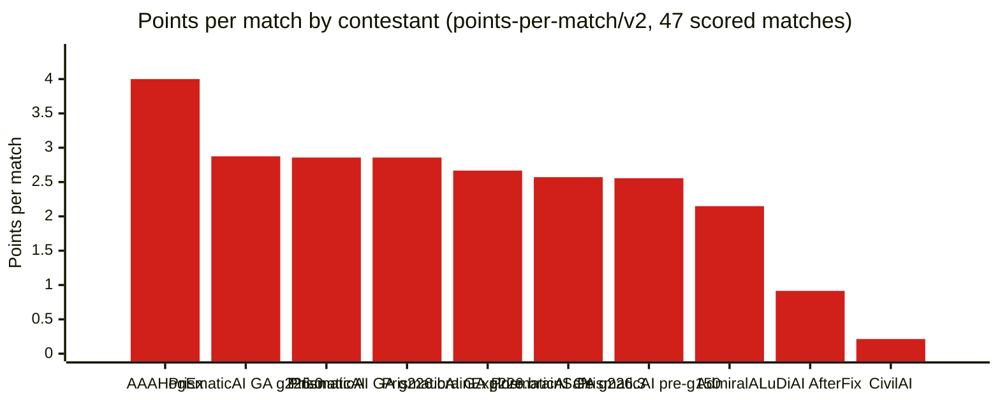
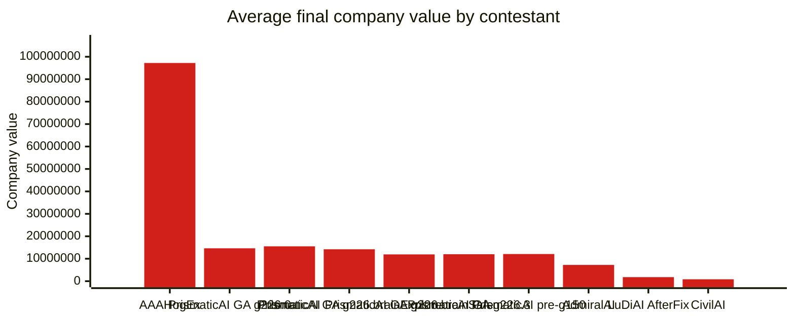
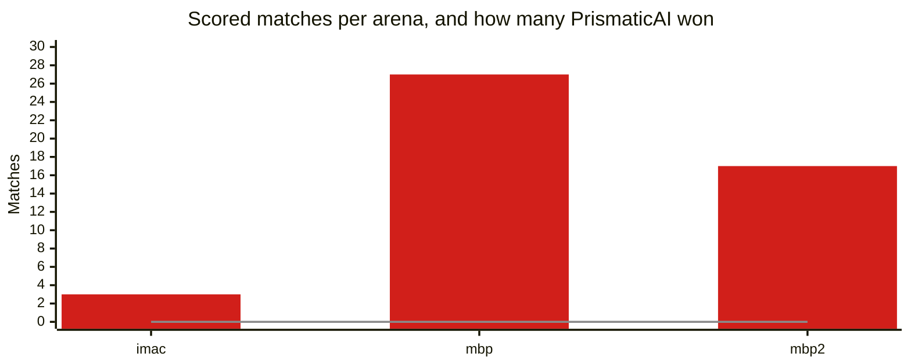

# battle-20261121T042556-ccb7a60f

Derived from `battle-20261121T042556-ccb7a60f.json` by `tools/research/ai-battle/battle.py report`; do not edit.

- Edition `ccb7a60f8483cbbd`: PrismaticAI and referee at `962699034c20d90baeb9f617789ea6558cc6ff52`, base set `opengfx-8.0.tar`
- 20-year free-for-all from 1960, map 256x256 temperate, breakdowns 1
- 47 scored match(es) on `imac` (20261119-master-gdf1e05e7d8), `mbp` (20261120-master-m17653b726e), `mbp2` (20261119-master-gdf1e05e7d8)
- Replays: 0 of 1 identical to their original on another arena

| # | Contestant | Played | Wins | Points | Points/match | Avg rank | Avg final value | Squirrel errors | Matches with anomalies |
|---|---|---|---|---|---|---|---|---|---|
| 1 | AAAHogEx | 47 | 47 | 188 | 4.0 | 1.0 | 97.2 M | 0 | 0 |
| 2 | PrismaticAI GA g226.0 | 8 | 0 | 23 | 2.875 | 2.12 | 14.6 M | 0 | 2 |
| 3 | PrismaticAI | 7 | 0 | 20 | 2.857 | 2.14 | 15.5 M | 0 | 0 |
| 4 | PrismaticAI GA g226.brainExplore | 7 | 0 | 20 | 2.857 | 2.14 | 14.2 M | 0 | 0 |
| 5 | PrismaticAI GA g226.brainSafe | 9 | 0 | 24 | 2.667 | 2.33 | 11.9 M | 0 | 1 |
| 6 | PrismaticAI GA g226.3 | 7 | 0 | 18 | 2.571 | 2.43 | 12.0 M | 0 | 2 |
| 7 | PrismaticAI pre-g150 | 9 | 0 | 23 | 2.556 | 2.44 | 12.1 M | 0 | 6 |
| 8 | AdmiralAI | 47 | 0 | 101 | 2.149 | 2.85 | 7.2 M | 59 | 2 |
| 9 | LuDiAI AfterFix | 47 | 0 | 43 | 0.915 | 4.09 | 1.8 M | 0 | 1 |
| 10 | CivilAI | 47 | 0 | 10 | 0.213 | 4.79 | 843.1 k | 0 | 8 |

```mermaid
---
config:
  xyChart:
    width: 900
    height: 360
  themeVariables:
    xyChart:
      plotColorPalette: "#d11f1a, #8a8a8a, #0b0b0b, #ece4d6"
---
xychart-beta
    title "Final company value per scored match: winner vs best PrismaticAI"
    x-axis ["m-0001", "m-0002", "m-0003", "m-0004", "m-0005", "m-0006", "m-0007", "m-0008", "m-0009", "m-0010", "m-0011", "m-0012", "m-0013", "m-0014", "m-0015", "m-0016", "m-0017", "m-0018", "m-0019", "m-0020", "m-0021", "m-0022", "m-0023", "m-0024", "m-0025", "m-0026", "m-0027", "m-0028", "m-0036", "m-0037", "m-0038", "m-0039", "m-0040", "m-0041", "m-0042", "m-0043", "m-0044", "m-0045", "m-0047", "m-0057", "m-0058", "m-0065", "m-0066", "m-0067", "m-0068", "m-0069", "m-0073"]
    %% series: Winner | Best PrismaticAI
    %% links: battle-20261121T042556-ccb7a60f.md?col=Match&filter=m-0001 | battle-20261121T042556-ccb7a60f.md?col=Match&filter=m-0002 | battle-20261121T042556-ccb7a60f.md?col=Match&filter=m-0003 | battle-20261121T042556-ccb7a60f.md?col=Match&filter=m-0004 | battle-20261121T042556-ccb7a60f.md?col=Match&filter=m-0005 | battle-20261121T042556-ccb7a60f.md?col=Match&filter=m-0006 | battle-20261121T042556-ccb7a60f.md?col=Match&filter=m-0007 | battle-20261121T042556-ccb7a60f.md?col=Match&filter=m-0008 | battle-20261121T042556-ccb7a60f.md?col=Match&filter=m-0009 | battle-20261121T042556-ccb7a60f.md?col=Match&filter=m-0010 | battle-20261121T042556-ccb7a60f.md?col=Match&filter=m-0011 | battle-20261121T042556-ccb7a60f.md?col=Match&filter=m-0012 | battle-20261121T042556-ccb7a60f.md?col=Match&filter=m-0013 | battle-20261121T042556-ccb7a60f.md?col=Match&filter=m-0014 | battle-20261121T042556-ccb7a60f.md?col=Match&filter=m-0015 | battle-20261121T042556-ccb7a60f.md?col=Match&filter=m-0016 | battle-20261121T042556-ccb7a60f.md?col=Match&filter=m-0017 | battle-20261121T042556-ccb7a60f.md?col=Match&filter=m-0018 | battle-20261121T042556-ccb7a60f.md?col=Match&filter=m-0019 | battle-20261121T042556-ccb7a60f.md?col=Match&filter=m-0020 | battle-20261121T042556-ccb7a60f.md?col=Match&filter=m-0021 | battle-20261121T042556-ccb7a60f.md?col=Match&filter=m-0022 | battle-20261121T042556-ccb7a60f.md?col=Match&filter=m-0023 | battle-20261121T042556-ccb7a60f.md?col=Match&filter=m-0024 | battle-20261121T042556-ccb7a60f.md?col=Match&filter=m-0025 | battle-20261121T042556-ccb7a60f.md?col=Match&filter=m-0026 | battle-20261121T042556-ccb7a60f.md?col=Match&filter=m-0027 | battle-20261121T042556-ccb7a60f.md?col=Match&filter=m-0028 | battle-20261121T042556-ccb7a60f.md?col=Match&filter=m-0036 | battle-20261121T042556-ccb7a60f.md?col=Match&filter=m-0037 | battle-20261121T042556-ccb7a60f.md?col=Match&filter=m-0038 | battle-20261121T042556-ccb7a60f.md?col=Match&filter=m-0039 | battle-20261121T042556-ccb7a60f.md?col=Match&filter=m-0040 | battle-20261121T042556-ccb7a60f.md?col=Match&filter=m-0041 | battle-20261121T042556-ccb7a60f.md?col=Match&filter=m-0042 | battle-20261121T042556-ccb7a60f.md?col=Match&filter=m-0043 | battle-20261121T042556-ccb7a60f.md?col=Match&filter=m-0044 | battle-20261121T042556-ccb7a60f.md?col=Match&filter=m-0045 | battle-20261121T042556-ccb7a60f.md?col=Match&filter=m-0047 | battle-20261121T042556-ccb7a60f.md?col=Match&filter=m-0057 | battle-20261121T042556-ccb7a60f.md?col=Match&filter=m-0058 | battle-20261121T042556-ccb7a60f.md?col=Match&filter=m-0065 | battle-20261121T042556-ccb7a60f.md?col=Match&filter=m-0066 | battle-20261121T042556-ccb7a60f.md?col=Match&filter=m-0067 | battle-20261121T042556-ccb7a60f.md?col=Match&filter=m-0068 | battle-20261121T042556-ccb7a60f.md?col=Match&filter=m-0069 | battle-20261121T042556-ccb7a60f.md?col=Match&filter=m-0073
    y-axis "Company value" 0 --> 157000000
    bar [112026237, 116469871, 95773158, 119322358, 102634795, 45588805, 47121702, 41441224, 63358484, 58334483, 80471712, 81656381, 96174471, 92443228, 78355195, 86742553, 81482287, 141086292, 142273628, 130874762, 121383896, 120804138, 133559104, 80745136, 101407849, 90196201, 108951584, 94728774, 90433369, 85592106, 103827725, 102433278, 111957483, 84549563, 86863389, 109377624, 89462220, 83772710, 106577365, 134773582, 129062928, 122114810, 128239865, 85213369, 76094514, 97475944, 76117720]
    line [21876008, 15579001, 14155183, 25494536, 18463664, 20239413, 15794719, 18214175, 12413088, 15782261, 13471908, 14243331, 13219869, 10364051, 10311042, 15538644, 10251482, 10856044, 10343188, 11424525, 10267995, 10585435, 10339785, 19865570, 17214602, 15874822, 13540205, 13257817, 15208591, 14303490, 17756848, 14305378, 9967184, 16441183, 14720821, 1293462, 13673995, 11998539, 1148203, 5025329, 8866642, 13908897, 13532167, 11525889, 14262940, 15342606, 3279155]
```

<!-- battle-charts:begin -->
<!-- derived from battle-20261121T042556-ccb7a60f.json by `battle.py render`; `battle.py check` fails when it is stale -->

<!-- battle-charts:end -->

| Seed | Original | Replay | Arenas | Identical |
|---|---|---|---|---|
| 543933906 | m-0010 | m-0048 | imac / mbp | NO |

| Match | Arena | Seed | Winner | Value | Last | Anomalies |
|---|---|---|---|---|---|---|
| m-0001 | mbp | 632910239 | AAAHogEx | 112.0 M | CivilAI | PrismaticAI pre-g150: fleet_drop:138->72 |
| m-0002 | mbp | 632910239 | AAAHogEx | 116.5 M | CivilAI | - |
| m-0003 | mbp | 632910239 | AAAHogEx | 95.8 M | CivilAI | CivilAI: fleet_drop:56->39 |
| m-0004 | mbp | 632910239 | AAAHogEx | 119.3 M | CivilAI | AdmiralAI: fleet_drop:158->96 |
| m-0005 | mbp | 632910239 | AAAHogEx | 102.6 M | CivilAI | - |
| m-0006 | mbp | 543933906 | AAAHogEx | 45.6 M | LuDiAI AfterFix | - |
| m-0007 | mbp | 543933906 | AAAHogEx | 47.1 M | CivilAI | PrismaticAI pre-g150: fleet_drop:115->66 |
| m-0008 | mbp | 543933906 | AAAHogEx | 41.4 M | CivilAI | LuDiAI AfterFix: fleet_drop:120->82; CivilAI: fleet_drop:49->25 |
| m-0009 | mbp | 543933906 | AAAHogEx | 63.4 M | CivilAI | - |
| m-0010 | imac | 543933906 | AAAHogEx | 58.3 M | LuDiAI AfterFix | - |
| m-0011 | imac | 543933906 | AAAHogEx | 80.5 M | CivilAI | - |
| m-0012 | imac | 643356947 | AAAHogEx | 81.7 M | CivilAI | - |
| m-0013 | mbp2 | 643356947 | AAAHogEx | 96.2 M | LuDiAI AfterFix | - |
| m-0014 | mbp2 | 643356947 | AAAHogEx | 92.4 M | CivilAI | PrismaticAI GA g226.0: fleet_drop:94->63 |
| m-0015 | mbp2 | 643356947 | AAAHogEx | 78.4 M | CivilAI | CivilAI: fleet_drop:37->8 |
| m-0016 | mbp2 | 643356947 | AAAHogEx | 86.7 M | LuDiAI AfterFix | - |
| m-0017 | mbp2 | 643356947 | AAAHogEx | 81.5 M | LuDiAI AfterFix | - |
| m-0018 | mbp2 | 1626592746 | AAAHogEx | 141.1 M | CivilAI | - |
| m-0019 | mbp2 | 1626592746 | AAAHogEx | 142.3 M | CivilAI | PrismaticAI pre-g150: fleet_drop:107->60 |
| m-0020 | mbp2 | 1626592746 | AAAHogEx | 130.9 M | CivilAI | PrismaticAI GA g226.0: fleet_drop:127->87 |
| m-0021 | mbp2 | 1626592746 | AAAHogEx | 121.4 M | CivilAI | - |
| m-0022 | mbp2 | 1626592746 | AAAHogEx | 120.8 M | CivilAI | - |
| m-0023 | mbp2 | 1626592746 | AAAHogEx | 133.6 M | CivilAI | PrismaticAI GA g226.3: fleet_drop:55->37 |
| m-0024 | mbp2 | 26951519 | AAAHogEx | 80.7 M | CivilAI | - |
| m-0025 | mbp2 | 26951519 | AAAHogEx | 101.4 M | CivilAI | PrismaticAI pre-g150: fleet_drop:127->61 |
| m-0026 | mbp2 | 26951519 | AAAHogEx | 90.2 M | CivilAI | - |
| m-0027 | mbp2 | 26951519 | AAAHogEx | 109.0 M | CivilAI | - |
| m-0028 | mbp2 | 26951519 | AAAHogEx | 94.7 M | CivilAI | - |
| m-0036 | mbp | 1147413590 | AAAHogEx | 90.4 M | CivilAI | - |
| m-0037 | mbp | 1147413590 | AAAHogEx | 85.6 M | CivilAI | PrismaticAI pre-g150: fleet_drop:89->49 |
| m-0038 | mbp | 1147413590 | AAAHogEx | 103.8 M | CivilAI | - |
| m-0039 | mbp | 1147413590 | AAAHogEx | 102.4 M | LuDiAI AfterFix | - |
| m-0040 | mbp | 1147413590 | AAAHogEx | 112.0 M | CivilAI | - |
| m-0041 | mbp | 1147413590 | AAAHogEx | 84.5 M | CivilAI | - |
| m-0042 | mbp | 371319927 | AAAHogEx | 86.9 M | CivilAI | AdmiralAI: squirrel_errors:59; CivilAI: fleet_drop:51->31 |
| m-0043 | mbp | 371319927 | AAAHogEx | 109.4 M | PrismaticAI pre-g150 | PrismaticAI pre-g150: fleet_drop:55->28 |
| m-0044 | mbp | 371319927 | AAAHogEx | 89.5 M | CivilAI | - |
| m-0045 | mbp | 371319927 | AAAHogEx | 83.8 M | CivilAI | CivilAI: fleet_drop:36->16 |
| m-0047 | mbp2 | 371319927 | AAAHogEx | 106.6 M | PrismaticAI GA g226.3 | PrismaticAI GA g226.3: fleet_drop:20->13 |
| m-0048 (replay) | mbp | 543933906 | AAAHogEx | 60.4 M | LuDiAI AfterFix | AdmiralAI: fleet_drop:240->124 |
| m-0057 | mbp | 508697659 | AAAHogEx | 134.8 M | CivilAI | PrismaticAI GA g226.brainSafe: fleet_drop:48->31 |
| m-0058 | mbp | 508697659 | AAAHogEx | 129.1 M | LuDiAI AfterFix | - |
| m-0065 | mbp | 509757511 | AAAHogEx | 122.1 M | CivilAI | - |
| m-0066 | mbp | 833779913 | AAAHogEx | 128.2 M | CivilAI | CivilAI: no_vehicles |
| m-0067 | mbp | 833779913 | AAAHogEx | 85.2 M | CivilAI | - |
| m-0068 | mbp | 833779913 | AAAHogEx | 76.1 M | CivilAI | CivilAI: fleet_drop:109->63 |
| m-0069 | mbp | 833779913 | AAAHogEx | 97.5 M | CivilAI | CivilAI: no_vehicles |
| m-0073 | mbp | 3586427 | AAAHogEx | 76.1 M | LuDiAI AfterFix | - |
