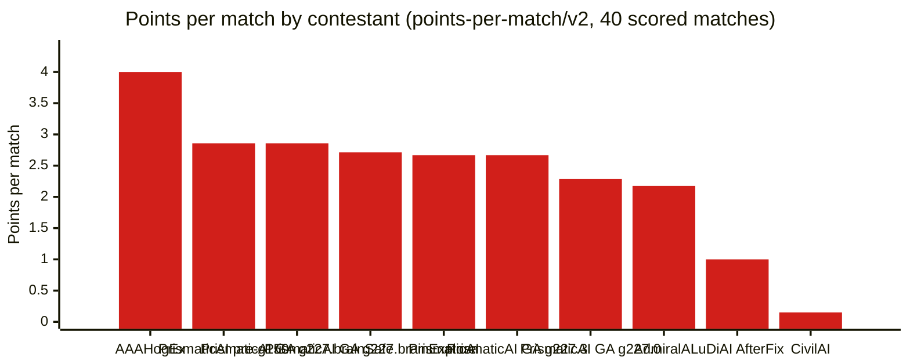
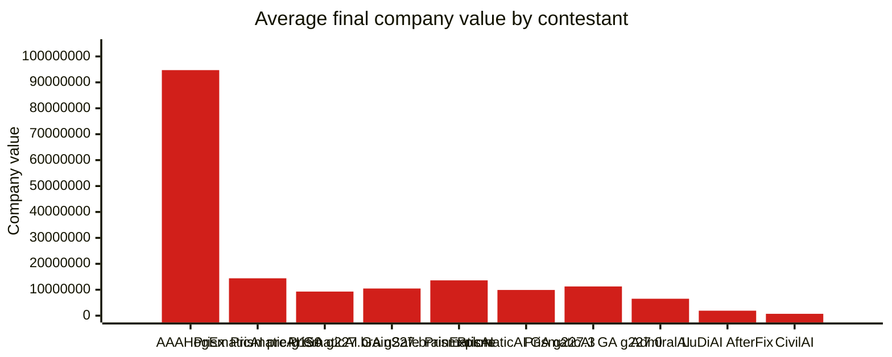
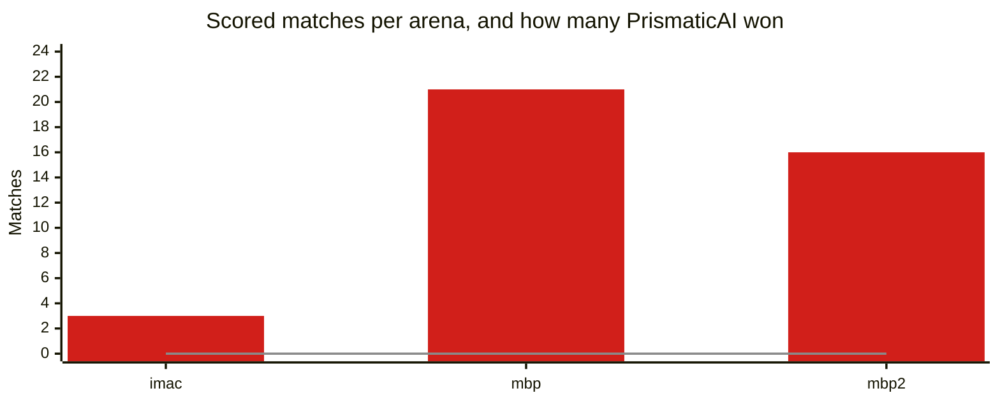

# battle-20261121T043633-2befd3c8

Derived from `battle-20261121T043633-2befd3c8.json` by `tools/research/ai-battle/battle.py report`; do not edit.

- Edition `2befd3c8b0306540`: PrismaticAI and referee at `962699034c20d90baeb9f617789ea6558cc6ff52`, base set `opengfx-8.0.tar`
- 20-year free-for-all from 1960, map 256x256 temperate, breakdowns 1
- 40 scored match(es) on `imac` (20261119-master-gdf1e05e7d8), `mbp` (20261120-master-m17653b726e), `mbp2` (20261119-master-gdf1e05e7d8)
- Replays: 1 of 1 identical to their original on another arena

| # | Contestant | Played | Wins | Points | Points/match | Avg rank | Avg final value | Squirrel errors | Matches with anomalies |
|---|---|---|---|---|---|---|---|---|---|
| 1 | AAAHogEx | 40 | 40 | 160 | 4.0 | 1.0 | 94.7 M | 0 | 0 |
| 2 | PrismaticAI pre-g150 | 7 | 0 | 20 | 2.857 | 2.14 | 14.4 M | 0 | 5 |
| 3 | PrismaticAI GA g227.brainSafe | 7 | 0 | 20 | 2.857 | 2.14 | 9.3 M | 0 | 2 |
| 4 | PrismaticAI GA g227.brainExplore | 7 | 0 | 19 | 2.714 | 2.29 | 10.5 M | 0 | 0 |
| 5 | PrismaticAI | 6 | 0 | 16 | 2.667 | 2.33 | 13.6 M | 0 | 0 |
| 6 | PrismaticAI GA g227.3 | 6 | 0 | 16 | 2.667 | 2.33 | 9.9 M | 0 | 0 |
| 7 | PrismaticAI GA g227.0 | 7 | 0 | 16 | 2.286 | 2.71 | 11.3 M | 0 | 2 |
| 8 | AdmiralAI | 40 | 0 | 87 | 2.175 | 2.83 | 6.5 M | 44 | 1 |
| 9 | LuDiAI AfterFix | 40 | 0 | 40 | 1.0 | 4.0 | 1.9 M | 0 | 4 |
| 10 | CivilAI | 40 | 0 | 6 | 0.15 | 4.85 | 705.8 k | 0 | 10 |

```mermaid
---
config:
  xyChart:
    width: 900
    height: 360
  themeVariables:
    xyChart:
      plotColorPalette: "#d11f1a, #8a8a8a, #0b0b0b, #ece4d6"
---
xychart-beta
    title "Final company value per scored match: winner vs best PrismaticAI"
    x-axis ["m-0001", "m-0002", "m-0003", "m-0004", "m-0005", "m-0006", "m-0007", "m-0008", "m-0009", "m-0010", "m-0011", "m-0012", "m-0013", "m-0014", "m-0015", "m-0016", "m-0017", "m-0018", "m-0019", "m-0020", "m-0021", "m-0022", "m-0023", "m-0024", "m-0025", "m-0026", "m-0027", "m-0028", "m-0036", "m-0037", "m-0038", "m-0039", "m-0040", "m-0041", "m-0042", "m-0043", "m-0044", "m-0045", "m-0046", "m-0047"]
    %% series: Winner | Best PrismaticAI
    %% links: battle-20261121T043633-2befd3c8.md?col=Match&filter=m-0001 | battle-20261121T043633-2befd3c8.md?col=Match&filter=m-0002 | battle-20261121T043633-2befd3c8.md?col=Match&filter=m-0003 | battle-20261121T043633-2befd3c8.md?col=Match&filter=m-0004 | battle-20261121T043633-2befd3c8.md?col=Match&filter=m-0005 | battle-20261121T043633-2befd3c8.md?col=Match&filter=m-0006 | battle-20261121T043633-2befd3c8.md?col=Match&filter=m-0007 | battle-20261121T043633-2befd3c8.md?col=Match&filter=m-0008 | battle-20261121T043633-2befd3c8.md?col=Match&filter=m-0009 | battle-20261121T043633-2befd3c8.md?col=Match&filter=m-0010 | battle-20261121T043633-2befd3c8.md?col=Match&filter=m-0011 | battle-20261121T043633-2befd3c8.md?col=Match&filter=m-0012 | battle-20261121T043633-2befd3c8.md?col=Match&filter=m-0013 | battle-20261121T043633-2befd3c8.md?col=Match&filter=m-0014 | battle-20261121T043633-2befd3c8.md?col=Match&filter=m-0015 | battle-20261121T043633-2befd3c8.md?col=Match&filter=m-0016 | battle-20261121T043633-2befd3c8.md?col=Match&filter=m-0017 | battle-20261121T043633-2befd3c8.md?col=Match&filter=m-0018 | battle-20261121T043633-2befd3c8.md?col=Match&filter=m-0019 | battle-20261121T043633-2befd3c8.md?col=Match&filter=m-0020 | battle-20261121T043633-2befd3c8.md?col=Match&filter=m-0021 | battle-20261121T043633-2befd3c8.md?col=Match&filter=m-0022 | battle-20261121T043633-2befd3c8.md?col=Match&filter=m-0023 | battle-20261121T043633-2befd3c8.md?col=Match&filter=m-0024 | battle-20261121T043633-2befd3c8.md?col=Match&filter=m-0025 | battle-20261121T043633-2befd3c8.md?col=Match&filter=m-0026 | battle-20261121T043633-2befd3c8.md?col=Match&filter=m-0027 | battle-20261121T043633-2befd3c8.md?col=Match&filter=m-0028 | battle-20261121T043633-2befd3c8.md?col=Match&filter=m-0036 | battle-20261121T043633-2befd3c8.md?col=Match&filter=m-0037 | battle-20261121T043633-2befd3c8.md?col=Match&filter=m-0038 | battle-20261121T043633-2befd3c8.md?col=Match&filter=m-0039 | battle-20261121T043633-2befd3c8.md?col=Match&filter=m-0040 | battle-20261121T043633-2befd3c8.md?col=Match&filter=m-0041 | battle-20261121T043633-2befd3c8.md?col=Match&filter=m-0042 | battle-20261121T043633-2befd3c8.md?col=Match&filter=m-0043 | battle-20261121T043633-2befd3c8.md?col=Match&filter=m-0044 | battle-20261121T043633-2befd3c8.md?col=Match&filter=m-0045 | battle-20261121T043633-2befd3c8.md?col=Match&filter=m-0046 | battle-20261121T043633-2befd3c8.md?col=Match&filter=m-0047
    y-axis "Company value" 0 --> 183000000
    bar [95918867, 102357749, 124418847, 96368845, 111021828, 78968686, 70608436, 97724633, 81843420, 70828837, 75182083, 117097469, 84394609, 105267477, 90601228, 106696114, 93008476, 88177164, 72300493, 84839539, 89490399, 97788637, 75442986, 132746127, 131481670, 135763258, 132482317, 166545378, 84322358, 72922084, 74453345, 80259657, 78118387, 70316084, 79772554, 99212292, 88705438, 82890781, 83159703, 85361426]
    line [18499757, 16784136, 8697152, 10010537, 12852788, 8584970, 23020196, 7939229, 4412579, 7240730, 16467040, 24199046, 13505472, 11480122, 9091394, 13657413, 12150201, 11173592, 7249262, 9028534, 14559700, 12614295, 6361140, 19796602, 19501235, 18223762, 15651134, 18865356, 4168716, 5828895, 1, 4598215, 2163752, 6150247, 13757759, 13253444, 15373299, 8013909, 8734963, 5454341]
```

<!-- battle-charts:begin -->
<!-- derived from battle-20261121T043633-2befd3c8.json by `battle.py render`; `battle.py check` fails when it is stale -->

<!-- battle-charts:end -->

| Seed | Original | Replay | Arenas | Identical |
|---|---|---|---|---|
| 1955948131 | m-0017 | m-0048 | mbp2 / mbp | yes |

| Match | Arena | Seed | Winner | Value | Last | Anomalies |
|---|---|---|---|---|---|---|
| m-0001 | mbp | 1638449817 | AAAHogEx | 95.9 M | CivilAI | PrismaticAI pre-g150: fleet_drop:105->72; CivilAI: fleet_drop:45->28 |
| m-0002 | mbp | 1638449817 | AAAHogEx | 102.4 M | CivilAI | PrismaticAI GA g227.0: fleet_drop:85->59 |
| m-0003 | mbp | 1638449817 | AAAHogEx | 124.4 M | CivilAI | PrismaticAI GA g227.brainSafe: fleet_drop:54->35; CivilAI: fleet_drop:30->15 |
| m-0004 | mbp | 1638449817 | AAAHogEx | 96.4 M | CivilAI | - |
| m-0005 | mbp | 1638449817 | AAAHogEx | 111.0 M | CivilAI | CivilAI: fleet_drop:53->32 |
| m-0006 | mbp | 451432241 | AAAHogEx | 79.0 M | CivilAI | - |
| m-0007 | mbp | 451432241 | AAAHogEx | 70.6 M | CivilAI | - |
| m-0008 | mbp | 451432241 | AAAHogEx | 97.7 M | CivilAI | - |
| m-0009 | mbp | 451432241 | AAAHogEx | 81.8 M | CivilAI | LuDiAI AfterFix: fleet_drop:57->30 |
| m-0010 | imac | 451432241 | AAAHogEx | 70.8 M | CivilAI | - |
| m-0011 | imac | 451432241 | AAAHogEx | 75.2 M | CivilAI | - |
| m-0012 | imac | 1955948131 | AAAHogEx | 117.1 M | CivilAI | - |
| m-0013 | mbp2 | 1955948131 | AAAHogEx | 84.4 M | CivilAI | PrismaticAI pre-g150: fleet_drop:118->75; AdmiralAI: squirrel_errors:44; LuDiAI AfterFix: fleet_drop:48->24 |
| m-0014 | mbp2 | 1955948131 | AAAHogEx | 105.3 M | CivilAI | - |
| m-0015 | mbp2 | 1955948131 | AAAHogEx | 90.6 M | LuDiAI AfterFix | - |
| m-0016 | mbp2 | 1955948131 | AAAHogEx | 106.7 M | CivilAI | - |
| m-0017 | mbp2 | 1955948131 | AAAHogEx | 93.0 M | LuDiAI AfterFix | CivilAI: fleet_drop:68->46 |
| m-0018 | mbp2 | 1138799289 | AAAHogEx | 88.2 M | CivilAI | - |
| m-0019 | mbp2 | 1138799289 | AAAHogEx | 72.3 M | CivilAI | CivilAI: fleet_drop:21->12 |
| m-0020 | mbp2 | 1138799289 | AAAHogEx | 84.8 M | CivilAI | PrismaticAI GA g227.0: fleet_drop:83->54 |
| m-0021 | mbp2 | 1138799289 | AAAHogEx | 89.5 M | CivilAI | - |
| m-0022 | mbp2 | 1138799289 | AAAHogEx | 97.8 M | CivilAI | LuDiAI AfterFix: fleet_drop:104->64 |
| m-0023 | mbp2 | 1138799289 | AAAHogEx | 75.4 M | CivilAI | - |
| m-0024 | mbp2 | 1478626351 | AAAHogEx | 132.7 M | CivilAI | CivilAI: fleet_drop:37->23 |
| m-0025 | mbp2 | 1478626351 | AAAHogEx | 131.5 M | CivilAI | PrismaticAI pre-g150: fleet_drop:105->65 |
| m-0026 | mbp2 | 1478626351 | AAAHogEx | 135.8 M | CivilAI | CivilAI: fleet_drop:16->11 |
| m-0027 | mbp2 | 1478626351 | AAAHogEx | 132.5 M | CivilAI | - |
| m-0028 | mbp2 | 1478626351 | AAAHogEx | 166.5 M | CivilAI | - |
| m-0036 | mbp | 446449271 | AAAHogEx | 84.3 M | CivilAI | - |
| m-0037 | mbp | 446449271 | AAAHogEx | 72.9 M | CivilAI | PrismaticAI pre-g150: fleet_drop:67->40 |
| m-0038 | mbp | 446449271 | AAAHogEx | 74.5 M | PrismaticAI GA g227.0 | - |
| m-0039 | mbp | 446449271 | AAAHogEx | 80.3 M | CivilAI | PrismaticAI GA g227.brainSafe: fleet_drop:31->21; CivilAI: fleet_drop:60->41 |
| m-0040 | mbp | 446449271 | AAAHogEx | 78.1 M | CivilAI | - |
| m-0041 | mbp | 446449271 | AAAHogEx | 70.3 M | CivilAI | LuDiAI AfterFix: fleet_drop:74->45; CivilAI: fleet_drop:21->6 |
| m-0042 | mbp | 482331176 | AAAHogEx | 79.8 M | CivilAI | - |
| m-0043 | mbp | 482331176 | AAAHogEx | 99.2 M | LuDiAI AfterFix | PrismaticAI pre-g150: fleet_drop:92->58; CivilAI: fleet_drop:57->28 |
| m-0044 | mbp | 482331176 | AAAHogEx | 88.7 M | LuDiAI AfterFix | - |
| m-0045 | mbp | 482331176 | AAAHogEx | 82.9 M | CivilAI | - |
| m-0046 | mbp | 482331176 | AAAHogEx | 83.2 M | CivilAI | - |
| m-0047 | mbp | 482331176 | AAAHogEx | 85.4 M | LuDiAI AfterFix | - |
| m-0048 (replay) | mbp | 1955948131 | AAAHogEx | 93.0 M | LuDiAI AfterFix | CivilAI: fleet_drop:68->46 |
