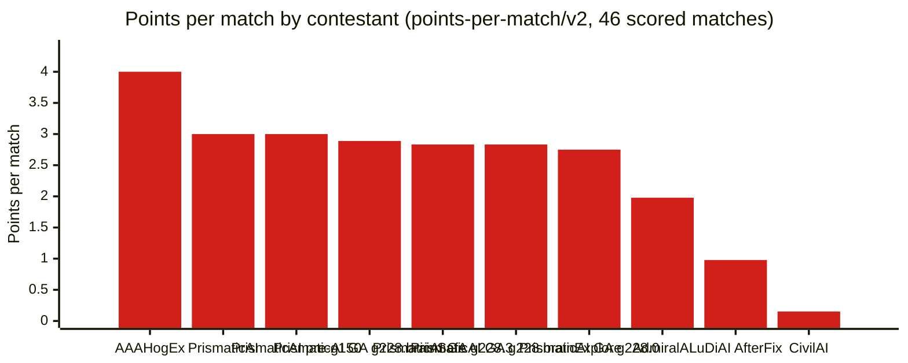
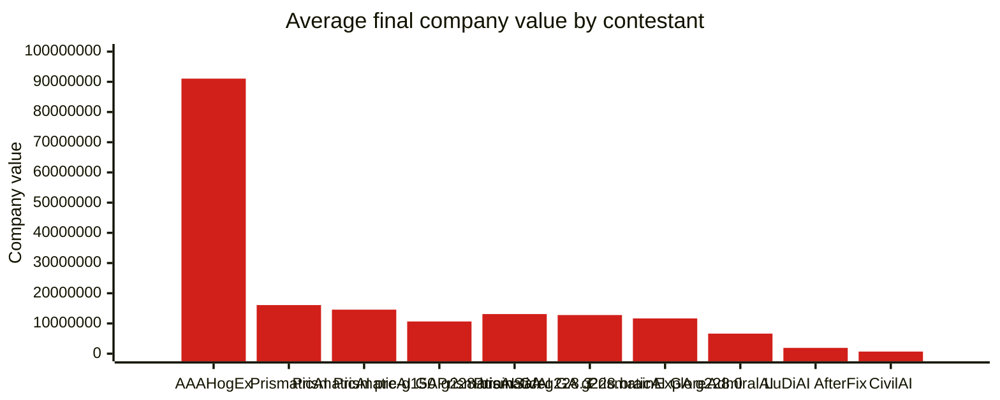
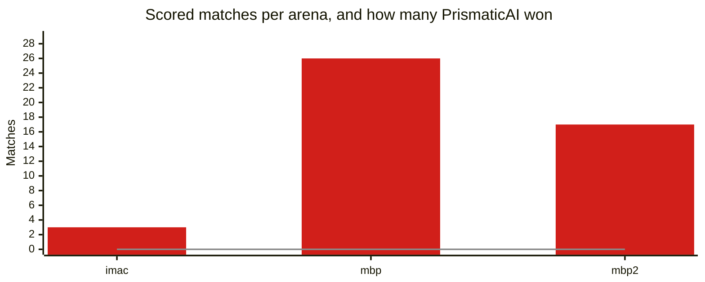

# battle-20261121T045616-00b22e02

Derived from `battle-20261121T045616-00b22e02.json` by `tools/research/ai-battle/battle.py report`; do not edit.

- Edition `00b22e0217e324c5`: PrismaticAI and referee at `52f631b115782334f422f741a79ecabce78e58c4`, base set `opengfx-8.0.tar`
- 20-year free-for-all from 1960, map 256x256 temperate, breakdowns 1
- 46 scored match(es) on `imac` (20261119-master-gdf1e05e7d8), `mbp` (20261120-master-m17653b726e), `mbp2` (20261119-master-gdf1e05e7d8)
- Replays: 0 of 2 identical to their original on another arena

| # | Contestant | Played | Wins | Points | Points/match | Avg rank | Avg final value | Squirrel errors | Matches with anomalies |
|---|---|---|---|---|---|---|---|---|---|
| 1 | AAAHogEx | 46 | 46 | 184 | 4.0 | 1.0 | 91.1 M | 0 | 0 |
| 2 | PrismaticAI | 7 | 0 | 21 | 3.0 | 2.0 | 16.1 M | 0 | 0 |
| 3 | PrismaticAI pre-g150 | 10 | 0 | 30 | 3.0 | 2.0 | 14.6 M | 0 | 4 |
| 4 | PrismaticAI GA g228.brainSafe | 9 | 0 | 26 | 2.889 | 2.11 | 10.7 M | 0 | 0 |
| 5 | PrismaticAI GA g228.3 | 6 | 0 | 17 | 2.833 | 2.17 | 13.1 M | 0 | 0 |
| 6 | PrismaticAI GA g228.brainExplore | 6 | 0 | 17 | 2.833 | 2.17 | 12.8 M | 0 | 0 |
| 7 | PrismaticAI GA g228.0 | 8 | 0 | 22 | 2.75 | 2.25 | 11.7 M | 0 | 1 |
| 8 | AdmiralAI | 46 | 0 | 91 | 1.978 | 3.02 | 6.6 M | 44 | 4 |
| 9 | LuDiAI AfterFix | 46 | 0 | 45 | 0.978 | 4.02 | 1.9 M | 0 | 1 |
| 10 | CivilAI | 46 | 0 | 7 | 0.152 | 4.85 | 692.0 k | 0 | 11 |

```mermaid
---
config:
  xyChart:
    width: 900
    height: 360
  themeVariables:
    xyChart:
      plotColorPalette: "#d11f1a, #8a8a8a, #0b0b0b, #ece4d6"
---
xychart-beta
    title "Final company value per scored match: winner vs best PrismaticAI"
    x-axis ["m-0001", "m-0002", "m-0003", "m-0004", "m-0005", "m-0006", "m-0007", "m-0008", "m-0009", "m-0010", "m-0011", "m-0012", "m-0013", "m-0014", "m-0015", "m-0016", "m-0017", "m-0018", "m-0019", "m-0020", "m-0021", "m-0022", "m-0023", "m-0024", "m-0025", "m-0026", "m-0027", "m-0028", "m-0036", "m-0037", "m-0038", "m-0039", "m-0040", "m-0041", "m-0042", "m-0043", "m-0044", "m-0045", "m-0047", "m-0049", "m-0050", "m-0051", "m-0054", "m-0055", "m-0057", "m-0073"]
    %% series: Winner | Best PrismaticAI
    %% links: battle-20261121T045616-00b22e02.md?col=Match&filter=m-0001 | battle-20261121T045616-00b22e02.md?col=Match&filter=m-0002 | battle-20261121T045616-00b22e02.md?col=Match&filter=m-0003 | battle-20261121T045616-00b22e02.md?col=Match&filter=m-0004 | battle-20261121T045616-00b22e02.md?col=Match&filter=m-0005 | battle-20261121T045616-00b22e02.md?col=Match&filter=m-0006 | battle-20261121T045616-00b22e02.md?col=Match&filter=m-0007 | battle-20261121T045616-00b22e02.md?col=Match&filter=m-0008 | battle-20261121T045616-00b22e02.md?col=Match&filter=m-0009 | battle-20261121T045616-00b22e02.md?col=Match&filter=m-0010 | battle-20261121T045616-00b22e02.md?col=Match&filter=m-0011 | battle-20261121T045616-00b22e02.md?col=Match&filter=m-0012 | battle-20261121T045616-00b22e02.md?col=Match&filter=m-0013 | battle-20261121T045616-00b22e02.md?col=Match&filter=m-0014 | battle-20261121T045616-00b22e02.md?col=Match&filter=m-0015 | battle-20261121T045616-00b22e02.md?col=Match&filter=m-0016 | battle-20261121T045616-00b22e02.md?col=Match&filter=m-0017 | battle-20261121T045616-00b22e02.md?col=Match&filter=m-0018 | battle-20261121T045616-00b22e02.md?col=Match&filter=m-0019 | battle-20261121T045616-00b22e02.md?col=Match&filter=m-0020 | battle-20261121T045616-00b22e02.md?col=Match&filter=m-0021 | battle-20261121T045616-00b22e02.md?col=Match&filter=m-0022 | battle-20261121T045616-00b22e02.md?col=Match&filter=m-0023 | battle-20261121T045616-00b22e02.md?col=Match&filter=m-0024 | battle-20261121T045616-00b22e02.md?col=Match&filter=m-0025 | battle-20261121T045616-00b22e02.md?col=Match&filter=m-0026 | battle-20261121T045616-00b22e02.md?col=Match&filter=m-0027 | battle-20261121T045616-00b22e02.md?col=Match&filter=m-0028 | battle-20261121T045616-00b22e02.md?col=Match&filter=m-0036 | battle-20261121T045616-00b22e02.md?col=Match&filter=m-0037 | battle-20261121T045616-00b22e02.md?col=Match&filter=m-0038 | battle-20261121T045616-00b22e02.md?col=Match&filter=m-0039 | battle-20261121T045616-00b22e02.md?col=Match&filter=m-0040 | battle-20261121T045616-00b22e02.md?col=Match&filter=m-0041 | battle-20261121T045616-00b22e02.md?col=Match&filter=m-0042 | battle-20261121T045616-00b22e02.md?col=Match&filter=m-0043 | battle-20261121T045616-00b22e02.md?col=Match&filter=m-0044 | battle-20261121T045616-00b22e02.md?col=Match&filter=m-0045 | battle-20261121T045616-00b22e02.md?col=Match&filter=m-0047 | battle-20261121T045616-00b22e02.md?col=Match&filter=m-0049 | battle-20261121T045616-00b22e02.md?col=Match&filter=m-0050 | battle-20261121T045616-00b22e02.md?col=Match&filter=m-0051 | battle-20261121T045616-00b22e02.md?col=Match&filter=m-0054 | battle-20261121T045616-00b22e02.md?col=Match&filter=m-0055 | battle-20261121T045616-00b22e02.md?col=Match&filter=m-0057 | battle-20261121T045616-00b22e02.md?col=Match&filter=m-0073
    y-axis "Company value" 0 --> 136000000
    bar [92910526, 100950126, 107452568, 110898833, 112264908, 80878355, 74149494, 84931879, 98853746, 96686501, 85631359, 100560028, 93380549, 96309142, 78233959, 97199652, 85717445, 78623156, 85509424, 91718138, 84917384, 94763619, 94690851, 115922942, 116527589, 93785408, 82764531, 88181113, 84286382, 63147539, 84783942, 65812785, 74743933, 82093857, 86142058, 123802685, 91463631, 94953152, 88971544, 59249263, 73632088, 64452418, 97118597, 105160173, 107160354, 117286879]
    line [24339772, 15989089, 15804037, 16711105, 17925021, 16490943, 13390986, 8808429, 11398801, 10151924, 9989555, 12080784, 12341038, 9335846, 9934095, 10161049, 9778544, 9431100, 8535351, 7407246, 6481867, 7250967, 13190104, 23027368, 18649714, 13270446, 10276870, 9858827, 20940900, 14350595, 16128434, 11645207, 22599761, 17285746, 14196464, 12331712, 9435637, 11467442, 10467729, 15457141, 12970479, 9707250, 16449150, 17565824, 9215281, 8743932]
```

<!-- battle-charts:begin -->
<!-- derived from battle-20261121T045616-00b22e02.json by `battle.py render`; `battle.py check` fails when it is stale -->

<!-- battle-charts:end -->

| Seed | Original | Replay | Arenas | Identical |
|---|---|---|---|---|
| 399653485 | m-0011 | m-0048 | imac / mbp | NO |
| 399653485 | m-0010 | m-0056 | imac / mbp | NO |

| Match | Arena | Seed | Winner | Value | Last | Anomalies |
|---|---|---|---|---|---|---|
| m-0001 | mbp | 1268245017 | AAAHogEx | 92.9 M | CivilAI | PrismaticAI pre-g150: fleet_drop:98->51 |
| m-0002 | mbp | 1268245017 | AAAHogEx | 101.0 M | CivilAI | CivilAI: fleet_drop:28->7 |
| m-0003 | mbp | 1268245017 | AAAHogEx | 107.5 M | CivilAI | - |
| m-0004 | mbp | 1268245017 | AAAHogEx | 110.9 M | CivilAI | CivilAI: fleet_drop:30->9 |
| m-0005 | mbp | 1268245017 | AAAHogEx | 112.3 M | CivilAI | AdmiralAI: squirrel_errors:44 |
| m-0006 | mbp | 399653485 | AAAHogEx | 80.9 M | CivilAI | - |
| m-0007 | mbp | 399653485 | AAAHogEx | 74.1 M | CivilAI | - |
| m-0008 | mbp | 399653485 | AAAHogEx | 84.9 M | CivilAI | - |
| m-0009 | mbp | 399653485 | AAAHogEx | 98.9 M | CivilAI | CivilAI: fleet_drop:71->32 |
| m-0010 | imac | 399653485 | AAAHogEx | 96.7 M | CivilAI | AdmiralAI: fleet_drop:214->145 |
| m-0011 | imac | 399653485 | AAAHogEx | 85.6 M | CivilAI | CivilAI: fleet_drop:23->14 |
| m-0012 | imac | 610538258 | AAAHogEx | 100.6 M | CivilAI | - |
| m-0013 | mbp2 | 610538258 | AAAHogEx | 93.4 M | CivilAI | - |
| m-0014 | mbp2 | 610538258 | AAAHogEx | 96.3 M | CivilAI | - |
| m-0015 | mbp2 | 610538258 | AAAHogEx | 78.2 M | CivilAI | - |
| m-0016 | mbp2 | 610538258 | AAAHogEx | 97.2 M | CivilAI | CivilAI: fleet_drop:87->47 |
| m-0017 | mbp2 | 610538258 | AAAHogEx | 85.7 M | CivilAI | - |
| m-0018 | mbp2 | 1950647750 | AAAHogEx | 78.6 M | CivilAI | - |
| m-0019 | mbp2 | 1950647750 | AAAHogEx | 85.5 M | CivilAI | PrismaticAI pre-g150: fleet_drop:54->27 |
| m-0020 | mbp2 | 1950647750 | AAAHogEx | 91.7 M | CivilAI | - |
| m-0021 | mbp2 | 1950647750 | AAAHogEx | 84.9 M | LuDiAI AfterFix | - |
| m-0022 | mbp2 | 1950647750 | AAAHogEx | 94.8 M | LuDiAI AfterFix | - |
| m-0023 | mbp2 | 1950647750 | AAAHogEx | 94.7 M | LuDiAI AfterFix | - |
| m-0024 | mbp2 | 146234934 | AAAHogEx | 115.9 M | AdmiralAI | - |
| m-0025 | mbp2 | 146234934 | AAAHogEx | 116.5 M | AdmiralAI | - |
| m-0026 | mbp2 | 146234934 | AAAHogEx | 93.8 M | CivilAI | - |
| m-0027 | mbp2 | 146234934 | AAAHogEx | 82.8 M | CivilAI | CivilAI: fleet_drop:41->15 |
| m-0028 | mbp2 | 146234934 | AAAHogEx | 88.2 M | CivilAI | CivilAI: fleet_drop:51->15 |
| m-0036 | mbp | 155001459 | AAAHogEx | 84.3 M | CivilAI | CivilAI: fleet_drop:88->51 |
| m-0037 | mbp | 155001459 | AAAHogEx | 63.1 M | CivilAI | - |
| m-0038 | mbp | 155001459 | AAAHogEx | 84.8 M | CivilAI | - |
| m-0039 | mbp | 155001459 | AAAHogEx | 65.8 M | CivilAI | - |
| m-0040 | mbp | 155001459 | AAAHogEx | 74.7 M | CivilAI | AdmiralAI: fleet_drop:190->114; CivilAI: fleet_drop:21->7 |
| m-0041 | mbp | 155001459 | AAAHogEx | 82.1 M | CivilAI | - |
| m-0042 | mbp | 125302268 | AAAHogEx | 86.1 M | CivilAI | CivilAI: fleet_drop:64->42 |
| m-0043 | mbp | 125302268 | AAAHogEx | 123.8 M | CivilAI | - |
| m-0044 | mbp | 125302268 | AAAHogEx | 91.5 M | CivilAI | PrismaticAI GA g228.0: fleet_drop:41->28 |
| m-0045 | mbp | 125302268 | AAAHogEx | 95.0 M | LuDiAI AfterFix | CivilAI: fleet_drop:15->10; LuDiAI AfterFix: fleet_drop:45->29 |
| m-0047 | mbp2 | 125302268 | AAAHogEx | 89.0 M | CivilAI | - |
| m-0048 (replay) | mbp | 399653485 | AAAHogEx | 84.5 M | CivilAI | - |
| m-0049 | mbp | 1997590409 | AAAHogEx | 59.2 M | CivilAI | - |
| m-0050 | mbp | 1997590409 | AAAHogEx | 73.6 M | CivilAI | - |
| m-0051 | mbp | 1997590409 | AAAHogEx | 64.5 M | CivilAI | - |
| m-0054 | mbp | 1625211693 | AAAHogEx | 97.1 M | CivilAI | - |
| m-0055 | mbp | 1625211693 | AAAHogEx | 105.2 M | CivilAI | PrismaticAI pre-g150: fleet_drop:124->70; AdmiralAI: fleet_drop:499->325 |
| m-0056 (replay) | mbp | 399653485 | AAAHogEx | 99.1 M | CivilAI | - |
| m-0057 | mbp | 1625211693 | AAAHogEx | 107.2 M | CivilAI | - |
| m-0073 | mbp | 681325106 | AAAHogEx | 117.3 M | CivilAI | PrismaticAI pre-g150: fleet_drop:87->53 |
