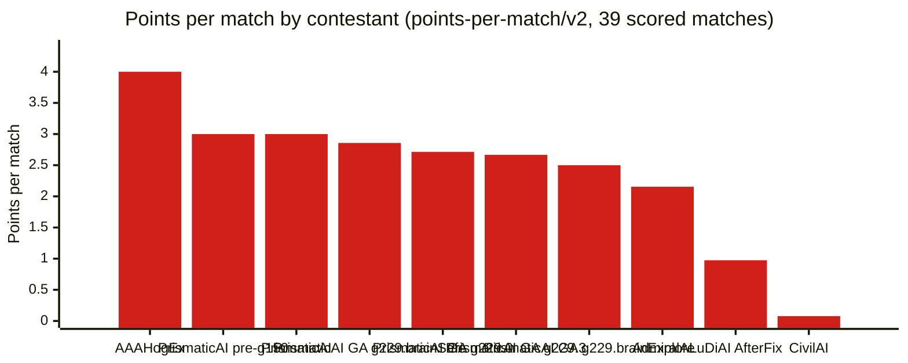
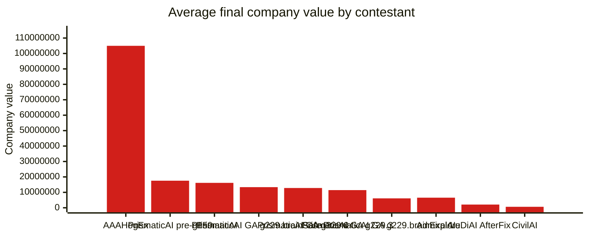
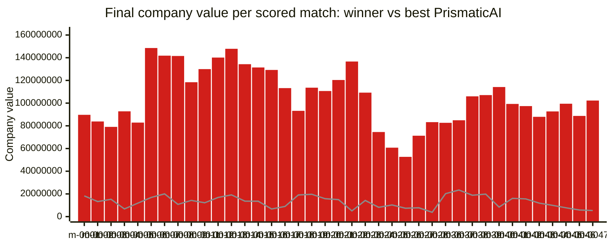
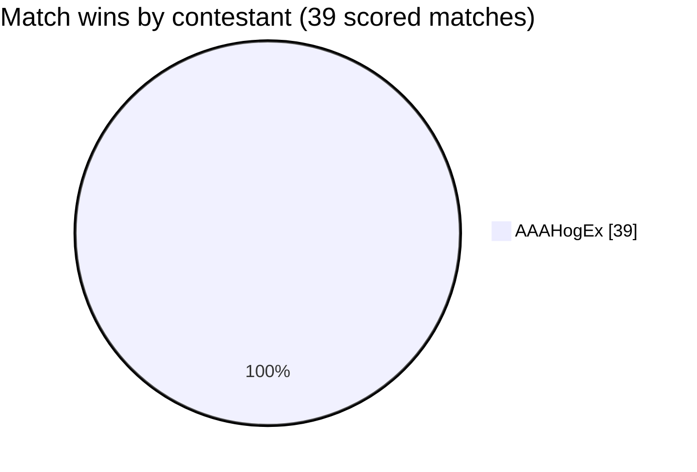
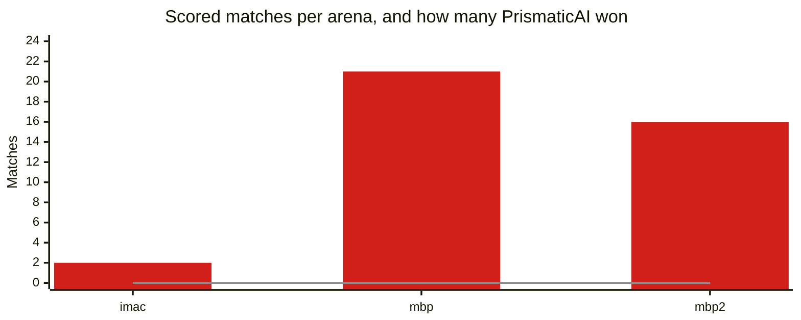

# battle-20261121T050629-9f325211

Derived from `battle-20261121T050629-9f325211.json` by `tools/research/ai-battle/battle.py report`; do not edit.

- Edition `9f325211a04fc20a`: PrismaticAI and referee at `52f631b115782334f422f741a79ecabce78e58c4`, base set `opengfx-8.0.tar`
- 20-year free-for-all from 1960, map 256x256 temperate, breakdowns 1
- 39 scored match(es) on `imac` (20261119-master-gdf1e05e7d8), `mbp` (20261120-master-m17653b726e), `mbp2` (20261119-master-gdf1e05e7d8)
- Replays: 0 of 0 identical to their original on another arena

| # | Contestant | Played | Wins | Points | Points/match | Avg rank | Avg final value | Squirrel errors | Matches with anomalies |
|---|---|---|---|---|---|---|---|---|---|
| 1 | AAAHogEx | 39 | 39 | 156 | 4.0 | 1.0 | 105.0 M | 0 | 0 |
| 2 | PrismaticAI pre-g150 | 7 | 0 | 21 | 3.0 | 2.0 | 17.5 M | 0 | 4 |
| 3 | PrismaticAI | 6 | 0 | 18 | 3.0 | 2.0 | 16.1 M | 0 | 0 |
| 4 | PrismaticAI GA g229.brainSafe | 7 | 0 | 20 | 2.857 | 2.14 | 13.4 M | 0 | 7 |
| 5 | PrismaticAI GA g229.0 | 7 | 0 | 19 | 2.714 | 2.29 | 12.8 M | 0 | 0 |
| 6 | PrismaticAI GA g229.3 | 6 | 0 | 16 | 2.667 | 2.33 | 11.4 M | 0 | 1 |
| 7 | PrismaticAI GA g229.brainExplore | 6 | 0 | 15 | 2.5 | 2.5 | 6.1 M | 0 | 0 |
| 8 | AdmiralAI | 39 | 0 | 84 | 2.154 | 2.85 | 6.5 M | 57 | 3 |
| 9 | LuDiAI AfterFix | 39 | 0 | 38 | 0.974 | 4.03 | 2.1 M | 0 | 0 |
| 10 | CivilAI | 39 | 0 | 3 | 0.077 | 4.92 | 635.8 k | 7315 | 8 |

<!-- battle-charts:begin -->
<!-- derived from battle-20261121T050629-9f325211.json by `battle.py render`; `battle.py check` fails when it is stale -->

<!-- battle-charts:end -->

| Match | Arena | Seed | Winner | Value | Last | Anomalies |
|---|---|---|---|---|---|---|
| m-0001 | mbp | 1229865595 | AAAHogEx | 89.7 M | CivilAI | - |
| m-0002 | mbp | 1229865595 | AAAHogEx | 83.8 M | CivilAI | - |
| m-0003 | mbp | 1229865595 | AAAHogEx | 79.1 M | CivilAI | PrismaticAI GA g229.brainSafe: fleet_drop:176->53 |
| m-0004 | mbp | 1229865595 | AAAHogEx | 92.8 M | CivilAI | - |
| m-0005 | mbp | 1229865595 | AAAHogEx | 82.8 M | CivilAI | AdmiralAI: squirrel_errors:57; CivilAI: fleet_drop:46->25 |
| m-0006 | mbp | 267256670 | AAAHogEx | 148.5 M | CivilAI | - |
| m-0007 | mbp | 267256670 | AAAHogEx | 141.8 M | CivilAI | PrismaticAI pre-g150: fleet_drop:151->79 |
| m-0008 | mbp | 267256670 | AAAHogEx | 141.5 M | CivilAI | - |
| m-0009 | mbp | 267256670 | AAAHogEx | 118.4 M | CivilAI | PrismaticAI GA g229.brainSafe: fleet_drop:199->57; AdmiralAI: fleet_drop:419->245 |
| m-0011 | imac | 267256670 | AAAHogEx | 130.0 M | CivilAI | - |
| m-0012 | imac | 458400898 | AAAHogEx | 140.1 M | CivilAI | - |
| m-0013 | mbp2 | 458400898 | AAAHogEx | 147.9 M | CivilAI | PrismaticAI pre-g150: fleet_drop:129->74 |
| m-0014 | mbp2 | 458400898 | AAAHogEx | 134.3 M | CivilAI | CivilAI: no_vehicles |
| m-0015 | mbp2 | 458400898 | AAAHogEx | 131.4 M | CivilAI | PrismaticAI GA g229.brainSafe: fleet_drop:226->71 |
| m-0016 | mbp2 | 458400898 | AAAHogEx | 129.2 M | CivilAI | - |
| m-0017 | mbp2 | 458400898 | AAAHogEx | 113.2 M | CivilAI | - |
| m-0018 | mbp2 | 1251784181 | AAAHogEx | 93.2 M | LuDiAI AfterFix | - |
| m-0019 | mbp2 | 1251784181 | AAAHogEx | 113.6 M | LuDiAI AfterFix | PrismaticAI pre-g150: fleet_drop:121->74 |
| m-0020 | mbp2 | 1251784181 | AAAHogEx | 110.7 M | CivilAI | - |
| m-0021 | mbp2 | 1251784181 | AAAHogEx | 120.4 M | LuDiAI AfterFix | PrismaticAI GA g229.brainSafe: fleet_drop:120->43 |
| m-0022 | mbp2 | 1251784181 | AAAHogEx | 136.7 M | CivilAI | - |
| m-0023 | mbp2 | 1251784181 | AAAHogEx | 109.2 M | CivilAI | - |
| m-0024 | mbp2 | 1515663253 | AAAHogEx | 74.5 M | CivilAI | CivilAI: fleet_drop:10->6 |
| m-0025 | mbp2 | 1515663253 | AAAHogEx | 60.8 M | CivilAI | - |
| m-0026 | mbp2 | 1515663253 | AAAHogEx | 52.7 M | CivilAI | CivilAI: squirrel_errors:3640, no_vehicles |
| m-0027 | mbp2 | 1515663253 | AAAHogEx | 71.3 M | CivilAI | PrismaticAI GA g229.brainSafe: fleet_drop:91->44; CivilAI: no_vehicles |
| m-0028 | mbp2 | 1515663253 | AAAHogEx | 83.2 M | CivilAI | CivilAI: no_vehicles |
| m-0036 | mbp | 861366551 | AAAHogEx | 82.7 M | CivilAI | - |
| m-0037 | mbp | 861366551 | AAAHogEx | 84.9 M | CivilAI | PrismaticAI pre-g150: fleet_drop:154->72 |
| m-0038 | mbp | 861366551 | AAAHogEx | 106.0 M | CivilAI | - |
| m-0039 | mbp | 861366551 | AAAHogEx | 107.1 M | CivilAI | PrismaticAI GA g229.brainSafe: fleet_drop:162->60 |
| m-0040 | mbp | 861366551 | AAAHogEx | 114.2 M | CivilAI | - |
| m-0041 | mbp | 861366551 | AAAHogEx | 99.3 M | CivilAI | - |
| m-0042 | mbp | 314840347 | AAAHogEx | 97.4 M | CivilAI | - |
| m-0043 | mbp | 314840347 | AAAHogEx | 87.9 M | CivilAI | CivilAI: fleet_drop:44->13 |
| m-0044 | mbp | 314840347 | AAAHogEx | 92.7 M | CivilAI | - |
| m-0045 | mbp | 314840347 | AAAHogEx | 99.5 M | CivilAI | PrismaticAI GA g229.brainSafe: fleet_drop:104->42 |
| m-0046 | mbp | 314840347 | AAAHogEx | 88.7 M | CivilAI | AdmiralAI: fleet_drop:198->134; CivilAI: squirrel_errors:3675 |
| m-0047 | mbp | 314840347 | AAAHogEx | 102.3 M | CivilAI | PrismaticAI GA g229.3: fleet_drop:108->72 |
