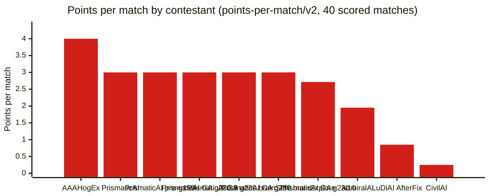
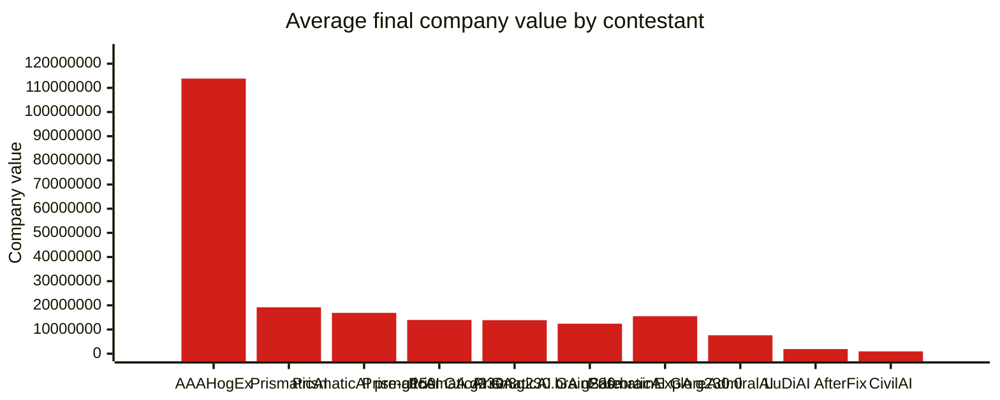
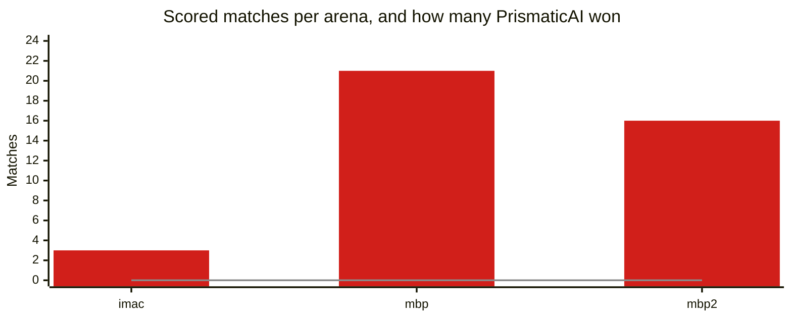

# battle-20261121T051634-45fad41c

Derived from `battle-20261121T051634-45fad41c.json` by `tools/research/ai-battle/battle.py report`; do not edit.

- Edition `45fad41c22037004`: PrismaticAI and referee at `52f631b115782334f422f741a79ecabce78e58c4`, base set `opengfx-8.0.tar`
- 20-year free-for-all from 1960, map 256x256 temperate, breakdowns 1
- 40 scored match(es) on `imac` (20261119-master-gdf1e05e7d8), `mbp` (20261120-master-m17653b726e), `mbp2` (20261119-master-gdf1e05e7d8)
- Replays: 0 of 0 identical to their original on another arena

| # | Contestant | Played | Wins | Points | Points/match | Avg rank | Avg final value | Squirrel errors | Matches with anomalies |
|---|---|---|---|---|---|---|---|---|---|
| 1 | AAAHogEx | 40 | 40 | 160 | 4.0 | 1.0 | 113.8 M | 0 | 0 |
| 2 | PrismaticAI | 6 | 0 | 18 | 3.0 | 2.0 | 19.2 M | 0 | 0 |
| 3 | PrismaticAI pre-g150 | 7 | 0 | 21 | 3.0 | 2.0 | 16.9 M | 0 | 5 |
| 4 | PrismaticAI GA g230.3 | 6 | 0 | 18 | 3.0 | 2.0 | 13.9 M | 0 | 0 |
| 5 | PrismaticAI GA g230.brainSafe | 7 | 0 | 21 | 3.0 | 2.0 | 13.9 M | 0 | 3 |
| 6 | PrismaticAI GA g230.brainExplore | 7 | 0 | 21 | 3.0 | 2.0 | 12.4 M | 0 | 5 |
| 7 | PrismaticAI GA g230.0 | 7 | 0 | 19 | 2.714 | 2.29 | 15.5 M | 0 | 6 |
| 8 | AdmiralAI | 40 | 0 | 78 | 1.95 | 3.05 | 7.6 M | 59 | 4 |
| 9 | LuDiAI AfterFix | 40 | 0 | 34 | 0.85 | 4.15 | 1.9 M | 0 | 0 |
| 10 | CivilAI | 40 | 0 | 10 | 0.25 | 4.75 | 951.2 k | 33 | 7 |

```mermaid
---
config:
  xyChart:
    width: 900
    height: 360
  themeVariables:
    xyChart:
      plotColorPalette: "#d11f1a, #8a8a8a, #0b0b0b, #ece4d6"
---
xychart-beta
    title "Final company value per scored match: winner vs best PrismaticAI"
    x-axis ["m-0001", "m-0002", "m-0003", "m-0004", "m-0005", "m-0006", "m-0007", "m-0008", "m-0009", "m-0010", "m-0011", "m-0012", "m-0013", "m-0014", "m-0015", "m-0016", "m-0017", "m-0018", "m-0019", "m-0020", "m-0021", "m-0022", "m-0023", "m-0024", "m-0025", "m-0026", "m-0027", "m-0028", "m-0036", "m-0037", "m-0038", "m-0039", "m-0040", "m-0041", "m-0042", "m-0043", "m-0044", "m-0045", "m-0046", "m-0047"]
    %% series: Winner | Best PrismaticAI
    %% links: battle-20261121T051634-45fad41c.md?col=Match&filter=m-0001 | battle-20261121T051634-45fad41c.md?col=Match&filter=m-0002 | battle-20261121T051634-45fad41c.md?col=Match&filter=m-0003 | battle-20261121T051634-45fad41c.md?col=Match&filter=m-0004 | battle-20261121T051634-45fad41c.md?col=Match&filter=m-0005 | battle-20261121T051634-45fad41c.md?col=Match&filter=m-0006 | battle-20261121T051634-45fad41c.md?col=Match&filter=m-0007 | battle-20261121T051634-45fad41c.md?col=Match&filter=m-0008 | battle-20261121T051634-45fad41c.md?col=Match&filter=m-0009 | battle-20261121T051634-45fad41c.md?col=Match&filter=m-0010 | battle-20261121T051634-45fad41c.md?col=Match&filter=m-0011 | battle-20261121T051634-45fad41c.md?col=Match&filter=m-0012 | battle-20261121T051634-45fad41c.md?col=Match&filter=m-0013 | battle-20261121T051634-45fad41c.md?col=Match&filter=m-0014 | battle-20261121T051634-45fad41c.md?col=Match&filter=m-0015 | battle-20261121T051634-45fad41c.md?col=Match&filter=m-0016 | battle-20261121T051634-45fad41c.md?col=Match&filter=m-0017 | battle-20261121T051634-45fad41c.md?col=Match&filter=m-0018 | battle-20261121T051634-45fad41c.md?col=Match&filter=m-0019 | battle-20261121T051634-45fad41c.md?col=Match&filter=m-0020 | battle-20261121T051634-45fad41c.md?col=Match&filter=m-0021 | battle-20261121T051634-45fad41c.md?col=Match&filter=m-0022 | battle-20261121T051634-45fad41c.md?col=Match&filter=m-0023 | battle-20261121T051634-45fad41c.md?col=Match&filter=m-0024 | battle-20261121T051634-45fad41c.md?col=Match&filter=m-0025 | battle-20261121T051634-45fad41c.md?col=Match&filter=m-0026 | battle-20261121T051634-45fad41c.md?col=Match&filter=m-0027 | battle-20261121T051634-45fad41c.md?col=Match&filter=m-0028 | battle-20261121T051634-45fad41c.md?col=Match&filter=m-0036 | battle-20261121T051634-45fad41c.md?col=Match&filter=m-0037 | battle-20261121T051634-45fad41c.md?col=Match&filter=m-0038 | battle-20261121T051634-45fad41c.md?col=Match&filter=m-0039 | battle-20261121T051634-45fad41c.md?col=Match&filter=m-0040 | battle-20261121T051634-45fad41c.md?col=Match&filter=m-0041 | battle-20261121T051634-45fad41c.md?col=Match&filter=m-0042 | battle-20261121T051634-45fad41c.md?col=Match&filter=m-0043 | battle-20261121T051634-45fad41c.md?col=Match&filter=m-0044 | battle-20261121T051634-45fad41c.md?col=Match&filter=m-0045 | battle-20261121T051634-45fad41c.md?col=Match&filter=m-0046 | battle-20261121T051634-45fad41c.md?col=Match&filter=m-0047
    y-axis "Company value" 0 --> 178000000
    bar [123674684, 128710731, 113923712, 120030169, 116119699, 72790014, 105028211, 97156150, 107280622, 100438778, 84023107, 115440017, 137230319, 108699859, 131048230, 120861097, 139214355, 105192753, 110668044, 119721232, 96119489, 119885721, 111746399, 86874910, 98712802, 86517685, 88454608, 82055299, 114830684, 127441370, 151988023, 139292601, 161589817, 157834697, 103110899, 110316417, 112683255, 114591333, 110085308, 122143228]
    line [22458135, 20610960, 18390621, 16489272, 12910101, 22262326, 17451225, 18887909, 19192113, 12913067, 14039333, 18704247, 15648034, 19592498, 10700137, 8509079, 14659764, 22475385, 19918250, 14287209, 16926619, 13694413, 21309138, 17004021, 13521738, 16452457, 13093607, 12001419, 17148738, 13296930, 9010775, 8803862, 8937143, 8561374, 17561081, 15898891, 9685330, 9898362, 14209139, 12215292]
```

<!-- battle-charts:begin -->
<!-- derived from battle-20261121T051634-45fad41c.json by `battle.py render`; `battle.py check` fails when it is stale -->

<!-- battle-charts:end -->

| Match | Arena | Seed | Winner | Value | Last | Anomalies |
|---|---|---|---|---|---|---|
| m-0001 | mbp | 113024401 | AAAHogEx | 123.7 M | CivilAI | PrismaticAI pre-g150: fleet_drop:101->67 |
| m-0002 | mbp | 113024401 | AAAHogEx | 128.7 M | CivilAI | PrismaticAI GA g230.0: fleet_drop:176->65 |
| m-0003 | mbp | 113024401 | AAAHogEx | 113.9 M | CivilAI | PrismaticAI GA g230.brainSafe: fleet_drop:126->87 |
| m-0004 | mbp | 113024401 | AAAHogEx | 120.0 M | CivilAI | PrismaticAI GA g230.brainExplore: fleet_drop:111->50 |
| m-0005 | mbp | 113024401 | AAAHogEx | 116.1 M | CivilAI | - |
| m-0006 | mbp | 793163842 | AAAHogEx | 72.8 M | CivilAI | CivilAI: squirrel_errors:33 |
| m-0007 | mbp | 793163842 | AAAHogEx | 105.0 M | CivilAI | - |
| m-0008 | mbp | 793163842 | AAAHogEx | 97.2 M | LuDiAI AfterFix | PrismaticAI GA g230.0: fleet_drop:260->176 |
| m-0009 | mbp | 793163842 | AAAHogEx | 107.3 M | LuDiAI AfterFix | AdmiralAI: fleet_drop:276->191; CivilAI: fleet_drop:14->8 |
| m-0010 | imac | 793163842 | AAAHogEx | 100.4 M | CivilAI | AdmiralAI: squirrel_errors:59 |
| m-0011 | imac | 793163842 | AAAHogEx | 84.0 M | CivilAI | - |
| m-0012 | imac | 513057389 | AAAHogEx | 115.4 M | CivilAI | - |
| m-0013 | mbp2 | 513057389 | AAAHogEx | 137.2 M | AdmiralAI | - |
| m-0014 | mbp2 | 513057389 | AAAHogEx | 108.7 M | LuDiAI AfterFix | - |
| m-0015 | mbp2 | 513057389 | AAAHogEx | 131.0 M | CivilAI | - |
| m-0016 | mbp2 | 513057389 | AAAHogEx | 120.9 M | CivilAI | CivilAI: fleet_drop:170->118 |
| m-0017 | mbp2 | 513057389 | AAAHogEx | 139.2 M | CivilAI | - |
| m-0018 | mbp2 | 1924092819 | AAAHogEx | 105.2 M | CivilAI | CivilAI: fleet_drop:35->19 |
| m-0019 | mbp2 | 1924092819 | AAAHogEx | 110.7 M | LuDiAI AfterFix | PrismaticAI pre-g150: fleet_drop:78->40; CivilAI: fleet_drop:66->35 |
| m-0020 | mbp2 | 1924092819 | AAAHogEx | 119.7 M | CivilAI | PrismaticAI GA g230.0: fleet_drop:134->57 |
| m-0021 | mbp2 | 1924092819 | AAAHogEx | 96.1 M | CivilAI | PrismaticAI GA g230.brainSafe: fleet_drop:228->75 |
| m-0022 | mbp2 | 1924092819 | AAAHogEx | 119.9 M | LuDiAI AfterFix | PrismaticAI GA g230.brainExplore: fleet_drop:137->54 |
| m-0023 | mbp2 | 1924092819 | AAAHogEx | 111.7 M | CivilAI | - |
| m-0024 | mbp2 | 1744713877 | AAAHogEx | 86.9 M | CivilAI | - |
| m-0025 | mbp2 | 1744713877 | AAAHogEx | 98.7 M | CivilAI | PrismaticAI pre-g150: fleet_drop:106->54 |
| m-0026 | mbp2 | 1744713877 | AAAHogEx | 86.5 M | LuDiAI AfterFix | PrismaticAI GA g230.0: fleet_drop:193->61 |
| m-0027 | mbp2 | 1744713877 | AAAHogEx | 88.5 M | LuDiAI AfterFix | PrismaticAI GA g230.brainSafe: fleet_drop:218->70 |
| m-0028 | mbp2 | 1744713877 | AAAHogEx | 82.1 M | CivilAI | PrismaticAI GA g230.brainExplore: fleet_drop:222->97 |
| m-0036 | mbp | 576993512 | AAAHogEx | 114.8 M | CivilAI | - |
| m-0037 | mbp | 576993512 | AAAHogEx | 127.4 M | CivilAI | PrismaticAI pre-g150: fleet_drop:90->54; AdmiralAI: fleet_drop:165->107 |
| m-0038 | mbp | 576993512 | AAAHogEx | 152.0 M | CivilAI | PrismaticAI GA g230.0: fleet_drop:116->74 |
| m-0039 | mbp | 576993512 | AAAHogEx | 139.3 M | CivilAI | AdmiralAI: fleet_drop:210->134 |
| m-0040 | mbp | 576993512 | AAAHogEx | 161.6 M | CivilAI | PrismaticAI GA g230.brainExplore: fleet_drop:218->55 |
| m-0041 | mbp | 576993512 | AAAHogEx | 157.8 M | CivilAI | - |
| m-0042 | mbp | 1526739547 | AAAHogEx | 103.1 M | CivilAI | CivilAI: fleet_drop:30->14 |
| m-0043 | mbp | 1526739547 | AAAHogEx | 110.3 M | CivilAI | PrismaticAI pre-g150: fleet_drop:79->36; CivilAI: fleet_drop:32->16 |
| m-0044 | mbp | 1526739547 | AAAHogEx | 112.7 M | LuDiAI AfterFix | PrismaticAI GA g230.0: fleet_drop:145->45 |
| m-0045 | mbp | 1526739547 | AAAHogEx | 114.6 M | CivilAI | - |
| m-0046 | mbp | 1526739547 | AAAHogEx | 110.1 M | LuDiAI AfterFix | PrismaticAI GA g230.brainExplore: fleet_drop:106->59 |
| m-0047 | mbp | 1526739547 | AAAHogEx | 122.1 M | CivilAI | - |
