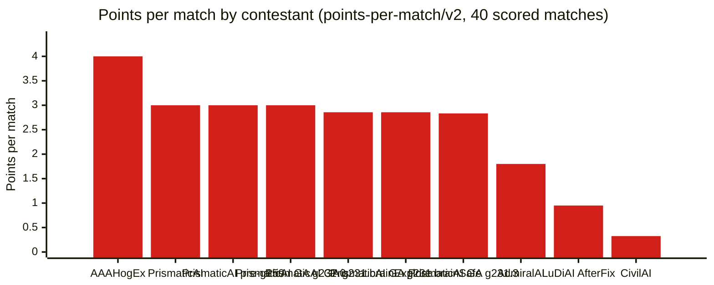
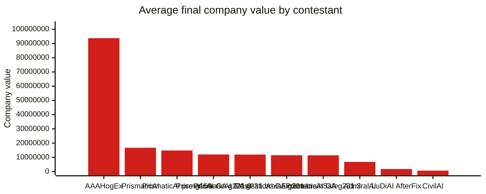
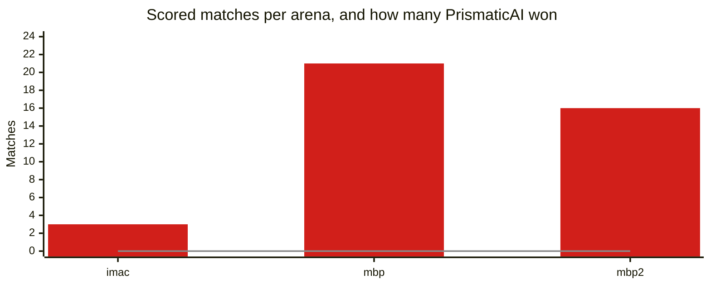

# battle-20261121T052537-0b4dc8e2

Derived from `battle-20261121T052537-0b4dc8e2.json` by `tools/research/ai-battle/battle.py report`; do not edit.

- Edition `0b4dc8e2e1e52f2f`: PrismaticAI and referee at `52f631b115782334f422f741a79ecabce78e58c4`, base set `opengfx-8.0.tar`
- 20-year free-for-all from 1960, map 256x256 temperate, breakdowns 1
- 40 scored match(es) on `imac` (20261119-master-gdf1e05e7d8), `mbp` (20261120-master-m17653b726e), `mbp2` (20261119-master-gdf1e05e7d8)
- Replays: 0 of 0 identical to their original on another arena

| # | Contestant | Played | Wins | Points | Points/match | Avg rank | Avg final value | Squirrel errors | Matches with anomalies |
|---|---|---|---|---|---|---|---|---|---|
| 1 | AAAHogEx | 40 | 40 | 160 | 4.0 | 1.0 | 93.8 M | 0 | 0 |
| 2 | PrismaticAI | 6 | 0 | 18 | 3.0 | 2.0 | 16.7 M | 0 | 0 |
| 3 | PrismaticAI pre-g150 | 7 | 0 | 21 | 3.0 | 2.0 | 14.8 M | 0 | 4 |
| 4 | PrismaticAI GA g231.0 | 7 | 0 | 21 | 3.0 | 2.0 | 12.0 M | 0 | 4 |
| 5 | PrismaticAI GA g231.brainExplore | 7 | 0 | 20 | 2.857 | 2.14 | 11.9 M | 0 | 1 |
| 6 | PrismaticAI GA g231.brainSafe | 7 | 0 | 20 | 2.857 | 2.14 | 11.5 M | 0 | 1 |
| 7 | PrismaticAI GA g231.3 | 6 | 0 | 17 | 2.833 | 2.17 | 11.4 M | 0 | 3 |
| 8 | AdmiralAI | 40 | 0 | 72 | 1.8 | 3.2 | 6.8 M | 0 | 2 |
| 9 | LuDiAI AfterFix | 40 | 0 | 38 | 0.95 | 4.05 | 1.8 M | 0 | 2 |
| 10 | CivilAI | 40 | 0 | 13 | 0.325 | 4.67 | 625.6 k | 0 | 10 |

```mermaid
---
config:
  xyChart:
    width: 900
    height: 360
  themeVariables:
    xyChart:
      plotColorPalette: "#d11f1a, #8a8a8a, #0b0b0b, #ece4d6"
---
xychart-beta
    title "Final company value per scored match: winner vs best PrismaticAI"
    x-axis ["m-0001", "m-0002", "m-0003", "m-0004", "m-0005", "m-0006", "m-0007", "m-0008", "m-0009", "m-0010", "m-0011", "m-0012", "m-0013", "m-0014", "m-0015", "m-0016", "m-0017", "m-0018", "m-0019", "m-0020", "m-0021", "m-0022", "m-0023", "m-0024", "m-0025", "m-0026", "m-0027", "m-0028", "m-0036", "m-0037", "m-0038", "m-0039", "m-0040", "m-0041", "m-0042", "m-0043", "m-0044", "m-0045", "m-0046", "m-0047"]
    %% series: Winner | Best PrismaticAI
    %% links: battle-20261121T052537-0b4dc8e2.md?col=Match&filter=m-0001 | battle-20261121T052537-0b4dc8e2.md?col=Match&filter=m-0002 | battle-20261121T052537-0b4dc8e2.md?col=Match&filter=m-0003 | battle-20261121T052537-0b4dc8e2.md?col=Match&filter=m-0004 | battle-20261121T052537-0b4dc8e2.md?col=Match&filter=m-0005 | battle-20261121T052537-0b4dc8e2.md?col=Match&filter=m-0006 | battle-20261121T052537-0b4dc8e2.md?col=Match&filter=m-0007 | battle-20261121T052537-0b4dc8e2.md?col=Match&filter=m-0008 | battle-20261121T052537-0b4dc8e2.md?col=Match&filter=m-0009 | battle-20261121T052537-0b4dc8e2.md?col=Match&filter=m-0010 | battle-20261121T052537-0b4dc8e2.md?col=Match&filter=m-0011 | battle-20261121T052537-0b4dc8e2.md?col=Match&filter=m-0012 | battle-20261121T052537-0b4dc8e2.md?col=Match&filter=m-0013 | battle-20261121T052537-0b4dc8e2.md?col=Match&filter=m-0014 | battle-20261121T052537-0b4dc8e2.md?col=Match&filter=m-0015 | battle-20261121T052537-0b4dc8e2.md?col=Match&filter=m-0016 | battle-20261121T052537-0b4dc8e2.md?col=Match&filter=m-0017 | battle-20261121T052537-0b4dc8e2.md?col=Match&filter=m-0018 | battle-20261121T052537-0b4dc8e2.md?col=Match&filter=m-0019 | battle-20261121T052537-0b4dc8e2.md?col=Match&filter=m-0020 | battle-20261121T052537-0b4dc8e2.md?col=Match&filter=m-0021 | battle-20261121T052537-0b4dc8e2.md?col=Match&filter=m-0022 | battle-20261121T052537-0b4dc8e2.md?col=Match&filter=m-0023 | battle-20261121T052537-0b4dc8e2.md?col=Match&filter=m-0024 | battle-20261121T052537-0b4dc8e2.md?col=Match&filter=m-0025 | battle-20261121T052537-0b4dc8e2.md?col=Match&filter=m-0026 | battle-20261121T052537-0b4dc8e2.md?col=Match&filter=m-0027 | battle-20261121T052537-0b4dc8e2.md?col=Match&filter=m-0028 | battle-20261121T052537-0b4dc8e2.md?col=Match&filter=m-0036 | battle-20261121T052537-0b4dc8e2.md?col=Match&filter=m-0037 | battle-20261121T052537-0b4dc8e2.md?col=Match&filter=m-0038 | battle-20261121T052537-0b4dc8e2.md?col=Match&filter=m-0039 | battle-20261121T052537-0b4dc8e2.md?col=Match&filter=m-0040 | battle-20261121T052537-0b4dc8e2.md?col=Match&filter=m-0041 | battle-20261121T052537-0b4dc8e2.md?col=Match&filter=m-0042 | battle-20261121T052537-0b4dc8e2.md?col=Match&filter=m-0043 | battle-20261121T052537-0b4dc8e2.md?col=Match&filter=m-0044 | battle-20261121T052537-0b4dc8e2.md?col=Match&filter=m-0045 | battle-20261121T052537-0b4dc8e2.md?col=Match&filter=m-0046 | battle-20261121T052537-0b4dc8e2.md?col=Match&filter=m-0047
    y-axis "Company value" 0 --> 136000000
    bar [77952163, 100419855, 95459973, 95459973, 103144077, 81510485, 84471502, 108101102, 106186560, 98672046, 104798053, 116098639, 113647817, 113267522, 123511661, 115753426, 102531427, 95815024, 110052197, 83531278, 79240310, 79859535, 87570204, 88647477, 99905648, 94988646, 102021187, 108208312, 67791815, 75361475, 78044617, 85867044, 80101602, 76881736, 55034844, 81521228, 91845353, 96716593, 95889339, 95305047]
    line [25532745, 18882437, 23572555, 23572555, 18215200, 15578416, 10328135, 11599348, 9517005, 10103251, 8625461, 10465716, 14354043, 10602716, 10184314, 9891456, 11560692, 17507234, 14252411, 12163518, 7892689, 7844014, 12512201, 23467829, 14596564, 12232918, 13938150, 14427431, 18740383, 11965006, 11087085, 8888447, 11485770, 9886450, 14552541, 12598837, 7310463, 6245422, 6102006, 7515566]
```

<!-- battle-charts:begin -->
<!-- derived from battle-20261121T052537-0b4dc8e2.json by `battle.py render`; `battle.py check` fails when it is stale -->

<!-- battle-charts:end -->

| Match | Arena | Seed | Winner | Value | Last | Anomalies |
|---|---|---|---|---|---|---|
| m-0001 | mbp | 1524149411 | AAAHogEx | 78.0 M | CivilAI | PrismaticAI pre-g150: fleet_drop:125->59 |
| m-0002 | mbp | 1524149411 | AAAHogEx | 100.4 M | CivilAI | PrismaticAI GA g231.0: fleet_drop:241->75 |
| m-0003 | mbp | 1524149411 | AAAHogEx | 95.5 M | CivilAI | - |
| m-0004 | mbp | 1524149411 | AAAHogEx | 95.5 M | CivilAI | - |
| m-0005 | mbp | 1524149411 | AAAHogEx | 103.1 M | LuDiAI AfterFix | PrismaticAI GA g231.3: fleet_drop:229->103 |
| m-0006 | mbp | 1881640372 | AAAHogEx | 81.5 M | CivilAI | CivilAI: fleet_drop:13->5 |
| m-0007 | mbp | 1881640372 | AAAHogEx | 84.5 M | CivilAI | - |
| m-0008 | mbp | 1881640372 | AAAHogEx | 108.1 M | CivilAI | - |
| m-0009 | mbp | 1881640372 | AAAHogEx | 106.2 M | CivilAI | CivilAI: no_vehicles |
| m-0010 | imac | 1881640372 | AAAHogEx | 98.7 M | CivilAI | CivilAI: no_vehicles |
| m-0011 | imac | 1881640372 | AAAHogEx | 104.8 M | CivilAI | - |
| m-0012 | imac | 26012746 | AAAHogEx | 116.1 M | CivilAI | - |
| m-0013 | mbp2 | 26012746 | AAAHogEx | 113.6 M | CivilAI | - |
| m-0014 | mbp2 | 26012746 | AAAHogEx | 113.3 M | CivilAI | AdmiralAI: fleet_drop:214->147 |
| m-0015 | mbp2 | 26012746 | AAAHogEx | 123.5 M | CivilAI | PrismaticAI GA g231.brainSafe: fleet_drop:52->33; CivilAI: fleet_drop:28->13 |
| m-0016 | mbp2 | 26012746 | AAAHogEx | 115.8 M | LuDiAI AfterFix | PrismaticAI GA g231.brainExplore: fleet_drop:52->35 |
| m-0017 | mbp2 | 26012746 | AAAHogEx | 102.5 M | LuDiAI AfterFix | - |
| m-0018 | mbp2 | 1381879120 | AAAHogEx | 95.8 M | LuDiAI AfterFix | - |
| m-0019 | mbp2 | 1381879120 | AAAHogEx | 110.1 M | LuDiAI AfterFix | CivilAI: fleet_drop:12->7; LuDiAI AfterFix: fleet_drop:17->8 |
| m-0020 | mbp2 | 1381879120 | AAAHogEx | 83.5 M | CivilAI | PrismaticAI GA g231.0: fleet_drop:145->46 |
| m-0021 | mbp2 | 1381879120 | AAAHogEx | 79.2 M | CivilAI | - |
| m-0022 | mbp2 | 1381879120 | AAAHogEx | 79.9 M | CivilAI | CivilAI: fleet_drop:71->39 |
| m-0023 | mbp2 | 1381879120 | AAAHogEx | 87.6 M | CivilAI | AdmiralAI: fleet_drop:216->141 |
| m-0024 | mbp2 | 51015477 | AAAHogEx | 88.6 M | LuDiAI AfterFix | - |
| m-0025 | mbp2 | 51015477 | AAAHogEx | 99.9 M | CivilAI | PrismaticAI pre-g150: fleet_drop:118->67; LuDiAI AfterFix: fleet_drop:19->5 |
| m-0026 | mbp2 | 51015477 | AAAHogEx | 95.0 M | LuDiAI AfterFix | PrismaticAI GA g231.0: fleet_drop:193->90 |
| m-0027 | mbp2 | 51015477 | AAAHogEx | 102.0 M | CivilAI | CivilAI: fleet_drop:48->21 |
| m-0028 | mbp2 | 51015477 | AAAHogEx | 108.2 M | CivilAI | - |
| m-0036 | mbp | 685776306 | AAAHogEx | 67.8 M | CivilAI | - |
| m-0037 | mbp | 685776306 | AAAHogEx | 75.4 M | CivilAI | PrismaticAI pre-g150: fleet_drop:110->65 |
| m-0038 | mbp | 685776306 | AAAHogEx | 78.0 M | CivilAI | - |
| m-0039 | mbp | 685776306 | AAAHogEx | 85.9 M | CivilAI | - |
| m-0040 | mbp | 685776306 | AAAHogEx | 80.1 M | CivilAI | CivilAI: fleet_drop:78->47 |
| m-0041 | mbp | 685776306 | AAAHogEx | 76.9 M | CivilAI | PrismaticAI GA g231.3: fleet_drop:162->99; CivilAI: fleet_drop:27->17 |
| m-0042 | mbp | 282635327 | AAAHogEx | 55.0 M | CivilAI | - |
| m-0043 | mbp | 282635327 | AAAHogEx | 81.5 M | AdmiralAI | PrismaticAI pre-g150: fleet_drop:97->66 |
| m-0044 | mbp | 282635327 | AAAHogEx | 91.8 M | AdmiralAI | PrismaticAI GA g231.0: fleet_drop:180->91; CivilAI: fleet_drop:65->45 |
| m-0045 | mbp | 282635327 | AAAHogEx | 96.7 M | AdmiralAI | - |
| m-0046 | mbp | 282635327 | AAAHogEx | 95.9 M | AdmiralAI | - |
| m-0047 | mbp | 282635327 | AAAHogEx | 95.3 M | AdmiralAI | PrismaticAI GA g231.3: fleet_drop:184->81 |
