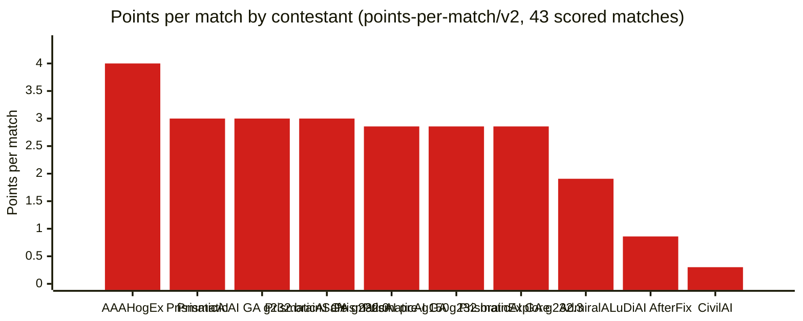
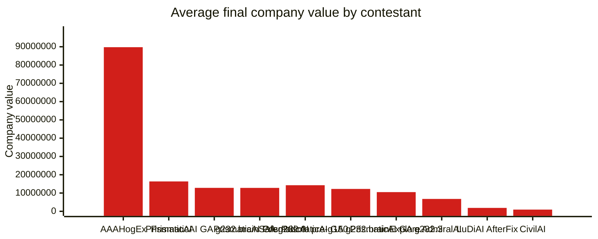
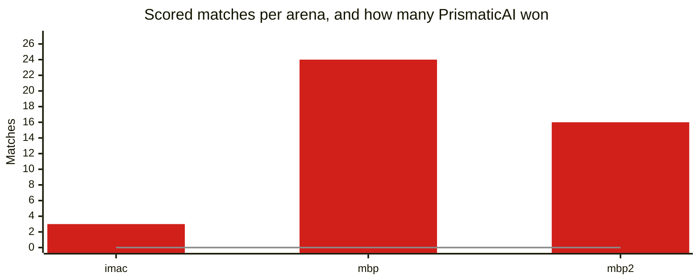

# battle-20261121T053438-e9dbaedc

Derived from `battle-20261121T053438-e9dbaedc.json` by `tools/research/ai-battle/battle.py report`; do not edit.

- Edition `e9dbaedc32b02491`: PrismaticAI and referee at `52f631b115782334f422f741a79ecabce78e58c4`, base set `opengfx-8.0.tar`
- 20-year free-for-all from 1960, map 256x256 temperate, breakdowns 1
- 43 scored match(es) on `imac` (20261119-master-gdf1e05e7d8), `mbp` (20261120-master-m17653b726e), `mbp2` (20261119-master-gdf1e05e7d8)
- Replays: 0 of 0 identical to their original on another arena

| # | Contestant | Played | Wins | Points | Points/match | Avg rank | Avg final value | Squirrel errors | Matches with anomalies |
|---|---|---|---|---|---|---|---|---|---|
| 1 | AAAHogEx | 43 | 43 | 172 | 4.0 | 1.0 | 89.8 M | 0 | 0 |
| 2 | PrismaticAI | 7 | 0 | 21 | 3.0 | 2.0 | 16.3 M | 0 | 0 |
| 3 | PrismaticAI GA g232.brainSafe | 7 | 0 | 21 | 3.0 | 2.0 | 12.8 M | 0 | 0 |
| 4 | PrismaticAI GA g232.0 | 8 | 0 | 24 | 3.0 | 2.0 | 12.8 M | 0 | 6 |
| 5 | PrismaticAI pre-g150 | 7 | 0 | 20 | 2.857 | 2.14 | 14.3 M | 0 | 4 |
| 6 | PrismaticAI GA g232.brainExplore | 7 | 0 | 20 | 2.857 | 2.14 | 12.2 M | 0 | 0 |
| 7 | PrismaticAI GA g232.3 | 7 | 0 | 20 | 2.857 | 2.14 | 10.5 M | 0 | 0 |
| 8 | AdmiralAI | 43 | 0 | 82 | 1.907 | 3.09 | 6.8 M | 0 | 3 |
| 9 | LuDiAI AfterFix | 43 | 0 | 37 | 0.86 | 4.14 | 1.9 M | 0 | 0 |
| 10 | CivilAI | 43 | 0 | 13 | 0.302 | 4.7 | 940.2 k | 0 | 4 |

```mermaid
---
config:
  xyChart:
    width: 900
    height: 360
  themeVariables:
    xyChart:
      plotColorPalette: "#d11f1a, #8a8a8a, #0b0b0b, #ece4d6"
---
xychart-beta
    title "Final company value per scored match: winner vs best PrismaticAI"
    x-axis ["m-0001", "m-0002", "m-0003", "m-0004", "m-0005", "m-0006", "m-0007", "m-0008", "m-0009", "m-0010", "m-0011", "m-0012", "m-0013", "m-0014", "m-0015", "m-0016", "m-0017", "m-0018", "m-0019", "m-0020", "m-0021", "m-0022", "m-0023", "m-0024", "m-0025", "m-0026", "m-0027", "m-0028", "m-0036", "m-0037", "m-0038", "m-0039", "m-0040", "m-0041", "m-0042", "m-0043", "m-0044", "m-0045", "m-0046", "m-0047", "m-0048", "m-0050", "m-0053"]
    %% series: Winner | Best PrismaticAI
    %% links: battle-20261121T053438-e9dbaedc.md?col=Match&filter=m-0001 | battle-20261121T053438-e9dbaedc.md?col=Match&filter=m-0002 | battle-20261121T053438-e9dbaedc.md?col=Match&filter=m-0003 | battle-20261121T053438-e9dbaedc.md?col=Match&filter=m-0004 | battle-20261121T053438-e9dbaedc.md?col=Match&filter=m-0005 | battle-20261121T053438-e9dbaedc.md?col=Match&filter=m-0006 | battle-20261121T053438-e9dbaedc.md?col=Match&filter=m-0007 | battle-20261121T053438-e9dbaedc.md?col=Match&filter=m-0008 | battle-20261121T053438-e9dbaedc.md?col=Match&filter=m-0009 | battle-20261121T053438-e9dbaedc.md?col=Match&filter=m-0010 | battle-20261121T053438-e9dbaedc.md?col=Match&filter=m-0011 | battle-20261121T053438-e9dbaedc.md?col=Match&filter=m-0012 | battle-20261121T053438-e9dbaedc.md?col=Match&filter=m-0013 | battle-20261121T053438-e9dbaedc.md?col=Match&filter=m-0014 | battle-20261121T053438-e9dbaedc.md?col=Match&filter=m-0015 | battle-20261121T053438-e9dbaedc.md?col=Match&filter=m-0016 | battle-20261121T053438-e9dbaedc.md?col=Match&filter=m-0017 | battle-20261121T053438-e9dbaedc.md?col=Match&filter=m-0018 | battle-20261121T053438-e9dbaedc.md?col=Match&filter=m-0019 | battle-20261121T053438-e9dbaedc.md?col=Match&filter=m-0020 | battle-20261121T053438-e9dbaedc.md?col=Match&filter=m-0021 | battle-20261121T053438-e9dbaedc.md?col=Match&filter=m-0022 | battle-20261121T053438-e9dbaedc.md?col=Match&filter=m-0023 | battle-20261121T053438-e9dbaedc.md?col=Match&filter=m-0024 | battle-20261121T053438-e9dbaedc.md?col=Match&filter=m-0025 | battle-20261121T053438-e9dbaedc.md?col=Match&filter=m-0026 | battle-20261121T053438-e9dbaedc.md?col=Match&filter=m-0027 | battle-20261121T053438-e9dbaedc.md?col=Match&filter=m-0028 | battle-20261121T053438-e9dbaedc.md?col=Match&filter=m-0036 | battle-20261121T053438-e9dbaedc.md?col=Match&filter=m-0037 | battle-20261121T053438-e9dbaedc.md?col=Match&filter=m-0038 | battle-20261121T053438-e9dbaedc.md?col=Match&filter=m-0039 | battle-20261121T053438-e9dbaedc.md?col=Match&filter=m-0040 | battle-20261121T053438-e9dbaedc.md?col=Match&filter=m-0041 | battle-20261121T053438-e9dbaedc.md?col=Match&filter=m-0042 | battle-20261121T053438-e9dbaedc.md?col=Match&filter=m-0043 | battle-20261121T053438-e9dbaedc.md?col=Match&filter=m-0044 | battle-20261121T053438-e9dbaedc.md?col=Match&filter=m-0045 | battle-20261121T053438-e9dbaedc.md?col=Match&filter=m-0046 | battle-20261121T053438-e9dbaedc.md?col=Match&filter=m-0047 | battle-20261121T053438-e9dbaedc.md?col=Match&filter=m-0048 | battle-20261121T053438-e9dbaedc.md?col=Match&filter=m-0050 | battle-20261121T053438-e9dbaedc.md?col=Match&filter=m-0053
    y-axis "Company value" 0 --> 161000000
    bar [99860168, 92474721, 98099761, 92403028, 97482584, 146047789, 126005773, 115199522, 128908070, 112591497, 123605425, 70482999, 69205838, 68098069, 83843373, 91890726, 70072479, 83071053, 92328459, 92144879, 82732005, 85155394, 82561498, 126564273, 102266580, 97362873, 82319005, 82805995, 75416938, 93962603, 114317307, 78314300, 78314300, 77585555, 48632047, 59472700, 73246991, 64189640, 64394144, 52990379, 98559701, 84943158, 99602888]
    line [17329357, 15466109, 10779880, 11512457, 9924350, 22442796, 17933516, 17849402, 19594762, 22268282, 14704770, 20045067, 17229685, 15183561, 16794195, 14035358, 5986734, 24309671, 13676805, 15244959, 15513139, 15506248, 13672596, 13484005, 9123724, 12152622, 12995067, 9591019, 9541792, 12254888, 6019647, 9114772, 9114772, 10856131, 12594890, 12373904, 8880332, 4974766, 3649981, 5549890, 11983785, 11682152, 12828193]
```

<!-- battle-charts:begin -->
<!-- derived from battle-20261121T053438-e9dbaedc.json by `battle.py render`; `battle.py check` fails when it is stale -->

<!-- battle-charts:end -->

| Match | Arena | Seed | Winner | Value | Last | Anomalies |
|---|---|---|---|---|---|---|
| m-0001 | mbp | 1386959777 | AAAHogEx | 99.9 M | CivilAI | PrismaticAI pre-g150: fleet_drop:91->57 |
| m-0002 | mbp | 1386959777 | AAAHogEx | 92.5 M | CivilAI | PrismaticAI GA g232.0: fleet_drop:180->59 |
| m-0003 | mbp | 1386959777 | AAAHogEx | 98.1 M | CivilAI | CivilAI: fleet_drop:85->58 |
| m-0004 | mbp | 1386959777 | AAAHogEx | 92.4 M | CivilAI | CivilAI: fleet_drop:59->29 |
| m-0005 | mbp | 1386959777 | AAAHogEx | 97.5 M | CivilAI | - |
| m-0006 | mbp | 1912970931 | AAAHogEx | 146.0 M | CivilAI | - |
| m-0007 | mbp | 1912970931 | AAAHogEx | 126.0 M | CivilAI | PrismaticAI pre-g150: fleet_drop:88->58 |
| m-0008 | mbp | 1912970931 | AAAHogEx | 115.2 M | LuDiAI AfterFix | PrismaticAI GA g232.0: fleet_drop:219->66 |
| m-0009 | mbp | 1912970931 | AAAHogEx | 128.9 M | LuDiAI AfterFix | - |
| m-0010 | imac | 1912970931 | AAAHogEx | 112.6 M | LuDiAI AfterFix | - |
| m-0011 | imac | 1912970931 | AAAHogEx | 123.6 M | LuDiAI AfterFix | - |
| m-0012 | imac | 225564159 | AAAHogEx | 70.5 M | LuDiAI AfterFix | AdmiralAI: fleet_drop:350->238 |
| m-0013 | mbp2 | 225564159 | AAAHogEx | 69.2 M | CivilAI | PrismaticAI pre-g150: fleet_drop:76->49 |
| m-0014 | mbp2 | 225564159 | AAAHogEx | 68.1 M | CivilAI | - |
| m-0015 | mbp2 | 225564159 | AAAHogEx | 83.8 M | CivilAI | - |
| m-0016 | mbp2 | 225564159 | AAAHogEx | 91.9 M | CivilAI | - |
| m-0017 | mbp2 | 225564159 | AAAHogEx | 70.1 M | LuDiAI AfterFix | - |
| m-0018 | mbp2 | 1116011243 | AAAHogEx | 83.1 M | CivilAI | CivilAI: no_vehicles |
| m-0019 | mbp2 | 1116011243 | AAAHogEx | 92.3 M | CivilAI | - |
| m-0020 | mbp2 | 1116011243 | AAAHogEx | 92.1 M | CivilAI | PrismaticAI GA g232.0: fleet_drop:138->55 |
| m-0021 | mbp2 | 1116011243 | AAAHogEx | 82.7 M | LuDiAI AfterFix | - |
| m-0022 | mbp2 | 1116011243 | AAAHogEx | 85.2 M | LuDiAI AfterFix | - |
| m-0023 | mbp2 | 1116011243 | AAAHogEx | 82.6 M | LuDiAI AfterFix | - |
| m-0024 | mbp2 | 798957012 | AAAHogEx | 126.6 M | CivilAI | - |
| m-0025 | mbp2 | 798957012 | AAAHogEx | 102.3 M | CivilAI | - |
| m-0026 | mbp2 | 798957012 | AAAHogEx | 97.4 M | CivilAI | PrismaticAI GA g232.0: fleet_drop:204->72 |
| m-0027 | mbp2 | 798957012 | AAAHogEx | 82.3 M | LuDiAI AfterFix | - |
| m-0028 | mbp2 | 798957012 | AAAHogEx | 82.8 M | CivilAI | - |
| m-0036 | mbp | 200207465 | AAAHogEx | 75.4 M | CivilAI | - |
| m-0037 | mbp | 200207465 | AAAHogEx | 94.0 M | LuDiAI AfterFix | - |
| m-0038 | mbp | 200207465 | AAAHogEx | 114.3 M | AdmiralAI | PrismaticAI GA g232.0: fleet_drop:141->43 |
| m-0039 | mbp | 200207465 | AAAHogEx | 78.3 M | CivilAI | AdmiralAI: fleet_drop:76->28 |
| m-0040 | mbp | 200207465 | AAAHogEx | 78.3 M | CivilAI | AdmiralAI: fleet_drop:76->28 |
| m-0041 | mbp | 200207465 | AAAHogEx | 77.6 M | CivilAI | - |
| m-0042 | mbp | 335959599 | AAAHogEx | 48.6 M | CivilAI | CivilAI: fleet_drop:46->29 |
| m-0043 | mbp | 335959599 | AAAHogEx | 59.5 M | CivilAI | PrismaticAI pre-g150: fleet_drop:85->52 |
| m-0044 | mbp | 335959599 | AAAHogEx | 73.2 M | CivilAI | - |
| m-0045 | mbp | 335959599 | AAAHogEx | 64.2 M | CivilAI | - |
| m-0046 | mbp | 335959599 | AAAHogEx | 64.4 M | CivilAI | - |
| m-0047 | mbp | 335959599 | AAAHogEx | 53.0 M | AdmiralAI | - |
| m-0048 | mbp | 1299602505 | AAAHogEx | 98.6 M | CivilAI | - |
| m-0050 | mbp | 1299602505 | AAAHogEx | 84.9 M | CivilAI | PrismaticAI GA g232.0: fleet_drop:98->64 |
| m-0053 | mbp | 1299602505 | AAAHogEx | 99.6 M | CivilAI | - |
