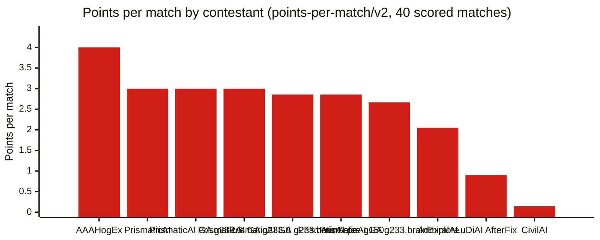
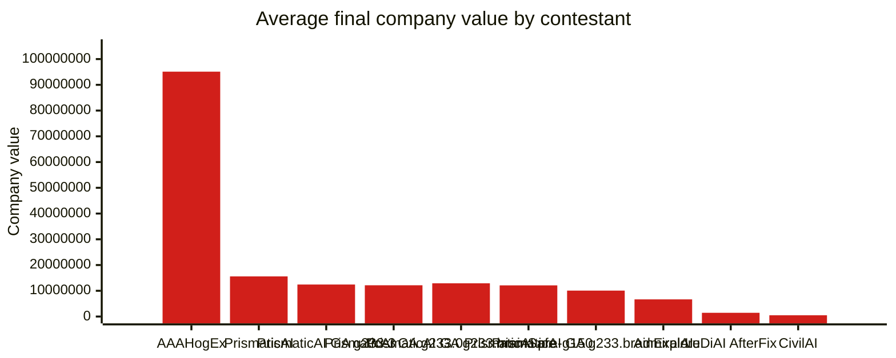
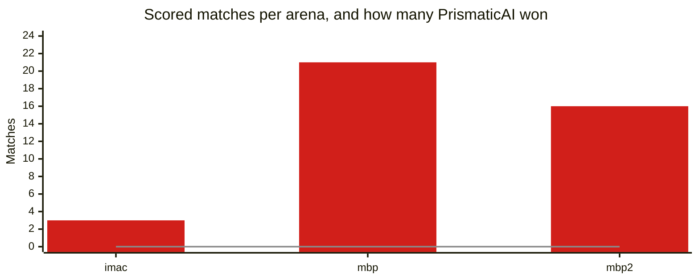

# battle-20261121T054400-8f7a472e

Derived from `battle-20261121T054400-8f7a472e.json` by `tools/research/ai-battle/battle.py report`; do not edit.

- Edition `8f7a472e923dae88`: PrismaticAI and referee at `52f631b115782334f422f741a79ecabce78e58c4`, base set `opengfx-8.0.tar`
- 20-year free-for-all from 1960, map 256x256 temperate, breakdowns 1
- 40 scored match(es) on `imac` (20261119-master-gdf1e05e7d8), `mbp` (20261120-master-m17653b726e), `mbp2` (20261119-master-gdf1e05e7d8)
- Replays: 0 of 0 identical to their original on another arena

| # | Contestant | Played | Wins | Points | Points/match | Avg rank | Avg final value | Squirrel errors | Matches with anomalies |
|---|---|---|---|---|---|---|---|---|---|
| 1 | AAAHogEx | 40 | 40 | 160 | 4.0 | 1.0 | 95.1 M | 0 | 0 |
| 2 | PrismaticAI | 7 | 0 | 21 | 3.0 | 2.0 | 15.6 M | 0 | 0 |
| 3 | PrismaticAI GA g233.3 | 6 | 0 | 18 | 3.0 | 2.0 | 12.4 M | 0 | 6 |
| 4 | PrismaticAI GA g233.0 | 7 | 0 | 21 | 3.0 | 2.0 | 12.1 M | 0 | 0 |
| 5 | PrismaticAI GA g233.brainSafe | 7 | 0 | 20 | 2.857 | 2.14 | 12.9 M | 0 | 2 |
| 6 | PrismaticAI pre-g150 | 7 | 0 | 20 | 2.857 | 2.14 | 12.1 M | 0 | 6 |
| 7 | PrismaticAI GA g233.brainExplore | 6 | 0 | 16 | 2.667 | 2.33 | 10.1 M | 0 | 0 |
| 8 | AdmiralAI | 40 | 0 | 82 | 2.05 | 2.95 | 6.7 M | 0 | 1 |
| 9 | LuDiAI AfterFix | 40 | 0 | 36 | 0.9 | 4.1 | 1.4 M | 0 | 2 |
| 10 | CivilAI | 40 | 0 | 6 | 0.15 | 4.85 | 486.9 k | 0 | 10 |

```mermaid
---
config:
  xyChart:
    width: 900
    height: 360
  themeVariables:
    xyChart:
      plotColorPalette: "#d11f1a, #8a8a8a, #0b0b0b, #ece4d6"
---
xychart-beta
    title "Final company value per scored match: winner vs best PrismaticAI"
    x-axis ["m-0001", "m-0002", "m-0003", "m-0004", "m-0005", "m-0006", "m-0007", "m-0008", "m-0009", "m-0010", "m-0011", "m-0012", "m-0013", "m-0014", "m-0015", "m-0016", "m-0017", "m-0018", "m-0019", "m-0020", "m-0021", "m-0022", "m-0023", "m-0024", "m-0025", "m-0026", "m-0027", "m-0028", "m-0036", "m-0037", "m-0038", "m-0039", "m-0040", "m-0041", "m-0042", "m-0043", "m-0044", "m-0045", "m-0047", "m-0048"]
    %% series: Winner | Best PrismaticAI
    %% links: battle-20261121T054400-8f7a472e.md?col=Match&filter=m-0001 | battle-20261121T054400-8f7a472e.md?col=Match&filter=m-0002 | battle-20261121T054400-8f7a472e.md?col=Match&filter=m-0003 | battle-20261121T054400-8f7a472e.md?col=Match&filter=m-0004 | battle-20261121T054400-8f7a472e.md?col=Match&filter=m-0005 | battle-20261121T054400-8f7a472e.md?col=Match&filter=m-0006 | battle-20261121T054400-8f7a472e.md?col=Match&filter=m-0007 | battle-20261121T054400-8f7a472e.md?col=Match&filter=m-0008 | battle-20261121T054400-8f7a472e.md?col=Match&filter=m-0009 | battle-20261121T054400-8f7a472e.md?col=Match&filter=m-0010 | battle-20261121T054400-8f7a472e.md?col=Match&filter=m-0011 | battle-20261121T054400-8f7a472e.md?col=Match&filter=m-0012 | battle-20261121T054400-8f7a472e.md?col=Match&filter=m-0013 | battle-20261121T054400-8f7a472e.md?col=Match&filter=m-0014 | battle-20261121T054400-8f7a472e.md?col=Match&filter=m-0015 | battle-20261121T054400-8f7a472e.md?col=Match&filter=m-0016 | battle-20261121T054400-8f7a472e.md?col=Match&filter=m-0017 | battle-20261121T054400-8f7a472e.md?col=Match&filter=m-0018 | battle-20261121T054400-8f7a472e.md?col=Match&filter=m-0019 | battle-20261121T054400-8f7a472e.md?col=Match&filter=m-0020 | battle-20261121T054400-8f7a472e.md?col=Match&filter=m-0021 | battle-20261121T054400-8f7a472e.md?col=Match&filter=m-0022 | battle-20261121T054400-8f7a472e.md?col=Match&filter=m-0023 | battle-20261121T054400-8f7a472e.md?col=Match&filter=m-0024 | battle-20261121T054400-8f7a472e.md?col=Match&filter=m-0025 | battle-20261121T054400-8f7a472e.md?col=Match&filter=m-0026 | battle-20261121T054400-8f7a472e.md?col=Match&filter=m-0027 | battle-20261121T054400-8f7a472e.md?col=Match&filter=m-0028 | battle-20261121T054400-8f7a472e.md?col=Match&filter=m-0036 | battle-20261121T054400-8f7a472e.md?col=Match&filter=m-0037 | battle-20261121T054400-8f7a472e.md?col=Match&filter=m-0038 | battle-20261121T054400-8f7a472e.md?col=Match&filter=m-0039 | battle-20261121T054400-8f7a472e.md?col=Match&filter=m-0040 | battle-20261121T054400-8f7a472e.md?col=Match&filter=m-0041 | battle-20261121T054400-8f7a472e.md?col=Match&filter=m-0042 | battle-20261121T054400-8f7a472e.md?col=Match&filter=m-0043 | battle-20261121T054400-8f7a472e.md?col=Match&filter=m-0044 | battle-20261121T054400-8f7a472e.md?col=Match&filter=m-0045 | battle-20261121T054400-8f7a472e.md?col=Match&filter=m-0047 | battle-20261121T054400-8f7a472e.md?col=Match&filter=m-0048
    y-axis "Company value" 0 --> 162000000
    bar [76287619, 53508656, 75395001, 73808317, 72071128, 99063471, 103909672, 124552782, 97048279, 82964134, 86362174, 79875120, 89717524, 89066204, 83489221, 94755434, 85726226, 89362147, 98649962, 106929212, 111299036, 89211877, 130551849, 102432578, 108052963, 124905240, 120859518, 108866077, 147409532, 115354969, 106888234, 91063453, 101395890, 105134473, 66693352, 83214864, 97713388, 78213015, 70689909, 81918776]
    line [13294876, 10679980, 8639707, 4254283, 8809938, 7641105, 5481823, 11439130, 14424508, 5890426, 13644981, 17312250, 12735444, 13105489, 9954424, 9094412, 10940178, 22533718, 11347454, 21699327, 15492282, 19575337, 13771656, 16136489, 11733236, 8533120, 17955073, 11227184, 14549422, 18143617, 12256843, 14110890, 10386648, 15396784, 12167912, 11983458, 7280966, 9774652, 12024982, 18830341]
```

<!-- battle-charts:begin -->
<!-- derived from battle-20261121T054400-8f7a472e.json by `battle.py render`; `battle.py check` fails when it is stale -->

<!-- battle-charts:end -->

| Match | Arena | Seed | Winner | Value | Last | Anomalies |
|---|---|---|---|---|---|---|
| m-0001 | mbp | 71866061 | AAAHogEx | 76.3 M | CivilAI | PrismaticAI pre-g150: fleet_drop:91->38 |
| m-0002 | mbp | 71866061 | AAAHogEx | 53.5 M | CivilAI | - |
| m-0003 | mbp | 71866061 | AAAHogEx | 75.4 M | LuDiAI AfterFix | PrismaticAI GA g233.brainSafe: fleet_drop:105->61 |
| m-0004 | mbp | 71866061 | AAAHogEx | 73.8 M | LuDiAI AfterFix | - |
| m-0005 | mbp | 71866061 | AAAHogEx | 72.1 M | LuDiAI AfterFix | PrismaticAI GA g233.3: fleet_drop:64->33; LuDiAI AfterFix: fleet_drop:26->14 |
| m-0006 | mbp | 972017662 | AAAHogEx | 99.1 M | CivilAI | CivilAI: fleet_drop:16->11 |
| m-0007 | mbp | 972017662 | AAAHogEx | 103.9 M | CivilAI | PrismaticAI pre-g150: fleet_drop:62->26 |
| m-0008 | mbp | 972017662 | AAAHogEx | 124.6 M | CivilAI | CivilAI: fleet_drop:25->7 |
| m-0009 | mbp | 972017662 | AAAHogEx | 97.0 M | CivilAI | CivilAI: fleet_drop:28->16 |
| m-0010 | imac | 972017662 | AAAHogEx | 83.0 M | CivilAI | - |
| m-0011 | imac | 972017662 | AAAHogEx | 86.4 M | CivilAI | PrismaticAI GA g233.3: fleet_drop:140->66; AdmiralAI: fleet_drop:295->201; CivilAI: fleet_drop:26->11 |
| m-0012 | imac | 1600395032 | AAAHogEx | 79.9 M | CivilAI | - |
| m-0013 | mbp2 | 1600395032 | AAAHogEx | 89.7 M | LuDiAI AfterFix | PrismaticAI pre-g150: fleet_drop:112->69 |
| m-0014 | mbp2 | 1600395032 | AAAHogEx | 89.1 M | CivilAI | - |
| m-0015 | mbp2 | 1600395032 | AAAHogEx | 83.5 M | CivilAI | PrismaticAI GA g233.brainSafe: fleet_drop:85->57 |
| m-0016 | mbp2 | 1600395032 | AAAHogEx | 94.8 M | CivilAI | - |
| m-0017 | mbp2 | 1600395032 | AAAHogEx | 85.7 M | CivilAI | PrismaticAI GA g233.3: fleet_drop:184->39 |
| m-0018 | mbp2 | 192197155 | AAAHogEx | 89.4 M | CivilAI | - |
| m-0019 | mbp2 | 192197155 | AAAHogEx | 98.6 M | CivilAI | PrismaticAI pre-g150: fleet_drop:105->63 |
| m-0020 | mbp2 | 192197155 | AAAHogEx | 106.9 M | CivilAI | - |
| m-0021 | mbp2 | 192197155 | AAAHogEx | 111.3 M | LuDiAI AfterFix | LuDiAI AfterFix: fleet_drop:89->61 |
| m-0022 | mbp2 | 192197155 | AAAHogEx | 89.2 M | CivilAI | - |
| m-0023 | mbp2 | 192197155 | AAAHogEx | 130.6 M | CivilAI | PrismaticAI GA g233.3: fleet_drop:221->150 |
| m-0024 | mbp2 | 476437710 | AAAHogEx | 102.4 M | LuDiAI AfterFix | - |
| m-0025 | mbp2 | 476437710 | AAAHogEx | 108.1 M | CivilAI | PrismaticAI pre-g150: fleet_drop:150->69 |
| m-0026 | mbp2 | 476437710 | AAAHogEx | 124.9 M | CivilAI | CivilAI: fleet_drop:51->27 |
| m-0027 | mbp2 | 476437710 | AAAHogEx | 120.9 M | CivilAI | - |
| m-0028 | mbp2 | 476437710 | AAAHogEx | 108.9 M | CivilAI | - |
| m-0036 | mbp | 498464314 | AAAHogEx | 147.4 M | CivilAI | - |
| m-0037 | mbp | 498464314 | AAAHogEx | 115.4 M | CivilAI | CivilAI: fleet_drop:42->29 |
| m-0038 | mbp | 498464314 | AAAHogEx | 106.9 M | CivilAI | CivilAI: fleet_drop:14->5 |
| m-0039 | mbp | 498464314 | AAAHogEx | 91.1 M | CivilAI | CivilAI: fleet_drop:62->41 |
| m-0040 | mbp | 498464314 | AAAHogEx | 101.4 M | CivilAI | - |
| m-0041 | mbp | 498464314 | AAAHogEx | 105.1 M | CivilAI | PrismaticAI GA g233.3: fleet_drop:112->76; CivilAI: fleet_drop:31->20 |
| m-0042 | mbp | 1059326987 | AAAHogEx | 66.7 M | CivilAI | - |
| m-0043 | mbp | 1059326987 | AAAHogEx | 83.2 M | CivilAI | PrismaticAI pre-g150: fleet_drop:71->43 |
| m-0044 | mbp | 1059326987 | AAAHogEx | 97.7 M | CivilAI | - |
| m-0045 | mbp | 1059326987 | AAAHogEx | 78.2 M | CivilAI | - |
| m-0047 | mbp | 1059326987 | AAAHogEx | 70.7 M | CivilAI | PrismaticAI GA g233.3: fleet_drop:73->45 |
| m-0048 | mbp | 654454310 | AAAHogEx | 81.9 M | CivilAI | CivilAI: fleet_drop:42->20 |
