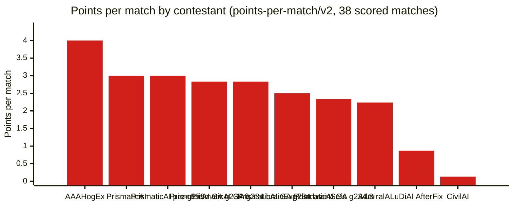
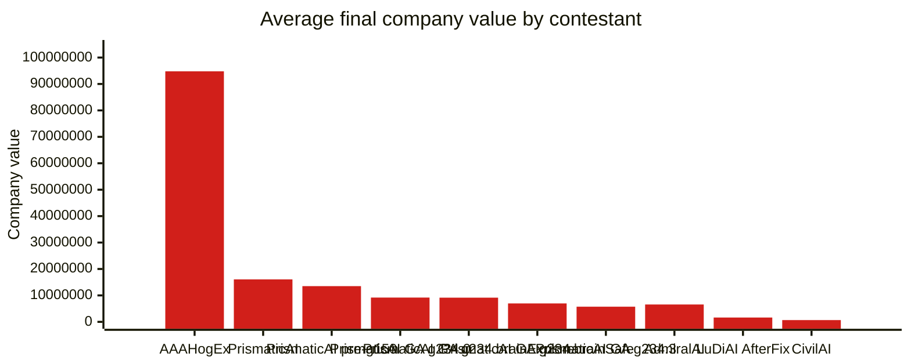
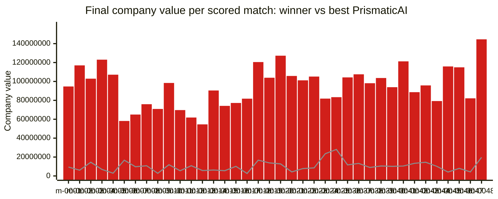
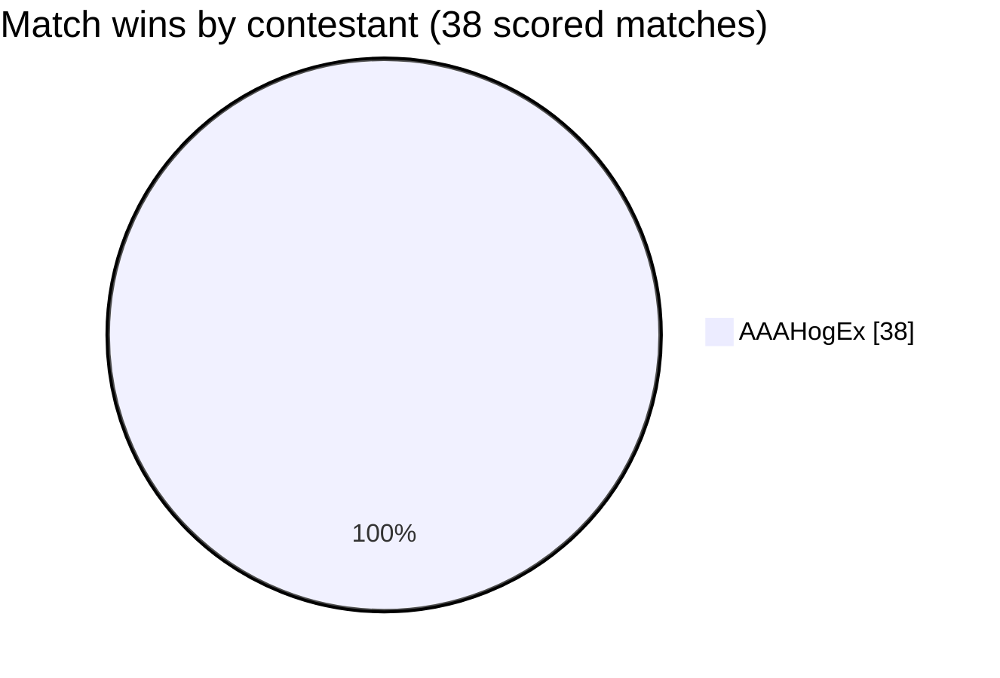
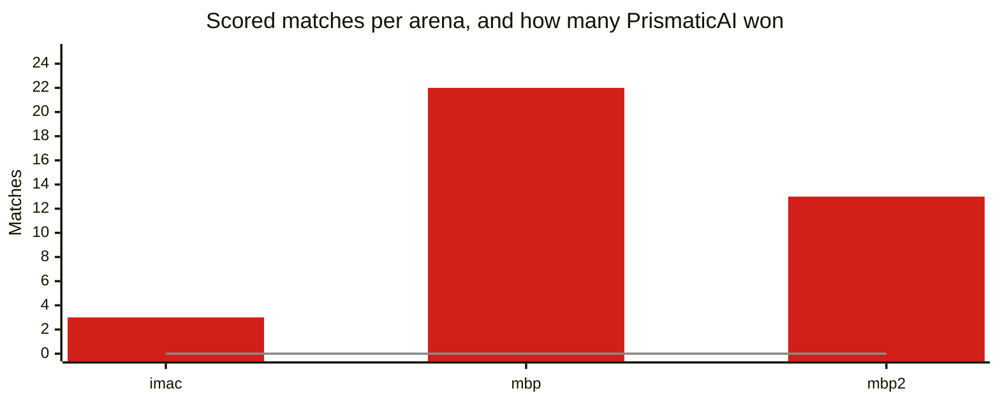

# battle-20261121T055319-72295d65

Derived from `battle-20261121T055319-72295d65.json` by `tools/research/ai-battle/battle.py report`; do not edit.

- Edition `72295d65878d3dab`: PrismaticAI and referee at `52f631b115782334f422f741a79ecabce78e58c4`, base set `opengfx-8.0.tar`
- 20-year free-for-all from 1960, map 256x256 temperate, breakdowns 1
- 38 scored match(es) on `imac` (20261119-master-gdf1e05e7d8), `mbp` (20261120-master-m17653b726e), `mbp2` (20261119-master-gdf1e05e7d8)
- Replays: 0 of 0 identical to their original on another arena

| # | Contestant | Played | Wins | Points | Points/match | Avg rank | Avg final value | Squirrel errors | Matches with anomalies |
|---|---|---|---|---|---|---|---|---|---|
| 1 | AAAHogEx | 38 | 38 | 152 | 4.0 | 1.0 | 94.8 M | 0 | 0 |
| 2 | PrismaticAI | 7 | 0 | 21 | 3.0 | 2.0 | 16.1 M | 0 | 0 |
| 3 | PrismaticAI pre-g150 | 7 | 0 | 21 | 3.0 | 2.0 | 13.5 M | 0 | 4 |
| 4 | PrismaticAI GA g234.0 | 6 | 0 | 17 | 2.833 | 2.17 | 9.2 M | 0 | 3 |
| 5 | PrismaticAI GA g234.brainExplore | 6 | 0 | 17 | 2.833 | 2.17 | 9.1 M | 0 | 0 |
| 6 | PrismaticAI GA g234.brainSafe | 6 | 0 | 15 | 2.5 | 2.5 | 7.0 M | 0 | 3 |
| 7 | PrismaticAI GA g234.3 | 6 | 0 | 14 | 2.333 | 2.67 | 5.7 M | 0 | 3 |
| 8 | AdmiralAI | 38 | 0 | 85 | 2.237 | 2.76 | 6.6 M | 0 | 2 |
| 9 | LuDiAI AfterFix | 38 | 0 | 33 | 0.868 | 4.13 | 1.6 M | 0 | 1 |
| 10 | CivilAI | 38 | 0 | 5 | 0.132 | 4.87 | 661.3 k | 3922 | 7 |

<!-- battle-charts:begin -->
<!-- derived from battle-20261121T055319-72295d65.json by `battle.py render`; `battle.py check` fails when it is stale -->

<!-- battle-charts:end -->

| Match | Arena | Seed | Winner | Value | Last | Anomalies |
|---|---|---|---|---|---|---|
| m-0001 | mbp | 445221110 | AAAHogEx | 94.7 M | CivilAI | - |
| m-0002 | mbp | 445221110 | AAAHogEx | 117.0 M | CivilAI | AdmiralAI: fleet_drop:308->207 |
| m-0003 | mbp | 445221110 | AAAHogEx | 102.9 M | CivilAI | PrismaticAI GA g234.brainSafe: fleet_drop:167->88; AdmiralAI: fleet_drop:169->108; CivilAI: fleet_drop:47->30 |
| m-0004 | mbp | 445221110 | AAAHogEx | 123.0 M | CivilAI | - |
| m-0005 | mbp | 445221110 | AAAHogEx | 107.1 M | CivilAI | PrismaticAI GA g234.3: fleet_drop:157->93; CivilAI: fleet_drop:77->49 |
| m-0006 | mbp | 1850189890 | AAAHogEx | 58.2 M | CivilAI | - |
| m-0007 | mbp | 1850189890 | AAAHogEx | 65.0 M | CivilAI | PrismaticAI pre-g150: fleet_drop:80->52; CivilAI: squirrel_errors:32 |
| m-0008 | mbp | 1850189890 | AAAHogEx | 75.9 M | CivilAI | PrismaticAI GA g234.0: fleet_drop:83->53 |
| m-0009 | mbp | 1850189890 | AAAHogEx | 70.9 M | CivilAI | - |
| m-0010 | imac | 1850189890 | AAAHogEx | 98.4 M | LuDiAI AfterFix | - |
| m-0011 | imac | 1850189890 | AAAHogEx | 69.7 M | CivilAI | - |
| m-0012 | imac | 1036684470 | AAAHogEx | 61.8 M | CivilAI | LuDiAI AfterFix: fleet_drop:105->70 |
| m-0013 | mbp2 | 1036684470 | AAAHogEx | 54.6 M | CivilAI | - |
| m-0014 | mbp2 | 1036684470 | AAAHogEx | 90.4 M | CivilAI | - |
| m-0015 | mbp2 | 1036684470 | AAAHogEx | 74.1 M | CivilAI | - |
| m-0016 | mbp2 | 1036684470 | AAAHogEx | 77.2 M | CivilAI | - |
| m-0017 | mbp2 | 1036684470 | AAAHogEx | 81.8 M | CivilAI | - |
| m-0018 | mbp2 | 1325662667 | AAAHogEx | 120.5 M | CivilAI | - |
| m-0019 | mbp2 | 1325662667 | AAAHogEx | 103.9 M | LuDiAI AfterFix | PrismaticAI pre-g150: fleet_drop:88->58 |
| m-0020 | mbp2 | 1325662667 | AAAHogEx | 127.2 M | LuDiAI AfterFix | - |
| m-0021 | mbp2 | 1325662667 | AAAHogEx | 105.8 M | LuDiAI AfterFix | - |
| m-0022 | mbp2 | 1325662667 | AAAHogEx | 101.2 M | CivilAI | - |
| m-0023 | mbp2 | 1325662667 | AAAHogEx | 105.2 M | CivilAI | PrismaticAI GA g234.3: fleet_drop:195->116 |
| m-0024 | mbp2 | 585921127 | AAAHogEx | 81.8 M | LuDiAI AfterFix | - |
| m-0025 | mbp2 | 585921127 | AAAHogEx | 83.4 M | CivilAI | PrismaticAI pre-g150: fleet_drop:141->70; CivilAI: fleet_drop:59->39 |
| m-0036 | mbp | 817489891 | AAAHogEx | 104.3 M | CivilAI | - |
| m-0037 | mbp | 817489891 | AAAHogEx | 107.5 M | CivilAI | CivilAI: squirrel_errors:3890 |
| m-0038 | mbp | 817489891 | AAAHogEx | 98.1 M | CivilAI | PrismaticAI GA g234.0: fleet_drop:139->57 |
| m-0039 | mbp | 817489891 | AAAHogEx | 103.6 M | CivilAI | PrismaticAI GA g234.brainSafe: fleet_drop:133->87 |
| m-0040 | mbp | 817489891 | AAAHogEx | 93.9 M | CivilAI | - |
| m-0041 | mbp | 817489891 | AAAHogEx | 121.3 M | CivilAI | - |
| m-0042 | mbp | 1416607509 | AAAHogEx | 88.6 M | CivilAI | - |
| m-0043 | mbp | 1416607509 | AAAHogEx | 95.8 M | CivilAI | PrismaticAI pre-g150: fleet_drop:76->47 |
| m-0044 | mbp | 1416607509 | AAAHogEx | 79.3 M | CivilAI | PrismaticAI GA g234.0: fleet_drop:120->63; CivilAI: fleet_drop:52->31 |
| m-0045 | mbp | 1416607509 | AAAHogEx | 115.9 M | CivilAI | PrismaticAI GA g234.brainSafe: fleet_drop:112->40; CivilAI: fleet_drop:41->25 |
| m-0046 | mbp | 1416607509 | AAAHogEx | 114.9 M | CivilAI | - |
| m-0047 | mbp | 1416607509 | AAAHogEx | 82.1 M | CivilAI | PrismaticAI GA g234.3: fleet_drop:110->60 |
| m-0048 | mbp | 970179003 | AAAHogEx | 144.6 M | CivilAI | - |
