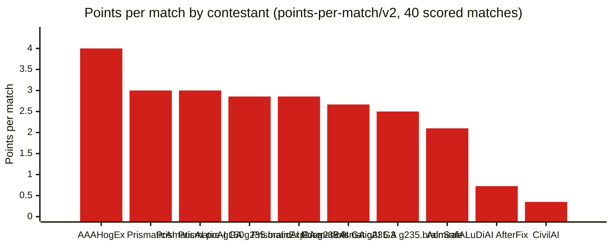
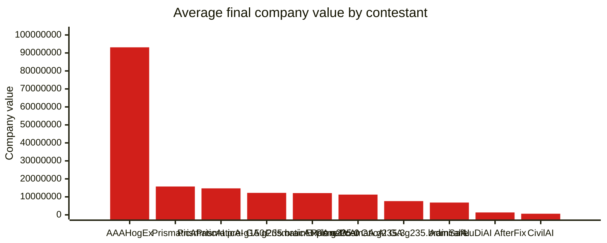
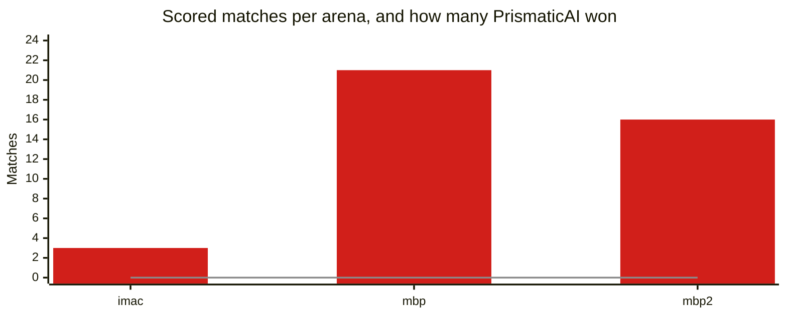

# battle-20261121T060230-0004117a

Derived from `battle-20261121T060230-0004117a.json` by `tools/research/ai-battle/battle.py report`; do not edit.

- Edition `0004117afd6494c3`: PrismaticAI and referee at `52f631b115782334f422f741a79ecabce78e58c4`, base set `opengfx-8.0.tar`
- 20-year free-for-all from 1960, map 256x256 temperate, breakdowns 1
- 40 scored match(es) on `imac` (20261119-master-gdf1e05e7d8), `mbp` (20261120-master-m17653b726e), `mbp2` (20261119-master-gdf1e05e7d8)
- Replays: 2 of 2 identical to their original on another arena

| # | Contestant | Played | Wins | Points | Points/match | Avg rank | Avg final value | Squirrel errors | Matches with anomalies |
|---|---|---|---|---|---|---|---|---|---|
| 1 | AAAHogEx | 40 | 40 | 160 | 4.0 | 1.0 | 93.1 M | 0 | 0 |
| 2 | PrismaticAI | 7 | 0 | 21 | 3.0 | 2.0 | 15.8 M | 0 | 1 |
| 3 | PrismaticAI pre-g150 | 7 | 0 | 21 | 3.0 | 2.0 | 14.7 M | 0 | 3 |
| 4 | PrismaticAI GA g235.brainExplore | 7 | 0 | 20 | 2.857 | 2.14 | 12.2 M | 0 | 0 |
| 5 | PrismaticAI GA g235.0 | 7 | 0 | 20 | 2.857 | 2.14 | 12.1 M | 0 | 3 |
| 6 | PrismaticAI GA g235.3 | 6 | 0 | 16 | 2.667 | 2.33 | 11.3 M | 0 | 2 |
| 7 | PrismaticAI GA g235.brainSafe | 6 | 0 | 15 | 2.5 | 2.5 | 7.6 M | 0 | 2 |
| 8 | AdmiralAI | 40 | 0 | 84 | 2.1 | 2.9 | 6.8 M | 57 | 2 |
| 9 | LuDiAI AfterFix | 40 | 0 | 29 | 0.725 | 4.28 | 1.3 M | 0 | 0 |
| 10 | CivilAI | 40 | 0 | 14 | 0.35 | 4.65 | 631.1 k | 3690 | 8 |

```mermaid
---
config:
  xyChart:
    width: 900
    height: 360
  themeVariables:
    xyChart:
      plotColorPalette: "#d11f1a, #8a8a8a, #0b0b0b, #ece4d6"
---
xychart-beta
    title "Final company value per scored match: winner vs best PrismaticAI"
    x-axis ["m-0001", "m-0002", "m-0003", "m-0004", "m-0005", "m-0006", "m-0007", "m-0008", "m-0009", "m-0010", "m-0011", "m-0012", "m-0013", "m-0014", "m-0015", "m-0016", "m-0017", "m-0018", "m-0019", "m-0020", "m-0021", "m-0022", "m-0023", "m-0024", "m-0025", "m-0026", "m-0027", "m-0028", "m-0036", "m-0037", "m-0038", "m-0039", "m-0040", "m-0041", "m-0042", "m-0043", "m-0044", "m-0046", "m-0047", "m-0054"]
    %% series: Winner | Best PrismaticAI
    %% links: battle-20261121T060230-0004117a.md?col=Match&filter=m-0001 | battle-20261121T060230-0004117a.md?col=Match&filter=m-0002 | battle-20261121T060230-0004117a.md?col=Match&filter=m-0003 | battle-20261121T060230-0004117a.md?col=Match&filter=m-0004 | battle-20261121T060230-0004117a.md?col=Match&filter=m-0005 | battle-20261121T060230-0004117a.md?col=Match&filter=m-0006 | battle-20261121T060230-0004117a.md?col=Match&filter=m-0007 | battle-20261121T060230-0004117a.md?col=Match&filter=m-0008 | battle-20261121T060230-0004117a.md?col=Match&filter=m-0009 | battle-20261121T060230-0004117a.md?col=Match&filter=m-0010 | battle-20261121T060230-0004117a.md?col=Match&filter=m-0011 | battle-20261121T060230-0004117a.md?col=Match&filter=m-0012 | battle-20261121T060230-0004117a.md?col=Match&filter=m-0013 | battle-20261121T060230-0004117a.md?col=Match&filter=m-0014 | battle-20261121T060230-0004117a.md?col=Match&filter=m-0015 | battle-20261121T060230-0004117a.md?col=Match&filter=m-0016 | battle-20261121T060230-0004117a.md?col=Match&filter=m-0017 | battle-20261121T060230-0004117a.md?col=Match&filter=m-0018 | battle-20261121T060230-0004117a.md?col=Match&filter=m-0019 | battle-20261121T060230-0004117a.md?col=Match&filter=m-0020 | battle-20261121T060230-0004117a.md?col=Match&filter=m-0021 | battle-20261121T060230-0004117a.md?col=Match&filter=m-0022 | battle-20261121T060230-0004117a.md?col=Match&filter=m-0023 | battle-20261121T060230-0004117a.md?col=Match&filter=m-0024 | battle-20261121T060230-0004117a.md?col=Match&filter=m-0025 | battle-20261121T060230-0004117a.md?col=Match&filter=m-0026 | battle-20261121T060230-0004117a.md?col=Match&filter=m-0027 | battle-20261121T060230-0004117a.md?col=Match&filter=m-0028 | battle-20261121T060230-0004117a.md?col=Match&filter=m-0036 | battle-20261121T060230-0004117a.md?col=Match&filter=m-0037 | battle-20261121T060230-0004117a.md?col=Match&filter=m-0038 | battle-20261121T060230-0004117a.md?col=Match&filter=m-0039 | battle-20261121T060230-0004117a.md?col=Match&filter=m-0040 | battle-20261121T060230-0004117a.md?col=Match&filter=m-0041 | battle-20261121T060230-0004117a.md?col=Match&filter=m-0042 | battle-20261121T060230-0004117a.md?col=Match&filter=m-0043 | battle-20261121T060230-0004117a.md?col=Match&filter=m-0044 | battle-20261121T060230-0004117a.md?col=Match&filter=m-0046 | battle-20261121T060230-0004117a.md?col=Match&filter=m-0047 | battle-20261121T060230-0004117a.md?col=Match&filter=m-0054
    y-axis "Company value" 0 --> 163000000
    bar [70113239, 96524491, 63086010, 94990000, 96476554, 122427477, 117162451, 90832200, 106030188, 113379671, 111669933, 103697487, 127334314, 123768894, 140980001, 148229293, 106380523, 97030785, 90175113, 89332965, 83098030, 95643076, 80648214, 69781781, 73008255, 50460355, 75883347, 76384754, 94376126, 92888099, 102356245, 84576585, 88412964, 102377594, 72864039, 66935909, 70985503, 74733350, 61912197, 98166014]
    line [14849470, 21847853, 10047631, 15592930, 18318659, 16219545, 14565793, 7091963, 10290609, 11469412, 10239315, 17434457, 21139658, 11717100, 7292875, 16190619, 12443449, 12445855, 8140547, 6730007, 3999947, 7692033, 7300441, 11302518, 12140461, 12046934, 3434454, 7350842, 16355280, 18121562, 13973136, 10774175, 13751010, 10986822, 15426358, 14075705, 11219443, 13467215, 8277423, 21138634]
```

<!-- battle-charts:begin -->
<!-- derived from battle-20261121T060230-0004117a.json by `battle.py render`; `battle.py check` fails when it is stale -->

<!-- battle-charts:end -->

| Seed | Original | Replay | Arenas | Identical |
|---|---|---|---|---|
| 1501984466 | m-0024 | m-0048 | mbp2 / mbp | yes |
| 1501984466 | m-0025 | m-0056 | mbp2 / mbp | yes |

| Match | Arena | Seed | Winner | Value | Last | Anomalies |
|---|---|---|---|---|---|---|
| m-0001 | mbp | 20086345 | AAAHogEx | 70.1 M | CivilAI | PrismaticAI pre-g150: fleet_drop:82->41; CivilAI: fleet_drop:34->11 |
| m-0002 | mbp | 20086345 | AAAHogEx | 96.5 M | CivilAI | - |
| m-0003 | mbp | 20086345 | AAAHogEx | 63.1 M | CivilAI | - |
| m-0004 | mbp | 20086345 | AAAHogEx | 95.0 M | CivilAI | - |
| m-0005 | mbp | 20086345 | AAAHogEx | 96.5 M | LuDiAI AfterFix | - |
| m-0006 | mbp | 1537089285 | AAAHogEx | 122.4 M | CivilAI | CivilAI: fleet_drop:31->15 |
| m-0007 | mbp | 1537089285 | AAAHogEx | 117.2 M | CivilAI | CivilAI: fleet_drop:29->13 |
| m-0008 | mbp | 1537089285 | AAAHogEx | 90.8 M | CivilAI | CivilAI: squirrel_errors:3690 |
| m-0009 | mbp | 1537089285 | AAAHogEx | 106.0 M | CivilAI | - |
| m-0010 | imac | 1537089285 | AAAHogEx | 113.4 M | CivilAI | - |
| m-0011 | imac | 1537089285 | AAAHogEx | 111.7 M | CivilAI | - |
| m-0012 | imac | 178496673 | AAAHogEx | 103.7 M | CivilAI | - |
| m-0013 | mbp2 | 178496673 | AAAHogEx | 127.3 M | CivilAI | - |
| m-0014 | mbp2 | 178496673 | AAAHogEx | 123.8 M | LuDiAI AfterFix | PrismaticAI GA g235.0: fleet_drop:140->48 |
| m-0015 | mbp2 | 178496673 | AAAHogEx | 141.0 M | LuDiAI AfterFix | AdmiralAI: squirrel_errors:57; PrismaticAI GA g235.brainSafe: fleet_drop:176->69 |
| m-0016 | mbp2 | 178496673 | AAAHogEx | 148.2 M | CivilAI | AdmiralAI: fleet_drop:169->110; CivilAI: fleet_drop:58->31 |
| m-0017 | mbp2 | 178496673 | AAAHogEx | 106.4 M | LuDiAI AfterFix | PrismaticAI GA g235.3: fleet_drop:113->72 |
| m-0018 | mbp2 | 910865877 | AAAHogEx | 97.0 M | CivilAI | CivilAI: fleet_drop:33->12 |
| m-0019 | mbp2 | 910865877 | AAAHogEx | 90.2 M | LuDiAI AfterFix | - |
| m-0020 | mbp2 | 910865877 | AAAHogEx | 89.3 M | CivilAI | - |
| m-0021 | mbp2 | 910865877 | AAAHogEx | 83.1 M | CivilAI | CivilAI: fleet_drop:44->25 |
| m-0022 | mbp2 | 910865877 | AAAHogEx | 95.6 M | CivilAI | - |
| m-0023 | mbp2 | 910865877 | AAAHogEx | 80.6 M | CivilAI | - |
| m-0024 | mbp2 | 1501984466 | AAAHogEx | 69.8 M | LuDiAI AfterFix | PrismaticAI: fleet_drop:40->27 |
| m-0025 | mbp2 | 1501984466 | AAAHogEx | 73.0 M | LuDiAI AfterFix | PrismaticAI pre-g150: fleet_drop:60->37 |
| m-0026 | mbp2 | 1501984466 | AAAHogEx | 50.5 M | LuDiAI AfterFix | PrismaticAI GA g235.0: fleet_drop:102->65 |
| m-0027 | mbp2 | 1501984466 | AAAHogEx | 75.9 M | LuDiAI AfterFix | PrismaticAI GA g235.brainSafe: fleet_drop:100->44 |
| m-0028 | mbp2 | 1501984466 | AAAHogEx | 76.4 M | LuDiAI AfterFix | - |
| m-0036 | mbp | 1173346334 | AAAHogEx | 94.4 M | CivilAI | - |
| m-0037 | mbp | 1173346334 | AAAHogEx | 92.9 M | CivilAI | PrismaticAI pre-g150: fleet_drop:111->62 |
| m-0038 | mbp | 1173346334 | AAAHogEx | 102.4 M | AdmiralAI | - |
| m-0039 | mbp | 1173346334 | AAAHogEx | 84.6 M | CivilAI | - |
| m-0040 | mbp | 1173346334 | AAAHogEx | 88.4 M | LuDiAI AfterFix | - |
| m-0041 | mbp | 1173346334 | AAAHogEx | 102.4 M | LuDiAI AfterFix | - |
| m-0042 | mbp | 942400252 | AAAHogEx | 72.9 M | CivilAI | - |
| m-0043 | mbp | 942400252 | AAAHogEx | 66.9 M | CivilAI | CivilAI: no_vehicles |
| m-0044 | mbp | 942400252 | AAAHogEx | 71.0 M | CivilAI | PrismaticAI GA g235.0: fleet_drop:104->43 |
| m-0046 | mbp | 942400252 | AAAHogEx | 74.7 M | CivilAI | - |
| m-0047 | mbp | 942400252 | AAAHogEx | 61.9 M | CivilAI | PrismaticAI GA g235.3: fleet_drop:98->32 |
| m-0048 (replay) | mbp | 1501984466 | AAAHogEx | 69.8 M | LuDiAI AfterFix | PrismaticAI: fleet_drop:40->27 |
| m-0054 | mbp | 1983811781 | AAAHogEx | 98.2 M | CivilAI | - |
| m-0056 (replay) | mbp | 1501984466 | AAAHogEx | 73.0 M | LuDiAI AfterFix | PrismaticAI pre-g150: fleet_drop:60->37 |
