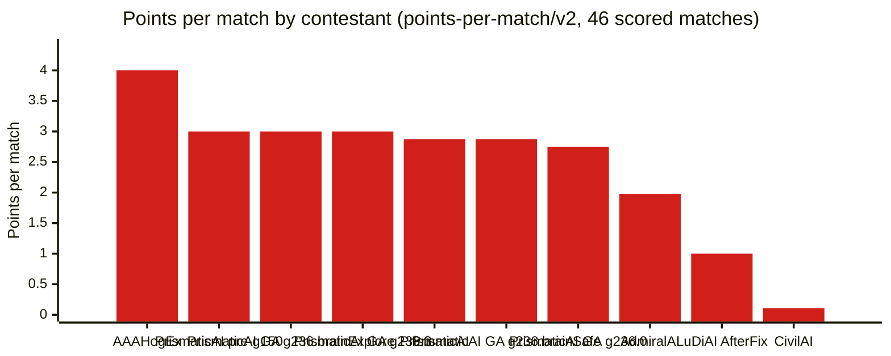
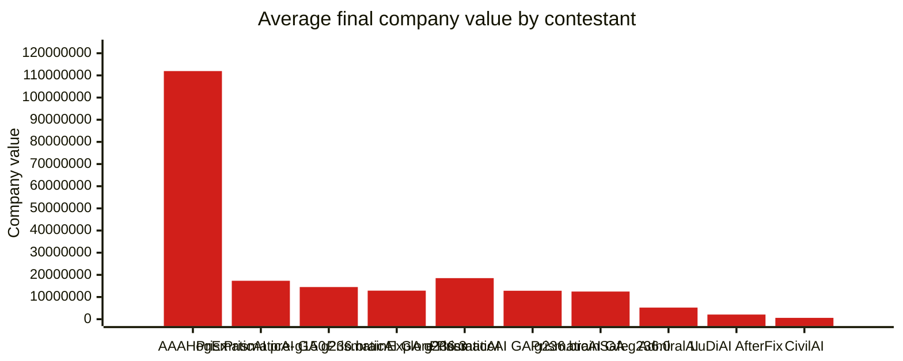
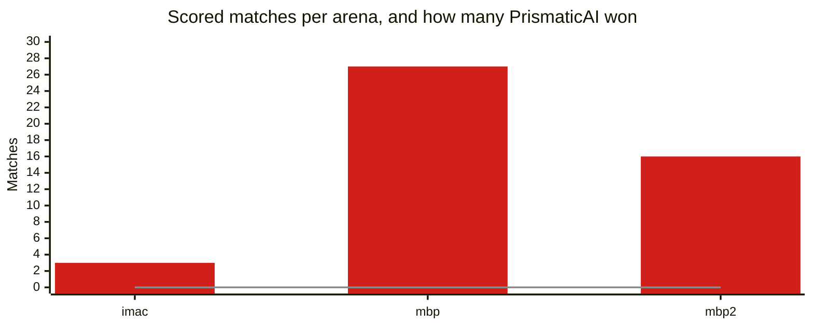

# battle-20261121T061316-1321de94

Derived from `battle-20261121T061316-1321de94.json` by `tools/research/ai-battle/battle.py report`; do not edit.

- Edition `1321de940ccb6d88`: PrismaticAI and referee at `52f631b115782334f422f741a79ecabce78e58c4`, base set `opengfx-8.0.tar`
- 20-year free-for-all from 1960, map 256x256 temperate, breakdowns 1
- 46 scored match(es) on `imac` (20261119-master-gdf1e05e7d8), `mbp` (20261120-master-m17653b726e), `mbp2` (20261119-master-gdf1e05e7d8)
- Replays: 0 of 0 identical to their original on another arena

| # | Contestant | Played | Wins | Points | Points/match | Avg rank | Avg final value | Squirrel errors | Matches with anomalies |
|---|---|---|---|---|---|---|---|---|---|
| 1 | AAAHogEx | 46 | 46 | 184 | 4.0 | 1.0 | 112.0 M | 0 | 0 |
| 2 | PrismaticAI pre-g150 | 8 | 0 | 24 | 3.0 | 2.0 | 17.3 M | 0 | 2 |
| 3 | PrismaticAI GA g236.brainExplore | 8 | 0 | 24 | 3.0 | 2.0 | 14.5 M | 0 | 2 |
| 4 | PrismaticAI GA g236.3 | 6 | 0 | 18 | 3.0 | 2.0 | 12.9 M | 0 | 2 |
| 5 | PrismaticAI | 8 | 0 | 23 | 2.875 | 2.12 | 18.5 M | 0 | 0 |
| 6 | PrismaticAI GA g236.brainSafe | 8 | 0 | 23 | 2.875 | 2.12 | 12.8 M | 0 | 2 |
| 7 | PrismaticAI GA g236.0 | 8 | 0 | 22 | 2.75 | 2.25 | 12.5 M | 0 | 6 |
| 8 | AdmiralAI | 46 | 0 | 91 | 1.978 | 3.02 | 5.2 M | 0 | 4 |
| 9 | LuDiAI AfterFix | 46 | 0 | 46 | 1.0 | 4.0 | 2.1 M | 0 | 1 |
| 10 | CivilAI | 46 | 0 | 5 | 0.109 | 4.89 | 598.4 k | 0 | 8 |

```mermaid
---
config:
  xyChart:
    width: 900
    height: 360
  themeVariables:
    xyChart:
      plotColorPalette: "#d11f1a, #8a8a8a, #0b0b0b, #ece4d6"
---
xychart-beta
    title "Final company value per scored match: winner vs best PrismaticAI"
    x-axis ["m-0001", "m-0002", "m-0003", "m-0004", "m-0005", "m-0006", "m-0007", "m-0008", "m-0009", "m-0010", "m-0011", "m-0012", "m-0013", "m-0014", "m-0015", "m-0016", "m-0017", "m-0018", "m-0019", "m-0020", "m-0021", "m-0022", "m-0023", "m-0024", "m-0025", "m-0026", "m-0027", "m-0028", "m-0036", "m-0037", "m-0038", "m-0039", "m-0040", "m-0041", "m-0042", "m-0043", "m-0044", "m-0045", "m-0046", "m-0047", "m-0048", "m-0049", "m-0050", "m-0051", "m-0052", "m-0054"]
    %% series: Winner | Best PrismaticAI
    %% links: battle-20261121T061316-1321de94.md?col=Match&filter=m-0001 | battle-20261121T061316-1321de94.md?col=Match&filter=m-0002 | battle-20261121T061316-1321de94.md?col=Match&filter=m-0003 | battle-20261121T061316-1321de94.md?col=Match&filter=m-0004 | battle-20261121T061316-1321de94.md?col=Match&filter=m-0005 | battle-20261121T061316-1321de94.md?col=Match&filter=m-0006 | battle-20261121T061316-1321de94.md?col=Match&filter=m-0007 | battle-20261121T061316-1321de94.md?col=Match&filter=m-0008 | battle-20261121T061316-1321de94.md?col=Match&filter=m-0009 | battle-20261121T061316-1321de94.md?col=Match&filter=m-0010 | battle-20261121T061316-1321de94.md?col=Match&filter=m-0011 | battle-20261121T061316-1321de94.md?col=Match&filter=m-0012 | battle-20261121T061316-1321de94.md?col=Match&filter=m-0013 | battle-20261121T061316-1321de94.md?col=Match&filter=m-0014 | battle-20261121T061316-1321de94.md?col=Match&filter=m-0015 | battle-20261121T061316-1321de94.md?col=Match&filter=m-0016 | battle-20261121T061316-1321de94.md?col=Match&filter=m-0017 | battle-20261121T061316-1321de94.md?col=Match&filter=m-0018 | battle-20261121T061316-1321de94.md?col=Match&filter=m-0019 | battle-20261121T061316-1321de94.md?col=Match&filter=m-0020 | battle-20261121T061316-1321de94.md?col=Match&filter=m-0021 | battle-20261121T061316-1321de94.md?col=Match&filter=m-0022 | battle-20261121T061316-1321de94.md?col=Match&filter=m-0023 | battle-20261121T061316-1321de94.md?col=Match&filter=m-0024 | battle-20261121T061316-1321de94.md?col=Match&filter=m-0025 | battle-20261121T061316-1321de94.md?col=Match&filter=m-0026 | battle-20261121T061316-1321de94.md?col=Match&filter=m-0027 | battle-20261121T061316-1321de94.md?col=Match&filter=m-0028 | battle-20261121T061316-1321de94.md?col=Match&filter=m-0036 | battle-20261121T061316-1321de94.md?col=Match&filter=m-0037 | battle-20261121T061316-1321de94.md?col=Match&filter=m-0038 | battle-20261121T061316-1321de94.md?col=Match&filter=m-0039 | battle-20261121T061316-1321de94.md?col=Match&filter=m-0040 | battle-20261121T061316-1321de94.md?col=Match&filter=m-0041 | battle-20261121T061316-1321de94.md?col=Match&filter=m-0042 | battle-20261121T061316-1321de94.md?col=Match&filter=m-0043 | battle-20261121T061316-1321de94.md?col=Match&filter=m-0044 | battle-20261121T061316-1321de94.md?col=Match&filter=m-0045 | battle-20261121T061316-1321de94.md?col=Match&filter=m-0046 | battle-20261121T061316-1321de94.md?col=Match&filter=m-0047 | battle-20261121T061316-1321de94.md?col=Match&filter=m-0048 | battle-20261121T061316-1321de94.md?col=Match&filter=m-0049 | battle-20261121T061316-1321de94.md?col=Match&filter=m-0050 | battle-20261121T061316-1321de94.md?col=Match&filter=m-0051 | battle-20261121T061316-1321de94.md?col=Match&filter=m-0052 | battle-20261121T061316-1321de94.md?col=Match&filter=m-0054
    y-axis "Company value" 0 --> 180000000
    bar [119911075, 133275194, 127690811, 112064774, 131384557, 112509033, 107624451, 110195561, 104862123, 111364707, 123991033, 93109850, 86558520, 92879755, 112578927, 112132734, 121181033, 96680759, 90861545, 96869164, 109455897, 129637188, 105858809, 98255899, 109237469, 119652794, 102843835, 129888788, 111326297, 114302240, 114027159, 128578692, 127035795, 120342962, 86775128, 80438579, 77101314, 70957750, 73679508, 95138339, 140360760, 151965676, 163309953, 157042008, 133795993, 101104039]
    line [21623208, 16920965, 16346511, 16513784, 16416044, 18388816, 21193242, 13359717, 17048146, 18803348, 14473552, 19260824, 18129799, 4747737, 17138167, 14363111, 14268487, 6587247, 14094096, 5238180, 2657894, 6198122, 12058206, 21238039, 16359937, 14190664, 13902678, 16621377, 24276766, 15712941, 24400853, 13541612, 16237032, 11087909, 11536944, 13563394, 5633619, 7008111, 10235795, 8958368, 28190925, 17975113, 15264193, 14991206, 17039047, 18728045]
```

<!-- battle-charts:begin -->
<!-- derived from battle-20261121T061316-1321de94.json by `battle.py render`; `battle.py check` fails when it is stale -->

<!-- battle-charts:end -->

| Match | Arena | Seed | Winner | Value | Last | Anomalies |
|---|---|---|---|---|---|---|
| m-0001 | mbp | 1360360475 | AAAHogEx | 119.9 M | LuDiAI AfterFix | - |
| m-0002 | mbp | 1360360475 | AAAHogEx | 133.3 M | CivilAI | PrismaticAI GA g236.0: fleet_drop:169->109 |
| m-0003 | mbp | 1360360475 | AAAHogEx | 127.7 M | CivilAI | - |
| m-0004 | mbp | 1360360475 | AAAHogEx | 112.1 M | CivilAI | - |
| m-0005 | mbp | 1360360475 | AAAHogEx | 131.4 M | AdmiralAI | PrismaticAI GA g236.3: fleet_drop:163->67 |
| m-0006 | mbp | 640002712 | AAAHogEx | 112.5 M | CivilAI | - |
| m-0007 | mbp | 640002712 | AAAHogEx | 107.6 M | CivilAI | PrismaticAI pre-g150: fleet_drop:145->96 |
| m-0008 | mbp | 640002712 | AAAHogEx | 110.2 M | CivilAI | AdmiralAI: fleet_drop:319->220; LuDiAI AfterFix: fleet_drop:160->110 |
| m-0009 | mbp | 640002712 | AAAHogEx | 104.9 M | CivilAI | PrismaticAI GA g236.brainSafe: fleet_drop:90->53; CivilAI: fleet_drop:24->12 |
| m-0010 | imac | 640002712 | AAAHogEx | 111.4 M | CivilAI | - |
| m-0011 | imac | 640002712 | AAAHogEx | 124.0 M | CivilAI | - |
| m-0012 | imac | 1710760127 | AAAHogEx | 93.1 M | CivilAI | - |
| m-0013 | mbp2 | 1710760127 | AAAHogEx | 86.6 M | CivilAI | CivilAI: fleet_drop:69->33 |
| m-0014 | mbp2 | 1710760127 | AAAHogEx | 92.9 M | LuDiAI AfterFix | PrismaticAI GA g236.0: fleet_drop:52->28 |
| m-0015 | mbp2 | 1710760127 | AAAHogEx | 112.6 M | CivilAI | - |
| m-0016 | mbp2 | 1710760127 | AAAHogEx | 112.1 M | CivilAI | - |
| m-0017 | mbp2 | 1710760127 | AAAHogEx | 121.2 M | CivilAI | PrismaticAI GA g236.3: fleet_drop:107->51; AdmiralAI: fleet_drop:487->313 |
| m-0018 | mbp2 | 421646187 | AAAHogEx | 96.7 M | CivilAI | CivilAI: fleet_drop:40->22 |
| m-0019 | mbp2 | 421646187 | AAAHogEx | 90.9 M | CivilAI | AdmiralAI: fleet_drop:284->156 |
| m-0020 | mbp2 | 421646187 | AAAHogEx | 96.9 M | CivilAI | PrismaticAI GA g236.0: fleet_drop:151->81; CivilAI: fleet_drop:42->16 |
| m-0021 | mbp2 | 421646187 | AAAHogEx | 109.5 M | LuDiAI AfterFix | - |
| m-0022 | mbp2 | 421646187 | AAAHogEx | 129.6 M | CivilAI | PrismaticAI GA g236.brainExplore: fleet_drop:54->30; CivilAI: fleet_drop:124->39 |
| m-0023 | mbp2 | 421646187 | AAAHogEx | 105.9 M | CivilAI | CivilAI: fleet_drop:41->7 |
| m-0024 | mbp2 | 1294927202 | AAAHogEx | 98.3 M | CivilAI | - |
| m-0025 | mbp2 | 1294927202 | AAAHogEx | 109.2 M | CivilAI | - |
| m-0026 | mbp2 | 1294927202 | AAAHogEx | 119.7 M | CivilAI | PrismaticAI GA g236.0: fleet_drop:147->95 |
| m-0027 | mbp2 | 1294927202 | AAAHogEx | 102.8 M | CivilAI | - |
| m-0028 | mbp2 | 1294927202 | AAAHogEx | 129.9 M | CivilAI | - |
| m-0036 | mbp | 72463706 | AAAHogEx | 111.3 M | CivilAI | - |
| m-0037 | mbp | 72463706 | AAAHogEx | 114.3 M | CivilAI | PrismaticAI pre-g150: fleet_drop:89->37; AdmiralAI: fleet_drop:186->115 |
| m-0038 | mbp | 72463706 | AAAHogEx | 114.0 M | CivilAI | - |
| m-0039 | mbp | 72463706 | AAAHogEx | 128.6 M | CivilAI | - |
| m-0040 | mbp | 72463706 | AAAHogEx | 127.0 M | CivilAI | CivilAI: fleet_drop:44->28 |
| m-0041 | mbp | 72463706 | AAAHogEx | 120.3 M | CivilAI | - |
| m-0042 | mbp | 1246753645 | AAAHogEx | 86.8 M | CivilAI | - |
| m-0043 | mbp | 1246753645 | AAAHogEx | 80.4 M | CivilAI | - |
| m-0044 | mbp | 1246753645 | AAAHogEx | 77.1 M | CivilAI | PrismaticAI GA g236.0: fleet_drop:117->80 |
| m-0045 | mbp | 1246753645 | AAAHogEx | 71.0 M | CivilAI | PrismaticAI GA g236.brainSafe: fleet_drop:47->28 |
| m-0046 | mbp | 1246753645 | AAAHogEx | 73.7 M | CivilAI | PrismaticAI GA g236.brainExplore: fleet_drop:91->34 |
| m-0047 | mbp | 1246753645 | AAAHogEx | 95.1 M | LuDiAI AfterFix | - |
| m-0048 | mbp | 291929483 | AAAHogEx | 140.4 M | CivilAI | - |
| m-0049 | mbp | 291929483 | AAAHogEx | 152.0 M | CivilAI | - |
| m-0050 | mbp | 291929483 | AAAHogEx | 163.3 M | CivilAI | PrismaticAI GA g236.0: fleet_drop:187->63; CivilAI: fleet_drop:40->10 |
| m-0051 | mbp | 291929483 | AAAHogEx | 157.0 M | CivilAI | - |
| m-0052 | mbp | 291929483 | AAAHogEx | 133.8 M | CivilAI | - |
| m-0054 | mbp | 78652192 | AAAHogEx | 101.1 M | CivilAI | - |
