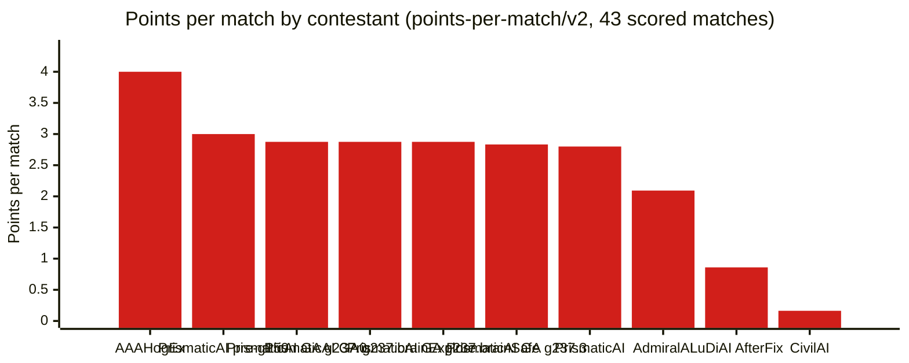
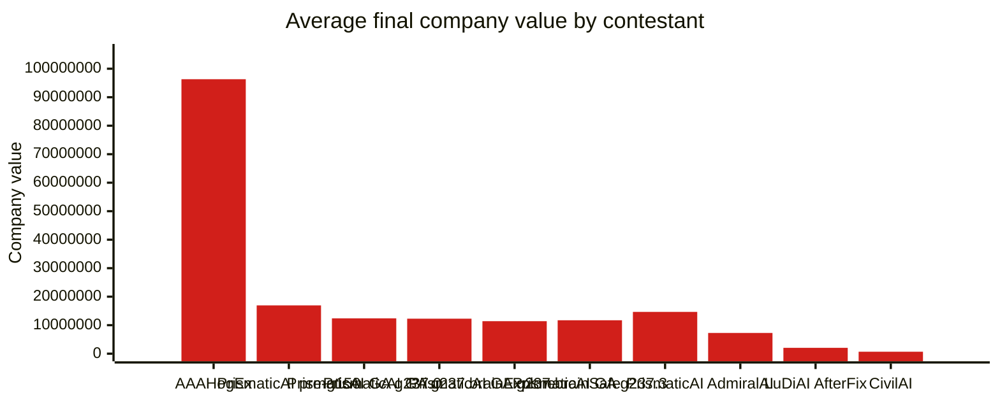
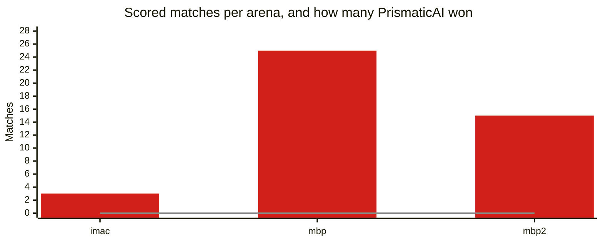

# battle-20261121T062305-f0187ebf

Derived from `battle-20261121T062305-f0187ebf.json` by `tools/research/ai-battle/battle.py report`; do not edit.

- Edition `f0187ebf16b8f339`: PrismaticAI and referee at `52f631b115782334f422f741a79ecabce78e58c4`, base set `opengfx-8.0.tar`
- 20-year free-for-all from 1960, map 256x256 temperate, breakdowns 1
- 43 scored match(es) on `imac` (20261119-master-gdf1e05e7d8), `mbp` (20261120-master-m17653b726e), `mbp2` (20261119-master-gdf1e05e7d8)
- Replays: 1 of 1 identical to their original on another arena

| # | Contestant | Played | Wins | Points | Points/match | Avg rank | Avg final value | Squirrel errors | Matches with anomalies |
|---|---|---|---|---|---|---|---|---|---|
| 1 | AAAHogEx | 43 | 43 | 172 | 4.0 | 1.0 | 96.3 M | 0 | 0 |
| 2 | PrismaticAI pre-g150 | 8 | 0 | 24 | 3.0 | 2.0 | 16.9 M | 0 | 2 |
| 3 | PrismaticAI GA g237.0 | 8 | 0 | 23 | 2.875 | 2.12 | 12.4 M | 0 | 1 |
| 4 | PrismaticAI GA g237.brainExplore | 8 | 0 | 23 | 2.875 | 2.12 | 12.3 M | 0 | 2 |
| 5 | PrismaticAI GA g237.brainSafe | 8 | 0 | 23 | 2.875 | 2.12 | 11.4 M | 0 | 6 |
| 6 | PrismaticAI GA g237.3 | 6 | 0 | 17 | 2.833 | 2.17 | 11.7 M | 0 | 0 |
| 7 | PrismaticAI | 5 | 0 | 14 | 2.8 | 2.2 | 14.7 M | 0 | 0 |
| 8 | AdmiralAI | 43 | 0 | 90 | 2.093 | 2.91 | 7.3 M | 0 | 3 |
| 9 | LuDiAI AfterFix | 43 | 0 | 37 | 0.86 | 4.14 | 2.0 M | 0 | 0 |
| 10 | CivilAI | 43 | 0 | 7 | 0.163 | 4.84 | 680.1 k | 0 | 3 |

```mermaid
---
config:
  xyChart:
    width: 900
    height: 360
  themeVariables:
    xyChart:
      plotColorPalette: "#d11f1a, #8a8a8a, #0b0b0b, #ece4d6"
---
xychart-beta
    title "Final company value per scored match: winner vs best PrismaticAI"
    x-axis ["m-0001", "m-0002", "m-0003", "m-0004", "m-0005", "m-0006", "m-0007", "m-0008", "m-0009", "m-0010", "m-0011", "m-0012", "m-0013", "m-0014", "m-0015", "m-0016", "m-0017", "m-0019", "m-0020", "m-0021", "m-0022", "m-0023", "m-0024", "m-0025", "m-0026", "m-0027", "m-0028", "m-0036", "m-0037", "m-0038", "m-0039", "m-0040", "m-0041", "m-0042", "m-0043", "m-0044", "m-0045", "m-0046", "m-0047", "m-0049", "m-0050", "m-0051", "m-0052"]
    %% series: Winner | Best PrismaticAI
    %% links: battle-20261121T062305-f0187ebf.md?col=Match&filter=m-0001 | battle-20261121T062305-f0187ebf.md?col=Match&filter=m-0002 | battle-20261121T062305-f0187ebf.md?col=Match&filter=m-0003 | battle-20261121T062305-f0187ebf.md?col=Match&filter=m-0004 | battle-20261121T062305-f0187ebf.md?col=Match&filter=m-0005 | battle-20261121T062305-f0187ebf.md?col=Match&filter=m-0006 | battle-20261121T062305-f0187ebf.md?col=Match&filter=m-0007 | battle-20261121T062305-f0187ebf.md?col=Match&filter=m-0008 | battle-20261121T062305-f0187ebf.md?col=Match&filter=m-0009 | battle-20261121T062305-f0187ebf.md?col=Match&filter=m-0010 | battle-20261121T062305-f0187ebf.md?col=Match&filter=m-0011 | battle-20261121T062305-f0187ebf.md?col=Match&filter=m-0012 | battle-20261121T062305-f0187ebf.md?col=Match&filter=m-0013 | battle-20261121T062305-f0187ebf.md?col=Match&filter=m-0014 | battle-20261121T062305-f0187ebf.md?col=Match&filter=m-0015 | battle-20261121T062305-f0187ebf.md?col=Match&filter=m-0016 | battle-20261121T062305-f0187ebf.md?col=Match&filter=m-0017 | battle-20261121T062305-f0187ebf.md?col=Match&filter=m-0019 | battle-20261121T062305-f0187ebf.md?col=Match&filter=m-0020 | battle-20261121T062305-f0187ebf.md?col=Match&filter=m-0021 | battle-20261121T062305-f0187ebf.md?col=Match&filter=m-0022 | battle-20261121T062305-f0187ebf.md?col=Match&filter=m-0023 | battle-20261121T062305-f0187ebf.md?col=Match&filter=m-0024 | battle-20261121T062305-f0187ebf.md?col=Match&filter=m-0025 | battle-20261121T062305-f0187ebf.md?col=Match&filter=m-0026 | battle-20261121T062305-f0187ebf.md?col=Match&filter=m-0027 | battle-20261121T062305-f0187ebf.md?col=Match&filter=m-0028 | battle-20261121T062305-f0187ebf.md?col=Match&filter=m-0036 | battle-20261121T062305-f0187ebf.md?col=Match&filter=m-0037 | battle-20261121T062305-f0187ebf.md?col=Match&filter=m-0038 | battle-20261121T062305-f0187ebf.md?col=Match&filter=m-0039 | battle-20261121T062305-f0187ebf.md?col=Match&filter=m-0040 | battle-20261121T062305-f0187ebf.md?col=Match&filter=m-0041 | battle-20261121T062305-f0187ebf.md?col=Match&filter=m-0042 | battle-20261121T062305-f0187ebf.md?col=Match&filter=m-0043 | battle-20261121T062305-f0187ebf.md?col=Match&filter=m-0044 | battle-20261121T062305-f0187ebf.md?col=Match&filter=m-0045 | battle-20261121T062305-f0187ebf.md?col=Match&filter=m-0046 | battle-20261121T062305-f0187ebf.md?col=Match&filter=m-0047 | battle-20261121T062305-f0187ebf.md?col=Match&filter=m-0049 | battle-20261121T062305-f0187ebf.md?col=Match&filter=m-0050 | battle-20261121T062305-f0187ebf.md?col=Match&filter=m-0051 | battle-20261121T062305-f0187ebf.md?col=Match&filter=m-0052
    y-axis "Company value" 0 --> 160000000
    bar [84461815, 88825221, 75083336, 88825221, 71417269, 81819025, 79210136, 77713318, 73089756, 83563573, 82831139, 105221677, 89297020, 123879092, 87417137, 123879092, 104700975, 112996647, 90017650, 86746531, 90017650, 100885147, 72634272, 68306327, 84361335, 73722013, 84361335, 114300665, 109525496, 76001706, 86755861, 76001706, 92412264, 139102770, 145829235, 123484385, 125601743, 123484385, 109475798, 122115593, 109510037, 93192082, 109510037]
    line [12121503, 11656723, 8796687, 11656723, 13787644, 20238239, 21165517, 8283698, 4465584, 7298290, 8373740, 20900847, 16268337, 12549730, 18132888, 12549730, 12573050, 17082984, 12650736, 16693532, 12650736, 13140049, 11677094, 13976444, 14518447, 9000941, 14518447, 12196862, 18053338, 9215055, 11258596, 9215055, 11095058, 8289466, 10047942, 13395077, 8569879, 13395077, 11360543, 26812669, 16916467, 14274257, 16916467]
```

<!-- battle-charts:begin -->
<!-- derived from battle-20261121T062305-f0187ebf.json by `battle.py render`; `battle.py check` fails when it is stale -->

<!-- battle-charts:end -->

| Seed | Original | Replay | Arenas | Identical |
|---|---|---|---|---|
| 474276593 | m-0025 | m-0048 | mbp2 / mbp | yes |

| Match | Arena | Seed | Winner | Value | Last | Anomalies |
|---|---|---|---|---|---|---|
| m-0001 | mbp | 1125698069 | AAAHogEx | 84.5 M | CivilAI | PrismaticAI pre-g150: fleet_drop:107->56 |
| m-0002 | mbp | 1125698069 | AAAHogEx | 88.8 M | CivilAI | - |
| m-0003 | mbp | 1125698069 | AAAHogEx | 75.1 M | CivilAI | PrismaticAI GA g237.brainSafe: fleet_drop:50->25 |
| m-0004 | mbp | 1125698069 | AAAHogEx | 88.8 M | CivilAI | - |
| m-0005 | mbp | 1125698069 | AAAHogEx | 71.4 M | CivilAI | - |
| m-0006 | mbp | 1213124260 | AAAHogEx | 81.8 M | CivilAI | - |
| m-0007 | mbp | 1213124260 | AAAHogEx | 79.2 M | CivilAI | AdmiralAI: fleet_drop:297->185 |
| m-0008 | mbp | 1213124260 | AAAHogEx | 77.7 M | CivilAI | - |
| m-0009 | mbp | 1213124260 | AAAHogEx | 73.1 M | CivilAI | PrismaticAI GA g237.brainSafe: fleet_drop:55->26 |
| m-0010 | imac | 1213124260 | AAAHogEx | 83.6 M | CivilAI | PrismaticAI GA g237.brainExplore: fleet_drop:86->45 |
| m-0011 | imac | 1213124260 | AAAHogEx | 82.8 M | CivilAI | - |
| m-0012 | imac | 655086457 | AAAHogEx | 105.2 M | CivilAI | - |
| m-0013 | mbp2 | 655086457 | AAAHogEx | 89.3 M | CivilAI | - |
| m-0014 | mbp2 | 655086457 | AAAHogEx | 123.9 M | CivilAI | PrismaticAI GA g237.0: fleet_drop:72->43 |
| m-0015 | mbp2 | 655086457 | AAAHogEx | 87.4 M | CivilAI | PrismaticAI GA g237.brainSafe: fleet_drop:139->91 |
| m-0016 | mbp2 | 655086457 | AAAHogEx | 123.9 M | CivilAI | PrismaticAI GA g237.brainExplore: fleet_drop:72->43 |
| m-0017 | mbp2 | 655086457 | AAAHogEx | 104.7 M | CivilAI | - |
| m-0019 | mbp2 | 984780661 | AAAHogEx | 113.0 M | CivilAI | - |
| m-0020 | mbp2 | 984780661 | AAAHogEx | 90.0 M | CivilAI | - |
| m-0021 | mbp2 | 984780661 | AAAHogEx | 86.7 M | CivilAI | PrismaticAI GA g237.brainSafe: fleet_drop:116->66 |
| m-0022 | mbp2 | 984780661 | AAAHogEx | 90.0 M | CivilAI | - |
| m-0023 | mbp2 | 984780661 | AAAHogEx | 100.9 M | CivilAI | - |
| m-0024 | mbp2 | 474276593 | AAAHogEx | 72.6 M | CivilAI | - |
| m-0025 | mbp2 | 474276593 | AAAHogEx | 68.3 M | LuDiAI AfterFix | - |
| m-0026 | mbp2 | 474276593 | AAAHogEx | 84.4 M | CivilAI | CivilAI: fleet_drop:25->14 |
| m-0027 | mbp2 | 474276593 | AAAHogEx | 73.7 M | CivilAI | - |
| m-0028 | mbp2 | 474276593 | AAAHogEx | 84.4 M | CivilAI | CivilAI: fleet_drop:25->14 |
| m-0036 | mbp | 394275091 | AAAHogEx | 114.3 M | LuDiAI AfterFix | - |
| m-0037 | mbp | 394275091 | AAAHogEx | 109.5 M | CivilAI | - |
| m-0038 | mbp | 394275091 | AAAHogEx | 76.0 M | LuDiAI AfterFix | - |
| m-0039 | mbp | 394275091 | AAAHogEx | 86.8 M | LuDiAI AfterFix | - |
| m-0040 | mbp | 394275091 | AAAHogEx | 76.0 M | LuDiAI AfterFix | - |
| m-0041 | mbp | 394275091 | AAAHogEx | 92.4 M | LuDiAI AfterFix | - |
| m-0042 | mbp | 922919389 | AAAHogEx | 139.1 M | CivilAI | - |
| m-0043 | mbp | 922919389 | AAAHogEx | 145.8 M | CivilAI | - |
| m-0044 | mbp | 922919389 | AAAHogEx | 123.5 M | CivilAI | AdmiralAI: fleet_drop:332->206 |
| m-0045 | mbp | 922919389 | AAAHogEx | 125.6 M | CivilAI | PrismaticAI GA g237.brainSafe: fleet_drop:84->49 |
| m-0046 | mbp | 922919389 | AAAHogEx | 123.5 M | CivilAI | AdmiralAI: fleet_drop:332->206 |
| m-0047 | mbp | 922919389 | AAAHogEx | 109.5 M | CivilAI | - |
| m-0048 (replay) | mbp | 474276593 | AAAHogEx | 68.3 M | LuDiAI AfterFix | - |
| m-0049 | mbp | 1184847936 | AAAHogEx | 122.1 M | CivilAI | PrismaticAI pre-g150: fleet_drop:132->87 |
| m-0050 | mbp | 1184847936 | AAAHogEx | 109.5 M | CivilAI | - |
| m-0051 | mbp | 1184847936 | AAAHogEx | 93.2 M | LuDiAI AfterFix | PrismaticAI GA g237.brainSafe: fleet_drop:74->47; CivilAI: fleet_drop:49->29 |
| m-0052 | mbp | 1184847936 | AAAHogEx | 109.5 M | CivilAI | - |
