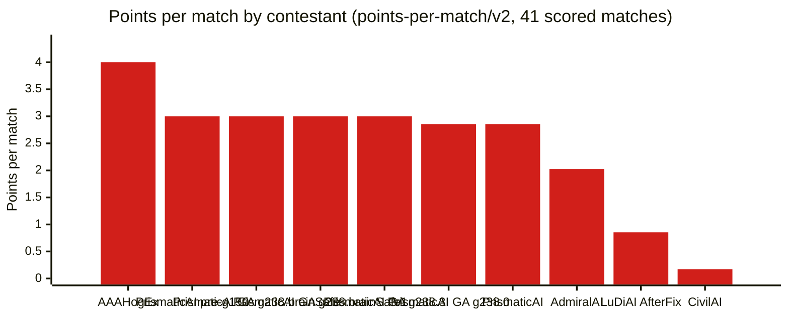
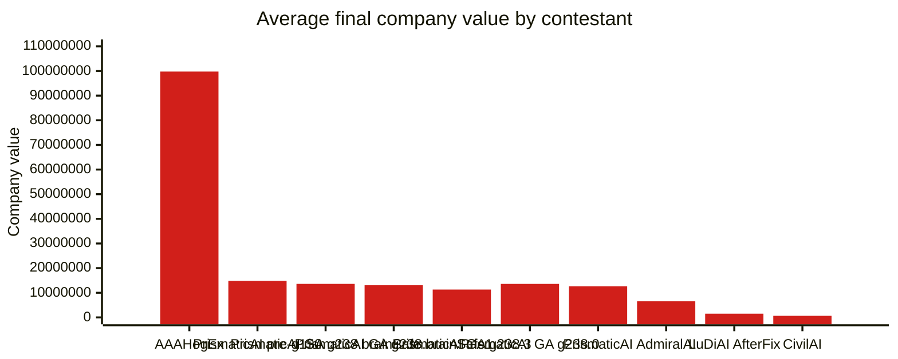
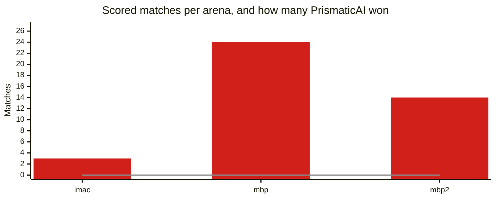

# battle-20261121T063216-f9bd9673

Derived from `battle-20261121T063216-f9bd9673.json` by `tools/research/ai-battle/battle.py report`; do not edit.

- Edition `f9bd9673fa504240`: PrismaticAI and referee at `52f631b115782334f422f741a79ecabce78e58c4`, base set `opengfx-8.0.tar`
- 20-year free-for-all from 1960, map 256x256 temperate, breakdowns 1
- 41 scored match(es) on `imac` (20261119-master-gdf1e05e7d8), `mbp` (20261120-master-m17653b726e), `mbp2` (20261119-master-gdf1e05e7d8)
- Replays: 0 of 0 identical to their original on another arena

| # | Contestant | Played | Wins | Points | Points/match | Avg rank | Avg final value | Squirrel errors | Matches with anomalies |
|---|---|---|---|---|---|---|---|---|---|
| 1 | AAAHogEx | 41 | 41 | 164 | 4.0 | 1.0 | 99.8 M | 0 | 0 |
| 2 | PrismaticAI pre-g150 | 8 | 0 | 24 | 3.0 | 2.0 | 14.8 M | 0 | 3 |
| 3 | PrismaticAI GA g238.brainSafe | 7 | 0 | 21 | 3.0 | 2.0 | 13.6 M | 0 | 0 |
| 4 | PrismaticAI GA g238.brainSafe1 | 6 | 0 | 18 | 3.0 | 2.0 | 13.1 M | 0 | 2 |
| 5 | PrismaticAI GA g238.3 | 6 | 0 | 18 | 3.0 | 2.0 | 11.3 M | 0 | 2 |
| 6 | PrismaticAI GA g238.0 | 7 | 0 | 20 | 2.857 | 2.14 | 13.6 M | 0 | 0 |
| 7 | PrismaticAI | 7 | 0 | 20 | 2.857 | 2.14 | 12.6 M | 0 | 0 |
| 8 | AdmiralAI | 41 | 0 | 83 | 2.024 | 2.98 | 6.5 M | 116 | 2 |
| 9 | LuDiAI AfterFix | 41 | 0 | 35 | 0.854 | 4.15 | 1.5 M | 0 | 1 |
| 10 | CivilAI | 41 | 0 | 7 | 0.171 | 4.83 | 643.4 k | 0 | 13 |

```mermaid
---
config:
  xyChart:
    width: 900
    height: 360
  themeVariables:
    xyChart:
      plotColorPalette: "#d11f1a, #8a8a8a, #0b0b0b, #ece4d6"
---
xychart-beta
    title "Final company value per scored match: winner vs best PrismaticAI"
    x-axis ["m-0001", "m-0002", "m-0003", "m-0004", "m-0005", "m-0006", "m-0007", "m-0008", "m-0009", "m-0010", "m-0011", "m-0012", "m-0013", "m-0014", "m-0015", "m-0018", "m-0019", "m-0020", "m-0021", "m-0022", "m-0023", "m-0024", "m-0025", "m-0026", "m-0027", "m-0028", "m-0036", "m-0037", "m-0038", "m-0039", "m-0040", "m-0041", "m-0042", "m-0043", "m-0044", "m-0045", "m-0046", "m-0047", "m-0048", "m-0049", "m-0053"]
    %% series: Winner | Best PrismaticAI
    %% links: battle-20261121T063216-f9bd9673.md?col=Match&filter=m-0001 | battle-20261121T063216-f9bd9673.md?col=Match&filter=m-0002 | battle-20261121T063216-f9bd9673.md?col=Match&filter=m-0003 | battle-20261121T063216-f9bd9673.md?col=Match&filter=m-0004 | battle-20261121T063216-f9bd9673.md?col=Match&filter=m-0005 | battle-20261121T063216-f9bd9673.md?col=Match&filter=m-0006 | battle-20261121T063216-f9bd9673.md?col=Match&filter=m-0007 | battle-20261121T063216-f9bd9673.md?col=Match&filter=m-0008 | battle-20261121T063216-f9bd9673.md?col=Match&filter=m-0009 | battle-20261121T063216-f9bd9673.md?col=Match&filter=m-0010 | battle-20261121T063216-f9bd9673.md?col=Match&filter=m-0011 | battle-20261121T063216-f9bd9673.md?col=Match&filter=m-0012 | battle-20261121T063216-f9bd9673.md?col=Match&filter=m-0013 | battle-20261121T063216-f9bd9673.md?col=Match&filter=m-0014 | battle-20261121T063216-f9bd9673.md?col=Match&filter=m-0015 | battle-20261121T063216-f9bd9673.md?col=Match&filter=m-0018 | battle-20261121T063216-f9bd9673.md?col=Match&filter=m-0019 | battle-20261121T063216-f9bd9673.md?col=Match&filter=m-0020 | battle-20261121T063216-f9bd9673.md?col=Match&filter=m-0021 | battle-20261121T063216-f9bd9673.md?col=Match&filter=m-0022 | battle-20261121T063216-f9bd9673.md?col=Match&filter=m-0023 | battle-20261121T063216-f9bd9673.md?col=Match&filter=m-0024 | battle-20261121T063216-f9bd9673.md?col=Match&filter=m-0025 | battle-20261121T063216-f9bd9673.md?col=Match&filter=m-0026 | battle-20261121T063216-f9bd9673.md?col=Match&filter=m-0027 | battle-20261121T063216-f9bd9673.md?col=Match&filter=m-0028 | battle-20261121T063216-f9bd9673.md?col=Match&filter=m-0036 | battle-20261121T063216-f9bd9673.md?col=Match&filter=m-0037 | battle-20261121T063216-f9bd9673.md?col=Match&filter=m-0038 | battle-20261121T063216-f9bd9673.md?col=Match&filter=m-0039 | battle-20261121T063216-f9bd9673.md?col=Match&filter=m-0040 | battle-20261121T063216-f9bd9673.md?col=Match&filter=m-0041 | battle-20261121T063216-f9bd9673.md?col=Match&filter=m-0042 | battle-20261121T063216-f9bd9673.md?col=Match&filter=m-0043 | battle-20261121T063216-f9bd9673.md?col=Match&filter=m-0044 | battle-20261121T063216-f9bd9673.md?col=Match&filter=m-0045 | battle-20261121T063216-f9bd9673.md?col=Match&filter=m-0046 | battle-20261121T063216-f9bd9673.md?col=Match&filter=m-0047 | battle-20261121T063216-f9bd9673.md?col=Match&filter=m-0048 | battle-20261121T063216-f9bd9673.md?col=Match&filter=m-0049 | battle-20261121T063216-f9bd9673.md?col=Match&filter=m-0053
    y-axis "Company value" 0 --> 174000000
    bar [119482325, 123940253, 120249611, 104547310, 114239236, 120666671, 107176122, 85627409, 86957260, 72791595, 91074656, 134237500, 133305686, 97693908, 119076401, 130807585, 157939820, 99680550, 99468306, 109723822, 117362384, 64769355, 76985608, 64750177, 62466750, 87283181, 75610249, 71732812, 96505418, 79513506, 88125034, 98523333, 110313753, 89047731, 121865078, 111585497, 111805299, 106522360, 70838424, 72943909, 83049474]
    line [15821050, 12792324, 13748596, 10920220, 10541794, 12705446, 16967847, 13457196, 12203916, 11038103, 15401964, 19677829, 22243305, 12730160, 16512349, 11106023, 10035570, 14866854, 16122925, 12609420, 18153307, 14104272, 18210850, 14753293, 19370187, 14392475, 14469532, 12484404, 15249828, 11305383, 12439047, 12177720, 10118202, 16308726, 11331049, 5973579, 16914942, 6131022, 6271093, 6602956, 5430917]
```

<!-- battle-charts:begin -->
<!-- derived from battle-20261121T063216-f9bd9673.json by `battle.py render`; `battle.py check` fails when it is stale -->

<!-- battle-charts:end -->

| Match | Arena | Seed | Winner | Value | Last | Anomalies |
|---|---|---|---|---|---|---|
| m-0001 | mbp | 165178752 | AAAHogEx | 119.5 M | LuDiAI AfterFix | - |
| m-0002 | mbp | 165178752 | AAAHogEx | 123.9 M | CivilAI | CivilAI: fleet_drop:64->40 |
| m-0003 | mbp | 165178752 | AAAHogEx | 120.2 M | CivilAI | - |
| m-0004 | mbp | 165178752 | AAAHogEx | 104.5 M | CivilAI | CivilAI: fleet_drop:72->47 |
| m-0005 | mbp | 165178752 | AAAHogEx | 114.2 M | CivilAI | PrismaticAI GA g238.3: fleet_drop:99->59; AdmiralAI: squirrel_errors:44; CivilAI: fleet_drop:77->50 |
| m-0006 | mbp | 204571968 | AAAHogEx | 120.7 M | LuDiAI AfterFix | - |
| m-0007 | mbp | 204571968 | AAAHogEx | 107.2 M | CivilAI | - |
| m-0008 | mbp | 204571968 | AAAHogEx | 85.6 M | CivilAI | AdmiralAI: squirrel_errors:72 |
| m-0009 | mbp | 204571968 | AAAHogEx | 87.0 M | CivilAI | - |
| m-0010 | imac | 204571968 | AAAHogEx | 72.8 M | LuDiAI AfterFix | PrismaticAI GA g238.brainSafe1: fleet_drop:105->68 |
| m-0011 | imac | 204571968 | AAAHogEx | 91.1 M | CivilAI | - |
| m-0012 | imac | 469910053 | AAAHogEx | 134.2 M | LuDiAI AfterFix | - |
| m-0013 | mbp2 | 469910053 | AAAHogEx | 133.3 M | CivilAI | PrismaticAI pre-g150: fleet_drop:114->73; CivilAI: fleet_drop:29->18 |
| m-0014 | mbp2 | 469910053 | AAAHogEx | 97.7 M | CivilAI | - |
| m-0015 | mbp2 | 469910053 | AAAHogEx | 119.1 M | CivilAI | - |
| m-0018 | mbp2 | 1368260298 | AAAHogEx | 130.8 M | CivilAI | - |
| m-0019 | mbp2 | 1368260298 | AAAHogEx | 157.9 M | LuDiAI AfterFix | - |
| m-0020 | mbp2 | 1368260298 | AAAHogEx | 99.7 M | CivilAI | - |
| m-0021 | mbp2 | 1368260298 | AAAHogEx | 99.5 M | CivilAI | LuDiAI AfterFix: fleet_drop:61->42; CivilAI: fleet_drop:80->50 |
| m-0022 | mbp2 | 1368260298 | AAAHogEx | 109.7 M | CivilAI | - |
| m-0023 | mbp2 | 1368260298 | AAAHogEx | 117.4 M | CivilAI | - |
| m-0024 | mbp2 | 263042094 | AAAHogEx | 64.8 M | LuDiAI AfterFix | - |
| m-0025 | mbp2 | 263042094 | AAAHogEx | 77.0 M | CivilAI | PrismaticAI pre-g150: fleet_drop:67->33; CivilAI: fleet_drop:68->25 |
| m-0026 | mbp2 | 263042094 | AAAHogEx | 64.8 M | CivilAI | CivilAI: fleet_drop:58->35 |
| m-0027 | mbp2 | 263042094 | AAAHogEx | 62.5 M | CivilAI | - |
| m-0028 | mbp2 | 263042094 | AAAHogEx | 87.3 M | CivilAI | PrismaticAI GA g238.brainSafe1: fleet_drop:91->55; CivilAI: fleet_drop:86->48 |
| m-0036 | mbp | 580768185 | AAAHogEx | 75.6 M | CivilAI | - |
| m-0037 | mbp | 580768185 | AAAHogEx | 71.7 M | CivilAI | - |
| m-0038 | mbp | 580768185 | AAAHogEx | 96.5 M | CivilAI | - |
| m-0039 | mbp | 580768185 | AAAHogEx | 79.5 M | CivilAI | CivilAI: fleet_drop:43->17 |
| m-0040 | mbp | 580768185 | AAAHogEx | 88.1 M | CivilAI | - |
| m-0041 | mbp | 580768185 | AAAHogEx | 98.5 M | CivilAI | CivilAI: fleet_drop:44->24 |
| m-0042 | mbp | 292983478 | AAAHogEx | 110.3 M | CivilAI | - |
| m-0043 | mbp | 292983478 | AAAHogEx | 89.0 M | CivilAI | PrismaticAI pre-g150: fleet_drop:91->58 |
| m-0044 | mbp | 292983478 | AAAHogEx | 121.9 M | LuDiAI AfterFix | - |
| m-0045 | mbp | 292983478 | AAAHogEx | 111.6 M | CivilAI | - |
| m-0046 | mbp | 292983478 | AAAHogEx | 111.8 M | CivilAI | CivilAI: fleet_drop:30->1 |
| m-0047 | mbp | 292983478 | AAAHogEx | 106.5 M | CivilAI | - |
| m-0048 | mbp | 1572907984 | AAAHogEx | 70.8 M | CivilAI | - |
| m-0049 | mbp | 1572907984 | AAAHogEx | 72.9 M | CivilAI | CivilAI: fleet_drop:47->12 |
| m-0053 | mbp | 1572907984 | AAAHogEx | 83.0 M | CivilAI | PrismaticAI GA g238.3: fleet_drop:52->32; CivilAI: fleet_drop:18->10 |
