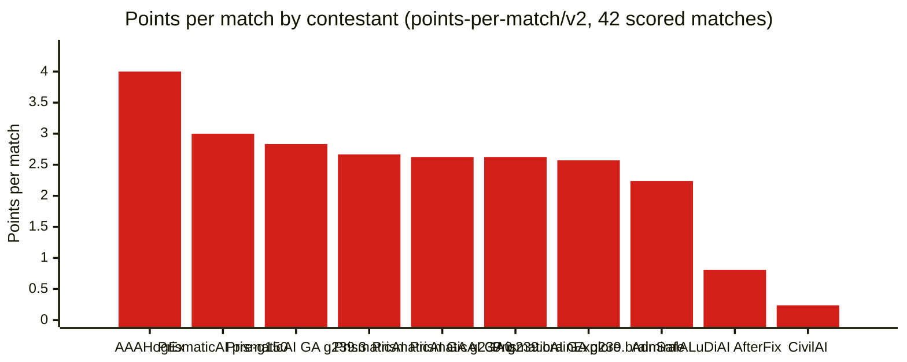
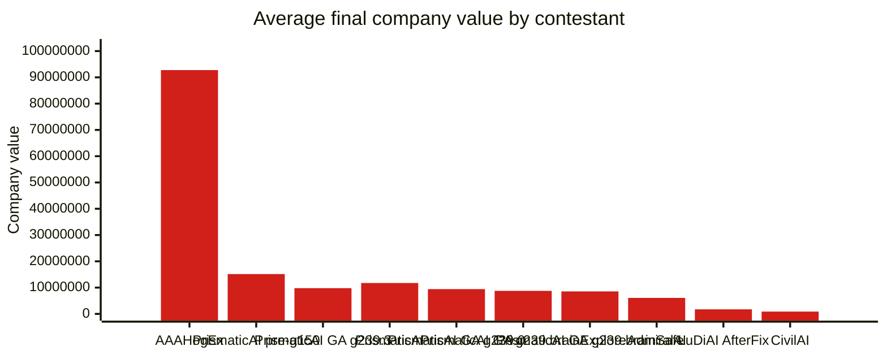
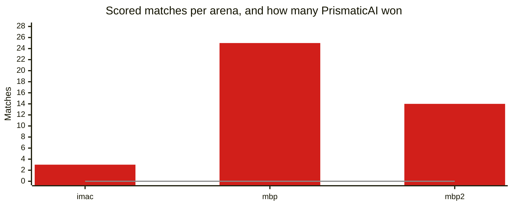

# battle-20261121T064152-94a0929d

Derived from `battle-20261121T064152-94a0929d.json` by `tools/research/ai-battle/battle.py report`; do not edit.

- Edition `94a0929db5bb11b0`: PrismaticAI and referee at `52f631b115782334f422f741a79ecabce78e58c4`, base set `opengfx-8.0.tar`
- 20-year free-for-all from 1960, map 256x256 temperate, breakdowns 1
- 42 scored match(es) on `imac` (20261119-master-gdf1e05e7d8), `mbp` (20261120-master-m17653b726e), `mbp2` (20261119-master-gdf1e05e7d8)
- Replays: 0 of 0 identical to their original on another arena

| # | Contestant | Played | Wins | Points | Points/match | Avg rank | Avg final value | Squirrel errors | Matches with anomalies |
|---|---|---|---|---|---|---|---|---|---|
| 1 | AAAHogEx | 42 | 42 | 168 | 4.0 | 1.0 | 92.8 M | 0 | 0 |
| 2 | PrismaticAI pre-g150 | 7 | 0 | 21 | 3.0 | 2.0 | 15.1 M | 0 | 6 |
| 3 | PrismaticAI GA g239.3 | 6 | 0 | 17 | 2.833 | 2.17 | 9.8 M | 0 | 0 |
| 4 | PrismaticAI | 6 | 0 | 16 | 2.667 | 2.33 | 11.7 M | 0 | 0 |
| 5 | PrismaticAI GA g239.0 | 8 | 0 | 21 | 2.625 | 2.38 | 9.4 M | 0 | 4 |
| 6 | PrismaticAI GA g239.brainExplore | 8 | 0 | 21 | 2.625 | 2.38 | 8.8 M | 0 | 1 |
| 7 | PrismaticAI GA g239.brainSafe | 7 | 0 | 18 | 2.571 | 2.43 | 8.6 M | 0 | 1 |
| 8 | AdmiralAI | 42 | 0 | 94 | 2.238 | 2.76 | 6.1 M | 0 | 1 |
| 9 | LuDiAI AfterFix | 42 | 0 | 34 | 0.81 | 4.19 | 1.7 M | 0 | 1 |
| 10 | CivilAI | 42 | 0 | 10 | 0.238 | 4.76 | 871.4 k | 3660 | 7 |

```mermaid
---
config:
  xyChart:
    width: 900
    height: 360
  themeVariables:
    xyChart:
      plotColorPalette: "#d11f1a, #8a8a8a, #0b0b0b, #ece4d6"
---
xychart-beta
    title "Final company value per scored match: winner vs best PrismaticAI"
    x-axis ["m-0001", "m-0002", "m-0003", "m-0004", "m-0005", "m-0006", "m-0007", "m-0008", "m-0009", "m-0010", "m-0011", "m-0012", "m-0013", "m-0014", "m-0015", "m-0016", "m-0017", "m-0018", "m-0019", "m-0020", "m-0021", "m-0022", "m-0023", "m-0026", "m-0027", "m-0028", "m-0036", "m-0037", "m-0038", "m-0039", "m-0040", "m-0041", "m-0042", "m-0043", "m-0044", "m-0045", "m-0046", "m-0047", "m-0048", "m-0049", "m-0050", "m-0052"]
    %% series: Winner | Best PrismaticAI
    %% links: battle-20261121T064152-94a0929d.md?col=Match&filter=m-0001 | battle-20261121T064152-94a0929d.md?col=Match&filter=m-0002 | battle-20261121T064152-94a0929d.md?col=Match&filter=m-0003 | battle-20261121T064152-94a0929d.md?col=Match&filter=m-0004 | battle-20261121T064152-94a0929d.md?col=Match&filter=m-0005 | battle-20261121T064152-94a0929d.md?col=Match&filter=m-0006 | battle-20261121T064152-94a0929d.md?col=Match&filter=m-0007 | battle-20261121T064152-94a0929d.md?col=Match&filter=m-0008 | battle-20261121T064152-94a0929d.md?col=Match&filter=m-0009 | battle-20261121T064152-94a0929d.md?col=Match&filter=m-0010 | battle-20261121T064152-94a0929d.md?col=Match&filter=m-0011 | battle-20261121T064152-94a0929d.md?col=Match&filter=m-0012 | battle-20261121T064152-94a0929d.md?col=Match&filter=m-0013 | battle-20261121T064152-94a0929d.md?col=Match&filter=m-0014 | battle-20261121T064152-94a0929d.md?col=Match&filter=m-0015 | battle-20261121T064152-94a0929d.md?col=Match&filter=m-0016 | battle-20261121T064152-94a0929d.md?col=Match&filter=m-0017 | battle-20261121T064152-94a0929d.md?col=Match&filter=m-0018 | battle-20261121T064152-94a0929d.md?col=Match&filter=m-0019 | battle-20261121T064152-94a0929d.md?col=Match&filter=m-0020 | battle-20261121T064152-94a0929d.md?col=Match&filter=m-0021 | battle-20261121T064152-94a0929d.md?col=Match&filter=m-0022 | battle-20261121T064152-94a0929d.md?col=Match&filter=m-0023 | battle-20261121T064152-94a0929d.md?col=Match&filter=m-0026 | battle-20261121T064152-94a0929d.md?col=Match&filter=m-0027 | battle-20261121T064152-94a0929d.md?col=Match&filter=m-0028 | battle-20261121T064152-94a0929d.md?col=Match&filter=m-0036 | battle-20261121T064152-94a0929d.md?col=Match&filter=m-0037 | battle-20261121T064152-94a0929d.md?col=Match&filter=m-0038 | battle-20261121T064152-94a0929d.md?col=Match&filter=m-0039 | battle-20261121T064152-94a0929d.md?col=Match&filter=m-0040 | battle-20261121T064152-94a0929d.md?col=Match&filter=m-0041 | battle-20261121T064152-94a0929d.md?col=Match&filter=m-0042 | battle-20261121T064152-94a0929d.md?col=Match&filter=m-0043 | battle-20261121T064152-94a0929d.md?col=Match&filter=m-0044 | battle-20261121T064152-94a0929d.md?col=Match&filter=m-0045 | battle-20261121T064152-94a0929d.md?col=Match&filter=m-0046 | battle-20261121T064152-94a0929d.md?col=Match&filter=m-0047 | battle-20261121T064152-94a0929d.md?col=Match&filter=m-0048 | battle-20261121T064152-94a0929d.md?col=Match&filter=m-0049 | battle-20261121T064152-94a0929d.md?col=Match&filter=m-0050 | battle-20261121T064152-94a0929d.md?col=Match&filter=m-0052
    y-axis "Company value" 0 --> 142000000
    bar [83095748, 69039729, 84347236, 86041682, 84976956, 82674542, 72142570, 78309585, 95669539, 83501297, 93759075, 120601755, 92129394, 93708307, 89312664, 92032875, 88954061, 117993241, 111090420, 109649600, 97295546, 97445343, 128986476, 75239433, 82937710, 86419401, 107646165, 101438473, 70061715, 104222653, 76355231, 71130418, 98887995, 129066444, 124584899, 114140891, 84700497, 108743121, 78906268, 77989320, 81701676, 69226326]
    line [11576868, 10359879, 4308584, 5961092, 4963397, 17688620, 21461555, 13773552, 15784555, 13422470, 10149108, 4598750, 12839432, 5757863, 4535761, 2715566, 7115717, 13768645, 14328464, 10793725, 9758843, 8162564, 10376296, 9996242, 7469382, 8713438, 8828191, 15254454, 6260143, 8595499, 6695075, 6630582, 15839286, 17272051, 16108948, 9413053, 19591410, 19478848, 9759220, 13300403, 2326905, 4819578]
```

<!-- battle-charts:begin -->
<!-- derived from battle-20261121T064152-94a0929d.json by `battle.py render`; `battle.py check` fails when it is stale -->

<!-- battle-charts:end -->

| Match | Arena | Seed | Winner | Value | Last | Anomalies |
|---|---|---|---|---|---|---|
| m-0001 | mbp | 1764673071 | AAAHogEx | 83.1 M | CivilAI | PrismaticAI pre-g150: fleet_drop:58->39 |
| m-0002 | mbp | 1764673071 | AAAHogEx | 69.0 M | CivilAI | PrismaticAI GA g239.0: fleet_drop:83->53 |
| m-0003 | mbp | 1764673071 | AAAHogEx | 84.3 M | CivilAI | - |
| m-0004 | mbp | 1764673071 | AAAHogEx | 86.0 M | CivilAI | PrismaticAI GA g239.brainExplore: fleet_drop:58->34; CivilAI: squirrel_errors:3660 |
| m-0005 | mbp | 1764673071 | AAAHogEx | 85.0 M | CivilAI | - |
| m-0006 | mbp | 1304966553 | AAAHogEx | 82.7 M | CivilAI | - |
| m-0007 | mbp | 1304966553 | AAAHogEx | 72.1 M | CivilAI | PrismaticAI pre-g150: fleet_drop:118->67 |
| m-0008 | mbp | 1304966553 | AAAHogEx | 78.3 M | CivilAI | PrismaticAI GA g239.0: fleet_drop:130->65 |
| m-0009 | mbp | 1304966553 | AAAHogEx | 95.7 M | CivilAI | - |
| m-0010 | imac | 1304966553 | AAAHogEx | 83.5 M | CivilAI | - |
| m-0011 | imac | 1304966553 | AAAHogEx | 93.8 M | CivilAI | - |
| m-0012 | imac | 507318435 | AAAHogEx | 120.6 M | CivilAI | - |
| m-0013 | mbp2 | 507318435 | AAAHogEx | 92.1 M | CivilAI | PrismaticAI pre-g150: fleet_drop:68->43; CivilAI: fleet_drop:17->11 |
| m-0014 | mbp2 | 507318435 | AAAHogEx | 93.7 M | CivilAI | CivilAI: fleet_drop:67->40 |
| m-0015 | mbp2 | 507318435 | AAAHogEx | 89.3 M | CivilAI | PrismaticAI GA g239.brainSafe: fleet_drop:64->35 |
| m-0016 | mbp2 | 507318435 | AAAHogEx | 92.0 M | CivilAI | - |
| m-0017 | mbp2 | 507318435 | AAAHogEx | 89.0 M | CivilAI | CivilAI: fleet_drop:66->20 |
| m-0018 | mbp2 | 1745570534 | AAAHogEx | 118.0 M | LuDiAI AfterFix | - |
| m-0019 | mbp2 | 1745570534 | AAAHogEx | 111.1 M | LuDiAI AfterFix | PrismaticAI pre-g150: fleet_drop:89->53; AdmiralAI: fleet_drop:423->281 |
| m-0020 | mbp2 | 1745570534 | AAAHogEx | 109.6 M | LuDiAI AfterFix | - |
| m-0021 | mbp2 | 1745570534 | AAAHogEx | 97.3 M | LuDiAI AfterFix | - |
| m-0022 | mbp2 | 1745570534 | AAAHogEx | 97.4 M | CivilAI | - |
| m-0023 | mbp2 | 1745570534 | AAAHogEx | 129.0 M | CivilAI | - |
| m-0026 | mbp2 | 1392105576 | AAAHogEx | 75.2 M | CivilAI | - |
| m-0027 | mbp2 | 1392105576 | AAAHogEx | 82.9 M | CivilAI | - |
| m-0028 | mbp2 | 1392105576 | AAAHogEx | 86.4 M | CivilAI | CivilAI: fleet_drop:59->36 |
| m-0036 | mbp | 714135252 | AAAHogEx | 107.6 M | LuDiAI AfterFix | - |
| m-0037 | mbp | 714135252 | AAAHogEx | 101.4 M | LuDiAI AfterFix | - |
| m-0038 | mbp | 714135252 | AAAHogEx | 70.1 M | LuDiAI AfterFix | PrismaticAI GA g239.0: fleet_drop:78->53; LuDiAI AfterFix: fleet_drop:32->21 |
| m-0039 | mbp | 714135252 | AAAHogEx | 104.2 M | LuDiAI AfterFix | - |
| m-0040 | mbp | 714135252 | AAAHogEx | 76.4 M | LuDiAI AfterFix | - |
| m-0041 | mbp | 714135252 | AAAHogEx | 71.1 M | LuDiAI AfterFix | - |
| m-0042 | mbp | 476538326 | AAAHogEx | 98.9 M | CivilAI | - |
| m-0043 | mbp | 476538326 | AAAHogEx | 129.1 M | CivilAI | PrismaticAI pre-g150: fleet_drop:121->65 |
| m-0044 | mbp | 476538326 | AAAHogEx | 124.6 M | CivilAI | PrismaticAI GA g239.0: fleet_drop:112->62 |
| m-0045 | mbp | 476538326 | AAAHogEx | 114.1 M | CivilAI | CivilAI: fleet_drop:35->24 |
| m-0046 | mbp | 476538326 | AAAHogEx | 84.7 M | CivilAI | - |
| m-0047 | mbp | 476538326 | AAAHogEx | 108.7 M | CivilAI | - |
| m-0048 | mbp | 1266662509 | AAAHogEx | 78.9 M | CivilAI | - |
| m-0049 | mbp | 1266662509 | AAAHogEx | 78.0 M | CivilAI | PrismaticAI pre-g150: fleet_drop:99->52 |
| m-0050 | mbp | 1266662509 | AAAHogEx | 81.7 M | CivilAI | CivilAI: fleet_drop:66->45 |
| m-0052 | mbp | 1266662509 | AAAHogEx | 69.2 M | CivilAI | - |
