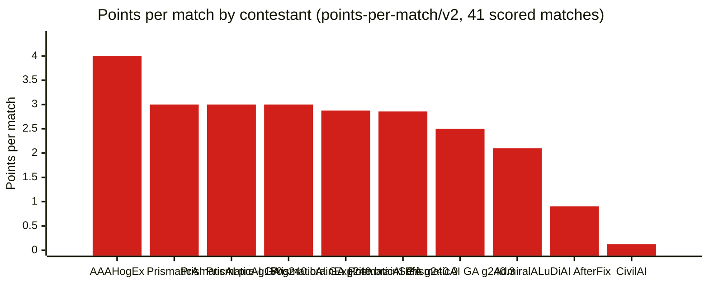
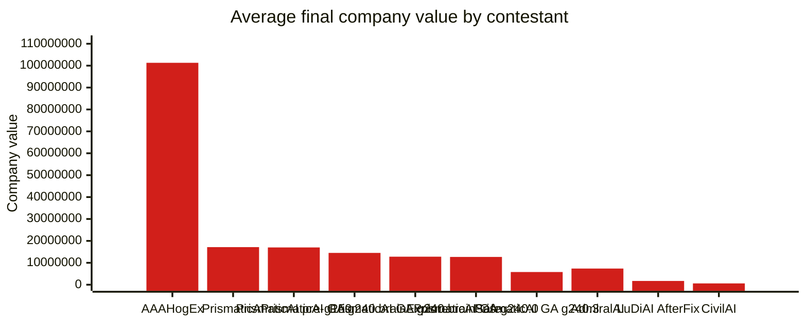
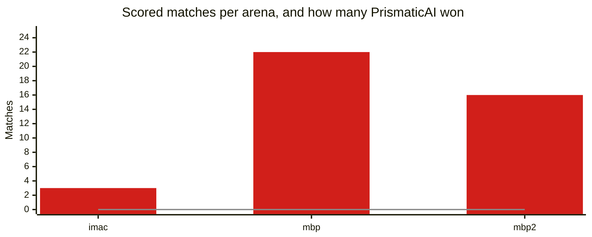

# battle-20261121T065129-1ebb8a7b

Derived from `battle-20261121T065129-1ebb8a7b.json` by `tools/research/ai-battle/battle.py report`; do not edit.

- Edition `1ebb8a7bdbbd8d41`: PrismaticAI and referee at `52f631b115782334f422f741a79ecabce78e58c4`, base set `opengfx-8.0.tar`
- 20-year free-for-all from 1960, map 256x256 temperate, breakdowns 1
- 41 scored match(es) on `imac` (20261119-master-gdf1e05e7d8), `mbp` (20261120-master-m17653b726e), `mbp2` (20261119-master-gdf1e05e7d8)
- Replays: 0 of 1 identical to their original on another arena

| # | Contestant | Played | Wins | Points | Points/match | Avg rank | Avg final value | Squirrel errors | Matches with anomalies |
|---|---|---|---|---|---|---|---|---|---|
| 1 | AAAHogEx | 41 | 41 | 164 | 4.0 | 1.0 | 101.3 M | 0 | 0 |
| 2 | PrismaticAI | 6 | 0 | 18 | 3.0 | 2.0 | 17.2 M | 0 | 0 |
| 3 | PrismaticAI pre-g150 | 8 | 0 | 24 | 3.0 | 2.0 | 17.0 M | 0 | 4 |
| 4 | PrismaticAI GA g240.brainExplore | 6 | 0 | 18 | 3.0 | 2.0 | 14.5 M | 0 | 2 |
| 5 | PrismaticAI GA g240.brainSafe | 8 | 0 | 23 | 2.875 | 2.12 | 12.8 M | 0 | 0 |
| 6 | PrismaticAI GA g240.0 | 7 | 0 | 20 | 2.857 | 2.14 | 12.7 M | 0 | 0 |
| 7 | PrismaticAI GA g240.3 | 6 | 0 | 15 | 2.5 | 2.5 | 5.8 M | 0 | 0 |
| 8 | AdmiralAI | 41 | 0 | 86 | 2.098 | 2.9 | 7.4 M | 70 | 2 |
| 9 | LuDiAI AfterFix | 41 | 0 | 37 | 0.902 | 4.1 | 1.7 M | 0 | 0 |
| 10 | CivilAI | 41 | 0 | 5 | 0.122 | 4.88 | 588.6 k | 0 | 7 |

```mermaid
---
config:
  xyChart:
    width: 900
    height: 360
  themeVariables:
    xyChart:
      plotColorPalette: "#d11f1a, #8a8a8a, #0b0b0b, #ece4d6"
---
xychart-beta
    title "Final company value per scored match: winner vs best PrismaticAI"
    x-axis ["m-0001", "m-0002", "m-0003", "m-0004", "m-0005", "m-0006", "m-0007", "m-0008", "m-0009", "m-0010", "m-0011", "m-0012", "m-0013", "m-0014", "m-0015", "m-0016", "m-0017", "m-0018", "m-0019", "m-0020", "m-0021", "m-0022", "m-0023", "m-0024", "m-0025", "m-0026", "m-0027", "m-0028", "m-0036", "m-0037", "m-0038", "m-0039", "m-0040", "m-0041", "m-0042", "m-0043", "m-0044", "m-0045", "m-0047", "m-0049", "m-0051"]
    %% series: Winner | Best PrismaticAI
    %% links: battle-20261121T065129-1ebb8a7b.md?col=Match&filter=m-0001 | battle-20261121T065129-1ebb8a7b.md?col=Match&filter=m-0002 | battle-20261121T065129-1ebb8a7b.md?col=Match&filter=m-0003 | battle-20261121T065129-1ebb8a7b.md?col=Match&filter=m-0004 | battle-20261121T065129-1ebb8a7b.md?col=Match&filter=m-0005 | battle-20261121T065129-1ebb8a7b.md?col=Match&filter=m-0006 | battle-20261121T065129-1ebb8a7b.md?col=Match&filter=m-0007 | battle-20261121T065129-1ebb8a7b.md?col=Match&filter=m-0008 | battle-20261121T065129-1ebb8a7b.md?col=Match&filter=m-0009 | battle-20261121T065129-1ebb8a7b.md?col=Match&filter=m-0010 | battle-20261121T065129-1ebb8a7b.md?col=Match&filter=m-0011 | battle-20261121T065129-1ebb8a7b.md?col=Match&filter=m-0012 | battle-20261121T065129-1ebb8a7b.md?col=Match&filter=m-0013 | battle-20261121T065129-1ebb8a7b.md?col=Match&filter=m-0014 | battle-20261121T065129-1ebb8a7b.md?col=Match&filter=m-0015 | battle-20261121T065129-1ebb8a7b.md?col=Match&filter=m-0016 | battle-20261121T065129-1ebb8a7b.md?col=Match&filter=m-0017 | battle-20261121T065129-1ebb8a7b.md?col=Match&filter=m-0018 | battle-20261121T065129-1ebb8a7b.md?col=Match&filter=m-0019 | battle-20261121T065129-1ebb8a7b.md?col=Match&filter=m-0020 | battle-20261121T065129-1ebb8a7b.md?col=Match&filter=m-0021 | battle-20261121T065129-1ebb8a7b.md?col=Match&filter=m-0022 | battle-20261121T065129-1ebb8a7b.md?col=Match&filter=m-0023 | battle-20261121T065129-1ebb8a7b.md?col=Match&filter=m-0024 | battle-20261121T065129-1ebb8a7b.md?col=Match&filter=m-0025 | battle-20261121T065129-1ebb8a7b.md?col=Match&filter=m-0026 | battle-20261121T065129-1ebb8a7b.md?col=Match&filter=m-0027 | battle-20261121T065129-1ebb8a7b.md?col=Match&filter=m-0028 | battle-20261121T065129-1ebb8a7b.md?col=Match&filter=m-0036 | battle-20261121T065129-1ebb8a7b.md?col=Match&filter=m-0037 | battle-20261121T065129-1ebb8a7b.md?col=Match&filter=m-0038 | battle-20261121T065129-1ebb8a7b.md?col=Match&filter=m-0039 | battle-20261121T065129-1ebb8a7b.md?col=Match&filter=m-0040 | battle-20261121T065129-1ebb8a7b.md?col=Match&filter=m-0041 | battle-20261121T065129-1ebb8a7b.md?col=Match&filter=m-0042 | battle-20261121T065129-1ebb8a7b.md?col=Match&filter=m-0043 | battle-20261121T065129-1ebb8a7b.md?col=Match&filter=m-0044 | battle-20261121T065129-1ebb8a7b.md?col=Match&filter=m-0045 | battle-20261121T065129-1ebb8a7b.md?col=Match&filter=m-0047 | battle-20261121T065129-1ebb8a7b.md?col=Match&filter=m-0049 | battle-20261121T065129-1ebb8a7b.md?col=Match&filter=m-0051
    y-axis "Company value" 0 --> 168000000
    bar [128403590, 117877901, 110105368, 116316636, 106639918, 127533635, 84745702, 109544590, 77140466, 90253958, 76529913, 95041476, 122889898, 119599967, 121792236, 152487189, 134219736, 79914954, 74304710, 79136192, 76432831, 76343643, 83907188, 86811075, 81716072, 89922616, 70561307, 66487451, 126776540, 134432533, 117906733, 133758205, 107822534, 129110302, 103445121, 101276267, 89365070, 80434791, 92732592, 91309367, 88145832]
    line [21207505, 14188424, 13915993, 18429612, 7089395, 14202752, 17210861, 8178672, 14113628, 12447400, 3794571, 18362923, 15106364, 24869743, 10717434, 11402992, 6804175, 15775876, 13791671, 9656615, 11891610, 13282306, 3892299, 16096332, 18258054, 6093258, 11042650, 11257356, 23385340, 20856201, 16999984, 10699590, 20263328, 11231149, 15109128, 12379522, 8723814, 13259888, 1919483, 17254396, 16684920]
```

<!-- battle-charts:begin -->
<!-- derived from battle-20261121T065129-1ebb8a7b.json by `battle.py render`; `battle.py check` fails when it is stale -->

<!-- battle-charts:end -->

| Seed | Original | Replay | Arenas | Identical |
|---|---|---|---|---|
| 88153440 | m-0012 | m-0048 | imac / mbp | NO |

| Match | Arena | Seed | Winner | Value | Last | Anomalies |
|---|---|---|---|---|---|---|
| m-0001 | mbp | 1103774062 | AAAHogEx | 128.4 M | CivilAI | - |
| m-0002 | mbp | 1103774062 | AAAHogEx | 117.9 M | CivilAI | - |
| m-0003 | mbp | 1103774062 | AAAHogEx | 110.1 M | CivilAI | - |
| m-0004 | mbp | 1103774062 | AAAHogEx | 116.3 M | CivilAI | PrismaticAI GA g240.brainExplore: fleet_drop:126->86; AdmiralAI: squirrel_errors:70; CivilAI: fleet_drop:25->14 |
| m-0005 | mbp | 1103774062 | AAAHogEx | 106.6 M | CivilAI | - |
| m-0006 | mbp | 1933404257 | AAAHogEx | 127.5 M | CivilAI | - |
| m-0007 | mbp | 1933404257 | AAAHogEx | 84.7 M | CivilAI | PrismaticAI pre-g150: fleet_drop:118->68 |
| m-0008 | mbp | 1933404257 | AAAHogEx | 109.5 M | LuDiAI AfterFix | - |
| m-0009 | mbp | 1933404257 | AAAHogEx | 77.1 M | CivilAI | - |
| m-0010 | imac | 1933404257 | AAAHogEx | 90.3 M | CivilAI | - |
| m-0011 | imac | 1933404257 | AAAHogEx | 76.5 M | CivilAI | - |
| m-0012 | imac | 88153440 | AAAHogEx | 95.0 M | CivilAI | - |
| m-0013 | mbp2 | 88153440 | AAAHogEx | 122.9 M | CivilAI | PrismaticAI pre-g150: fleet_drop:137->82 |
| m-0014 | mbp2 | 88153440 | AAAHogEx | 119.6 M | LuDiAI AfterFix | - |
| m-0015 | mbp2 | 88153440 | AAAHogEx | 121.8 M | CivilAI | - |
| m-0016 | mbp2 | 88153440 | AAAHogEx | 152.5 M | CivilAI | PrismaticAI GA g240.brainExplore: fleet_drop:108->45 |
| m-0017 | mbp2 | 88153440 | AAAHogEx | 134.2 M | CivilAI | CivilAI: fleet_drop:11->7 |
| m-0018 | mbp2 | 872173010 | AAAHogEx | 79.9 M | CivilAI | - |
| m-0019 | mbp2 | 872173010 | AAAHogEx | 74.3 M | CivilAI | - |
| m-0020 | mbp2 | 872173010 | AAAHogEx | 79.1 M | CivilAI | - |
| m-0021 | mbp2 | 872173010 | AAAHogEx | 76.4 M | CivilAI | - |
| m-0022 | mbp2 | 872173010 | AAAHogEx | 76.3 M | CivilAI | CivilAI: fleet_drop:135->86 |
| m-0023 | mbp2 | 872173010 | AAAHogEx | 83.9 M | CivilAI | - |
| m-0024 | mbp2 | 510475706 | AAAHogEx | 86.8 M | CivilAI | CivilAI: fleet_drop:22->14 |
| m-0025 | mbp2 | 510475706 | AAAHogEx | 81.7 M | CivilAI | PrismaticAI pre-g150: fleet_drop:65->42 |
| m-0026 | mbp2 | 510475706 | AAAHogEx | 89.9 M | LuDiAI AfterFix | - |
| m-0027 | mbp2 | 510475706 | AAAHogEx | 70.6 M | CivilAI | - |
| m-0028 | mbp2 | 510475706 | AAAHogEx | 66.5 M | LuDiAI AfterFix | - |
| m-0036 | mbp | 166562378 | AAAHogEx | 126.8 M | CivilAI | - |
| m-0037 | mbp | 166562378 | AAAHogEx | 134.4 M | CivilAI | - |
| m-0038 | mbp | 166562378 | AAAHogEx | 117.9 M | LuDiAI AfterFix | - |
| m-0039 | mbp | 166562378 | AAAHogEx | 133.8 M | CivilAI | CivilAI: fleet_drop:41->14 |
| m-0040 | mbp | 166562378 | AAAHogEx | 107.8 M | CivilAI | - |
| m-0041 | mbp | 166562378 | AAAHogEx | 129.1 M | CivilAI | CivilAI: fleet_drop:58->40 |
| m-0042 | mbp | 336990138 | AAAHogEx | 103.4 M | CivilAI | - |
| m-0043 | mbp | 336990138 | AAAHogEx | 101.3 M | CivilAI | - |
| m-0044 | mbp | 336990138 | AAAHogEx | 89.4 M | CivilAI | - |
| m-0045 | mbp | 336990138 | AAAHogEx | 80.4 M | CivilAI | CivilAI: fleet_drop:25->15 |
| m-0047 | mbp | 336990138 | AAAHogEx | 92.7 M | CivilAI | AdmiralAI: fleet_drop:244->167 |
| m-0048 (replay) | mbp | 88153440 | AAAHogEx | 99.0 M | CivilAI | - |
| m-0049 | mbp | 155562150 | AAAHogEx | 91.3 M | CivilAI | PrismaticAI pre-g150: fleet_drop:106->56 |
| m-0051 | mbp | 155562150 | AAAHogEx | 88.1 M | CivilAI | - |
