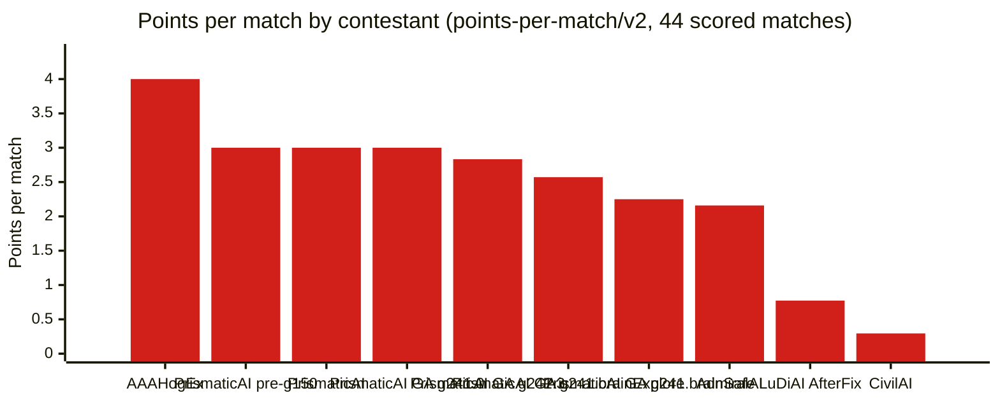
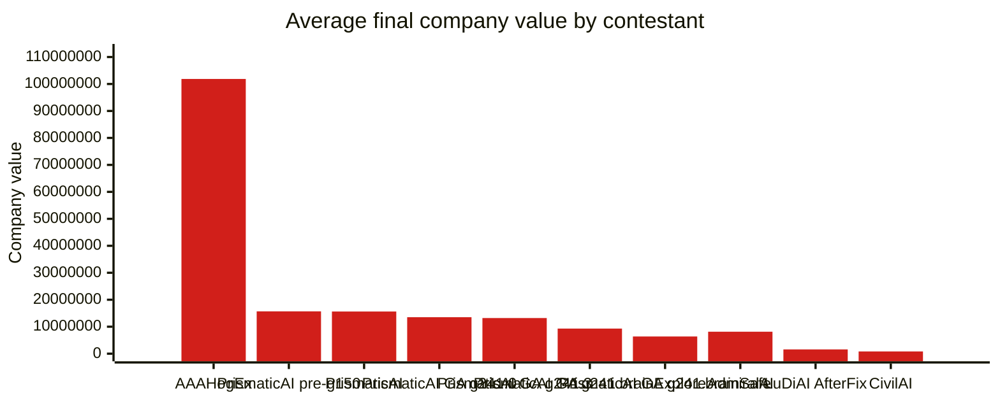
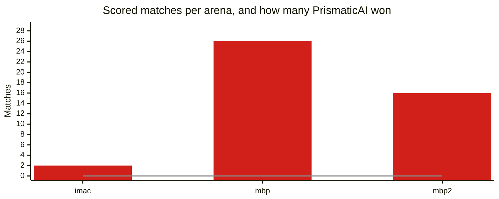

# battle-20261121T070203-eb9cae38

Derived from `battle-20261121T070203-eb9cae38.json` by `tools/research/ai-battle/battle.py report`; do not edit.

- Edition `eb9cae38d611bb43`: PrismaticAI and referee at `52f631b115782334f422f741a79ecabce78e58c4`, base set `opengfx-8.0.tar`
- 20-year free-for-all from 1960, map 256x256 temperate, breakdowns 1
- 44 scored match(es) on `imac` (20261119-master-gdf1e05e7d8), `mbp` (20261120-master-m17653b726e), `mbp2` (20261119-master-gdf1e05e7d8)
- Replays: 1 of 1 identical to their original on another arena

| # | Contestant | Played | Wins | Points | Points/match | Avg rank | Avg final value | Squirrel errors | Matches with anomalies |
|---|---|---|---|---|---|---|---|---|---|
| 1 | AAAHogEx | 44 | 44 | 176 | 4.0 | 1.0 | 101.9 M | 0 | 0 |
| 2 | PrismaticAI pre-g150 | 8 | 0 | 24 | 3.0 | 2.0 | 15.7 M | 0 | 2 |
| 3 | PrismaticAI | 7 | 0 | 21 | 3.0 | 2.0 | 15.6 M | 0 | 0 |
| 4 | PrismaticAI GA g241.0 | 8 | 0 | 24 | 3.0 | 2.0 | 13.5 M | 0 | 3 |
| 5 | PrismaticAI GA g241.3 | 6 | 0 | 17 | 2.833 | 2.17 | 13.2 M | 0 | 2 |
| 6 | PrismaticAI GA g241.brainExplore | 7 | 0 | 18 | 2.571 | 2.43 | 9.3 M | 0 | 2 |
| 7 | PrismaticAI GA g241.brainSafe | 8 | 0 | 18 | 2.25 | 2.75 | 6.4 M | 0 | 3 |
| 8 | AdmiralAI | 44 | 0 | 95 | 2.159 | 2.84 | 8.1 M | 44 | 2 |
| 9 | LuDiAI AfterFix | 44 | 0 | 34 | 0.773 | 4.23 | 1.6 M | 0 | 2 |
| 10 | CivilAI | 44 | 0 | 13 | 0.295 | 4.7 | 824.0 k | 0 | 8 |

```mermaid
---
config:
  xyChart:
    width: 900
    height: 360
  themeVariables:
    xyChart:
      plotColorPalette: "#d11f1a, #8a8a8a, #0b0b0b, #ece4d6"
---
xychart-beta
    title "Final company value per scored match: winner vs best PrismaticAI"
    x-axis ["m-0001", "m-0002", "m-0003", "m-0004", "m-0005", "m-0006", "m-0007", "m-0008", "m-0009", "m-0010", "m-0012", "m-0013", "m-0014", "m-0015", "m-0016", "m-0017", "m-0018", "m-0019", "m-0020", "m-0021", "m-0022", "m-0023", "m-0024", "m-0025", "m-0026", "m-0027", "m-0028", "m-0036", "m-0037", "m-0038", "m-0039", "m-0040", "m-0041", "m-0042", "m-0043", "m-0044", "m-0045", "m-0046", "m-0047", "m-0049", "m-0050", "m-0051", "m-0053", "m-0054"]
    %% series: Winner | Best PrismaticAI
    %% links: battle-20261121T070203-eb9cae38.md?col=Match&filter=m-0001 | battle-20261121T070203-eb9cae38.md?col=Match&filter=m-0002 | battle-20261121T070203-eb9cae38.md?col=Match&filter=m-0003 | battle-20261121T070203-eb9cae38.md?col=Match&filter=m-0004 | battle-20261121T070203-eb9cae38.md?col=Match&filter=m-0005 | battle-20261121T070203-eb9cae38.md?col=Match&filter=m-0006 | battle-20261121T070203-eb9cae38.md?col=Match&filter=m-0007 | battle-20261121T070203-eb9cae38.md?col=Match&filter=m-0008 | battle-20261121T070203-eb9cae38.md?col=Match&filter=m-0009 | battle-20261121T070203-eb9cae38.md?col=Match&filter=m-0010 | battle-20261121T070203-eb9cae38.md?col=Match&filter=m-0012 | battle-20261121T070203-eb9cae38.md?col=Match&filter=m-0013 | battle-20261121T070203-eb9cae38.md?col=Match&filter=m-0014 | battle-20261121T070203-eb9cae38.md?col=Match&filter=m-0015 | battle-20261121T070203-eb9cae38.md?col=Match&filter=m-0016 | battle-20261121T070203-eb9cae38.md?col=Match&filter=m-0017 | battle-20261121T070203-eb9cae38.md?col=Match&filter=m-0018 | battle-20261121T070203-eb9cae38.md?col=Match&filter=m-0019 | battle-20261121T070203-eb9cae38.md?col=Match&filter=m-0020 | battle-20261121T070203-eb9cae38.md?col=Match&filter=m-0021 | battle-20261121T070203-eb9cae38.md?col=Match&filter=m-0022 | battle-20261121T070203-eb9cae38.md?col=Match&filter=m-0023 | battle-20261121T070203-eb9cae38.md?col=Match&filter=m-0024 | battle-20261121T070203-eb9cae38.md?col=Match&filter=m-0025 | battle-20261121T070203-eb9cae38.md?col=Match&filter=m-0026 | battle-20261121T070203-eb9cae38.md?col=Match&filter=m-0027 | battle-20261121T070203-eb9cae38.md?col=Match&filter=m-0028 | battle-20261121T070203-eb9cae38.md?col=Match&filter=m-0036 | battle-20261121T070203-eb9cae38.md?col=Match&filter=m-0037 | battle-20261121T070203-eb9cae38.md?col=Match&filter=m-0038 | battle-20261121T070203-eb9cae38.md?col=Match&filter=m-0039 | battle-20261121T070203-eb9cae38.md?col=Match&filter=m-0040 | battle-20261121T070203-eb9cae38.md?col=Match&filter=m-0041 | battle-20261121T070203-eb9cae38.md?col=Match&filter=m-0042 | battle-20261121T070203-eb9cae38.md?col=Match&filter=m-0043 | battle-20261121T070203-eb9cae38.md?col=Match&filter=m-0044 | battle-20261121T070203-eb9cae38.md?col=Match&filter=m-0045 | battle-20261121T070203-eb9cae38.md?col=Match&filter=m-0046 | battle-20261121T070203-eb9cae38.md?col=Match&filter=m-0047 | battle-20261121T070203-eb9cae38.md?col=Match&filter=m-0049 | battle-20261121T070203-eb9cae38.md?col=Match&filter=m-0050 | battle-20261121T070203-eb9cae38.md?col=Match&filter=m-0051 | battle-20261121T070203-eb9cae38.md?col=Match&filter=m-0053 | battle-20261121T070203-eb9cae38.md?col=Match&filter=m-0054
    y-axis "Company value" 0 --> 189000000
    bar [144328145, 129293120, 147796737, 136786026, 125189951, 128611716, 95053599, 100229802, 114237843, 108453922, 140783140, 171783641, 121364754, 156177087, 134925759, 127731470, 81746618, 64710354, 58832284, 73424549, 80979907, 56356887, 80569983, 94496687, 84545162, 67691033, 94487226, 80515598, 85328135, 86987073, 73135541, 75130343, 68374872, 107637205, 118516750, 83636509, 131776757, 141134120, 83423910, 74134805, 90795616, 101422964, 89326245, 70154603]
    line [15398143, 6979683, 750444, 12546519, 8395316, 17375584, 14480865, 12407017, 6974531, 5086497, 27283231, 18457659, 18631361, 10590460, 17580193, 18766035, 14758397, 18914169, 9944967, 7191495, 5357818, 9676087, 15507563, 14683736, 11524709, 8753955, 7466924, 10357134, 13151558, 13698083, 4581535, 9327936, 15101011, 18329707, 14882333, 19286320, 6401831, 7751483, 14009106, 15541950, 15670668, 5722451, 13291907, 5781937]
```

<!-- battle-charts:begin -->
<!-- derived from battle-20261121T070203-eb9cae38.json by `battle.py render`; `battle.py check` fails when it is stale -->

<!-- battle-charts:end -->

| Seed | Original | Replay | Arenas | Identical |
|---|---|---|---|---|
| 1495246101 | m-0028 | m-0048 | mbp2 / mbp | yes |

| Match | Arena | Seed | Winner | Value | Last | Anomalies |
|---|---|---|---|---|---|---|
| m-0001 | mbp | 199435860 | AAAHogEx | 144.3 M | LuDiAI AfterFix | PrismaticAI pre-g150: fleet_drop:130->90 |
| m-0002 | mbp | 199435860 | AAAHogEx | 129.3 M | LuDiAI AfterFix | PrismaticAI GA g241.0: fleet_drop:86->56 |
| m-0003 | mbp | 199435860 | AAAHogEx | 147.8 M | PrismaticAI GA g241.brainSafe | PrismaticAI GA g241.brainSafe: fleet_drop:23->14 |
| m-0004 | mbp | 199435860 | AAAHogEx | 136.8 M | CivilAI | - |
| m-0005 | mbp | 199435860 | AAAHogEx | 125.2 M | CivilAI | CivilAI: fleet_drop:31->20 |
| m-0006 | mbp | 471967789 | AAAHogEx | 128.6 M | CivilAI | - |
| m-0007 | mbp | 471967789 | AAAHogEx | 95.1 M | CivilAI | - |
| m-0008 | mbp | 471967789 | AAAHogEx | 100.2 M | CivilAI | - |
| m-0009 | mbp | 471967789 | AAAHogEx | 114.2 M | LuDiAI AfterFix | - |
| m-0010 | imac | 471967789 | AAAHogEx | 108.5 M | LuDiAI AfterFix | CivilAI: fleet_drop:96->61 |
| m-0012 | imac | 1589614889 | AAAHogEx | 140.8 M | LuDiAI AfterFix | - |
| m-0013 | mbp2 | 1589614889 | AAAHogEx | 171.8 M | LuDiAI AfterFix | PrismaticAI pre-g150: fleet_drop:119->44 |
| m-0014 | mbp2 | 1589614889 | AAAHogEx | 121.4 M | CivilAI | PrismaticAI GA g241.0: fleet_drop:172->113 |
| m-0015 | mbp2 | 1589614889 | AAAHogEx | 156.2 M | CivilAI | AdmiralAI: fleet_drop:271->188 |
| m-0016 | mbp2 | 1589614889 | AAAHogEx | 134.9 M | CivilAI | - |
| m-0017 | mbp2 | 1589614889 | AAAHogEx | 127.7 M | CivilAI | PrismaticAI GA g241.3: fleet_drop:175->116 |
| m-0018 | mbp2 | 1464078750 | AAAHogEx | 81.7 M | CivilAI | - |
| m-0019 | mbp2 | 1464078750 | AAAHogEx | 64.7 M | CivilAI | - |
| m-0020 | mbp2 | 1464078750 | AAAHogEx | 58.8 M | LuDiAI AfterFix | LuDiAI AfterFix: fleet_drop:32->22 |
| m-0021 | mbp2 | 1464078750 | AAAHogEx | 73.4 M | CivilAI | - |
| m-0022 | mbp2 | 1464078750 | AAAHogEx | 81.0 M | LuDiAI AfterFix | PrismaticAI GA g241.brainExplore: fleet_drop:38->23 |
| m-0023 | mbp2 | 1464078750 | AAAHogEx | 56.4 M | LuDiAI AfterFix | - |
| m-0024 | mbp2 | 1495246101 | AAAHogEx | 80.6 M | CivilAI | - |
| m-0025 | mbp2 | 1495246101 | AAAHogEx | 94.5 M | CivilAI | CivilAI: fleet_drop:50->31 |
| m-0026 | mbp2 | 1495246101 | AAAHogEx | 84.5 M | CivilAI | - |
| m-0027 | mbp2 | 1495246101 | AAAHogEx | 67.7 M | CivilAI | CivilAI: fleet_drop:96->56 |
| m-0028 | mbp2 | 1495246101 | AAAHogEx | 94.5 M | CivilAI | - |
| m-0036 | mbp | 295232779 | AAAHogEx | 80.5 M | CivilAI | - |
| m-0037 | mbp | 295232779 | AAAHogEx | 85.3 M | CivilAI | - |
| m-0038 | mbp | 295232779 | AAAHogEx | 87.0 M | CivilAI | PrismaticAI GA g241.0: fleet_drop:128->88; CivilAI: fleet_drop:38->23 |
| m-0039 | mbp | 295232779 | AAAHogEx | 73.1 M | CivilAI | PrismaticAI GA g241.brainSafe: fleet_drop:82->39; AdmiralAI: squirrel_errors:44 |
| m-0040 | mbp | 295232779 | AAAHogEx | 75.1 M | CivilAI | - |
| m-0041 | mbp | 295232779 | AAAHogEx | 68.4 M | CivilAI | - |
| m-0042 | mbp | 1585173506 | AAAHogEx | 107.6 M | CivilAI | - |
| m-0043 | mbp | 1585173506 | AAAHogEx | 118.5 M | CivilAI | - |
| m-0044 | mbp | 1585173506 | AAAHogEx | 83.6 M | LuDiAI AfterFix | - |
| m-0045 | mbp | 1585173506 | AAAHogEx | 131.8 M | CivilAI | PrismaticAI GA g241.brainSafe: fleet_drop:48->20 |
| m-0046 | mbp | 1585173506 | AAAHogEx | 141.1 M | LuDiAI AfterFix | PrismaticAI GA g241.brainExplore: fleet_drop:50->34; LuDiAI AfterFix: fleet_drop:10->0, no_vehicles |
| m-0047 | mbp | 1585173506 | AAAHogEx | 83.4 M | LuDiAI AfterFix | - |
| m-0048 (replay) | mbp | 1495246101 | AAAHogEx | 94.5 M | CivilAI | - |
| m-0049 | mbp | 1694801960 | AAAHogEx | 74.1 M | CivilAI | - |
| m-0050 | mbp | 1694801960 | AAAHogEx | 90.8 M | CivilAI | CivilAI: fleet_drop:45->18 |
| m-0051 | mbp | 1694801960 | AAAHogEx | 101.4 M | CivilAI | CivilAI: fleet_drop:105->55 |
| m-0053 | mbp | 1694801960 | AAAHogEx | 89.3 M | CivilAI | PrismaticAI GA g241.3: fleet_drop:98->68; CivilAI: fleet_drop:52->34 |
| m-0054 | mbp | 1903391555 | AAAHogEx | 70.2 M | CivilAI | - |
