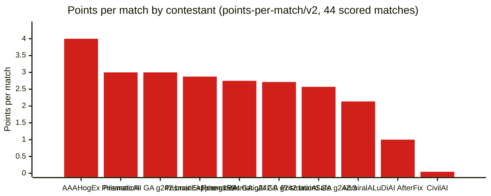
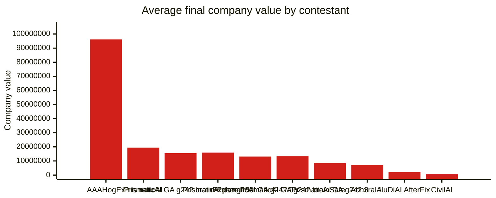
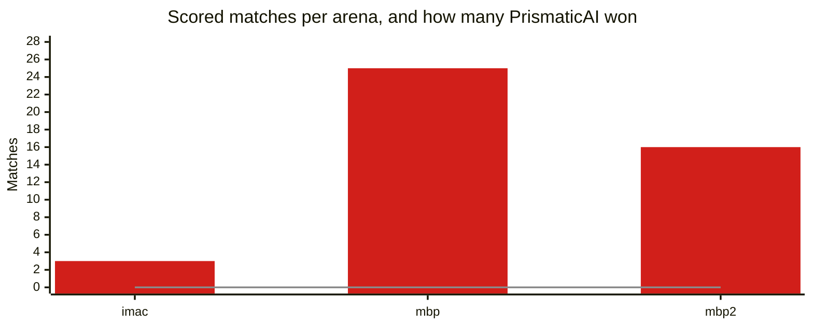

# battle-20261121T071217-3fcdc765

Derived from `battle-20261121T071217-3fcdc765.json` by `tools/research/ai-battle/battle.py report`; do not edit.

- Edition `3fcdc765150cbbaf`: PrismaticAI and referee at `52f631b115782334f422f741a79ecabce78e58c4`, base set `opengfx-8.0.tar`
- 20-year free-for-all from 1960, map 256x256 temperate, breakdowns 1
- 44 scored match(es) on `imac` (20261119-master-gdf1e05e7d8), `mbp` (20261120-master-m17653b726e), `mbp2` (20261119-master-gdf1e05e7d8)
- Replays: 0 of 0 identical to their original on another arena

| # | Contestant | Played | Wins | Points | Points/match | Avg rank | Avg final value | Squirrel errors | Matches with anomalies |
|---|---|---|---|---|---|---|---|---|---|
| 1 | AAAHogEx | 44 | 44 | 176 | 4.0 | 1.0 | 96.1 M | 0 | 0 |
| 2 | PrismaticAI | 7 | 0 | 21 | 3.0 | 2.0 | 19.4 M | 0 | 0 |
| 3 | PrismaticAI GA g242.brainExplore | 7 | 0 | 21 | 3.0 | 2.0 | 15.5 M | 0 | 0 |
| 4 | PrismaticAI pre-g150 | 8 | 0 | 23 | 2.875 | 2.12 | 16.0 M | 0 | 2 |
| 5 | PrismaticAI GA g242.0 | 8 | 0 | 22 | 2.75 | 2.25 | 13.1 M | 0 | 1 |
| 6 | PrismaticAI GA g242.brainSafe | 7 | 0 | 19 | 2.714 | 2.29 | 13.4 M | 0 | 0 |
| 7 | PrismaticAI GA g242.3 | 7 | 0 | 18 | 2.571 | 2.43 | 8.4 M | 0 | 0 |
| 8 | AdmiralAI | 44 | 0 | 94 | 2.136 | 2.86 | 7.2 M | 150 | 7 |
| 9 | LuDiAI AfterFix | 44 | 0 | 44 | 1.0 | 4.0 | 2.1 M | 0 | 0 |
| 10 | CivilAI | 44 | 0 | 2 | 0.045 | 4.95 | 609.9 k | 3665 | 7 |

```mermaid
---
config:
  xyChart:
    width: 900
    height: 360
  themeVariables:
    xyChart:
      plotColorPalette: "#d11f1a, #8a8a8a, #0b0b0b, #ece4d6"
---
xychart-beta
    title "Final company value per scored match: winner vs best PrismaticAI"
    x-axis ["m-0001", "m-0002", "m-0003", "m-0004", "m-0005", "m-0006", "m-0007", "m-0008", "m-0009", "m-0010", "m-0011", "m-0012", "m-0013", "m-0014", "m-0015", "m-0016", "m-0017", "m-0018", "m-0019", "m-0020", "m-0021", "m-0022", "m-0023", "m-0024", "m-0025", "m-0026", "m-0027", "m-0028", "m-0036", "m-0037", "m-0038", "m-0039", "m-0040", "m-0041", "m-0042", "m-0043", "m-0044", "m-0045", "m-0046", "m-0047", "m-0048", "m-0049", "m-0050", "m-0053"]
    %% series: Winner | Best PrismaticAI
    %% links: battle-20261121T071217-3fcdc765.md?col=Match&filter=m-0001 | battle-20261121T071217-3fcdc765.md?col=Match&filter=m-0002 | battle-20261121T071217-3fcdc765.md?col=Match&filter=m-0003 | battle-20261121T071217-3fcdc765.md?col=Match&filter=m-0004 | battle-20261121T071217-3fcdc765.md?col=Match&filter=m-0005 | battle-20261121T071217-3fcdc765.md?col=Match&filter=m-0006 | battle-20261121T071217-3fcdc765.md?col=Match&filter=m-0007 | battle-20261121T071217-3fcdc765.md?col=Match&filter=m-0008 | battle-20261121T071217-3fcdc765.md?col=Match&filter=m-0009 | battle-20261121T071217-3fcdc765.md?col=Match&filter=m-0010 | battle-20261121T071217-3fcdc765.md?col=Match&filter=m-0011 | battle-20261121T071217-3fcdc765.md?col=Match&filter=m-0012 | battle-20261121T071217-3fcdc765.md?col=Match&filter=m-0013 | battle-20261121T071217-3fcdc765.md?col=Match&filter=m-0014 | battle-20261121T071217-3fcdc765.md?col=Match&filter=m-0015 | battle-20261121T071217-3fcdc765.md?col=Match&filter=m-0016 | battle-20261121T071217-3fcdc765.md?col=Match&filter=m-0017 | battle-20261121T071217-3fcdc765.md?col=Match&filter=m-0018 | battle-20261121T071217-3fcdc765.md?col=Match&filter=m-0019 | battle-20261121T071217-3fcdc765.md?col=Match&filter=m-0020 | battle-20261121T071217-3fcdc765.md?col=Match&filter=m-0021 | battle-20261121T071217-3fcdc765.md?col=Match&filter=m-0022 | battle-20261121T071217-3fcdc765.md?col=Match&filter=m-0023 | battle-20261121T071217-3fcdc765.md?col=Match&filter=m-0024 | battle-20261121T071217-3fcdc765.md?col=Match&filter=m-0025 | battle-20261121T071217-3fcdc765.md?col=Match&filter=m-0026 | battle-20261121T071217-3fcdc765.md?col=Match&filter=m-0027 | battle-20261121T071217-3fcdc765.md?col=Match&filter=m-0028 | battle-20261121T071217-3fcdc765.md?col=Match&filter=m-0036 | battle-20261121T071217-3fcdc765.md?col=Match&filter=m-0037 | battle-20261121T071217-3fcdc765.md?col=Match&filter=m-0038 | battle-20261121T071217-3fcdc765.md?col=Match&filter=m-0039 | battle-20261121T071217-3fcdc765.md?col=Match&filter=m-0040 | battle-20261121T071217-3fcdc765.md?col=Match&filter=m-0041 | battle-20261121T071217-3fcdc765.md?col=Match&filter=m-0042 | battle-20261121T071217-3fcdc765.md?col=Match&filter=m-0043 | battle-20261121T071217-3fcdc765.md?col=Match&filter=m-0044 | battle-20261121T071217-3fcdc765.md?col=Match&filter=m-0045 | battle-20261121T071217-3fcdc765.md?col=Match&filter=m-0046 | battle-20261121T071217-3fcdc765.md?col=Match&filter=m-0047 | battle-20261121T071217-3fcdc765.md?col=Match&filter=m-0048 | battle-20261121T071217-3fcdc765.md?col=Match&filter=m-0049 | battle-20261121T071217-3fcdc765.md?col=Match&filter=m-0050 | battle-20261121T071217-3fcdc765.md?col=Match&filter=m-0053
    y-axis "Company value" 0 --> 140000000
    bar [97669965, 97714768, 99629574, 111570657, 102626927, 100447293, 88881108, 91317039, 83404756, 107370312, 102090429, 94124268, 103152819, 102051791, 96191567, 100271938, 127022654, 71083356, 88982357, 94925561, 77896207, 77115520, 80605794, 64759783, 72397965, 82392476, 84356260, 73443600, 118052643, 113145801, 93369701, 98593539, 114168002, 114752551, 92838788, 111336510, 111572199, 111986918, 86079454, 104541061, 89080295, 98151431, 84681466, 114239208]
    line [14054446, 5358040, 2939456, 7564045, 2757320, 19131526, 16531385, 27293926, 19426473, 23221661, 15266965, 20557268, 20176979, 14167794, 21191230, 18443212, 12756770, 20533785, 5794297, 2621533, 16091190, 14998148, 6338318, 17049391, 17145063, 14423834, 7556502, 12457197, 21746337, 19536205, 16948059, 15424428, 14926962, 9496949, 16569667, 15287117, 10387215, 10907122, 16754514, 7984416, 20507091, 19231875, 13799266, 4238540]
```

<!-- battle-charts:begin -->
<!-- derived from battle-20261121T071217-3fcdc765.json by `battle.py render`; `battle.py check` fails when it is stale -->

<!-- battle-charts:end -->

| Match | Arena | Seed | Winner | Value | Last | Anomalies |
|---|---|---|---|---|---|---|
| m-0001 | mbp | 1884507062 | AAAHogEx | 97.7 M | CivilAI | - |
| m-0002 | mbp | 1884507062 | AAAHogEx | 97.7 M | CivilAI | - |
| m-0003 | mbp | 1884507062 | AAAHogEx | 99.6 M | CivilAI | - |
| m-0004 | mbp | 1884507062 | AAAHogEx | 111.6 M | CivilAI | - |
| m-0005 | mbp | 1884507062 | AAAHogEx | 102.6 M | LuDiAI AfterFix | - |
| m-0006 | mbp | 1814376573 | AAAHogEx | 100.4 M | CivilAI | AdmiralAI: fleet_drop:334->226 |
| m-0007 | mbp | 1814376573 | AAAHogEx | 88.9 M | CivilAI | - |
| m-0008 | mbp | 1814376573 | AAAHogEx | 91.3 M | CivilAI | - |
| m-0009 | mbp | 1814376573 | AAAHogEx | 83.4 M | CivilAI | - |
| m-0010 | imac | 1814376573 | AAAHogEx | 107.4 M | CivilAI | AdmiralAI: fleet_drop:242->158; CivilAI: squirrel_errors:3665 |
| m-0011 | imac | 1814376573 | AAAHogEx | 102.1 M | CivilAI | CivilAI: fleet_drop:15->10 |
| m-0012 | imac | 198822302 | AAAHogEx | 94.1 M | CivilAI | AdmiralAI: squirrel_errors:59 |
| m-0013 | mbp2 | 198822302 | AAAHogEx | 103.2 M | CivilAI | PrismaticAI pre-g150: fleet_drop:138->83 |
| m-0014 | mbp2 | 198822302 | AAAHogEx | 102.1 M | CivilAI | - |
| m-0015 | mbp2 | 198822302 | AAAHogEx | 96.2 M | CivilAI | - |
| m-0016 | mbp2 | 198822302 | AAAHogEx | 100.3 M | CivilAI | CivilAI: fleet_drop:82->50 |
| m-0017 | mbp2 | 198822302 | AAAHogEx | 127.0 M | CivilAI | - |
| m-0018 | mbp2 | 1859893554 | AAAHogEx | 71.1 M | CivilAI | - |
| m-0019 | mbp2 | 1859893554 | AAAHogEx | 89.0 M | CivilAI | - |
| m-0020 | mbp2 | 1859893554 | AAAHogEx | 94.9 M | CivilAI | - |
| m-0021 | mbp2 | 1859893554 | AAAHogEx | 77.9 M | CivilAI | - |
| m-0022 | mbp2 | 1859893554 | AAAHogEx | 77.1 M | CivilAI | AdmiralAI: fleet_drop:187->130; CivilAI: fleet_drop:40->24 |
| m-0023 | mbp2 | 1859893554 | AAAHogEx | 80.6 M | CivilAI | - |
| m-0024 | mbp2 | 344256082 | AAAHogEx | 64.8 M | CivilAI | - |
| m-0025 | mbp2 | 344256082 | AAAHogEx | 72.4 M | CivilAI | - |
| m-0026 | mbp2 | 344256082 | AAAHogEx | 82.4 M | CivilAI | AdmiralAI: squirrel_errors:59 |
| m-0027 | mbp2 | 344256082 | AAAHogEx | 84.4 M | CivilAI | - |
| m-0028 | mbp2 | 344256082 | AAAHogEx | 73.4 M | CivilAI | CivilAI: fleet_drop:59->25 |
| m-0036 | mbp | 647063961 | AAAHogEx | 118.1 M | CivilAI | - |
| m-0037 | mbp | 647063961 | AAAHogEx | 113.1 M | CivilAI | PrismaticAI pre-g150: fleet_drop:101->66 |
| m-0038 | mbp | 647063961 | AAAHogEx | 93.4 M | CivilAI | - |
| m-0039 | mbp | 647063961 | AAAHogEx | 98.6 M | CivilAI | CivilAI: fleet_drop:15->8 |
| m-0040 | mbp | 647063961 | AAAHogEx | 114.2 M | CivilAI | CivilAI: fleet_drop:28->14 |
| m-0041 | mbp | 647063961 | AAAHogEx | 114.8 M | CivilAI | - |
| m-0042 | mbp | 1190302444 | AAAHogEx | 92.8 M | CivilAI | AdmiralAI: squirrel_errors:32 |
| m-0043 | mbp | 1190302444 | AAAHogEx | 111.3 M | LuDiAI AfterFix | AdmiralAI: fleet_drop:223->145 |
| m-0044 | mbp | 1190302444 | AAAHogEx | 111.6 M | CivilAI | PrismaticAI GA g242.0: fleet_drop:99->65 |
| m-0045 | mbp | 1190302444 | AAAHogEx | 112.0 M | CivilAI | - |
| m-0046 | mbp | 1190302444 | AAAHogEx | 86.1 M | CivilAI | - |
| m-0047 | mbp | 1190302444 | AAAHogEx | 104.5 M | CivilAI | - |
| m-0048 | mbp | 1198981320 | AAAHogEx | 89.1 M | CivilAI | - |
| m-0049 | mbp | 1198981320 | AAAHogEx | 98.2 M | CivilAI | - |
| m-0050 | mbp | 1198981320 | AAAHogEx | 84.7 M | CivilAI | - |
| m-0053 | mbp | 1198981320 | AAAHogEx | 114.2 M | CivilAI | - |
