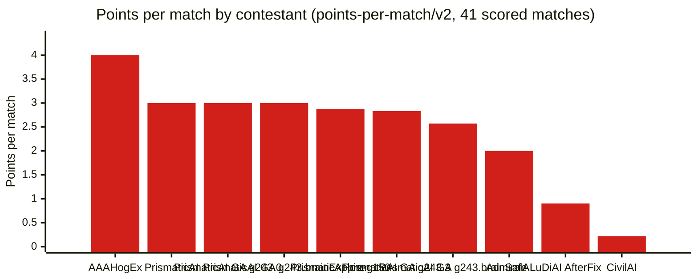
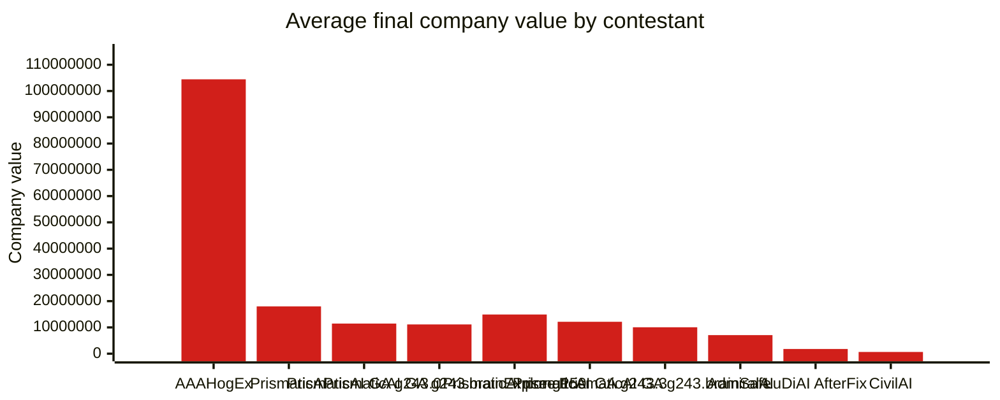
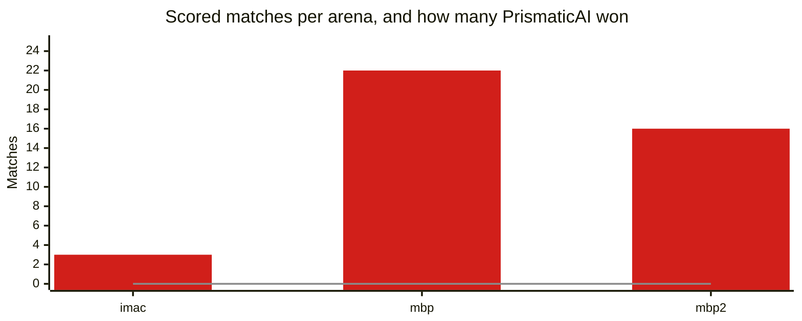

# battle-20261121T072212-772ee5a0

Derived from `battle-20261121T072212-772ee5a0.json` by `tools/research/ai-battle/battle.py report`; do not edit.

- Edition `772ee5a0b9cd9ede`: PrismaticAI and referee at `52f631b115782334f422f741a79ecabce78e58c4`, base set `opengfx-8.0.tar`
- 20-year free-for-all from 1960, map 256x256 temperate, breakdowns 1
- 41 scored match(es) on `imac` (20261119-master-gdf1e05e7d8), `mbp` (20261120-master-m17653b726e), `mbp2` (20261119-master-gdf1e05e7d8)
- Replays: 0 of 1 identical to their original on another arena

| # | Contestant | Played | Wins | Points | Points/match | Avg rank | Avg final value | Squirrel errors | Matches with anomalies |
|---|---|---|---|---|---|---|---|---|---|
| 1 | AAAHogEx | 41 | 41 | 164 | 4.0 | 1.0 | 104.5 M | 0 | 0 |
| 2 | PrismaticAI | 6 | 0 | 18 | 3.0 | 2.0 | 18.0 M | 0 | 0 |
| 3 | PrismaticAI GA g243.0 | 7 | 0 | 21 | 3.0 | 2.0 | 11.5 M | 0 | 2 |
| 4 | PrismaticAI GA g243.brainExplore | 7 | 0 | 21 | 3.0 | 2.0 | 11.1 M | 0 | 2 |
| 5 | PrismaticAI pre-g150 | 8 | 0 | 23 | 2.875 | 2.12 | 14.9 M | 0 | 4 |
| 6 | PrismaticAI GA g243.3 | 6 | 0 | 17 | 2.833 | 2.17 | 12.1 M | 0 | 1 |
| 7 | PrismaticAI GA g243.brainSafe | 7 | 0 | 18 | 2.571 | 2.43 | 10.0 M | 0 | 1 |
| 8 | AdmiralAI | 41 | 0 | 82 | 2.0 | 3.0 | 7.1 M | 0 | 0 |
| 9 | LuDiAI AfterFix | 41 | 0 | 37 | 0.902 | 4.1 | 1.8 M | 0 | 1 |
| 10 | CivilAI | 41 | 0 | 9 | 0.22 | 4.78 | 651.2 k | 3680 | 14 |

```mermaid
---
config:
  xyChart:
    width: 900
    height: 360
  themeVariables:
    xyChart:
      plotColorPalette: "#d11f1a, #8a8a8a, #0b0b0b, #ece4d6"
---
xychart-beta
    title "Final company value per scored match: winner vs best PrismaticAI"
    x-axis ["m-0001", "m-0002", "m-0003", "m-0004", "m-0005", "m-0006", "m-0007", "m-0008", "m-0009", "m-0010", "m-0011", "m-0012", "m-0013", "m-0014", "m-0015", "m-0016", "m-0017", "m-0018", "m-0019", "m-0020", "m-0021", "m-0022", "m-0023", "m-0024", "m-0025", "m-0026", "m-0027", "m-0028", "m-0036", "m-0037", "m-0038", "m-0039", "m-0040", "m-0041", "m-0042", "m-0043", "m-0044", "m-0045", "m-0046", "m-0047", "m-0049"]
    %% series: Winner | Best PrismaticAI
    %% links: battle-20261121T072212-772ee5a0.md?col=Match&filter=m-0001 | battle-20261121T072212-772ee5a0.md?col=Match&filter=m-0002 | battle-20261121T072212-772ee5a0.md?col=Match&filter=m-0003 | battle-20261121T072212-772ee5a0.md?col=Match&filter=m-0004 | battle-20261121T072212-772ee5a0.md?col=Match&filter=m-0005 | battle-20261121T072212-772ee5a0.md?col=Match&filter=m-0006 | battle-20261121T072212-772ee5a0.md?col=Match&filter=m-0007 | battle-20261121T072212-772ee5a0.md?col=Match&filter=m-0008 | battle-20261121T072212-772ee5a0.md?col=Match&filter=m-0009 | battle-20261121T072212-772ee5a0.md?col=Match&filter=m-0010 | battle-20261121T072212-772ee5a0.md?col=Match&filter=m-0011 | battle-20261121T072212-772ee5a0.md?col=Match&filter=m-0012 | battle-20261121T072212-772ee5a0.md?col=Match&filter=m-0013 | battle-20261121T072212-772ee5a0.md?col=Match&filter=m-0014 | battle-20261121T072212-772ee5a0.md?col=Match&filter=m-0015 | battle-20261121T072212-772ee5a0.md?col=Match&filter=m-0016 | battle-20261121T072212-772ee5a0.md?col=Match&filter=m-0017 | battle-20261121T072212-772ee5a0.md?col=Match&filter=m-0018 | battle-20261121T072212-772ee5a0.md?col=Match&filter=m-0019 | battle-20261121T072212-772ee5a0.md?col=Match&filter=m-0020 | battle-20261121T072212-772ee5a0.md?col=Match&filter=m-0021 | battle-20261121T072212-772ee5a0.md?col=Match&filter=m-0022 | battle-20261121T072212-772ee5a0.md?col=Match&filter=m-0023 | battle-20261121T072212-772ee5a0.md?col=Match&filter=m-0024 | battle-20261121T072212-772ee5a0.md?col=Match&filter=m-0025 | battle-20261121T072212-772ee5a0.md?col=Match&filter=m-0026 | battle-20261121T072212-772ee5a0.md?col=Match&filter=m-0027 | battle-20261121T072212-772ee5a0.md?col=Match&filter=m-0028 | battle-20261121T072212-772ee5a0.md?col=Match&filter=m-0036 | battle-20261121T072212-772ee5a0.md?col=Match&filter=m-0037 | battle-20261121T072212-772ee5a0.md?col=Match&filter=m-0038 | battle-20261121T072212-772ee5a0.md?col=Match&filter=m-0039 | battle-20261121T072212-772ee5a0.md?col=Match&filter=m-0040 | battle-20261121T072212-772ee5a0.md?col=Match&filter=m-0041 | battle-20261121T072212-772ee5a0.md?col=Match&filter=m-0042 | battle-20261121T072212-772ee5a0.md?col=Match&filter=m-0043 | battle-20261121T072212-772ee5a0.md?col=Match&filter=m-0044 | battle-20261121T072212-772ee5a0.md?col=Match&filter=m-0045 | battle-20261121T072212-772ee5a0.md?col=Match&filter=m-0046 | battle-20261121T072212-772ee5a0.md?col=Match&filter=m-0047 | battle-20261121T072212-772ee5a0.md?col=Match&filter=m-0049
    y-axis "Company value" 0 --> 168000000
    bar [111382352, 109407835, 126216423, 109407835, 120756399, 142968455, 153070934, 139201032, 136213183, 112206706, 115951440, 81516175, 80665227, 77276147, 84088253, 77276147, 70015944, 95092033, 105050074, 86907189, 80962482, 86907189, 101302225, 98155409, 118113057, 116106379, 99298129, 116106379, 108690407, 101573166, 115956195, 118041747, 115956195, 109188350, 87605721, 83243711, 104713080, 81401448, 104713080, 113449657, 86592702]
    line [8199032, 6955159, 2599031, 6955159, 3484109, 25059942, 25262063, 16154379, 13583649, 13893176, 22731311, 13435328, 9952284, 4046202, 3100142, 4046202, 4569032, 13374414, 22596308, 14260396, 16991315, 14260396, 15891886, 26599247, 16539504, 13087266, 13193492, 13087266, 14538226, 12119671, 16060727, 9075885, 16060727, 15361948, 14940681, 12151888, 9619002, 11796992, 9619002, 10801085, 12467868]
```

<!-- battle-charts:begin -->
<!-- derived from battle-20261121T072212-772ee5a0.json by `battle.py render`; `battle.py check` fails when it is stale -->

<!-- battle-charts:end -->

| Seed | Original | Replay | Arenas | Identical |
|---|---|---|---|---|
| 787530906 | m-0012 | m-0048 | imac / mbp | NO |

| Match | Arena | Seed | Winner | Value | Last | Anomalies |
|---|---|---|---|---|---|---|
| m-0001 | mbp | 916366958 | AAAHogEx | 111.4 M | CivilAI | PrismaticAI pre-g150: fleet_drop:171->82 |
| m-0002 | mbp | 916366958 | AAAHogEx | 109.4 M | CivilAI | PrismaticAI GA g243.0: fleet_drop:30->20; CivilAI: fleet_drop:67->34 |
| m-0003 | mbp | 916366958 | AAAHogEx | 126.2 M | CivilAI | - |
| m-0004 | mbp | 916366958 | AAAHogEx | 109.4 M | CivilAI | PrismaticAI GA g243.brainExplore: fleet_drop:30->20; CivilAI: fleet_drop:67->34 |
| m-0005 | mbp | 916366958 | AAAHogEx | 120.8 M | CivilAI | PrismaticAI GA g243.3: fleet_drop:27->15; CivilAI: fleet_drop:79->43 |
| m-0006 | mbp | 1385996177 | AAAHogEx | 143.0 M | AdmiralAI | LuDiAI AfterFix: fleet_drop:52->29 |
| m-0007 | mbp | 1385996177 | AAAHogEx | 153.1 M | LuDiAI AfterFix | PrismaticAI pre-g150: fleet_drop:139->85 |
| m-0008 | mbp | 1385996177 | AAAHogEx | 139.2 M | CivilAI | CivilAI: fleet_drop:89->50 |
| m-0009 | mbp | 1385996177 | AAAHogEx | 136.2 M | CivilAI | - |
| m-0010 | imac | 1385996177 | AAAHogEx | 112.2 M | CivilAI | - |
| m-0011 | imac | 1385996177 | AAAHogEx | 116.0 M | CivilAI | CivilAI: fleet_drop:39->25 |
| m-0012 | imac | 787530906 | AAAHogEx | 81.5 M | CivilAI | - |
| m-0013 | mbp2 | 787530906 | AAAHogEx | 80.7 M | CivilAI | CivilAI: no_vehicles |
| m-0014 | mbp2 | 787530906 | AAAHogEx | 77.3 M | CivilAI | - |
| m-0015 | mbp2 | 787530906 | AAAHogEx | 84.1 M | CivilAI | - |
| m-0016 | mbp2 | 787530906 | AAAHogEx | 77.3 M | CivilAI | - |
| m-0017 | mbp2 | 787530906 | AAAHogEx | 70.0 M | CivilAI | - |
| m-0018 | mbp2 | 813091843 | AAAHogEx | 95.1 M | CivilAI | - |
| m-0019 | mbp2 | 813091843 | AAAHogEx | 105.1 M | CivilAI | - |
| m-0020 | mbp2 | 813091843 | AAAHogEx | 86.9 M | LuDiAI AfterFix | PrismaticAI GA g243.0: fleet_drop:37->23 |
| m-0021 | mbp2 | 813091843 | AAAHogEx | 81.0 M | CivilAI | CivilAI: squirrel_errors:3680 |
| m-0022 | mbp2 | 813091843 | AAAHogEx | 86.9 M | LuDiAI AfterFix | PrismaticAI GA g243.brainExplore: fleet_drop:37->23 |
| m-0023 | mbp2 | 813091843 | AAAHogEx | 101.3 M | CivilAI | - |
| m-0024 | mbp2 | 1085014658 | AAAHogEx | 98.2 M | CivilAI | - |
| m-0025 | mbp2 | 1085014658 | AAAHogEx | 118.1 M | LuDiAI AfterFix | PrismaticAI pre-g150: fleet_drop:124->58 |
| m-0026 | mbp2 | 1085014658 | AAAHogEx | 116.1 M | LuDiAI AfterFix | - |
| m-0027 | mbp2 | 1085014658 | AAAHogEx | 99.3 M | CivilAI | PrismaticAI GA g243.brainSafe: fleet_drop:119->76 |
| m-0028 | mbp2 | 1085014658 | AAAHogEx | 116.1 M | LuDiAI AfterFix | - |
| m-0036 | mbp | 423887341 | AAAHogEx | 108.7 M | CivilAI | - |
| m-0037 | mbp | 423887341 | AAAHogEx | 101.6 M | CivilAI | CivilAI: fleet_drop:21->11 |
| m-0038 | mbp | 423887341 | AAAHogEx | 116.0 M | CivilAI | - |
| m-0039 | mbp | 423887341 | AAAHogEx | 118.0 M | CivilAI | - |
| m-0040 | mbp | 423887341 | AAAHogEx | 116.0 M | CivilAI | - |
| m-0041 | mbp | 423887341 | AAAHogEx | 109.2 M | CivilAI | - |
| m-0042 | mbp | 1430421941 | AAAHogEx | 87.6 M | CivilAI | CivilAI: fleet_drop:12->6 |
| m-0043 | mbp | 1430421941 | AAAHogEx | 83.2 M | CivilAI | PrismaticAI pre-g150: fleet_drop:76->47; CivilAI: fleet_drop:39->25 |
| m-0044 | mbp | 1430421941 | AAAHogEx | 104.7 M | CivilAI | CivilAI: fleet_drop:21->10 |
| m-0045 | mbp | 1430421941 | AAAHogEx | 81.4 M | CivilAI | CivilAI: fleet_drop:32->21 |
| m-0046 | mbp | 1430421941 | AAAHogEx | 104.7 M | CivilAI | CivilAI: fleet_drop:21->10 |
| m-0047 | mbp | 1430421941 | AAAHogEx | 113.4 M | CivilAI | - |
| m-0048 (replay) | mbp | 787530906 | AAAHogEx | 81.1 M | CivilAI | - |
| m-0049 | mbp | 1818604532 | AAAHogEx | 86.6 M | CivilAI | CivilAI: fleet_drop:46->31 |
