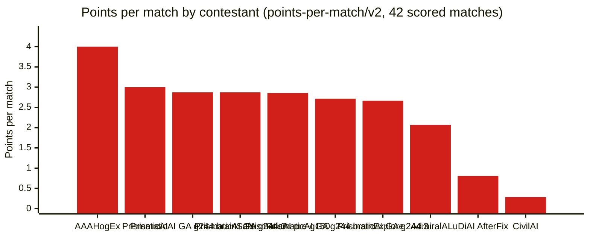
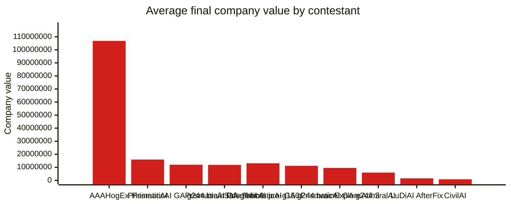
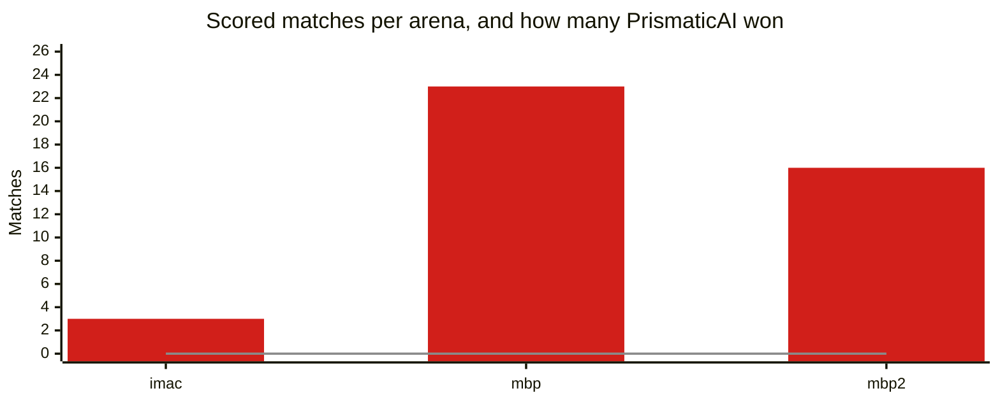

# battle-20261121T073229-8df547cc

Derived from `battle-20261121T073229-8df547cc.json` by `tools/research/ai-battle/battle.py report`; do not edit.

- Edition `8df547cc1a682581`: PrismaticAI and referee at `52f631b115782334f422f741a79ecabce78e58c4`, base set `opengfx-8.0.tar`
- 20-year free-for-all from 1960, map 256x256 temperate, breakdowns 1
- 42 scored match(es) on `imac` (20261119-master-gdf1e05e7d8), `mbp` (20261120-master-m17653b726e), `mbp2` (20261119-master-gdf1e05e7d8)
- Replays: 1 of 1 identical to their original on another arena

| # | Contestant | Played | Wins | Points | Points/match | Avg rank | Avg final value | Squirrel errors | Matches with anomalies |
|---|---|---|---|---|---|---|---|---|---|
| 1 | AAAHogEx | 42 | 42 | 168 | 4.0 | 1.0 | 106.8 M | 0 | 0 |
| 2 | PrismaticAI | 6 | 0 | 18 | 3.0 | 2.0 | 15.9 M | 0 | 0 |
| 3 | PrismaticAI GA g244.brainSafe | 8 | 0 | 23 | 2.875 | 2.12 | 12.0 M | 0 | 0 |
| 4 | PrismaticAI GA g244.0 | 8 | 0 | 23 | 2.875 | 2.12 | 11.9 M | 0 | 0 |
| 5 | PrismaticAI pre-g150 | 7 | 0 | 20 | 2.857 | 2.14 | 13.1 M | 0 | 0 |
| 6 | PrismaticAI GA g244.brainExplore | 7 | 0 | 19 | 2.714 | 2.29 | 11.2 M | 0 | 0 |
| 7 | PrismaticAI GA g244.3 | 6 | 0 | 16 | 2.667 | 2.33 | 9.6 M | 0 | 1 |
| 8 | AdmiralAI | 42 | 0 | 87 | 2.071 | 2.93 | 6.0 M | 72 | 3 |
| 9 | LuDiAI AfterFix | 42 | 0 | 34 | 0.81 | 4.19 | 1.6 M | 0 | 1 |
| 10 | CivilAI | 42 | 0 | 12 | 0.286 | 4.71 | 807.3 k | 3630 | 8 |

```mermaid
---
config:
  xyChart:
    width: 900
    height: 360
  themeVariables:
    xyChart:
      plotColorPalette: "#d11f1a, #8a8a8a, #0b0b0b, #ece4d6"
---
xychart-beta
    title "Final company value per scored match: winner vs best PrismaticAI"
    x-axis ["m-0001", "m-0002", "m-0003", "m-0004", "m-0005", "m-0006", "m-0007", "m-0008", "m-0009", "m-0010", "m-0011", "m-0012", "m-0013", "m-0014", "m-0015", "m-0016", "m-0017", "m-0018", "m-0019", "m-0020", "m-0021", "m-0022", "m-0023", "m-0024", "m-0025", "m-0026", "m-0027", "m-0028", "m-0036", "m-0037", "m-0038", "m-0039", "m-0040", "m-0041", "m-0042", "m-0043", "m-0044", "m-0045", "m-0047", "m-0050", "m-0051", "m-0052"]
    %% series: Winner | Best PrismaticAI
    %% links: battle-20261121T073229-8df547cc.md?col=Match&filter=m-0001 | battle-20261121T073229-8df547cc.md?col=Match&filter=m-0002 | battle-20261121T073229-8df547cc.md?col=Match&filter=m-0003 | battle-20261121T073229-8df547cc.md?col=Match&filter=m-0004 | battle-20261121T073229-8df547cc.md?col=Match&filter=m-0005 | battle-20261121T073229-8df547cc.md?col=Match&filter=m-0006 | battle-20261121T073229-8df547cc.md?col=Match&filter=m-0007 | battle-20261121T073229-8df547cc.md?col=Match&filter=m-0008 | battle-20261121T073229-8df547cc.md?col=Match&filter=m-0009 | battle-20261121T073229-8df547cc.md?col=Match&filter=m-0010 | battle-20261121T073229-8df547cc.md?col=Match&filter=m-0011 | battle-20261121T073229-8df547cc.md?col=Match&filter=m-0012 | battle-20261121T073229-8df547cc.md?col=Match&filter=m-0013 | battle-20261121T073229-8df547cc.md?col=Match&filter=m-0014 | battle-20261121T073229-8df547cc.md?col=Match&filter=m-0015 | battle-20261121T073229-8df547cc.md?col=Match&filter=m-0016 | battle-20261121T073229-8df547cc.md?col=Match&filter=m-0017 | battle-20261121T073229-8df547cc.md?col=Match&filter=m-0018 | battle-20261121T073229-8df547cc.md?col=Match&filter=m-0019 | battle-20261121T073229-8df547cc.md?col=Match&filter=m-0020 | battle-20261121T073229-8df547cc.md?col=Match&filter=m-0021 | battle-20261121T073229-8df547cc.md?col=Match&filter=m-0022 | battle-20261121T073229-8df547cc.md?col=Match&filter=m-0023 | battle-20261121T073229-8df547cc.md?col=Match&filter=m-0024 | battle-20261121T073229-8df547cc.md?col=Match&filter=m-0025 | battle-20261121T073229-8df547cc.md?col=Match&filter=m-0026 | battle-20261121T073229-8df547cc.md?col=Match&filter=m-0027 | battle-20261121T073229-8df547cc.md?col=Match&filter=m-0028 | battle-20261121T073229-8df547cc.md?col=Match&filter=m-0036 | battle-20261121T073229-8df547cc.md?col=Match&filter=m-0037 | battle-20261121T073229-8df547cc.md?col=Match&filter=m-0038 | battle-20261121T073229-8df547cc.md?col=Match&filter=m-0039 | battle-20261121T073229-8df547cc.md?col=Match&filter=m-0040 | battle-20261121T073229-8df547cc.md?col=Match&filter=m-0041 | battle-20261121T073229-8df547cc.md?col=Match&filter=m-0042 | battle-20261121T073229-8df547cc.md?col=Match&filter=m-0043 | battle-20261121T073229-8df547cc.md?col=Match&filter=m-0044 | battle-20261121T073229-8df547cc.md?col=Match&filter=m-0045 | battle-20261121T073229-8df547cc.md?col=Match&filter=m-0047 | battle-20261121T073229-8df547cc.md?col=Match&filter=m-0050 | battle-20261121T073229-8df547cc.md?col=Match&filter=m-0051 | battle-20261121T073229-8df547cc.md?col=Match&filter=m-0052
    y-axis "Company value" 0 --> 198000000
    bar [133078901, 133007744, 122054399, 118162284, 128034749, 113347069, 140886143, 134523064, 123222913, 123254450, 123797664, 81032294, 104103845, 124732846, 140645681, 123223730, 119535715, 48244345, 43354217, 50632459, 62518816, 59934785, 59111451, 53654231, 63954704, 50429440, 56129427, 61222542, 180316785, 153809761, 163739171, 159354373, 148039210, 178764869, 109236001, 98679604, 118628587, 94434588, 111399258, 121586593, 80782642, 72976997]
    line [5098502, 6789067, 10083494, 6759051, 7399463, 18819239, 21633370, 14261088, 12510335, 15362667, 14113007, 18018395, 17800125, 10535282, 9761515, 7605477, 10941035, 11596889, 11737772, 9977941, 8994226, 6264148, 6647666, 13511948, 9495057, 15435657, 7135680, 5803861, 21351366, 11712446, 18823394, 17345510, 18142556, 14941774, 12328703, 14310517, 5740661, 9974050, 3319763, 13532490, 20342997, 18149262]
```

<!-- battle-charts:begin -->
<!-- derived from battle-20261121T073229-8df547cc.json by `battle.py render`; `battle.py check` fails when it is stale -->

<!-- battle-charts:end -->

| Seed | Original | Replay | Arenas | Identical |
|---|---|---|---|---|
| 1852176337 | m-0018 | m-0048 | mbp2 / mbp | yes |

| Match | Arena | Seed | Winner | Value | Last | Anomalies |
|---|---|---|---|---|---|---|
| m-0001 | mbp | 1007110669 | AAAHogEx | 133.1 M | CivilAI | - |
| m-0002 | mbp | 1007110669 | AAAHogEx | 133.0 M | CivilAI | - |
| m-0003 | mbp | 1007110669 | AAAHogEx | 122.1 M | CivilAI | - |
| m-0004 | mbp | 1007110669 | AAAHogEx | 118.2 M | LuDiAI AfterFix | - |
| m-0005 | mbp | 1007110669 | AAAHogEx | 128.0 M | CivilAI | - |
| m-0006 | mbp | 1179981712 | AAAHogEx | 113.3 M | CivilAI | CivilAI: squirrel_errors:3630 |
| m-0007 | mbp | 1179981712 | AAAHogEx | 140.9 M | CivilAI | CivilAI: fleet_drop:55->26 |
| m-0008 | mbp | 1179981712 | AAAHogEx | 134.5 M | CivilAI | - |
| m-0009 | mbp | 1179981712 | AAAHogEx | 123.2 M | CivilAI | - |
| m-0010 | imac | 1179981712 | AAAHogEx | 123.3 M | CivilAI | - |
| m-0011 | imac | 1179981712 | AAAHogEx | 123.8 M | CivilAI | CivilAI: fleet_drop:29->19 |
| m-0012 | imac | 185065541 | AAAHogEx | 81.0 M | CivilAI | - |
| m-0013 | mbp2 | 185065541 | AAAHogEx | 104.1 M | CivilAI | - |
| m-0014 | mbp2 | 185065541 | AAAHogEx | 124.7 M | LuDiAI AfterFix | CivilAI: fleet_drop:54->33 |
| m-0015 | mbp2 | 185065541 | AAAHogEx | 140.6 M | LuDiAI AfterFix | LuDiAI AfterFix: fleet_drop:44->15 |
| m-0016 | mbp2 | 185065541 | AAAHogEx | 123.2 M | CivilAI | - |
| m-0017 | mbp2 | 185065541 | AAAHogEx | 119.5 M | LuDiAI AfterFix | - |
| m-0018 | mbp2 | 1852176337 | AAAHogEx | 48.2 M | LuDiAI AfterFix | - |
| m-0019 | mbp2 | 1852176337 | AAAHogEx | 43.4 M | CivilAI | - |
| m-0020 | mbp2 | 1852176337 | AAAHogEx | 50.6 M | CivilAI | - |
| m-0021 | mbp2 | 1852176337 | AAAHogEx | 62.5 M | CivilAI | - |
| m-0022 | mbp2 | 1852176337 | AAAHogEx | 59.9 M | CivilAI | - |
| m-0023 | mbp2 | 1852176337 | AAAHogEx | 59.1 M | CivilAI | - |
| m-0024 | mbp2 | 494538991 | AAAHogEx | 53.7 M | CivilAI | CivilAI: fleet_drop:25->17 |
| m-0025 | mbp2 | 494538991 | AAAHogEx | 64.0 M | CivilAI | CivilAI: fleet_drop:53->20 |
| m-0026 | mbp2 | 494538991 | AAAHogEx | 50.4 M | CivilAI | - |
| m-0027 | mbp2 | 494538991 | AAAHogEx | 56.1 M | CivilAI | - |
| m-0028 | mbp2 | 494538991 | AAAHogEx | 61.2 M | CivilAI | - |
| m-0036 | mbp | 1298353539 | AAAHogEx | 180.3 M | LuDiAI AfterFix | - |
| m-0037 | mbp | 1298353539 | AAAHogEx | 153.8 M | CivilAI | CivilAI: fleet_drop:65->29 |
| m-0038 | mbp | 1298353539 | AAAHogEx | 163.7 M | AdmiralAI | AdmiralAI: squirrel_errors:72 |
| m-0039 | mbp | 1298353539 | AAAHogEx | 159.4 M | LuDiAI AfterFix | - |
| m-0040 | mbp | 1298353539 | AAAHogEx | 148.0 M | LuDiAI AfterFix | AdmiralAI: fleet_drop:103->71 |
| m-0041 | mbp | 1298353539 | AAAHogEx | 178.8 M | CivilAI | - |
| m-0042 | mbp | 703653567 | AAAHogEx | 109.2 M | CivilAI | - |
| m-0043 | mbp | 703653567 | AAAHogEx | 98.7 M | CivilAI | - |
| m-0044 | mbp | 703653567 | AAAHogEx | 118.6 M | LuDiAI AfterFix | - |
| m-0045 | mbp | 703653567 | AAAHogEx | 94.4 M | LuDiAI AfterFix | - |
| m-0047 | mbp | 703653567 | AAAHogEx | 111.4 M | CivilAI | PrismaticAI GA g244.3: fleet_drop:19->11 |
| m-0048 (replay) | mbp | 1852176337 | AAAHogEx | 48.2 M | LuDiAI AfterFix | - |
| m-0050 | mbp | 1843608265 | AAAHogEx | 121.6 M | LuDiAI AfterFix | - |
| m-0051 | mbp | 1843608265 | AAAHogEx | 80.8 M | CivilAI | CivilAI: fleet_drop:82->57 |
| m-0052 | mbp | 1843608265 | AAAHogEx | 73.0 M | CivilAI | AdmiralAI: fleet_drop:300->165 |
