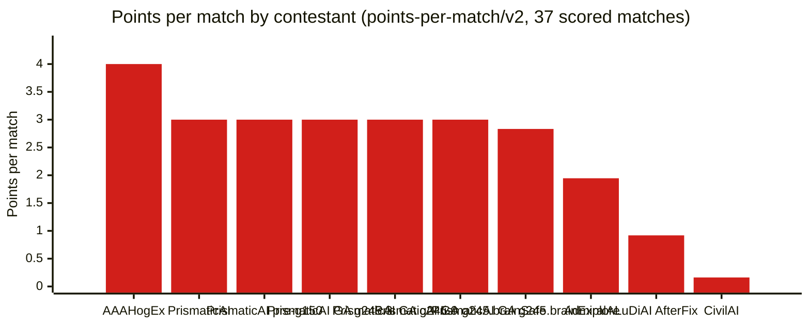
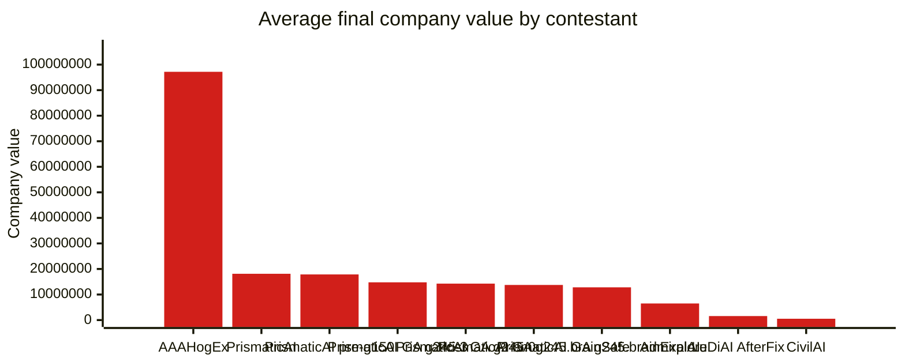
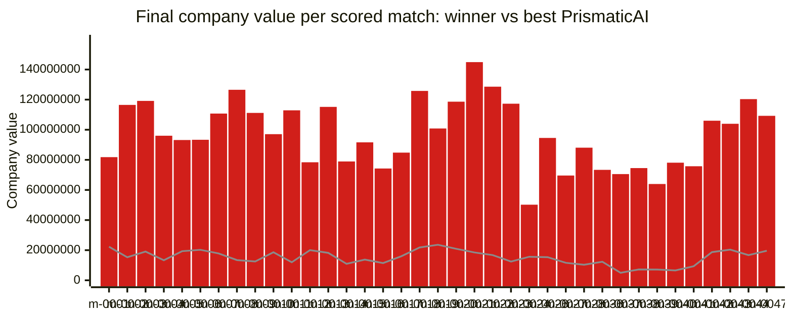
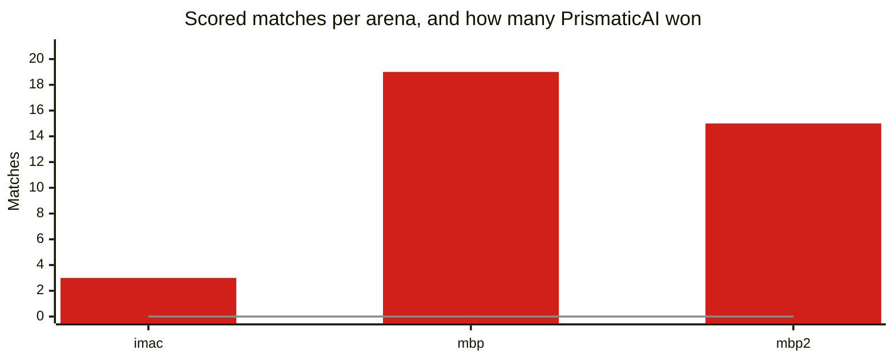

# battle-20261121T074101-070e7361

Derived from `battle-20261121T074101-070e7361.json` by `tools/research/ai-battle/battle.py report`; do not edit.

- Edition `070e73614beebacb`: PrismaticAI and referee at `52f631b115782334f422f741a79ecabce78e58c4`, base set `opengfx-8.0.tar`
- 20-year free-for-all from 1960, map 256x256 temperate, breakdowns 1
- 37 scored match(es) on `imac` (20261119-master-gdf1e05e7d8), `mbp` (20261120-master-m17653b726e), `mbp2` (20261119-master-gdf1e05e7d8)
- Replays: 0 of 0 identical to their original on another arena

| # | Contestant | Played | Wins | Points | Points/match | Avg rank | Avg final value | Squirrel errors | Matches with anomalies |
|---|---|---|---|---|---|---|---|---|---|
| 1 | AAAHogEx | 37 | 37 | 148 | 4.0 | 1.0 | 97.2 M | 0 | 0 |
| 2 | PrismaticAI | 6 | 0 | 18 | 3.0 | 2.0 | 18.1 M | 0 | 0 |
| 3 | PrismaticAI pre-g150 | 6 | 0 | 18 | 3.0 | 2.0 | 17.9 M | 0 | 3 |
| 4 | PrismaticAI GA g245.3 | 6 | 0 | 18 | 3.0 | 2.0 | 14.8 M | 0 | 0 |
| 5 | PrismaticAI GA g245.0 | 7 | 0 | 21 | 3.0 | 2.0 | 14.3 M | 0 | 0 |
| 6 | PrismaticAI GA g245.brainSafe | 6 | 0 | 18 | 3.0 | 2.0 | 13.7 M | 0 | 0 |
| 7 | PrismaticAI GA g245.brainExplore | 6 | 0 | 17 | 2.833 | 2.17 | 12.8 M | 0 | 1 |
| 8 | AdmiralAI | 37 | 0 | 72 | 1.946 | 3.05 | 6.5 M | 62 | 3 |
| 9 | LuDiAI AfterFix | 37 | 0 | 34 | 0.919 | 4.08 | 1.6 M | 0 | 2 |
| 10 | CivilAI | 37 | 0 | 6 | 0.162 | 4.84 | 516.9 k | 32 | 11 |

<!-- battle-charts:begin -->
<!-- derived from battle-20261121T074101-070e7361.json by `battle.py render`; `battle.py check` fails when it is stale -->

<!-- battle-charts:end -->

| Match | Arena | Seed | Winner | Value | Last | Anomalies |
|---|---|---|---|---|---|---|
| m-0001 | mbp | 1048534 | AAAHogEx | 81.8 M | CivilAI | PrismaticAI pre-g150: fleet_drop:155->83 |
| m-0002 | mbp | 1048534 | AAAHogEx | 116.5 M | CivilAI | AdmiralAI: fleet_drop:157->79 |
| m-0003 | mbp | 1048534 | AAAHogEx | 119.1 M | CivilAI | CivilAI: fleet_drop:40->10 |
| m-0004 | mbp | 1048534 | AAAHogEx | 96.0 M | CivilAI | - |
| m-0005 | mbp | 1048534 | AAAHogEx | 93.2 M | CivilAI | CivilAI: squirrel_errors:32 |
| m-0006 | mbp | 935834558 | AAAHogEx | 93.3 M | CivilAI | - |
| m-0007 | mbp | 935834558 | AAAHogEx | 110.7 M | CivilAI | PrismaticAI pre-g150: fleet_drop:112->54 |
| m-0008 | mbp | 935834558 | AAAHogEx | 126.5 M | CivilAI | CivilAI: fleet_drop:25->9 |
| m-0009 | mbp | 935834558 | AAAHogEx | 111.2 M | CivilAI | CivilAI: fleet_drop:66->42 |
| m-0010 | imac | 935834558 | AAAHogEx | 97.1 M | CivilAI | PrismaticAI GA g245.brainExplore: fleet_drop:182->125; AdmiralAI: squirrel_errors:62; CivilAI: fleet_drop:59->33 |
| m-0011 | imac | 935834558 | AAAHogEx | 112.9 M | CivilAI | CivilAI: fleet_drop:32->20 |
| m-0012 | imac | 1626955021 | AAAHogEx | 78.4 M | CivilAI | - |
| m-0013 | mbp2 | 1626955021 | AAAHogEx | 115.2 M | CivilAI | - |
| m-0014 | mbp2 | 1626955021 | AAAHogEx | 78.9 M | CivilAI | - |
| m-0015 | mbp2 | 1626955021 | AAAHogEx | 91.6 M | LuDiAI AfterFix | - |
| m-0016 | mbp2 | 1626955021 | AAAHogEx | 74.2 M | CivilAI | CivilAI: fleet_drop:151->102 |
| m-0017 | mbp2 | 1626955021 | AAAHogEx | 84.8 M | LuDiAI AfterFix | - |
| m-0018 | mbp2 | 1077247438 | AAAHogEx | 125.8 M | CivilAI | - |
| m-0019 | mbp2 | 1077247438 | AAAHogEx | 100.8 M | CivilAI | - |
| m-0020 | mbp2 | 1077247438 | AAAHogEx | 118.6 M | CivilAI | - |
| m-0021 | mbp2 | 1077247438 | AAAHogEx | 144.9 M | LuDiAI AfterFix | - |
| m-0022 | mbp2 | 1077247438 | AAAHogEx | 128.6 M | CivilAI | - |
| m-0023 | mbp2 | 1077247438 | AAAHogEx | 117.3 M | LuDiAI AfterFix | - |
| m-0024 | mbp2 | 1879777241 | AAAHogEx | 50.2 M | CivilAI | - |
| m-0026 | mbp2 | 1879777241 | AAAHogEx | 94.5 M | CivilAI | CivilAI: no_vehicles |
| m-0027 | mbp2 | 1879777241 | AAAHogEx | 69.6 M | CivilAI | LuDiAI AfterFix: fleet_drop:41->25; CivilAI: no_vehicles |
| m-0028 | mbp2 | 1879777241 | AAAHogEx | 88.1 M | CivilAI | CivilAI: no_vehicles |
| m-0036 | mbp | 1131601018 | AAAHogEx | 73.3 M | CivilAI | - |
| m-0037 | mbp | 1131601018 | AAAHogEx | 70.5 M | CivilAI | PrismaticAI pre-g150: fleet_drop:65->43 |
| m-0038 | mbp | 1131601018 | AAAHogEx | 74.5 M | CivilAI | AdmiralAI: fleet_drop:223->149 |
| m-0039 | mbp | 1131601018 | AAAHogEx | 64.0 M | CivilAI | - |
| m-0040 | mbp | 1131601018 | AAAHogEx | 78.1 M | CivilAI | - |
| m-0041 | mbp | 1131601018 | AAAHogEx | 75.7 M | CivilAI | - |
| m-0042 | mbp | 672211349 | AAAHogEx | 106.0 M | CivilAI | CivilAI: no_vehicles |
| m-0043 | mbp | 672211349 | AAAHogEx | 103.9 M | LuDiAI AfterFix | LuDiAI AfterFix: no_vehicles |
| m-0044 | mbp | 672211349 | AAAHogEx | 120.3 M | LuDiAI AfterFix | - |
| m-0047 | mbp | 672211349 | AAAHogEx | 109.2 M | CivilAI | - |
