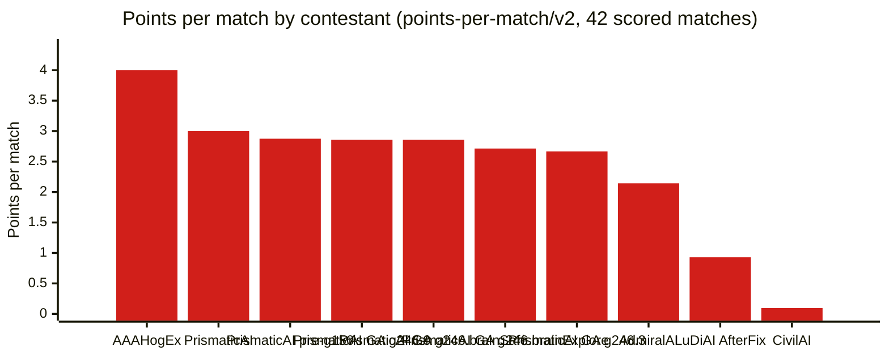
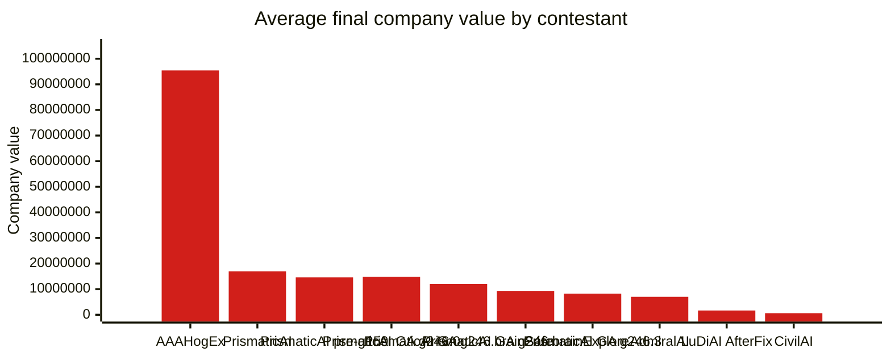
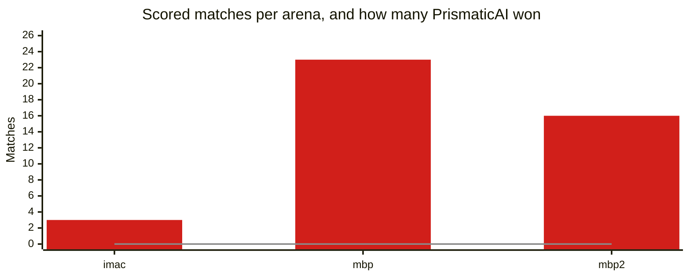

# battle-20261121T075000-59c45cd7

Derived from `battle-20261121T075000-59c45cd7.json` by `tools/research/ai-battle/battle.py report`; do not edit.

- Edition `59c45cd796ec42e0`: PrismaticAI and referee at `52f631b115782334f422f741a79ecabce78e58c4`, base set `opengfx-8.0.tar`
- 20-year free-for-all from 1960, map 256x256 temperate, breakdowns 1
- 42 scored match(es) on `imac` (20261119-master-gdf1e05e7d8), `mbp` (20261120-master-m17653b726e), `mbp2` (20261119-master-gdf1e05e7d8)
- Replays: 0 of 0 identical to their original on another arena

| # | Contestant | Played | Wins | Points | Points/match | Avg rank | Avg final value | Squirrel errors | Matches with anomalies |
|---|---|---|---|---|---|---|---|---|---|
| 1 | AAAHogEx | 42 | 42 | 168 | 4.0 | 1.0 | 95.4 M | 35 | 1 |
| 2 | PrismaticAI | 7 | 0 | 21 | 3.0 | 2.0 | 17.0 M | 0 | 0 |
| 3 | PrismaticAI pre-g150 | 8 | 0 | 23 | 2.875 | 2.12 | 14.6 M | 0 | 4 |
| 4 | PrismaticAI GA g246.0 | 7 | 0 | 20 | 2.857 | 2.14 | 14.8 M | 0 | 1 |
| 5 | PrismaticAI GA g246.brainSafe | 7 | 0 | 20 | 2.857 | 2.14 | 12.0 M | 0 | 0 |
| 6 | PrismaticAI GA g246.brainExplore | 7 | 0 | 19 | 2.714 | 2.29 | 9.3 M | 0 | 1 |
| 7 | PrismaticAI GA g246.3 | 6 | 0 | 16 | 2.667 | 2.33 | 8.3 M | 0 | 1 |
| 8 | AdmiralAI | 42 | 0 | 90 | 2.143 | 2.86 | 7.0 M | 0 | 2 |
| 9 | LuDiAI AfterFix | 42 | 0 | 39 | 0.929 | 4.07 | 1.7 M | 0 | 1 |
| 10 | CivilAI | 42 | 0 | 4 | 0.095 | 4.9 | 620.5 k | 0 | 4 |

```mermaid
---
config:
  xyChart:
    width: 900
    height: 360
  themeVariables:
    xyChart:
      plotColorPalette: "#d11f1a, #8a8a8a, #0b0b0b, #ece4d6"
---
xychart-beta
    title "Final company value per scored match: winner vs best PrismaticAI"
    x-axis ["m-0001", "m-0002", "m-0003", "m-0004", "m-0005", "m-0006", "m-0007", "m-0008", "m-0009", "m-0010", "m-0011", "m-0012", "m-0013", "m-0014", "m-0015", "m-0016", "m-0017", "m-0018", "m-0019", "m-0020", "m-0021", "m-0022", "m-0023", "m-0024", "m-0025", "m-0026", "m-0027", "m-0028", "m-0036", "m-0037", "m-0038", "m-0039", "m-0040", "m-0041", "m-0042", "m-0043", "m-0044", "m-0045", "m-0046", "m-0047", "m-0048", "m-0049"]
    %% series: Winner | Best PrismaticAI
    %% links: battle-20261121T075000-59c45cd7.md?col=Match&filter=m-0001 | battle-20261121T075000-59c45cd7.md?col=Match&filter=m-0002 | battle-20261121T075000-59c45cd7.md?col=Match&filter=m-0003 | battle-20261121T075000-59c45cd7.md?col=Match&filter=m-0004 | battle-20261121T075000-59c45cd7.md?col=Match&filter=m-0005 | battle-20261121T075000-59c45cd7.md?col=Match&filter=m-0006 | battle-20261121T075000-59c45cd7.md?col=Match&filter=m-0007 | battle-20261121T075000-59c45cd7.md?col=Match&filter=m-0008 | battle-20261121T075000-59c45cd7.md?col=Match&filter=m-0009 | battle-20261121T075000-59c45cd7.md?col=Match&filter=m-0010 | battle-20261121T075000-59c45cd7.md?col=Match&filter=m-0011 | battle-20261121T075000-59c45cd7.md?col=Match&filter=m-0012 | battle-20261121T075000-59c45cd7.md?col=Match&filter=m-0013 | battle-20261121T075000-59c45cd7.md?col=Match&filter=m-0014 | battle-20261121T075000-59c45cd7.md?col=Match&filter=m-0015 | battle-20261121T075000-59c45cd7.md?col=Match&filter=m-0016 | battle-20261121T075000-59c45cd7.md?col=Match&filter=m-0017 | battle-20261121T075000-59c45cd7.md?col=Match&filter=m-0018 | battle-20261121T075000-59c45cd7.md?col=Match&filter=m-0019 | battle-20261121T075000-59c45cd7.md?col=Match&filter=m-0020 | battle-20261121T075000-59c45cd7.md?col=Match&filter=m-0021 | battle-20261121T075000-59c45cd7.md?col=Match&filter=m-0022 | battle-20261121T075000-59c45cd7.md?col=Match&filter=m-0023 | battle-20261121T075000-59c45cd7.md?col=Match&filter=m-0024 | battle-20261121T075000-59c45cd7.md?col=Match&filter=m-0025 | battle-20261121T075000-59c45cd7.md?col=Match&filter=m-0026 | battle-20261121T075000-59c45cd7.md?col=Match&filter=m-0027 | battle-20261121T075000-59c45cd7.md?col=Match&filter=m-0028 | battle-20261121T075000-59c45cd7.md?col=Match&filter=m-0036 | battle-20261121T075000-59c45cd7.md?col=Match&filter=m-0037 | battle-20261121T075000-59c45cd7.md?col=Match&filter=m-0038 | battle-20261121T075000-59c45cd7.md?col=Match&filter=m-0039 | battle-20261121T075000-59c45cd7.md?col=Match&filter=m-0040 | battle-20261121T075000-59c45cd7.md?col=Match&filter=m-0041 | battle-20261121T075000-59c45cd7.md?col=Match&filter=m-0042 | battle-20261121T075000-59c45cd7.md?col=Match&filter=m-0043 | battle-20261121T075000-59c45cd7.md?col=Match&filter=m-0044 | battle-20261121T075000-59c45cd7.md?col=Match&filter=m-0045 | battle-20261121T075000-59c45cd7.md?col=Match&filter=m-0046 | battle-20261121T075000-59c45cd7.md?col=Match&filter=m-0047 | battle-20261121T075000-59c45cd7.md?col=Match&filter=m-0048 | battle-20261121T075000-59c45cd7.md?col=Match&filter=m-0049
    y-axis "Company value" 0 --> 163000000
    bar [101397759, 72697602, 107242417, 79658786, 72223379, 114832075, 123907908, 119766383, 130267750, 117330191, 102945978, 101323261, 114793029, 105344943, 96190954, 86753060, 97792155, 104793663, 104215572, 98220483, 95622571, 90426116, 115407647, 98751467, 92481989, 93811176, 81265002, 95791268, 82231692, 78538753, 69492824, 81037112, 86436077, 85592231, 67951316, 81588334, 57099027, 66990665, 69251412, 72936737, 147900339, 145666750]
    line [14476462, 11487454, 18221595, 6206478, 10447249, 20530689, 15351031, 14919147, 7852567, 10457399, 5522848, 21145195, 17330260, 13975062, 11073219, 10630981, 5629513, 11491522, 15595103, 21324963, 9933503, 7751796, 13892977, 19143182, 12058461, 12690628, 19129797, 10363462, 17392858, 17742345, 16160209, 14091046, 13782825, 8527052, 13482164, 7729997, 12941388, 3832778, 6039490, 5524632, 15702377, 16543390]
```

<!-- battle-charts:begin -->
<!-- derived from battle-20261121T075000-59c45cd7.json by `battle.py render`; `battle.py check` fails when it is stale -->

<!-- battle-charts:end -->

| Match | Arena | Seed | Winner | Value | Last | Anomalies |
|---|---|---|---|---|---|---|
| m-0001 | mbp | 1745074112 | AAAHogEx | 101.4 M | CivilAI | - |
| m-0002 | mbp | 1745074112 | AAAHogEx | 72.7 M | CivilAI | - |
| m-0003 | mbp | 1745074112 | AAAHogEx | 107.2 M | CivilAI | - |
| m-0004 | mbp | 1745074112 | AAAHogEx | 79.7 M | CivilAI | CivilAI: fleet_drop:24->15 |
| m-0005 | mbp | 1745074112 | AAAHogEx | 72.2 M | LuDiAI AfterFix | - |
| m-0006 | mbp | 885169359 | AAAHogEx | 114.8 M | CivilAI | - |
| m-0007 | mbp | 885169359 | AAAHogEx | 123.9 M | CivilAI | - |
| m-0008 | mbp | 885169359 | AAAHogEx | 119.8 M | CivilAI | LuDiAI AfterFix: fleet_drop:56->38 |
| m-0009 | mbp | 885169359 | AAAHogEx | 130.3 M | CivilAI | - |
| m-0010 | imac | 885169359 | AAAHogEx | 117.3 M | CivilAI | - |
| m-0011 | imac | 885169359 | AAAHogEx | 102.9 M | CivilAI | PrismaticAI GA g246.3: fleet_drop:42->27 |
| m-0012 | imac | 1184715770 | AAAHogEx | 101.3 M | CivilAI | - |
| m-0013 | mbp2 | 1184715770 | AAAHogEx | 114.8 M | CivilAI | - |
| m-0014 | mbp2 | 1184715770 | AAAHogEx | 105.3 M | CivilAI | - |
| m-0015 | mbp2 | 1184715770 | AAAHogEx | 96.2 M | CivilAI | - |
| m-0016 | mbp2 | 1184715770 | AAAHogEx | 86.8 M | CivilAI | - |
| m-0017 | mbp2 | 1184715770 | AAAHogEx | 97.8 M | CivilAI | - |
| m-0018 | mbp2 | 1610518015 | AAAHogEx | 104.8 M | CivilAI | - |
| m-0019 | mbp2 | 1610518015 | AAAHogEx | 104.2 M | CivilAI | PrismaticAI pre-g150: fleet_drop:91->55 |
| m-0020 | mbp2 | 1610518015 | AAAHogEx | 98.2 M | CivilAI | - |
| m-0021 | mbp2 | 1610518015 | AAAHogEx | 95.6 M | CivilAI | - |
| m-0022 | mbp2 | 1610518015 | AAAHogEx | 90.4 M | CivilAI | AdmiralAI: fleet_drop:344->201; PrismaticAI GA g246.brainExplore: fleet_drop:97->65 |
| m-0023 | mbp2 | 1610518015 | AAAHogEx | 115.4 M | CivilAI | - |
| m-0024 | mbp2 | 1806185685 | AAAHogEx | 98.8 M | CivilAI | - |
| m-0025 | mbp2 | 1806185685 | AAAHogEx | 92.5 M | CivilAI | - |
| m-0026 | mbp2 | 1806185685 | AAAHogEx | 93.8 M | CivilAI | - |
| m-0027 | mbp2 | 1806185685 | AAAHogEx | 81.3 M | CivilAI | - |
| m-0028 | mbp2 | 1806185685 | AAAHogEx | 95.8 M | CivilAI | CivilAI: fleet_drop:34->12 |
| m-0036 | mbp | 857622161 | AAAHogEx | 82.2 M | CivilAI | - |
| m-0037 | mbp | 857622161 | AAAHogEx | 78.5 M | CivilAI | PrismaticAI pre-g150: fleet_drop:106->58; CivilAI: fleet_drop:115->72 |
| m-0038 | mbp | 857622161 | AAAHogEx | 69.5 M | CivilAI | AAAHogEx: squirrel_errors:35; PrismaticAI GA g246.0: fleet_drop:77->44 |
| m-0039 | mbp | 857622161 | AAAHogEx | 81.0 M | CivilAI | - |
| m-0040 | mbp | 857622161 | AAAHogEx | 86.4 M | CivilAI | - |
| m-0041 | mbp | 857622161 | AAAHogEx | 85.6 M | CivilAI | CivilAI: fleet_drop:77->52 |
| m-0042 | mbp | 542810418 | AAAHogEx | 68.0 M | LuDiAI AfterFix | - |
| m-0043 | mbp | 542810418 | AAAHogEx | 81.6 M | LuDiAI AfterFix | PrismaticAI pre-g150: fleet_drop:71->37 |
| m-0044 | mbp | 542810418 | AAAHogEx | 57.1 M | CivilAI | - |
| m-0045 | mbp | 542810418 | AAAHogEx | 67.0 M | CivilAI | - |
| m-0046 | mbp | 542810418 | AAAHogEx | 69.3 M | CivilAI | - |
| m-0047 | mbp | 542810418 | AAAHogEx | 72.9 M | LuDiAI AfterFix | - |
| m-0048 | mbp | 963836251 | AAAHogEx | 147.9 M | CivilAI | AdmiralAI: fleet_drop:222->98 |
| m-0049 | mbp | 963836251 | AAAHogEx | 145.7 M | CivilAI | PrismaticAI pre-g150: fleet_drop:116->66 |
