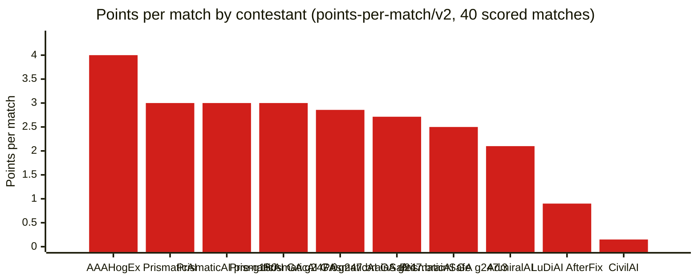
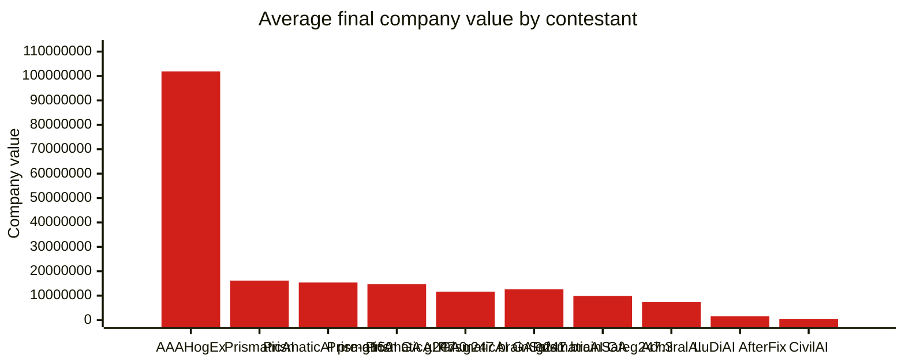
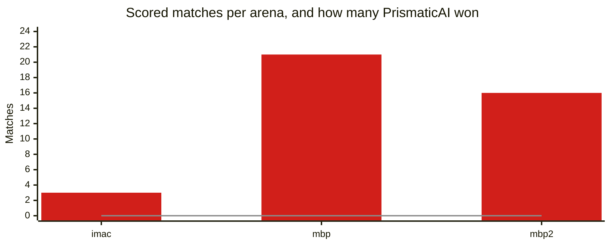

# battle-20261121T075924-38ab19a9

Derived from `battle-20261121T075924-38ab19a9.json` by `tools/research/ai-battle/battle.py report`; do not edit.

- Edition `38ab19a96ed913f7`: PrismaticAI and referee at `52f631b115782334f422f741a79ecabce78e58c4`, base set `opengfx-8.0.tar`
- 20-year free-for-all from 1960, map 256x256 temperate, breakdowns 1
- 40 scored match(es) on `imac` (20261119-master-gdf1e05e7d8), `mbp` (20261120-master-m17653b726e), `mbp2` (20261119-master-gdf1e05e7d8)
- Replays: 1 of 1 identical to their original on another arena

| # | Contestant | Played | Wins | Points | Points/match | Avg rank | Avg final value | Squirrel errors | Matches with anomalies |
|---|---|---|---|---|---|---|---|---|---|
| 1 | AAAHogEx | 40 | 40 | 160 | 4.0 | 1.0 | 101.9 M | 0 | 0 |
| 2 | PrismaticAI | 6 | 0 | 18 | 3.0 | 2.0 | 16.2 M | 0 | 0 |
| 3 | PrismaticAI pre-g150 | 7 | 0 | 21 | 3.0 | 2.0 | 15.4 M | 0 | 5 |
| 4 | PrismaticAI GA g247.0 | 7 | 0 | 21 | 3.0 | 2.0 | 14.7 M | 0 | 0 |
| 5 | PrismaticAI GA g247.brainSafe1 | 7 | 0 | 20 | 2.857 | 2.14 | 11.6 M | 0 | 2 |
| 6 | PrismaticAI GA g247.brainSafe | 7 | 0 | 19 | 2.714 | 2.29 | 12.6 M | 0 | 1 |
| 7 | PrismaticAI GA g247.3 | 6 | 0 | 15 | 2.5 | 2.5 | 9.9 M | 0 | 1 |
| 8 | AdmiralAI | 40 | 0 | 84 | 2.1 | 2.9 | 7.4 M | 47 | 1 |
| 9 | LuDiAI AfterFix | 40 | 0 | 36 | 0.9 | 4.1 | 1.6 M | 0 | 1 |
| 10 | CivilAI | 40 | 0 | 6 | 0.15 | 4.85 | 505.9 k | 3665 | 11 |

```mermaid
---
config:
  xyChart:
    width: 900
    height: 360
  themeVariables:
    xyChart:
      plotColorPalette: "#d11f1a, #8a8a8a, #0b0b0b, #ece4d6"
---
xychart-beta
    title "Final company value per scored match: winner vs best PrismaticAI"
    x-axis ["m-0001", "m-0002", "m-0003", "m-0004", "m-0005", "m-0006", "m-0007", "m-0008", "m-0009", "m-0010", "m-0011", "m-0012", "m-0013", "m-0014", "m-0015", "m-0016", "m-0017", "m-0018", "m-0019", "m-0020", "m-0021", "m-0022", "m-0023", "m-0024", "m-0025", "m-0026", "m-0027", "m-0028", "m-0036", "m-0037", "m-0038", "m-0039", "m-0040", "m-0041", "m-0042", "m-0043", "m-0044", "m-0045", "m-0046", "m-0047"]
    %% series: Winner | Best PrismaticAI
    %% links: battle-20261121T075924-38ab19a9.md?col=Match&filter=m-0001 | battle-20261121T075924-38ab19a9.md?col=Match&filter=m-0002 | battle-20261121T075924-38ab19a9.md?col=Match&filter=m-0003 | battle-20261121T075924-38ab19a9.md?col=Match&filter=m-0004 | battle-20261121T075924-38ab19a9.md?col=Match&filter=m-0005 | battle-20261121T075924-38ab19a9.md?col=Match&filter=m-0006 | battle-20261121T075924-38ab19a9.md?col=Match&filter=m-0007 | battle-20261121T075924-38ab19a9.md?col=Match&filter=m-0008 | battle-20261121T075924-38ab19a9.md?col=Match&filter=m-0009 | battle-20261121T075924-38ab19a9.md?col=Match&filter=m-0010 | battle-20261121T075924-38ab19a9.md?col=Match&filter=m-0011 | battle-20261121T075924-38ab19a9.md?col=Match&filter=m-0012 | battle-20261121T075924-38ab19a9.md?col=Match&filter=m-0013 | battle-20261121T075924-38ab19a9.md?col=Match&filter=m-0014 | battle-20261121T075924-38ab19a9.md?col=Match&filter=m-0015 | battle-20261121T075924-38ab19a9.md?col=Match&filter=m-0016 | battle-20261121T075924-38ab19a9.md?col=Match&filter=m-0017 | battle-20261121T075924-38ab19a9.md?col=Match&filter=m-0018 | battle-20261121T075924-38ab19a9.md?col=Match&filter=m-0019 | battle-20261121T075924-38ab19a9.md?col=Match&filter=m-0020 | battle-20261121T075924-38ab19a9.md?col=Match&filter=m-0021 | battle-20261121T075924-38ab19a9.md?col=Match&filter=m-0022 | battle-20261121T075924-38ab19a9.md?col=Match&filter=m-0023 | battle-20261121T075924-38ab19a9.md?col=Match&filter=m-0024 | battle-20261121T075924-38ab19a9.md?col=Match&filter=m-0025 | battle-20261121T075924-38ab19a9.md?col=Match&filter=m-0026 | battle-20261121T075924-38ab19a9.md?col=Match&filter=m-0027 | battle-20261121T075924-38ab19a9.md?col=Match&filter=m-0028 | battle-20261121T075924-38ab19a9.md?col=Match&filter=m-0036 | battle-20261121T075924-38ab19a9.md?col=Match&filter=m-0037 | battle-20261121T075924-38ab19a9.md?col=Match&filter=m-0038 | battle-20261121T075924-38ab19a9.md?col=Match&filter=m-0039 | battle-20261121T075924-38ab19a9.md?col=Match&filter=m-0040 | battle-20261121T075924-38ab19a9.md?col=Match&filter=m-0041 | battle-20261121T075924-38ab19a9.md?col=Match&filter=m-0042 | battle-20261121T075924-38ab19a9.md?col=Match&filter=m-0043 | battle-20261121T075924-38ab19a9.md?col=Match&filter=m-0044 | battle-20261121T075924-38ab19a9.md?col=Match&filter=m-0045 | battle-20261121T075924-38ab19a9.md?col=Match&filter=m-0046 | battle-20261121T075924-38ab19a9.md?col=Match&filter=m-0047
    y-axis "Company value" 0 --> 156000000
    bar [96857322, 107429074, 93301900, 98897744, 106092359, 119964966, 136055448, 99728240, 105506325, 112564350, 101841145, 91729207, 108216416, 79667932, 60371614, 60353665, 69124236, 107467048, 121215183, 89401499, 112645781, 113484485, 106574717, 79326314, 66076773, 89070362, 107462522, 68493105, 105592723, 84109971, 93683908, 86099040, 88374120, 96601691, 132915916, 141619559, 128554616, 135150590, 140450115, 133082205]
    line [15251897, 13986534, 18548052, 9869221, 15351498, 19227836, 11456131, 10869920, 13464741, 13004099, 6803316, 14984106, 9243983, 17393176, 13280124, 14222342, 10379251, 15473333, 16946519, 11857490, 6464305, 7613856, 8115650, 20347546, 19485109, 18851184, 9051773, 9607471, 16205856, 22448983, 20284317, 13066037, 15816424, 11086181, 10802346, 12882273, 9471675, 14244530, 11414266, 7535685]
```

<!-- battle-charts:begin -->
<!-- derived from battle-20261121T075924-38ab19a9.json by `battle.py render`; `battle.py check` fails when it is stale -->

<!-- battle-charts:end -->

| Seed | Original | Replay | Arenas | Identical |
|---|---|---|---|---|
| 1796442418 | m-0025 | m-0048 | mbp2 / mbp | yes |

| Match | Arena | Seed | Winner | Value | Last | Anomalies |
|---|---|---|---|---|---|---|
| m-0001 | mbp | 1993775813 | AAAHogEx | 96.9 M | CivilAI | PrismaticAI pre-g150: fleet_drop:130->45 |
| m-0002 | mbp | 1993775813 | AAAHogEx | 107.4 M | CivilAI | CivilAI: fleet_drop:38->18 |
| m-0003 | mbp | 1993775813 | AAAHogEx | 93.3 M | CivilAI | - |
| m-0004 | mbp | 1993775813 | AAAHogEx | 98.9 M | CivilAI | PrismaticAI GA g247.brainSafe1: fleet_drop:74->50 |
| m-0005 | mbp | 1993775813 | AAAHogEx | 106.1 M | LuDiAI AfterFix | - |
| m-0006 | mbp | 1450386685 | AAAHogEx | 120.0 M | CivilAI | CivilAI: no_vehicles |
| m-0007 | mbp | 1450386685 | AAAHogEx | 136.1 M | CivilAI | PrismaticAI pre-g150: fleet_drop:197->122; CivilAI: no_vehicles |
| m-0008 | mbp | 1450386685 | AAAHogEx | 99.7 M | CivilAI | - |
| m-0009 | mbp | 1450386685 | AAAHogEx | 105.5 M | CivilAI | CivilAI: no_vehicles |
| m-0010 | imac | 1450386685 | AAAHogEx | 112.6 M | CivilAI | PrismaticAI GA g247.brainSafe1: fleet_drop:158->109 |
| m-0011 | imac | 1450386685 | AAAHogEx | 101.8 M | CivilAI | CivilAI: squirrel_errors:3665 |
| m-0012 | imac | 1871524863 | AAAHogEx | 91.7 M | CivilAI | - |
| m-0013 | mbp2 | 1871524863 | AAAHogEx | 108.2 M | CivilAI | - |
| m-0014 | mbp2 | 1871524863 | AAAHogEx | 79.7 M | CivilAI | CivilAI: fleet_drop:44->24 |
| m-0015 | mbp2 | 1871524863 | AAAHogEx | 60.4 M | CivilAI | CivilAI: fleet_drop:64->43 |
| m-0016 | mbp2 | 1871524863 | AAAHogEx | 60.4 M | LuDiAI AfterFix | - |
| m-0017 | mbp2 | 1871524863 | AAAHogEx | 69.1 M | LuDiAI AfterFix | - |
| m-0018 | mbp2 | 295745306 | AAAHogEx | 107.5 M | LuDiAI AfterFix | - |
| m-0019 | mbp2 | 295745306 | AAAHogEx | 121.2 M | LuDiAI AfterFix | PrismaticAI pre-g150: fleet_drop:93->64 |
| m-0020 | mbp2 | 295745306 | AAAHogEx | 89.4 M | CivilAI | CivilAI: fleet_drop:36->25 |
| m-0021 | mbp2 | 295745306 | AAAHogEx | 112.6 M | CivilAI | - |
| m-0022 | mbp2 | 295745306 | AAAHogEx | 113.5 M | CivilAI | - |
| m-0023 | mbp2 | 295745306 | AAAHogEx | 106.6 M | CivilAI | - |
| m-0024 | mbp2 | 1796442418 | AAAHogEx | 79.3 M | CivilAI | CivilAI: fleet_drop:45->28 |
| m-0025 | mbp2 | 1796442418 | AAAHogEx | 66.1 M | CivilAI | PrismaticAI pre-g150: fleet_drop:103->55 |
| m-0026 | mbp2 | 1796442418 | AAAHogEx | 89.1 M | CivilAI | - |
| m-0027 | mbp2 | 1796442418 | AAAHogEx | 107.5 M | CivilAI | PrismaticAI GA g247.brainSafe: fleet_drop:44->26; AdmiralAI: squirrel_errors:47 |
| m-0028 | mbp2 | 1796442418 | AAAHogEx | 68.5 M | CivilAI | CivilAI: fleet_drop:31->10 |
| m-0036 | mbp | 1503964710 | AAAHogEx | 105.6 M | LuDiAI AfterFix | LuDiAI AfterFix: fleet_drop:39->27 |
| m-0037 | mbp | 1503964710 | AAAHogEx | 84.1 M | CivilAI | - |
| m-0038 | mbp | 1503964710 | AAAHogEx | 93.7 M | CivilAI | - |
| m-0039 | mbp | 1503964710 | AAAHogEx | 86.1 M | CivilAI | CivilAI: fleet_drop:14->9 |
| m-0040 | mbp | 1503964710 | AAAHogEx | 88.4 M | CivilAI | - |
| m-0041 | mbp | 1503964710 | AAAHogEx | 96.6 M | CivilAI | PrismaticAI GA g247.3: fleet_drop:96->65 |
| m-0042 | mbp | 1214613558 | AAAHogEx | 132.9 M | CivilAI | - |
| m-0043 | mbp | 1214613558 | AAAHogEx | 141.6 M | CivilAI | PrismaticAI pre-g150: fleet_drop:154->65 |
| m-0044 | mbp | 1214613558 | AAAHogEx | 128.6 M | CivilAI | - |
| m-0045 | mbp | 1214613558 | AAAHogEx | 135.2 M | CivilAI | - |
| m-0046 | mbp | 1214613558 | AAAHogEx | 140.5 M | CivilAI | - |
| m-0047 | mbp | 1214613558 | AAAHogEx | 133.1 M | CivilAI | - |
| m-0048 (replay) | mbp | 1796442418 | AAAHogEx | 66.1 M | CivilAI | PrismaticAI pre-g150: fleet_drop:103->55 |
