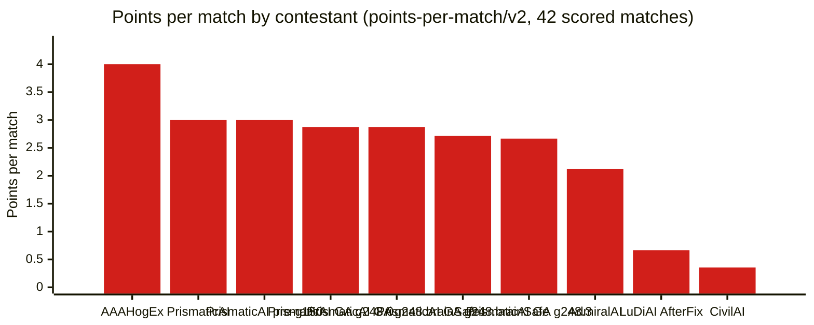
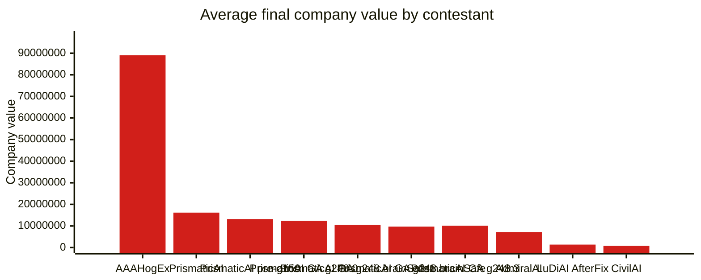
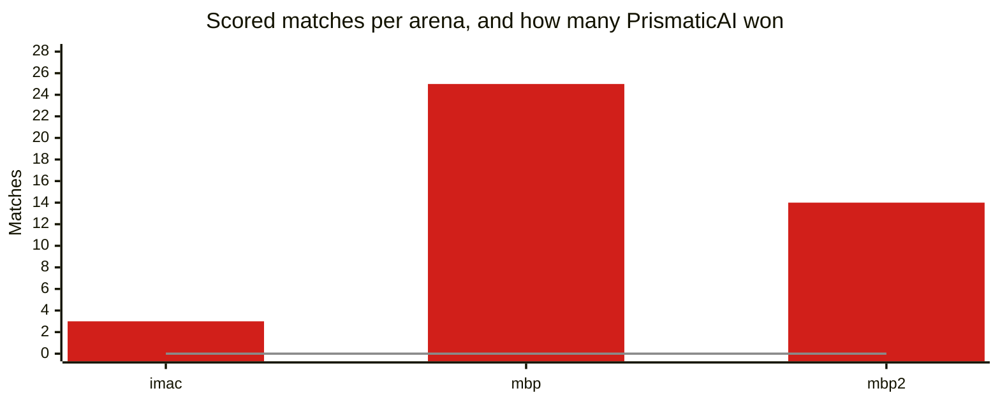

# battle-20261121T080837-e7b3626c

Derived from `battle-20261121T080837-e7b3626c.json` by `tools/research/ai-battle/battle.py report`; do not edit.

- Edition `e7b3626cf84526fe`: PrismaticAI and referee at `52f631b115782334f422f741a79ecabce78e58c4`, base set `opengfx-8.0.tar`
- 20-year free-for-all from 1960, map 256x256 temperate, breakdowns 1
- 42 scored match(es) on `imac` (20261119-master-gdf1e05e7d8), `mbp` (20261120-master-m17653b726e), `mbp2` (20261119-master-gdf1e05e7d8)
- Replays: 0 of 1 identical to their original on another arena

| # | Contestant | Played | Wins | Points | Points/match | Avg rank | Avg final value | Squirrel errors | Matches with anomalies |
|---|---|---|---|---|---|---|---|---|---|
| 1 | AAAHogEx | 42 | 42 | 168 | 4.0 | 1.0 | 89.0 M | 0 | 0 |
| 2 | PrismaticAI | 6 | 0 | 18 | 3.0 | 2.0 | 16.2 M | 0 | 0 |
| 3 | PrismaticAI pre-g150 | 7 | 0 | 21 | 3.0 | 2.0 | 13.2 M | 0 | 2 |
| 4 | PrismaticAI GA g248.0 | 8 | 0 | 23 | 2.875 | 2.12 | 12.4 M | 0 | 0 |
| 5 | PrismaticAI GA g248.brainSafe1 | 8 | 0 | 23 | 2.875 | 2.12 | 10.5 M | 0 | 1 |
| 6 | PrismaticAI GA g248.brainSafe | 7 | 0 | 19 | 2.714 | 2.29 | 9.7 M | 0 | 1 |
| 7 | PrismaticAI GA g248.3 | 6 | 0 | 16 | 2.667 | 2.33 | 10.1 M | 0 | 0 |
| 8 | AdmiralAI | 42 | 0 | 89 | 2.119 | 2.88 | 7.1 M | 44 | 2 |
| 9 | LuDiAI AfterFix | 42 | 0 | 28 | 0.667 | 4.33 | 1.4 M | 0 | 1 |
| 10 | CivilAI | 42 | 0 | 15 | 0.357 | 4.64 | 772.3 k | 0 | 8 |

```mermaid
---
config:
  xyChart:
    width: 900
    height: 360
  themeVariables:
    xyChart:
      plotColorPalette: "#d11f1a, #8a8a8a, #0b0b0b, #ece4d6"
---
xychart-beta
    title "Final company value per scored match: winner vs best PrismaticAI"
    x-axis ["m-0001", "m-0002", "m-0003", "m-0004", "m-0005", "m-0006", "m-0007", "m-0008", "m-0009", "m-0010", "m-0011", "m-0012", "m-0013", "m-0014", "m-0015", "m-0016", "m-0017", "m-0018", "m-0019", "m-0020", "m-0021", "m-0022", "m-0023", "m-0025", "m-0026", "m-0028", "m-0036", "m-0037", "m-0038", "m-0039", "m-0040", "m-0041", "m-0042", "m-0043", "m-0044", "m-0045", "m-0046", "m-0047", "m-0050", "m-0051", "m-0052", "m-0054"]
    %% series: Winner | Best PrismaticAI
    %% links: battle-20261121T080837-e7b3626c.md?col=Match&filter=m-0001 | battle-20261121T080837-e7b3626c.md?col=Match&filter=m-0002 | battle-20261121T080837-e7b3626c.md?col=Match&filter=m-0003 | battle-20261121T080837-e7b3626c.md?col=Match&filter=m-0004 | battle-20261121T080837-e7b3626c.md?col=Match&filter=m-0005 | battle-20261121T080837-e7b3626c.md?col=Match&filter=m-0006 | battle-20261121T080837-e7b3626c.md?col=Match&filter=m-0007 | battle-20261121T080837-e7b3626c.md?col=Match&filter=m-0008 | battle-20261121T080837-e7b3626c.md?col=Match&filter=m-0009 | battle-20261121T080837-e7b3626c.md?col=Match&filter=m-0010 | battle-20261121T080837-e7b3626c.md?col=Match&filter=m-0011 | battle-20261121T080837-e7b3626c.md?col=Match&filter=m-0012 | battle-20261121T080837-e7b3626c.md?col=Match&filter=m-0013 | battle-20261121T080837-e7b3626c.md?col=Match&filter=m-0014 | battle-20261121T080837-e7b3626c.md?col=Match&filter=m-0015 | battle-20261121T080837-e7b3626c.md?col=Match&filter=m-0016 | battle-20261121T080837-e7b3626c.md?col=Match&filter=m-0017 | battle-20261121T080837-e7b3626c.md?col=Match&filter=m-0018 | battle-20261121T080837-e7b3626c.md?col=Match&filter=m-0019 | battle-20261121T080837-e7b3626c.md?col=Match&filter=m-0020 | battle-20261121T080837-e7b3626c.md?col=Match&filter=m-0021 | battle-20261121T080837-e7b3626c.md?col=Match&filter=m-0022 | battle-20261121T080837-e7b3626c.md?col=Match&filter=m-0023 | battle-20261121T080837-e7b3626c.md?col=Match&filter=m-0025 | battle-20261121T080837-e7b3626c.md?col=Match&filter=m-0026 | battle-20261121T080837-e7b3626c.md?col=Match&filter=m-0028 | battle-20261121T080837-e7b3626c.md?col=Match&filter=m-0036 | battle-20261121T080837-e7b3626c.md?col=Match&filter=m-0037 | battle-20261121T080837-e7b3626c.md?col=Match&filter=m-0038 | battle-20261121T080837-e7b3626c.md?col=Match&filter=m-0039 | battle-20261121T080837-e7b3626c.md?col=Match&filter=m-0040 | battle-20261121T080837-e7b3626c.md?col=Match&filter=m-0041 | battle-20261121T080837-e7b3626c.md?col=Match&filter=m-0042 | battle-20261121T080837-e7b3626c.md?col=Match&filter=m-0043 | battle-20261121T080837-e7b3626c.md?col=Match&filter=m-0044 | battle-20261121T080837-e7b3626c.md?col=Match&filter=m-0045 | battle-20261121T080837-e7b3626c.md?col=Match&filter=m-0046 | battle-20261121T080837-e7b3626c.md?col=Match&filter=m-0047 | battle-20261121T080837-e7b3626c.md?col=Match&filter=m-0050 | battle-20261121T080837-e7b3626c.md?col=Match&filter=m-0051 | battle-20261121T080837-e7b3626c.md?col=Match&filter=m-0052 | battle-20261121T080837-e7b3626c.md?col=Match&filter=m-0054
    y-axis "Company value" 0 --> 172000000
    bar [101786646, 103206150, 92312413, 97856319, 106687459, 53655443, 64573608, 90827926, 61057202, 65410209, 77142491, 70117183, 79219136, 86373294, 64274504, 86950638, 69979254, 116188016, 93126204, 104306809, 136232068, 156192537, 129052358, 115251524, 113891994, 126927640, 63582290, 65678696, 84635241, 82009103, 83580341, 91078185, 81395522, 77031702, 78590232, 99507603, 89117326, 76169041, 86928439, 84227854, 73744030, 58668564]
    line [10586371, 8403738, 6823694, 10345823, 11092926, 14647694, 10212816, 8471883, 9126481, 10292229, 8228055, 21023454, 13551009, 12432644, 8841481, 12209256, 16643718, 14283076, 14578613, 14950752, 9077045, 3262841, 4160599, 16347328, 20477225, 13449804, 15051956, 14992249, 8760611, 9226950, 7127018, 7235017, 16325941, 12201177, 9341144, 10639894, 12353401, 13184369, 16265692, 14120700, 15274281, 15798337]
```

<!-- battle-charts:begin -->
<!-- derived from battle-20261121T080837-e7b3626c.json by `battle.py render`; `battle.py check` fails when it is stale -->

<!-- battle-charts:end -->

| Seed | Original | Replay | Arenas | Identical |
|---|---|---|---|---|
| 370493858 | m-0010 | m-0048 | imac / mbp | NO |

| Match | Arena | Seed | Winner | Value | Last | Anomalies |
|---|---|---|---|---|---|---|
| m-0001 | mbp | 174590983 | AAAHogEx | 101.8 M | LuDiAI AfterFix | PrismaticAI pre-g150: fleet_drop:69->46 |
| m-0002 | mbp | 174590983 | AAAHogEx | 103.2 M | LuDiAI AfterFix | AdmiralAI: squirrel_errors:44; CivilAI: no_vehicles |
| m-0003 | mbp | 174590983 | AAAHogEx | 92.3 M | CivilAI | - |
| m-0004 | mbp | 174590983 | AAAHogEx | 97.9 M | LuDiAI AfterFix | - |
| m-0005 | mbp | 174590983 | AAAHogEx | 106.7 M | CivilAI | - |
| m-0006 | mbp | 370493858 | AAAHogEx | 53.7 M | LuDiAI AfterFix | - |
| m-0007 | mbp | 370493858 | AAAHogEx | 64.6 M | CivilAI | - |
| m-0008 | mbp | 370493858 | AAAHogEx | 90.8 M | LuDiAI AfterFix | - |
| m-0009 | mbp | 370493858 | AAAHogEx | 61.1 M | LuDiAI AfterFix | - |
| m-0010 | imac | 370493858 | AAAHogEx | 65.4 M | LuDiAI AfterFix | - |
| m-0011 | imac | 370493858 | AAAHogEx | 77.1 M | LuDiAI AfterFix | - |
| m-0012 | imac | 1170861635 | AAAHogEx | 70.1 M | CivilAI | - |
| m-0013 | mbp2 | 1170861635 | AAAHogEx | 79.2 M | CivilAI | - |
| m-0014 | mbp2 | 1170861635 | AAAHogEx | 86.4 M | CivilAI | - |
| m-0015 | mbp2 | 1170861635 | AAAHogEx | 64.3 M | CivilAI | CivilAI: fleet_drop:52->29 |
| m-0016 | mbp2 | 1170861635 | AAAHogEx | 87.0 M | CivilAI | - |
| m-0017 | mbp2 | 1170861635 | AAAHogEx | 70.0 M | CivilAI | - |
| m-0018 | mbp2 | 1090223313 | AAAHogEx | 116.2 M | CivilAI | - |
| m-0019 | mbp2 | 1090223313 | AAAHogEx | 93.1 M | CivilAI | CivilAI: fleet_drop:26->18 |
| m-0020 | mbp2 | 1090223313 | AAAHogEx | 104.3 M | CivilAI | - |
| m-0021 | mbp2 | 1090223313 | AAAHogEx | 136.2 M | CivilAI | PrismaticAI GA g248.brainSafe: fleet_drop:91->44; CivilAI: fleet_drop:27->13 |
| m-0022 | mbp2 | 1090223313 | AAAHogEx | 156.2 M | CivilAI | AdmiralAI: fleet_drop:340->230 |
| m-0023 | mbp2 | 1090223313 | AAAHogEx | 129.1 M | CivilAI | - |
| m-0025 | mbp2 | 45723625 | AAAHogEx | 115.3 M | CivilAI | - |
| m-0026 | mbp2 | 45723625 | AAAHogEx | 113.9 M | CivilAI | - |
| m-0028 | mbp2 | 45723625 | AAAHogEx | 126.9 M | CivilAI | PrismaticAI GA g248.brainSafe1: fleet_drop:126->88 |
| m-0036 | mbp | 1345403000 | AAAHogEx | 63.6 M | CivilAI | - |
| m-0037 | mbp | 1345403000 | AAAHogEx | 65.7 M | CivilAI | - |
| m-0038 | mbp | 1345403000 | AAAHogEx | 84.6 M | LuDiAI AfterFix | - |
| m-0039 | mbp | 1345403000 | AAAHogEx | 82.0 M | LuDiAI AfterFix | CivilAI: fleet_drop:67->45 |
| m-0040 | mbp | 1345403000 | AAAHogEx | 83.6 M | LuDiAI AfterFix | LuDiAI AfterFix: fleet_drop:26->17 |
| m-0041 | mbp | 1345403000 | AAAHogEx | 91.1 M | LuDiAI AfterFix | - |
| m-0042 | mbp | 873908231 | AAAHogEx | 81.4 M | CivilAI | - |
| m-0043 | mbp | 873908231 | AAAHogEx | 77.0 M | CivilAI | PrismaticAI pre-g150: fleet_drop:75->33 |
| m-0044 | mbp | 873908231 | AAAHogEx | 78.6 M | CivilAI | - |
| m-0045 | mbp | 873908231 | AAAHogEx | 99.5 M | CivilAI | - |
| m-0046 | mbp | 873908231 | AAAHogEx | 89.1 M | CivilAI | CivilAI: fleet_drop:10->6 |
| m-0047 | mbp | 873908231 | AAAHogEx | 76.2 M | CivilAI | - |
| m-0048 (replay) | mbp | 370493858 | AAAHogEx | 67.9 M | LuDiAI AfterFix | CivilAI: fleet_drop:13->9 |
| m-0050 | mbp | 1667374147 | AAAHogEx | 86.9 M | LuDiAI AfterFix | CivilAI: fleet_drop:78->43 |
| m-0051 | mbp | 1667374147 | AAAHogEx | 84.2 M | CivilAI | - |
| m-0052 | mbp | 1667374147 | AAAHogEx | 73.7 M | LuDiAI AfterFix | CivilAI: fleet_drop:61->20 |
| m-0054 | mbp | 1857914631 | AAAHogEx | 58.7 M | LuDiAI AfterFix | - |
