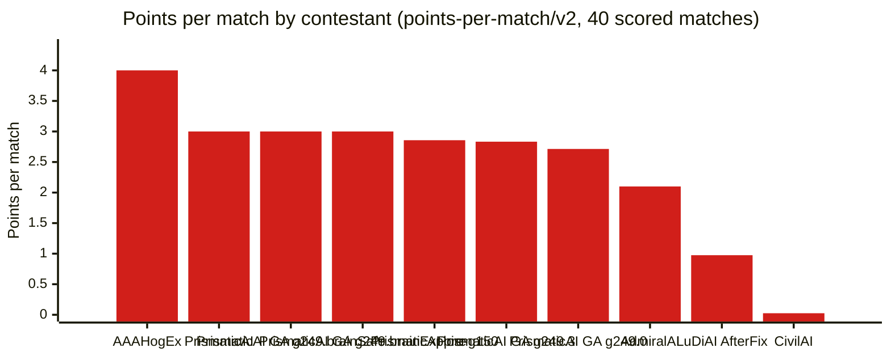
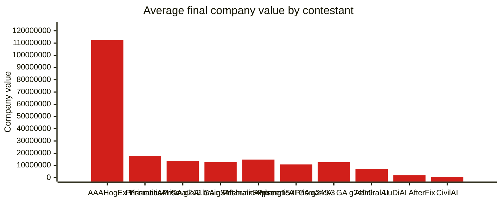
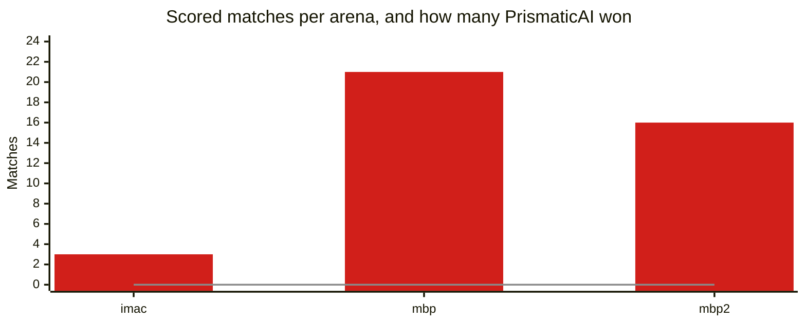

# battle-20261121T081806-2490713c

Derived from `battle-20261121T081806-2490713c.json` by `tools/research/ai-battle/battle.py report`; do not edit.

- Edition `2490713cb4935a6a`: PrismaticAI and referee at `52f631b115782334f422f741a79ecabce78e58c4`, base set `opengfx-8.0.tar`
- 20-year free-for-all from 1960, map 256x256 temperate, breakdowns 1
- 40 scored match(es) on `imac` (20261119-master-gdf1e05e7d8), `mbp` (20261120-master-m17653b726e), `mbp2` (20261119-master-gdf1e05e7d8)
- Replays: 0 of 0 identical to their original on another arena

| # | Contestant | Played | Wins | Points | Points/match | Avg rank | Avg final value | Squirrel errors | Matches with anomalies |
|---|---|---|---|---|---|---|---|---|---|
| 1 | AAAHogEx | 40 | 40 | 160 | 4.0 | 1.0 | 112.3 M | 0 | 0 |
| 2 | PrismaticAI | 7 | 0 | 21 | 3.0 | 2.0 | 17.9 M | 0 | 0 |
| 3 | PrismaticAI GA g249.brainSafe | 6 | 0 | 18 | 3.0 | 2.0 | 13.9 M | 0 | 5 |
| 4 | PrismaticAI GA g249.brainExplore | 7 | 0 | 21 | 3.0 | 2.0 | 12.8 M | 0 | 6 |
| 5 | PrismaticAI pre-g150 | 7 | 0 | 20 | 2.857 | 2.14 | 14.8 M | 0 | 1 |
| 6 | PrismaticAI GA g249.3 | 6 | 0 | 17 | 2.833 | 2.17 | 10.9 M | 0 | 2 |
| 7 | PrismaticAI GA g249.0 | 7 | 0 | 19 | 2.714 | 2.29 | 12.7 M | 0 | 0 |
| 8 | AdmiralAI | 40 | 0 | 84 | 2.1 | 2.9 | 7.3 M | 47 | 1 |
| 9 | LuDiAI AfterFix | 40 | 0 | 39 | 0.975 | 4.03 | 2.1 M | 0 | 0 |
| 10 | CivilAI | 40 | 0 | 1 | 0.025 | 4.97 | 714.5 k | 0 | 10 |

```mermaid
---
config:
  xyChart:
    width: 900
    height: 360
  themeVariables:
    xyChart:
      plotColorPalette: "#d11f1a, #8a8a8a, #0b0b0b, #ece4d6"
---
xychart-beta
    title "Final company value per scored match: winner vs best PrismaticAI"
    x-axis ["m-0001", "m-0002", "m-0003", "m-0004", "m-0005", "m-0006", "m-0007", "m-0008", "m-0009", "m-0010", "m-0011", "m-0012", "m-0013", "m-0014", "m-0015", "m-0016", "m-0017", "m-0018", "m-0019", "m-0020", "m-0021", "m-0022", "m-0023", "m-0024", "m-0025", "m-0026", "m-0027", "m-0028", "m-0036", "m-0037", "m-0038", "m-0039", "m-0040", "m-0041", "m-0042", "m-0043", "m-0044", "m-0046", "m-0047", "m-0048"]
    %% series: Winner | Best PrismaticAI
    %% links: battle-20261121T081806-2490713c.md?col=Match&filter=m-0001 | battle-20261121T081806-2490713c.md?col=Match&filter=m-0002 | battle-20261121T081806-2490713c.md?col=Match&filter=m-0003 | battle-20261121T081806-2490713c.md?col=Match&filter=m-0004 | battle-20261121T081806-2490713c.md?col=Match&filter=m-0005 | battle-20261121T081806-2490713c.md?col=Match&filter=m-0006 | battle-20261121T081806-2490713c.md?col=Match&filter=m-0007 | battle-20261121T081806-2490713c.md?col=Match&filter=m-0008 | battle-20261121T081806-2490713c.md?col=Match&filter=m-0009 | battle-20261121T081806-2490713c.md?col=Match&filter=m-0010 | battle-20261121T081806-2490713c.md?col=Match&filter=m-0011 | battle-20261121T081806-2490713c.md?col=Match&filter=m-0012 | battle-20261121T081806-2490713c.md?col=Match&filter=m-0013 | battle-20261121T081806-2490713c.md?col=Match&filter=m-0014 | battle-20261121T081806-2490713c.md?col=Match&filter=m-0015 | battle-20261121T081806-2490713c.md?col=Match&filter=m-0016 | battle-20261121T081806-2490713c.md?col=Match&filter=m-0017 | battle-20261121T081806-2490713c.md?col=Match&filter=m-0018 | battle-20261121T081806-2490713c.md?col=Match&filter=m-0019 | battle-20261121T081806-2490713c.md?col=Match&filter=m-0020 | battle-20261121T081806-2490713c.md?col=Match&filter=m-0021 | battle-20261121T081806-2490713c.md?col=Match&filter=m-0022 | battle-20261121T081806-2490713c.md?col=Match&filter=m-0023 | battle-20261121T081806-2490713c.md?col=Match&filter=m-0024 | battle-20261121T081806-2490713c.md?col=Match&filter=m-0025 | battle-20261121T081806-2490713c.md?col=Match&filter=m-0026 | battle-20261121T081806-2490713c.md?col=Match&filter=m-0027 | battle-20261121T081806-2490713c.md?col=Match&filter=m-0028 | battle-20261121T081806-2490713c.md?col=Match&filter=m-0036 | battle-20261121T081806-2490713c.md?col=Match&filter=m-0037 | battle-20261121T081806-2490713c.md?col=Match&filter=m-0038 | battle-20261121T081806-2490713c.md?col=Match&filter=m-0039 | battle-20261121T081806-2490713c.md?col=Match&filter=m-0040 | battle-20261121T081806-2490713c.md?col=Match&filter=m-0041 | battle-20261121T081806-2490713c.md?col=Match&filter=m-0042 | battle-20261121T081806-2490713c.md?col=Match&filter=m-0043 | battle-20261121T081806-2490713c.md?col=Match&filter=m-0044 | battle-20261121T081806-2490713c.md?col=Match&filter=m-0046 | battle-20261121T081806-2490713c.md?col=Match&filter=m-0047 | battle-20261121T081806-2490713c.md?col=Match&filter=m-0048
    y-axis "Company value" 0 --> 168000000
    bar [69827420, 95503817, 89514793, 89267044, 82376040, 77724525, 93415226, 102030561, 100704173, 86803453, 105294900, 128377771, 152298200, 131044676, 116046404, 115874614, 142902276, 103361559, 104929339, 94403747, 122112919, 101151645, 103943946, 129576942, 115620377, 144494152, 117361392, 128254921, 113382978, 96046669, 88305627, 139753680, 139959884, 128622768, 117680267, 138547064, 117404272, 132175167, 141010521, 96448269]
    line [13934793, 15221381, 12527700, 13133420, 10105892, 11432953, 13130102, 15650789, 10014995, 10972553, 9613645, 23347298, 16321927, 11455441, 16879904, 15909607, 14965110, 17021532, 11528718, 10985139, 8599060, 7763868, 6041726, 18494987, 13982778, 6778552, 17420510, 15502306, 26808068, 18169975, 18265000, 17953660, 18324484, 15082190, 14314184, 16573490, 10788009, 7993820, 9441864, 13625354]
```

<!-- battle-charts:begin -->
<!-- derived from battle-20261121T081806-2490713c.json by `battle.py render`; `battle.py check` fails when it is stale -->

<!-- battle-charts:end -->

| Match | Arena | Seed | Winner | Value | Last | Anomalies |
|---|---|---|---|---|---|---|
| m-0001 | mbp | 433162727 | AAAHogEx | 69.8 M | CivilAI | - |
| m-0002 | mbp | 433162727 | AAAHogEx | 95.5 M | CivilAI | - |
| m-0003 | mbp | 433162727 | AAAHogEx | 89.5 M | CivilAI | PrismaticAI GA g249.brainSafe: fleet_drop:151->42; CivilAI: fleet_drop:35->13 |
| m-0004 | mbp | 433162727 | AAAHogEx | 89.3 M | CivilAI | PrismaticAI GA g249.brainExplore: fleet_drop:151->41; CivilAI: fleet_drop:37->17 |
| m-0005 | mbp | 433162727 | AAAHogEx | 82.4 M | CivilAI | - |
| m-0006 | mbp | 810717949 | AAAHogEx | 77.7 M | CivilAI | CivilAI: fleet_drop:35->24 |
| m-0007 | mbp | 810717949 | AAAHogEx | 93.4 M | CivilAI | CivilAI: fleet_drop:36->22 |
| m-0008 | mbp | 810717949 | AAAHogEx | 102.0 M | CivilAI | CivilAI: fleet_drop:41->15 |
| m-0009 | mbp | 810717949 | AAAHogEx | 100.7 M | CivilAI | PrismaticAI GA g249.brainSafe: fleet_drop:200->106 |
| m-0010 | imac | 810717949 | AAAHogEx | 86.8 M | CivilAI | PrismaticAI GA g249.brainExplore: fleet_drop:155->98 |
| m-0011 | imac | 810717949 | AAAHogEx | 105.3 M | CivilAI | CivilAI: fleet_drop:41->26 |
| m-0012 | imac | 747115405 | AAAHogEx | 128.4 M | CivilAI | - |
| m-0013 | mbp2 | 747115405 | AAAHogEx | 152.3 M | CivilAI | PrismaticAI pre-g150: fleet_drop:145->78; CivilAI: fleet_drop:42->14 |
| m-0014 | mbp2 | 747115405 | AAAHogEx | 131.0 M | CivilAI | - |
| m-0015 | mbp2 | 747115405 | AAAHogEx | 116.0 M | CivilAI | PrismaticAI GA g249.brainSafe: fleet_drop:156->46 |
| m-0016 | mbp2 | 747115405 | AAAHogEx | 115.9 M | CivilAI | PrismaticAI GA g249.brainExplore: fleet_drop:160->51 |
| m-0017 | mbp2 | 747115405 | AAAHogEx | 142.9 M | CivilAI | - |
| m-0018 | mbp2 | 421682569 | AAAHogEx | 103.4 M | CivilAI | - |
| m-0019 | mbp2 | 421682569 | AAAHogEx | 104.9 M | CivilAI | AdmiralAI: squirrel_errors:47 |
| m-0020 | mbp2 | 421682569 | AAAHogEx | 94.4 M | CivilAI | CivilAI: fleet_drop:42->9 |
| m-0021 | mbp2 | 421682569 | AAAHogEx | 122.1 M | CivilAI | - |
| m-0022 | mbp2 | 421682569 | AAAHogEx | 101.2 M | CivilAI | CivilAI: fleet_drop:22->7 |
| m-0023 | mbp2 | 421682569 | AAAHogEx | 103.9 M | CivilAI | PrismaticAI GA g249.3: fleet_drop:43->30; CivilAI: fleet_drop:25->16 |
| m-0024 | mbp2 | 1335464420 | AAAHogEx | 129.6 M | CivilAI | - |
| m-0025 | mbp2 | 1335464420 | AAAHogEx | 115.6 M | CivilAI | - |
| m-0026 | mbp2 | 1335464420 | AAAHogEx | 144.5 M | CivilAI | - |
| m-0027 | mbp2 | 1335464420 | AAAHogEx | 117.4 M | LuDiAI AfterFix | PrismaticAI GA g249.brainSafe: fleet_drop:179->64 |
| m-0028 | mbp2 | 1335464420 | AAAHogEx | 128.3 M | CivilAI | PrismaticAI GA g249.brainExplore: fleet_drop:189->58 |
| m-0036 | mbp | 764876613 | AAAHogEx | 113.4 M | CivilAI | - |
| m-0037 | mbp | 764876613 | AAAHogEx | 96.0 M | CivilAI | - |
| m-0038 | mbp | 764876613 | AAAHogEx | 88.3 M | CivilAI | - |
| m-0039 | mbp | 764876613 | AAAHogEx | 139.8 M | CivilAI | PrismaticAI GA g249.brainSafe: fleet_drop:175->74 |
| m-0040 | mbp | 764876613 | AAAHogEx | 140.0 M | CivilAI | PrismaticAI GA g249.brainExplore: fleet_drop:191->73 |
| m-0041 | mbp | 764876613 | AAAHogEx | 128.6 M | CivilAI | PrismaticAI GA g249.3: fleet_drop:63->41 |
| m-0042 | mbp | 1685785315 | AAAHogEx | 117.7 M | CivilAI | - |
| m-0043 | mbp | 1685785315 | AAAHogEx | 138.5 M | CivilAI | - |
| m-0044 | mbp | 1685785315 | AAAHogEx | 117.4 M | CivilAI | - |
| m-0046 | mbp | 1685785315 | AAAHogEx | 132.2 M | CivilAI | PrismaticAI GA g249.brainExplore: fleet_drop:116->26 |
| m-0047 | mbp | 1685785315 | AAAHogEx | 141.0 M | CivilAI | - |
| m-0048 | mbp | 1845142184 | AAAHogEx | 96.4 M | CivilAI | - |
