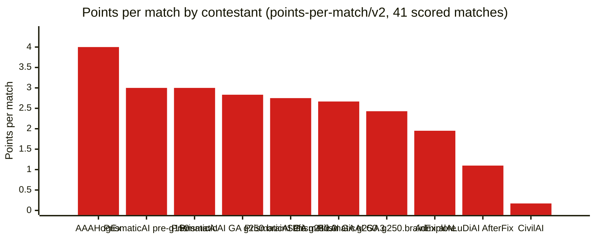
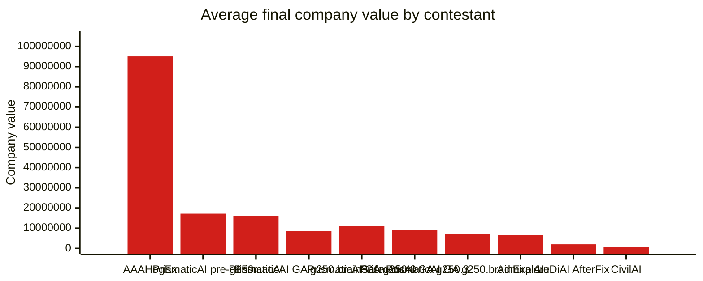
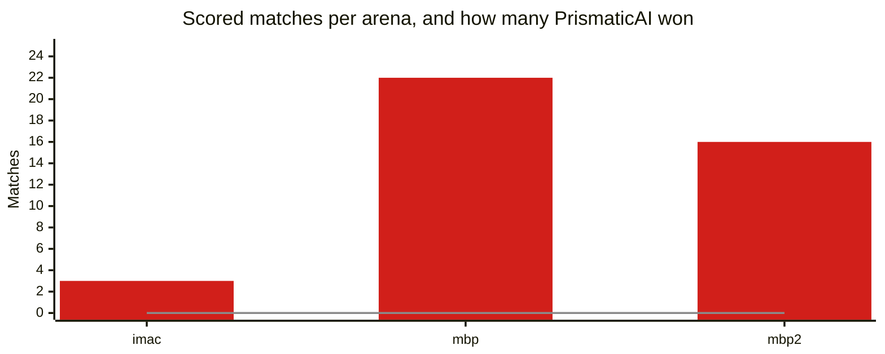

# battle-20261121T082758-dc14ba02

Derived from `battle-20261121T082758-dc14ba02.json` by `tools/research/ai-battle/battle.py report`; do not edit.

- Edition `dc14ba02c19abc8d`: PrismaticAI and referee at `52f631b115782334f422f741a79ecabce78e58c4`, base set `opengfx-8.0.tar`
- 20-year free-for-all from 1960, map 256x256 temperate, breakdowns 1
- 41 scored match(es) on `imac` (20261119-master-gdf1e05e7d8), `mbp` (20261120-master-m17653b726e), `mbp2` (20261119-master-gdf1e05e7d8)
- Replays: 0 of 2 identical to their original on another arena

| # | Contestant | Played | Wins | Points | Points/match | Avg rank | Avg final value | Squirrel errors | Matches with anomalies |
|---|---|---|---|---|---|---|---|---|---|
| 1 | AAAHogEx | 41 | 41 | 164 | 4.0 | 1.0 | 95.0 M | 0 | 0 |
| 2 | PrismaticAI pre-g150 | 8 | 0 | 24 | 3.0 | 2.0 | 17.2 M | 0 | 3 |
| 3 | PrismaticAI | 6 | 0 | 18 | 3.0 | 2.0 | 16.1 M | 0 | 0 |
| 4 | PrismaticAI GA g250.brainSafe | 6 | 0 | 17 | 2.833 | 2.17 | 8.5 M | 0 | 0 |
| 5 | PrismaticAI GA g250.0 | 8 | 0 | 22 | 2.75 | 2.25 | 11.1 M | 0 | 6 |
| 6 | PrismaticAI GA g250.3 | 6 | 0 | 16 | 2.667 | 2.33 | 9.3 M | 0 | 3 |
| 7 | PrismaticAI GA g250.brainExplore | 7 | 0 | 17 | 2.429 | 2.57 | 7.1 M | 0 | 3 |
| 8 | AdmiralAI | 41 | 0 | 80 | 1.951 | 3.05 | 6.6 M | 0 | 6 |
| 9 | LuDiAI AfterFix | 41 | 0 | 45 | 1.098 | 3.9 | 2.0 M | 0 | 3 |
| 10 | CivilAI | 41 | 0 | 7 | 0.171 | 4.83 | 778.2 k | 32 | 7 |

```mermaid
---
config:
  xyChart:
    width: 900
    height: 360
  themeVariables:
    xyChart:
      plotColorPalette: "#d11f1a, #8a8a8a, #0b0b0b, #ece4d6"
---
xychart-beta
    title "Final company value per scored match: winner vs best PrismaticAI"
    x-axis ["m-0001", "m-0002", "m-0003", "m-0004", "m-0005", "m-0006", "m-0007", "m-0008", "m-0009", "m-0010", "m-0011", "m-0012", "m-0013", "m-0014", "m-0015", "m-0016", "m-0017", "m-0018", "m-0019", "m-0020", "m-0021", "m-0022", "m-0023", "m-0024", "m-0025", "m-0026", "m-0027", "m-0028", "m-0036", "m-0037", "m-0038", "m-0039", "m-0040", "m-0041", "m-0042", "m-0043", "m-0044", "m-0046", "m-0047", "m-0049", "m-0050"]
    %% series: Winner | Best PrismaticAI
    %% links: battle-20261121T082758-dc14ba02.md?col=Match&filter=m-0001 | battle-20261121T082758-dc14ba02.md?col=Match&filter=m-0002 | battle-20261121T082758-dc14ba02.md?col=Match&filter=m-0003 | battle-20261121T082758-dc14ba02.md?col=Match&filter=m-0004 | battle-20261121T082758-dc14ba02.md?col=Match&filter=m-0005 | battle-20261121T082758-dc14ba02.md?col=Match&filter=m-0006 | battle-20261121T082758-dc14ba02.md?col=Match&filter=m-0007 | battle-20261121T082758-dc14ba02.md?col=Match&filter=m-0008 | battle-20261121T082758-dc14ba02.md?col=Match&filter=m-0009 | battle-20261121T082758-dc14ba02.md?col=Match&filter=m-0010 | battle-20261121T082758-dc14ba02.md?col=Match&filter=m-0011 | battle-20261121T082758-dc14ba02.md?col=Match&filter=m-0012 | battle-20261121T082758-dc14ba02.md?col=Match&filter=m-0013 | battle-20261121T082758-dc14ba02.md?col=Match&filter=m-0014 | battle-20261121T082758-dc14ba02.md?col=Match&filter=m-0015 | battle-20261121T082758-dc14ba02.md?col=Match&filter=m-0016 | battle-20261121T082758-dc14ba02.md?col=Match&filter=m-0017 | battle-20261121T082758-dc14ba02.md?col=Match&filter=m-0018 | battle-20261121T082758-dc14ba02.md?col=Match&filter=m-0019 | battle-20261121T082758-dc14ba02.md?col=Match&filter=m-0020 | battle-20261121T082758-dc14ba02.md?col=Match&filter=m-0021 | battle-20261121T082758-dc14ba02.md?col=Match&filter=m-0022 | battle-20261121T082758-dc14ba02.md?col=Match&filter=m-0023 | battle-20261121T082758-dc14ba02.md?col=Match&filter=m-0024 | battle-20261121T082758-dc14ba02.md?col=Match&filter=m-0025 | battle-20261121T082758-dc14ba02.md?col=Match&filter=m-0026 | battle-20261121T082758-dc14ba02.md?col=Match&filter=m-0027 | battle-20261121T082758-dc14ba02.md?col=Match&filter=m-0028 | battle-20261121T082758-dc14ba02.md?col=Match&filter=m-0036 | battle-20261121T082758-dc14ba02.md?col=Match&filter=m-0037 | battle-20261121T082758-dc14ba02.md?col=Match&filter=m-0038 | battle-20261121T082758-dc14ba02.md?col=Match&filter=m-0039 | battle-20261121T082758-dc14ba02.md?col=Match&filter=m-0040 | battle-20261121T082758-dc14ba02.md?col=Match&filter=m-0041 | battle-20261121T082758-dc14ba02.md?col=Match&filter=m-0042 | battle-20261121T082758-dc14ba02.md?col=Match&filter=m-0043 | battle-20261121T082758-dc14ba02.md?col=Match&filter=m-0044 | battle-20261121T082758-dc14ba02.md?col=Match&filter=m-0046 | battle-20261121T082758-dc14ba02.md?col=Match&filter=m-0047 | battle-20261121T082758-dc14ba02.md?col=Match&filter=m-0049 | battle-20261121T082758-dc14ba02.md?col=Match&filter=m-0050
    y-axis "Company value" 0 --> 164000000
    bar [89347212, 77072235, 99332802, 107435357, 77080929, 79086041, 84973451, 71275708, 81573101, 87272401, 115807114, 87322182, 91310869, 83167083, 99924383, 95442962, 99220196, 62689307, 60500336, 82681945, 73071935, 57707280, 72925060, 139902118, 116756445, 100293657, 115689648, 96184852, 97224724, 93510323, 108808147, 109572964, 87935358, 84898488, 113357404, 102545687, 149131136, 121232834, 121429172, 95974773, 105697959]
    line [18727543, 9579472, 6537349, 6257938, 11422225, 19710053, 19616652, 7740159, 10178960, 9225722, 4679075, 18680732, 21318534, 10091769, 9294131, 7101871, 11966061, 10544459, 10094175, 7678222, 8914746, 7489941, 7649704, 17174213, 19133223, 18136027, 13775675, 6755877, 14677997, 15159177, 7969805, 2311599, 2270916, 7300438, 16035655, 17023269, 14829216, 10300485, 12617574, 16566459, 12495388]
```

<!-- battle-charts:begin -->
<!-- derived from battle-20261121T082758-dc14ba02.json by `battle.py render`; `battle.py check` fails when it is stale -->

<!-- battle-charts:end -->

| Seed | Original | Replay | Arenas | Identical |
|---|---|---|---|---|
| 1428268168 | m-0010 | m-0048 | imac / mbp | NO |
| 1428268168 | m-0011 | m-0056 | imac / mbp | NO |

| Match | Arena | Seed | Winner | Value | Last | Anomalies |
|---|---|---|---|---|---|---|
| m-0001 | mbp | 1218997655 | AAAHogEx | 89.3 M | CivilAI | - |
| m-0002 | mbp | 1218997655 | AAAHogEx | 77.1 M | CivilAI | PrismaticAI GA g250.0: fleet_drop:169->48; AdmiralAI: fleet_drop:410->268 |
| m-0003 | mbp | 1218997655 | AAAHogEx | 99.3 M | CivilAI | CivilAI: fleet_drop:30->17 |
| m-0004 | mbp | 1218997655 | AAAHogEx | 107.4 M | CivilAI | - |
| m-0005 | mbp | 1218997655 | AAAHogEx | 77.1 M | CivilAI | CivilAI: fleet_drop:52->27 |
| m-0006 | mbp | 1428268168 | AAAHogEx | 79.1 M | LuDiAI AfterFix | AdmiralAI: fleet_drop:378->202 |
| m-0007 | mbp | 1428268168 | AAAHogEx | 85.0 M | LuDiAI AfterFix | PrismaticAI pre-g150: fleet_drop:73->42; CivilAI: fleet_drop:163->82 |
| m-0008 | mbp | 1428268168 | AAAHogEx | 71.3 M | CivilAI | PrismaticAI GA g250.0: fleet_drop:71->48 |
| m-0009 | mbp | 1428268168 | AAAHogEx | 81.6 M | CivilAI | - |
| m-0010 | imac | 1428268168 | AAAHogEx | 87.3 M | CivilAI | - |
| m-0011 | imac | 1428268168 | AAAHogEx | 115.8 M | CivilAI | PrismaticAI GA g250.3: fleet_drop:71->44 |
| m-0012 | imac | 1629241326 | AAAHogEx | 87.3 M | CivilAI | - |
| m-0013 | mbp2 | 1629241326 | AAAHogEx | 91.3 M | CivilAI | - |
| m-0014 | mbp2 | 1629241326 | AAAHogEx | 83.2 M | AdmiralAI | PrismaticAI GA g250.0: fleet_drop:223->63 |
| m-0015 | mbp2 | 1629241326 | AAAHogEx | 99.9 M | AdmiralAI | CivilAI: fleet_drop:32->21 |
| m-0016 | mbp2 | 1629241326 | AAAHogEx | 95.4 M | AdmiralAI | PrismaticAI GA g250.brainExplore: fleet_drop:73->46; AdmiralAI: fleet_drop:31->5 |
| m-0017 | mbp2 | 1629241326 | AAAHogEx | 99.2 M | AdmiralAI | PrismaticAI GA g250.3: fleet_drop:151->50 |
| m-0018 | mbp2 | 1496080003 | AAAHogEx | 62.7 M | CivilAI | AdmiralAI: fleet_drop:247->128 |
| m-0019 | mbp2 | 1496080003 | AAAHogEx | 60.5 M | LuDiAI AfterFix | - |
| m-0020 | mbp2 | 1496080003 | AAAHogEx | 82.7 M | CivilAI | PrismaticAI GA g250.0: fleet_drop:130->90 |
| m-0021 | mbp2 | 1496080003 | AAAHogEx | 73.1 M | CivilAI | - |
| m-0022 | mbp2 | 1496080003 | AAAHogEx | 57.7 M | CivilAI | - |
| m-0023 | mbp2 | 1496080003 | AAAHogEx | 72.9 M | CivilAI | PrismaticAI GA g250.3: fleet_drop:71->47; LuDiAI AfterFix: fleet_drop:65->21 |
| m-0024 | mbp2 | 917340603 | AAAHogEx | 139.9 M | CivilAI | - |
| m-0025 | mbp2 | 917340603 | AAAHogEx | 116.8 M | CivilAI | PrismaticAI pre-g150: fleet_drop:97->59 |
| m-0026 | mbp2 | 917340603 | AAAHogEx | 100.3 M | CivilAI | - |
| m-0027 | mbp2 | 917340603 | AAAHogEx | 115.7 M | CivilAI | - |
| m-0028 | mbp2 | 917340603 | AAAHogEx | 96.2 M | CivilAI | - |
| m-0036 | mbp | 1211965246 | AAAHogEx | 97.2 M | CivilAI | - |
| m-0037 | mbp | 1211965246 | AAAHogEx | 93.5 M | CivilAI | - |
| m-0038 | mbp | 1211965246 | AAAHogEx | 108.8 M | CivilAI | PrismaticAI GA g250.0: fleet_drop:93->54 |
| m-0039 | mbp | 1211965246 | AAAHogEx | 109.6 M | CivilAI | - |
| m-0040 | mbp | 1211965246 | AAAHogEx | 87.9 M | CivilAI | PrismaticAI GA g250.brainExplore: fleet_drop:83->48 |
| m-0041 | mbp | 1211965246 | AAAHogEx | 84.9 M | CivilAI | - |
| m-0042 | mbp | 1650835059 | AAAHogEx | 113.4 M | CivilAI | LuDiAI AfterFix: fleet_drop:132->90 |
| m-0043 | mbp | 1650835059 | AAAHogEx | 102.5 M | CivilAI | PrismaticAI pre-g150: fleet_drop:132->72; CivilAI: fleet_drop:77->53 |
| m-0044 | mbp | 1650835059 | AAAHogEx | 149.1 M | CivilAI | PrismaticAI GA g250.0: fleet_drop:175->81 |
| m-0046 | mbp | 1650835059 | AAAHogEx | 121.2 M | CivilAI | PrismaticAI GA g250.brainExplore: fleet_drop:175->116; LuDiAI AfterFix: fleet_drop:85->51 |
| m-0047 | mbp | 1650835059 | AAAHogEx | 121.4 M | CivilAI | CivilAI: fleet_drop:114->71 |
| m-0048 (replay) | mbp | 1428268168 | AAAHogEx | 84.0 M | CivilAI | - |
| m-0049 | mbp | 1012043772 | AAAHogEx | 96.0 M | CivilAI | AdmiralAI: fleet_drop:179->116; CivilAI: squirrel_errors:32 |
| m-0050 | mbp | 1012043772 | AAAHogEx | 105.7 M | CivilAI | AdmiralAI: fleet_drop:202->135 |
| m-0056 (replay) | mbp | 1428268168 | AAAHogEx | 111.6 M | CivilAI | AdmiralAI: fleet_drop:88->57 |
