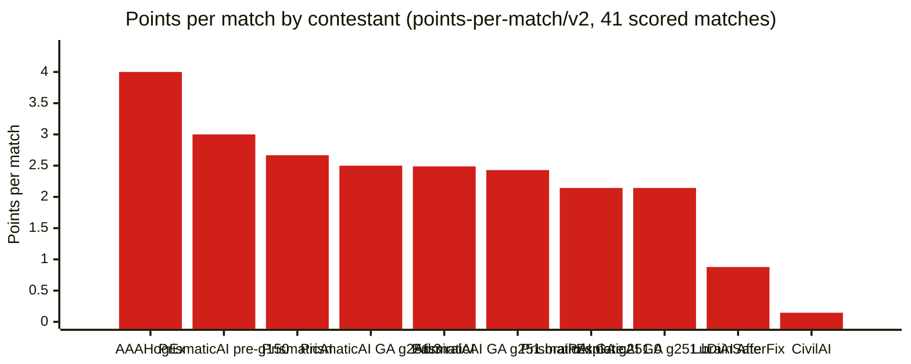
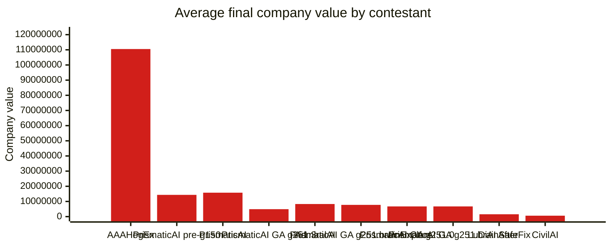
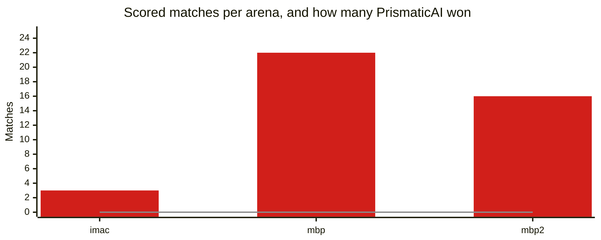

# battle-20261121T083753-8259b07e

Derived from `battle-20261121T083753-8259b07e.json` by `tools/research/ai-battle/battle.py report`; do not edit.

- Edition `8259b07eb429c679`: PrismaticAI and referee at `52f631b115782334f422f741a79ecabce78e58c4`, base set `opengfx-8.0.tar`
- 20-year free-for-all from 1960, map 256x256 temperate, breakdowns 1
- 41 scored match(es) on `imac` (20261119-master-gdf1e05e7d8), `mbp` (20261120-master-m17653b726e), `mbp2` (20261119-master-gdf1e05e7d8)
- Replays: 1 of 1 identical to their original on another arena

| # | Contestant | Played | Wins | Points | Points/match | Avg rank | Avg final value | Squirrel errors | Matches with anomalies |
|---|---|---|---|---|---|---|---|---|---|
| 1 | AAAHogEx | 41 | 41 | 164 | 4.0 | 1.0 | 110.5 M | 0 | 0 |
| 2 | PrismaticAI pre-g150 | 8 | 0 | 24 | 3.0 | 2.0 | 14.3 M | 0 | 5 |
| 3 | PrismaticAI | 6 | 0 | 16 | 2.667 | 2.33 | 15.8 M | 0 | 0 |
| 4 | PrismaticAI GA g251.3 | 6 | 0 | 15 | 2.5 | 2.5 | 4.9 M | 0 | 5 |
| 5 | AdmiralAI | 41 | 0 | 102 | 2.488 | 2.51 | 8.3 M | 0 | 2 |
| 6 | PrismaticAI GA g251.brainExplore | 7 | 0 | 17 | 2.429 | 2.57 | 7.7 M | 0 | 1 |
| 7 | PrismaticAI GA g251.0 | 7 | 0 | 15 | 2.143 | 2.86 | 6.7 M | 0 | 1 |
| 8 | PrismaticAI GA g251.brainSafe | 7 | 0 | 15 | 2.143 | 2.86 | 6.7 M | 0 | 1 |
| 9 | LuDiAI AfterFix | 41 | 0 | 36 | 0.878 | 4.12 | 1.5 M | 0 | 1 |
| 10 | CivilAI | 41 | 0 | 6 | 0.146 | 4.85 | 613.2 k | 0 | 7 |

```mermaid
---
config:
  xyChart:
    width: 900
    height: 360
  themeVariables:
    xyChart:
      plotColorPalette: "#d11f1a, #8a8a8a, #0b0b0b, #ece4d6"
---
xychart-beta
    title "Final company value per scored match: winner vs best PrismaticAI"
    x-axis ["m-0001", "m-0002", "m-0003", "m-0004", "m-0005", "m-0006", "m-0007", "m-0008", "m-0009", "m-0010", "m-0011", "m-0012", "m-0013", "m-0014", "m-0015", "m-0016", "m-0017", "m-0018", "m-0019", "m-0020", "m-0021", "m-0022", "m-0023", "m-0024", "m-0025", "m-0026", "m-0027", "m-0028", "m-0036", "m-0037", "m-0038", "m-0039", "m-0040", "m-0041", "m-0042", "m-0043", "m-0044", "m-0045", "m-0046", "m-0047", "m-0049"]
    %% series: Winner | Best PrismaticAI
    %% links: battle-20261121T083753-8259b07e.md?col=Match&filter=m-0001 | battle-20261121T083753-8259b07e.md?col=Match&filter=m-0002 | battle-20261121T083753-8259b07e.md?col=Match&filter=m-0003 | battle-20261121T083753-8259b07e.md?col=Match&filter=m-0004 | battle-20261121T083753-8259b07e.md?col=Match&filter=m-0005 | battle-20261121T083753-8259b07e.md?col=Match&filter=m-0006 | battle-20261121T083753-8259b07e.md?col=Match&filter=m-0007 | battle-20261121T083753-8259b07e.md?col=Match&filter=m-0008 | battle-20261121T083753-8259b07e.md?col=Match&filter=m-0009 | battle-20261121T083753-8259b07e.md?col=Match&filter=m-0010 | battle-20261121T083753-8259b07e.md?col=Match&filter=m-0011 | battle-20261121T083753-8259b07e.md?col=Match&filter=m-0012 | battle-20261121T083753-8259b07e.md?col=Match&filter=m-0013 | battle-20261121T083753-8259b07e.md?col=Match&filter=m-0014 | battle-20261121T083753-8259b07e.md?col=Match&filter=m-0015 | battle-20261121T083753-8259b07e.md?col=Match&filter=m-0016 | battle-20261121T083753-8259b07e.md?col=Match&filter=m-0017 | battle-20261121T083753-8259b07e.md?col=Match&filter=m-0018 | battle-20261121T083753-8259b07e.md?col=Match&filter=m-0019 | battle-20261121T083753-8259b07e.md?col=Match&filter=m-0020 | battle-20261121T083753-8259b07e.md?col=Match&filter=m-0021 | battle-20261121T083753-8259b07e.md?col=Match&filter=m-0022 | battle-20261121T083753-8259b07e.md?col=Match&filter=m-0023 | battle-20261121T083753-8259b07e.md?col=Match&filter=m-0024 | battle-20261121T083753-8259b07e.md?col=Match&filter=m-0025 | battle-20261121T083753-8259b07e.md?col=Match&filter=m-0026 | battle-20261121T083753-8259b07e.md?col=Match&filter=m-0027 | battle-20261121T083753-8259b07e.md?col=Match&filter=m-0028 | battle-20261121T083753-8259b07e.md?col=Match&filter=m-0036 | battle-20261121T083753-8259b07e.md?col=Match&filter=m-0037 | battle-20261121T083753-8259b07e.md?col=Match&filter=m-0038 | battle-20261121T083753-8259b07e.md?col=Match&filter=m-0039 | battle-20261121T083753-8259b07e.md?col=Match&filter=m-0040 | battle-20261121T083753-8259b07e.md?col=Match&filter=m-0041 | battle-20261121T083753-8259b07e.md?col=Match&filter=m-0042 | battle-20261121T083753-8259b07e.md?col=Match&filter=m-0043 | battle-20261121T083753-8259b07e.md?col=Match&filter=m-0044 | battle-20261121T083753-8259b07e.md?col=Match&filter=m-0045 | battle-20261121T083753-8259b07e.md?col=Match&filter=m-0046 | battle-20261121T083753-8259b07e.md?col=Match&filter=m-0047 | battle-20261121T083753-8259b07e.md?col=Match&filter=m-0049
    y-axis "Company value" 0 --> 157000000
    bar [135550856, 119525870, 119525870, 142305013, 138405949, 116759035, 123914998, 95271011, 95271011, 123889077, 142372403, 126989770, 119781187, 113649460, 113649460, 121621950, 100928180, 135905881, 99359940, 104027379, 104027379, 88246417, 116461825, 117521610, 125430890, 116062280, 116062280, 120295683, 94361787, 94276729, 73445181, 73445181, 77832903, 87697701, 88915914, 73224939, 119899789, 119899789, 121237320, 85286170, 128552563]
    line [8187933, 2333775, 2333775, 6300931, 2235131, 20000885, 20053341, 10360181, 10360181, 15081934, 7343523, 6432071, 12827692, 2318978, 2318978, 2288390, 3047910, 15654989, 16739814, 6931466, 6931466, 9589911, 4573454, 25061699, 17795930, 14174150, 14174150, 13711887, 17937523, 12821114, 7819814, 7819814, 3238447, 6820586, 9608068, 13452157, 3113312, 3113312, 3994585, 5433028, 12861600]
```

<!-- battle-charts:begin -->
<!-- derived from battle-20261121T083753-8259b07e.json by `battle.py render`; `battle.py check` fails when it is stale -->

<!-- battle-charts:end -->

| Seed | Original | Replay | Arenas | Identical |
|---|---|---|---|---|
| 597216469 | m-0022 | m-0048 | mbp2 / mbp | yes |

| Match | Arena | Seed | Winner | Value | Last | Anomalies |
|---|---|---|---|---|---|---|
| m-0001 | mbp | 231912684 | AAAHogEx | 135.6 M | CivilAI | PrismaticAI pre-g150: fleet_drop:105->46 |
| m-0002 | mbp | 231912684 | AAAHogEx | 119.5 M | CivilAI | PrismaticAI GA g251.0: fleet_drop:53->37 |
| m-0003 | mbp | 231912684 | AAAHogEx | 119.5 M | CivilAI | PrismaticAI GA g251.brainSafe: fleet_drop:53->37 |
| m-0004 | mbp | 231912684 | AAAHogEx | 142.3 M | CivilAI | - |
| m-0005 | mbp | 231912684 | AAAHogEx | 138.4 M | CivilAI | PrismaticAI GA g251.3: fleet_drop:216->39 |
| m-0006 | mbp | 991903671 | AAAHogEx | 116.8 M | CivilAI | CivilAI: fleet_drop:20->11 |
| m-0007 | mbp | 991903671 | AAAHogEx | 123.9 M | CivilAI | PrismaticAI pre-g150: fleet_drop:103->65 |
| m-0008 | mbp | 991903671 | AAAHogEx | 95.3 M | CivilAI | CivilAI: fleet_drop:29->18 |
| m-0009 | mbp | 991903671 | AAAHogEx | 95.3 M | CivilAI | CivilAI: fleet_drop:29->18 |
| m-0010 | imac | 991903671 | AAAHogEx | 123.9 M | CivilAI | - |
| m-0011 | imac | 991903671 | AAAHogEx | 142.4 M | CivilAI | PrismaticAI GA g251.3: fleet_drop:127->42 |
| m-0012 | imac | 165564405 | AAAHogEx | 127.0 M | CivilAI | - |
| m-0013 | mbp2 | 165564405 | AAAHogEx | 119.8 M | CivilAI | PrismaticAI pre-g150: fleet_drop:93->53 |
| m-0014 | mbp2 | 165564405 | AAAHogEx | 113.6 M | CivilAI | - |
| m-0015 | mbp2 | 165564405 | AAAHogEx | 113.6 M | CivilAI | - |
| m-0016 | mbp2 | 165564405 | AAAHogEx | 121.6 M | CivilAI | PrismaticAI GA g251.brainExplore: fleet_drop:35->24; CivilAI: fleet_drop:15->8 |
| m-0017 | mbp2 | 165564405 | AAAHogEx | 100.9 M | LuDiAI AfterFix | PrismaticAI GA g251.3: fleet_drop:198->71 |
| m-0018 | mbp2 | 597216469 | AAAHogEx | 135.9 M | LuDiAI AfterFix | - |
| m-0019 | mbp2 | 597216469 | AAAHogEx | 99.4 M | LuDiAI AfterFix | PrismaticAI pre-g150: fleet_drop:122->70 |
| m-0020 | mbp2 | 597216469 | AAAHogEx | 104.0 M | CivilAI | - |
| m-0021 | mbp2 | 597216469 | AAAHogEx | 104.0 M | CivilAI | - |
| m-0022 | mbp2 | 597216469 | AAAHogEx | 88.2 M | CivilAI | CivilAI: fleet_drop:22->1 |
| m-0023 | mbp2 | 597216469 | AAAHogEx | 116.5 M | CivilAI | PrismaticAI GA g251.3: fleet_drop:99->46 |
| m-0024 | mbp2 | 1364197467 | AAAHogEx | 117.5 M | CivilAI | - |
| m-0025 | mbp2 | 1364197467 | AAAHogEx | 125.4 M | CivilAI | - |
| m-0026 | mbp2 | 1364197467 | AAAHogEx | 116.1 M | LuDiAI AfterFix | - |
| m-0027 | mbp2 | 1364197467 | AAAHogEx | 116.1 M | LuDiAI AfterFix | - |
| m-0028 | mbp2 | 1364197467 | AAAHogEx | 120.3 M | CivilAI | - |
| m-0036 | mbp | 1666652752 | AAAHogEx | 94.4 M | CivilAI | - |
| m-0037 | mbp | 1666652752 | AAAHogEx | 94.3 M | CivilAI | AdmiralAI: fleet_drop:269->185; LuDiAI AfterFix: fleet_drop:232->153 |
| m-0038 | mbp | 1666652752 | AAAHogEx | 73.4 M | CivilAI | - |
| m-0039 | mbp | 1666652752 | AAAHogEx | 73.4 M | CivilAI | - |
| m-0040 | mbp | 1666652752 | AAAHogEx | 77.8 M | CivilAI | - |
| m-0041 | mbp | 1666652752 | AAAHogEx | 87.7 M | CivilAI | PrismaticAI GA g251.3: fleet_drop:124->59 |
| m-0042 | mbp | 1189105260 | AAAHogEx | 88.9 M | LuDiAI AfterFix | - |
| m-0043 | mbp | 1189105260 | AAAHogEx | 73.2 M | CivilAI | - |
| m-0044 | mbp | 1189105260 | AAAHogEx | 119.9 M | CivilAI | - |
| m-0045 | mbp | 1189105260 | AAAHogEx | 119.9 M | CivilAI | - |
| m-0046 | mbp | 1189105260 | AAAHogEx | 121.2 M | CivilAI | AdmiralAI: fleet_drop:187->128; CivilAI: fleet_drop:19->6 |
| m-0047 | mbp | 1189105260 | AAAHogEx | 85.3 M | CivilAI | - |
| m-0048 (replay) | mbp | 597216469 | AAAHogEx | 88.2 M | CivilAI | CivilAI: fleet_drop:22->1 |
| m-0049 | mbp | 408872014 | AAAHogEx | 128.6 M | CivilAI | PrismaticAI pre-g150: fleet_drop:87->56; CivilAI: fleet_drop:28->15 |
