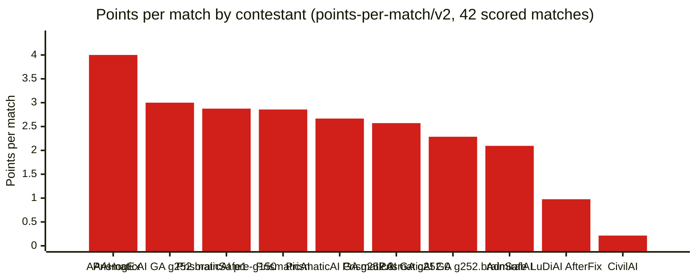
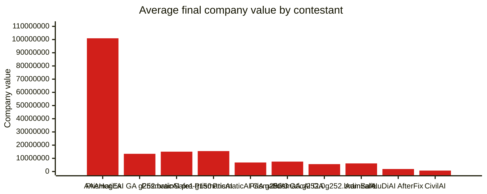
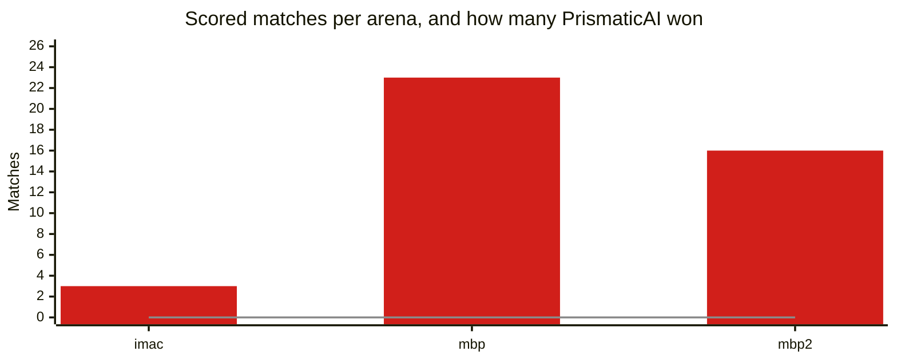

# battle-20261121T084831-20645868

Derived from `battle-20261121T084831-20645868.json` by `tools/research/ai-battle/battle.py report`; do not edit.

- Edition `20645868cdb36c00`: PrismaticAI and referee at `52f631b115782334f422f741a79ecabce78e58c4`, base set `opengfx-8.0.tar`
- 20-year free-for-all from 1960, map 256x256 temperate, breakdowns 1
- 42 scored match(es) on `imac` (20261119-master-gdf1e05e7d8), `mbp` (20261120-master-m17653b726e), `mbp2` (20261119-master-gdf1e05e7d8)
- Replays: 0 of 0 identical to their original on another arena

| # | Contestant | Played | Wins | Points | Points/match | Avg rank | Avg final value | Squirrel errors | Matches with anomalies |
|---|---|---|---|---|---|---|---|---|---|
| 1 | AAAHogEx | 42 | 42 | 168 | 4.0 | 1.0 | 101.0 M | 0 | 0 |
| 2 | PrismaticAI GA g252.brainSafe1 | 7 | 0 | 21 | 3.0 | 2.0 | 13.4 M | 0 | 0 |
| 3 | PrismaticAI pre-g150 | 8 | 0 | 23 | 2.875 | 2.12 | 15.1 M | 0 | 2 |
| 4 | PrismaticAI | 7 | 0 | 20 | 2.857 | 2.14 | 15.5 M | 0 | 0 |
| 5 | PrismaticAI GA g252.3 | 6 | 0 | 16 | 2.667 | 2.33 | 6.8 M | 0 | 3 |
| 6 | PrismaticAI GA g252.0 | 7 | 0 | 18 | 2.571 | 2.43 | 7.5 M | 0 | 5 |
| 7 | PrismaticAI GA g252.brainSafe | 7 | 0 | 16 | 2.286 | 2.71 | 5.6 M | 0 | 3 |
| 8 | AdmiralAI | 42 | 0 | 88 | 2.095 | 2.9 | 6.2 M | 59 | 5 |
| 9 | LuDiAI AfterFix | 42 | 0 | 41 | 0.976 | 4.02 | 1.9 M | 0 | 2 |
| 10 | CivilAI | 42 | 0 | 9 | 0.214 | 4.79 | 720.1 k | 0 | 5 |

```mermaid
---
config:
  xyChart:
    width: 900
    height: 360
  themeVariables:
    xyChart:
      plotColorPalette: "#d11f1a, #8a8a8a, #0b0b0b, #ece4d6"
---
xychart-beta
    title "Final company value per scored match: winner vs best PrismaticAI"
    x-axis ["m-0001", "m-0002", "m-0003", "m-0004", "m-0005", "m-0006", "m-0007", "m-0008", "m-0009", "m-0010", "m-0011", "m-0012", "m-0013", "m-0014", "m-0015", "m-0016", "m-0017", "m-0018", "m-0019", "m-0020", "m-0021", "m-0022", "m-0023", "m-0024", "m-0025", "m-0026", "m-0027", "m-0028", "m-0036", "m-0037", "m-0038", "m-0039", "m-0040", "m-0041", "m-0042", "m-0043", "m-0044", "m-0045", "m-0052", "m-0053", "m-0054", "m-0055"]
    %% series: Winner | Best PrismaticAI
    %% links: battle-20261121T084831-20645868.md?col=Match&filter=m-0001 | battle-20261121T084831-20645868.md?col=Match&filter=m-0002 | battle-20261121T084831-20645868.md?col=Match&filter=m-0003 | battle-20261121T084831-20645868.md?col=Match&filter=m-0004 | battle-20261121T084831-20645868.md?col=Match&filter=m-0005 | battle-20261121T084831-20645868.md?col=Match&filter=m-0006 | battle-20261121T084831-20645868.md?col=Match&filter=m-0007 | battle-20261121T084831-20645868.md?col=Match&filter=m-0008 | battle-20261121T084831-20645868.md?col=Match&filter=m-0009 | battle-20261121T084831-20645868.md?col=Match&filter=m-0010 | battle-20261121T084831-20645868.md?col=Match&filter=m-0011 | battle-20261121T084831-20645868.md?col=Match&filter=m-0012 | battle-20261121T084831-20645868.md?col=Match&filter=m-0013 | battle-20261121T084831-20645868.md?col=Match&filter=m-0014 | battle-20261121T084831-20645868.md?col=Match&filter=m-0015 | battle-20261121T084831-20645868.md?col=Match&filter=m-0016 | battle-20261121T084831-20645868.md?col=Match&filter=m-0017 | battle-20261121T084831-20645868.md?col=Match&filter=m-0018 | battle-20261121T084831-20645868.md?col=Match&filter=m-0019 | battle-20261121T084831-20645868.md?col=Match&filter=m-0020 | battle-20261121T084831-20645868.md?col=Match&filter=m-0021 | battle-20261121T084831-20645868.md?col=Match&filter=m-0022 | battle-20261121T084831-20645868.md?col=Match&filter=m-0023 | battle-20261121T084831-20645868.md?col=Match&filter=m-0024 | battle-20261121T084831-20645868.md?col=Match&filter=m-0025 | battle-20261121T084831-20645868.md?col=Match&filter=m-0026 | battle-20261121T084831-20645868.md?col=Match&filter=m-0027 | battle-20261121T084831-20645868.md?col=Match&filter=m-0028 | battle-20261121T084831-20645868.md?col=Match&filter=m-0036 | battle-20261121T084831-20645868.md?col=Match&filter=m-0037 | battle-20261121T084831-20645868.md?col=Match&filter=m-0038 | battle-20261121T084831-20645868.md?col=Match&filter=m-0039 | battle-20261121T084831-20645868.md?col=Match&filter=m-0040 | battle-20261121T084831-20645868.md?col=Match&filter=m-0041 | battle-20261121T084831-20645868.md?col=Match&filter=m-0042 | battle-20261121T084831-20645868.md?col=Match&filter=m-0043 | battle-20261121T084831-20645868.md?col=Match&filter=m-0044 | battle-20261121T084831-20645868.md?col=Match&filter=m-0045 | battle-20261121T084831-20645868.md?col=Match&filter=m-0052 | battle-20261121T084831-20645868.md?col=Match&filter=m-0053 | battle-20261121T084831-20645868.md?col=Match&filter=m-0054 | battle-20261121T084831-20645868.md?col=Match&filter=m-0055
    y-axis "Company value" 0 --> 163000000
    bar [109460533, 114545340, 109358473, 132509670, 142713205, 74046307, 77019667, 82676844, 89819714, 82913057, 72721590, 80414264, 67075663, 93852470, 86927553, 83490193, 85277101, 69595731, 77201368, 85724732, 101228076, 73641498, 114748680, 91849165, 98165893, 102141300, 91401506, 107155599, 120595791, 117462110, 146598396, 120714365, 147789378, 120800814, 88825924, 109224670, 112296256, 144260864, 109550502, 108502074, 98228038, 97532150]
    line [10888681, 2589271, 1874985, 10171626, 4541312, 14575463, 14646333, 3864115, 4353656, 12163885, 5792160, 5029450, 11934888, 7954972, 3616760, 15589213, 2565827, 15993351, 16474401, 6371867, 3160841, 10849178, 4700494, 16491776, 13378429, 8520639, 5054914, 13553408, 32593143, 19960259, 12066729, 7280957, 12764971, 10095103, 12488839, 15917383, 11291859, 13923823, 18903915, 13392302, 11223759, 17238033]
```

<!-- battle-charts:begin -->
<!-- derived from battle-20261121T084831-20645868.json by `battle.py render`; `battle.py check` fails when it is stale -->

<!-- battle-charts:end -->

| Match | Arena | Seed | Winner | Value | Last | Anomalies |
|---|---|---|---|---|---|---|
| m-0001 | mbp | 237600314 | AAAHogEx | 109.5 M | CivilAI | - |
| m-0002 | mbp | 237600314 | AAAHogEx | 114.5 M | CivilAI | PrismaticAI GA g252.0: fleet_drop:205->99 |
| m-0003 | mbp | 237600314 | AAAHogEx | 109.4 M | CivilAI | - |
| m-0004 | mbp | 237600314 | AAAHogEx | 132.5 M | CivilAI | - |
| m-0005 | mbp | 237600314 | AAAHogEx | 142.7 M | LuDiAI AfterFix | - |
| m-0006 | mbp | 61758055 | AAAHogEx | 74.0 M | CivilAI | - |
| m-0007 | mbp | 61758055 | AAAHogEx | 77.0 M | LuDiAI AfterFix | AdmiralAI: fleet_drop:152->88 |
| m-0008 | mbp | 61758055 | AAAHogEx | 82.7 M | CivilAI | - |
| m-0009 | mbp | 61758055 | AAAHogEx | 89.8 M | CivilAI | PrismaticAI GA g252.brainSafe: fleet_drop:88->59 |
| m-0010 | imac | 61758055 | AAAHogEx | 82.9 M | CivilAI | AdmiralAI: fleet_drop:142->82 |
| m-0011 | imac | 61758055 | AAAHogEx | 72.7 M | CivilAI | - |
| m-0012 | imac | 1551283823 | AAAHogEx | 80.4 M | CivilAI | CivilAI: fleet_drop:27->16 |
| m-0013 | mbp2 | 1551283823 | AAAHogEx | 67.1 M | CivilAI | PrismaticAI pre-g150: fleet_drop:84->51 |
| m-0014 | mbp2 | 1551283823 | AAAHogEx | 93.9 M | CivilAI | PrismaticAI GA g252.0: fleet_drop:130->61 |
| m-0015 | mbp2 | 1551283823 | AAAHogEx | 86.9 M | CivilAI | PrismaticAI GA g252.brainSafe: fleet_drop:76->42; CivilAI: fleet_drop:23->9 |
| m-0016 | mbp2 | 1551283823 | AAAHogEx | 83.5 M | CivilAI | - |
| m-0017 | mbp2 | 1551283823 | AAAHogEx | 85.3 M | AdmiralAI | PrismaticAI GA g252.3: fleet_drop:132->49 |
| m-0018 | mbp2 | 88519801 | AAAHogEx | 69.6 M | CivilAI | - |
| m-0019 | mbp2 | 88519801 | AAAHogEx | 77.2 M | CivilAI | PrismaticAI pre-g150: fleet_drop:78->47; AdmiralAI: fleet_drop:508->340 |
| m-0020 | mbp2 | 88519801 | AAAHogEx | 85.7 M | CivilAI | PrismaticAI GA g252.0: fleet_drop:151->28; CivilAI: fleet_drop:13->6 |
| m-0021 | mbp2 | 88519801 | AAAHogEx | 101.2 M | CivilAI | PrismaticAI GA g252.brainSafe: fleet_drop:67->34 |
| m-0022 | mbp2 | 88519801 | AAAHogEx | 73.6 M | CivilAI | - |
| m-0023 | mbp2 | 88519801 | AAAHogEx | 114.7 M | CivilAI | PrismaticAI GA g252.3: fleet_drop:73->47 |
| m-0024 | mbp2 | 1587024202 | AAAHogEx | 91.8 M | CivilAI | - |
| m-0025 | mbp2 | 1587024202 | AAAHogEx | 98.2 M | LuDiAI AfterFix | - |
| m-0026 | mbp2 | 1587024202 | AAAHogEx | 102.1 M | CivilAI | AdmiralAI: squirrel_errors:59 |
| m-0027 | mbp2 | 1587024202 | AAAHogEx | 91.4 M | LuDiAI AfterFix | LuDiAI AfterFix: fleet_drop:23->15 |
| m-0028 | mbp2 | 1587024202 | AAAHogEx | 107.2 M | CivilAI | CivilAI: fleet_drop:26->18 |
| m-0036 | mbp | 1273531819 | AAAHogEx | 120.6 M | CivilAI | - |
| m-0037 | mbp | 1273531819 | AAAHogEx | 117.5 M | CivilAI | - |
| m-0038 | mbp | 1273531819 | AAAHogEx | 146.6 M | CivilAI | PrismaticAI GA g252.0: fleet_drop:176->86 |
| m-0039 | mbp | 1273531819 | AAAHogEx | 120.7 M | CivilAI | - |
| m-0040 | mbp | 1273531819 | AAAHogEx | 147.8 M | CivilAI | - |
| m-0041 | mbp | 1273531819 | AAAHogEx | 120.8 M | CivilAI | - |
| m-0042 | mbp | 84656202 | AAAHogEx | 88.8 M | LuDiAI AfterFix | LuDiAI AfterFix: fleet_drop:15->1 |
| m-0043 | mbp | 84656202 | AAAHogEx | 109.2 M | CivilAI | CivilAI: fleet_drop:12->7 |
| m-0044 | mbp | 84656202 | AAAHogEx | 112.3 M | CivilAI | PrismaticAI GA g252.0: fleet_drop:91->57 |
| m-0045 | mbp | 84656202 | AAAHogEx | 144.3 M | LuDiAI AfterFix | - |
| m-0052 | mbp | 1914299462 | AAAHogEx | 109.6 M | CivilAI | AdmiralAI: fleet_drop:167->105 |
| m-0053 | mbp | 1914299462 | AAAHogEx | 108.5 M | CivilAI | PrismaticAI GA g252.3: fleet_drop:159->110 |
| m-0054 | mbp | 1919638694 | AAAHogEx | 98.2 M | LuDiAI AfterFix | - |
| m-0055 | mbp | 1919638694 | AAAHogEx | 97.5 M | CivilAI | - |
