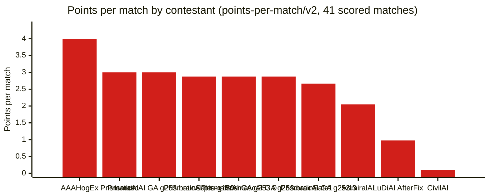
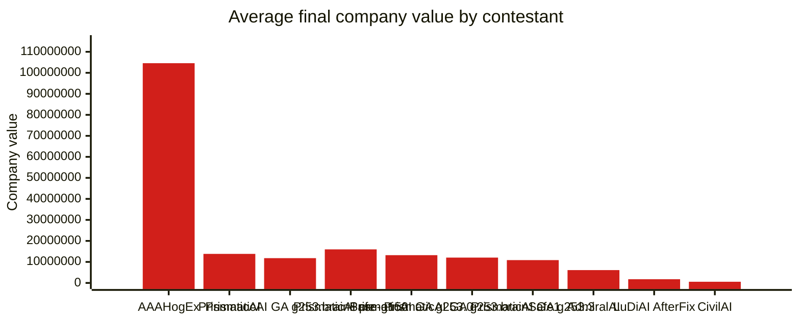
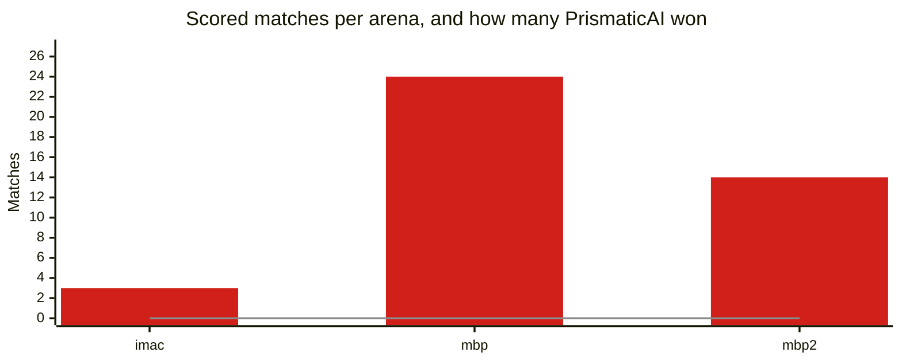

# battle-20261121T085856-42ba92ee

Derived from `battle-20261121T085856-42ba92ee.json` by `tools/research/ai-battle/battle.py report`; do not edit.

- Edition `42ba92eeae6da52f`: PrismaticAI and referee at `52f631b115782334f422f741a79ecabce78e58c4`, base set `opengfx-8.0.tar`
- 20-year free-for-all from 1960, map 256x256 temperate, breakdowns 1
- 41 scored match(es) on `imac` (20261119-master-gdf1e05e7d8), `mbp` (20261120-master-m17653b726e), `mbp2` (20261119-master-gdf1e05e7d8)
- Replays: 0 of 1 identical to their original on another arena

| # | Contestant | Played | Wins | Points | Points/match | Avg rank | Avg final value | Squirrel errors | Matches with anomalies |
|---|---|---|---|---|---|---|---|---|---|
| 1 | AAAHogEx | 41 | 41 | 164 | 4.0 | 1.0 | 104.6 M | 0 | 0 |
| 2 | PrismaticAI | 5 | 0 | 15 | 3.0 | 2.0 | 13.8 M | 0 | 0 |
| 3 | PrismaticAI GA g253.brainSafe | 6 | 0 | 18 | 3.0 | 2.0 | 11.8 M | 0 | 1 |
| 4 | PrismaticAI pre-g150 | 8 | 0 | 23 | 2.875 | 2.12 | 16.0 M | 0 | 5 |
| 5 | PrismaticAI GA g253.0 | 8 | 0 | 23 | 2.875 | 2.12 | 13.2 M | 0 | 0 |
| 6 | PrismaticAI GA g253.brainSafe1 | 8 | 0 | 23 | 2.875 | 2.12 | 12.1 M | 0 | 0 |
| 7 | PrismaticAI GA g253.3 | 6 | 0 | 16 | 2.667 | 2.33 | 10.9 M | 0 | 0 |
| 8 | AdmiralAI | 41 | 0 | 84 | 2.049 | 2.95 | 6.1 M | 59 | 3 |
| 9 | LuDiAI AfterFix | 41 | 0 | 40 | 0.976 | 4.02 | 1.8 M | 0 | 1 |
| 10 | CivilAI | 41 | 0 | 4 | 0.098 | 4.9 | 561.3 k | 0 | 2 |

```mermaid
---
config:
  xyChart:
    width: 900
    height: 360
  themeVariables:
    xyChart:
      plotColorPalette: "#d11f1a, #8a8a8a, #0b0b0b, #ece4d6"
---
xychart-beta
    title "Final company value per scored match: winner vs best PrismaticAI"
    x-axis ["m-0001", "m-0002", "m-0003", "m-0004", "m-0005", "m-0006", "m-0007", "m-0008", "m-0009", "m-0010", "m-0011", "m-0012", "m-0013", "m-0014", "m-0015", "m-0016", "m-0017", "m-0018", "m-0019", "m-0020", "m-0021", "m-0022", "m-0023", "m-0025", "m-0026", "m-0028", "m-0036", "m-0037", "m-0038", "m-0039", "m-0040", "m-0041", "m-0042", "m-0043", "m-0044", "m-0046", "m-0047", "m-0049", "m-0050", "m-0051", "m-0052"]
    %% series: Winner | Best PrismaticAI
    %% links: battle-20261121T085856-42ba92ee.md?col=Match&filter=m-0001 | battle-20261121T085856-42ba92ee.md?col=Match&filter=m-0002 | battle-20261121T085856-42ba92ee.md?col=Match&filter=m-0003 | battle-20261121T085856-42ba92ee.md?col=Match&filter=m-0004 | battle-20261121T085856-42ba92ee.md?col=Match&filter=m-0005 | battle-20261121T085856-42ba92ee.md?col=Match&filter=m-0006 | battle-20261121T085856-42ba92ee.md?col=Match&filter=m-0007 | battle-20261121T085856-42ba92ee.md?col=Match&filter=m-0008 | battle-20261121T085856-42ba92ee.md?col=Match&filter=m-0009 | battle-20261121T085856-42ba92ee.md?col=Match&filter=m-0010 | battle-20261121T085856-42ba92ee.md?col=Match&filter=m-0011 | battle-20261121T085856-42ba92ee.md?col=Match&filter=m-0012 | battle-20261121T085856-42ba92ee.md?col=Match&filter=m-0013 | battle-20261121T085856-42ba92ee.md?col=Match&filter=m-0014 | battle-20261121T085856-42ba92ee.md?col=Match&filter=m-0015 | battle-20261121T085856-42ba92ee.md?col=Match&filter=m-0016 | battle-20261121T085856-42ba92ee.md?col=Match&filter=m-0017 | battle-20261121T085856-42ba92ee.md?col=Match&filter=m-0018 | battle-20261121T085856-42ba92ee.md?col=Match&filter=m-0019 | battle-20261121T085856-42ba92ee.md?col=Match&filter=m-0020 | battle-20261121T085856-42ba92ee.md?col=Match&filter=m-0021 | battle-20261121T085856-42ba92ee.md?col=Match&filter=m-0022 | battle-20261121T085856-42ba92ee.md?col=Match&filter=m-0023 | battle-20261121T085856-42ba92ee.md?col=Match&filter=m-0025 | battle-20261121T085856-42ba92ee.md?col=Match&filter=m-0026 | battle-20261121T085856-42ba92ee.md?col=Match&filter=m-0028 | battle-20261121T085856-42ba92ee.md?col=Match&filter=m-0036 | battle-20261121T085856-42ba92ee.md?col=Match&filter=m-0037 | battle-20261121T085856-42ba92ee.md?col=Match&filter=m-0038 | battle-20261121T085856-42ba92ee.md?col=Match&filter=m-0039 | battle-20261121T085856-42ba92ee.md?col=Match&filter=m-0040 | battle-20261121T085856-42ba92ee.md?col=Match&filter=m-0041 | battle-20261121T085856-42ba92ee.md?col=Match&filter=m-0042 | battle-20261121T085856-42ba92ee.md?col=Match&filter=m-0043 | battle-20261121T085856-42ba92ee.md?col=Match&filter=m-0044 | battle-20261121T085856-42ba92ee.md?col=Match&filter=m-0046 | battle-20261121T085856-42ba92ee.md?col=Match&filter=m-0047 | battle-20261121T085856-42ba92ee.md?col=Match&filter=m-0049 | battle-20261121T085856-42ba92ee.md?col=Match&filter=m-0050 | battle-20261121T085856-42ba92ee.md?col=Match&filter=m-0051 | battle-20261121T085856-42ba92ee.md?col=Match&filter=m-0052
    y-axis "Company value" 0 --> 175000000
    bar [136718301, 143093264, 156108447, 158095599, 147462529, 108828944, 100977707, 80773653, 96515883, 94952239, 85871249, 96821679, 87038674, 81954461, 78975331, 66132209, 74806922, 70029837, 79831864, 89387574, 87435156, 86677618, 88358448, 153097770, 157149818, 158859751, 106913178, 123891680, 130097846, 115089358, 108201196, 111842413, 81303789, 86947986, 77487498, 89546446, 101562475, 95495523, 103923238, 101578692, 87750534]
    line [25586841, 22562632, 19809722, 22691051, 12033194, 14320236, 7820961, 6439466, 8961500, 6227445, 9401343, 13882062, 14713643, 6554505, 10112585, 4976148, 8538962, 10771532, 9927225, 10255504, 8112984, 5756857, 5973057, 20613665, 16213930, 16340169, 11869559, 18264161, 15449669, 15662828, 20388262, 17665719, 18258967, 15502961, 11735374, 10546476, 11558337, 15346938, 16504737, 8093124, 9548499]
```

<!-- battle-charts:begin -->
<!-- derived from battle-20261121T085856-42ba92ee.json by `battle.py render`; `battle.py check` fails when it is stale -->

<!-- battle-charts:end -->

| Seed | Original | Replay | Arenas | Identical |
|---|---|---|---|---|
| 1121054164 | m-0010 | m-0048 | imac / mbp | NO |

| Match | Arena | Seed | Winner | Value | Last | Anomalies |
|---|---|---|---|---|---|---|
| m-0001 | mbp | 1860889559 | AAAHogEx | 136.7 M | LuDiAI AfterFix | PrismaticAI pre-g150: fleet_drop:109->65 |
| m-0002 | mbp | 1860889559 | AAAHogEx | 143.1 M | CivilAI | - |
| m-0003 | mbp | 1860889559 | AAAHogEx | 156.1 M | CivilAI | - |
| m-0004 | mbp | 1860889559 | AAAHogEx | 158.1 M | CivilAI | - |
| m-0005 | mbp | 1860889559 | AAAHogEx | 147.5 M | LuDiAI AfterFix | LuDiAI AfterFix: fleet_drop:75->51 |
| m-0006 | mbp | 1121054164 | AAAHogEx | 108.8 M | CivilAI | - |
| m-0007 | mbp | 1121054164 | AAAHogEx | 101.0 M | CivilAI | PrismaticAI pre-g150: fleet_drop:124->80 |
| m-0008 | mbp | 1121054164 | AAAHogEx | 80.8 M | LuDiAI AfterFix | - |
| m-0009 | mbp | 1121054164 | AAAHogEx | 96.5 M | CivilAI | PrismaticAI GA g253.brainSafe: fleet_drop:47->28 |
| m-0010 | imac | 1121054164 | AAAHogEx | 95.0 M | CivilAI | - |
| m-0011 | imac | 1121054164 | AAAHogEx | 85.9 M | CivilAI | - |
| m-0012 | imac | 616486655 | AAAHogEx | 96.8 M | CivilAI | - |
| m-0013 | mbp2 | 616486655 | AAAHogEx | 87.0 M | CivilAI | PrismaticAI pre-g150: fleet_drop:97->64 |
| m-0014 | mbp2 | 616486655 | AAAHogEx | 82.0 M | CivilAI | - |
| m-0015 | mbp2 | 616486655 | AAAHogEx | 79.0 M | CivilAI | - |
| m-0016 | mbp2 | 616486655 | AAAHogEx | 66.1 M | CivilAI | - |
| m-0017 | mbp2 | 616486655 | AAAHogEx | 74.8 M | CivilAI | - |
| m-0018 | mbp2 | 1142092927 | AAAHogEx | 70.0 M | CivilAI | - |
| m-0019 | mbp2 | 1142092927 | AAAHogEx | 79.8 M | CivilAI | - |
| m-0020 | mbp2 | 1142092927 | AAAHogEx | 89.4 M | CivilAI | - |
| m-0021 | mbp2 | 1142092927 | AAAHogEx | 87.4 M | LuDiAI AfterFix | - |
| m-0022 | mbp2 | 1142092927 | AAAHogEx | 86.7 M | CivilAI | - |
| m-0023 | mbp2 | 1142092927 | AAAHogEx | 88.4 M | CivilAI | - |
| m-0025 | mbp2 | 937141100 | AAAHogEx | 153.1 M | CivilAI | PrismaticAI pre-g150: fleet_drop:184->110 |
| m-0026 | mbp2 | 937141100 | AAAHogEx | 157.1 M | CivilAI | CivilAI: fleet_drop:47->25 |
| m-0028 | mbp2 | 937141100 | AAAHogEx | 158.9 M | CivilAI | AdmiralAI: fleet_drop:190->132 |
| m-0036 | mbp | 1914936873 | AAAHogEx | 106.9 M | CivilAI | - |
| m-0037 | mbp | 1914936873 | AAAHogEx | 123.9 M | CivilAI | PrismaticAI pre-g150: fleet_drop:111->36; CivilAI: fleet_drop:49->34 |
| m-0038 | mbp | 1914936873 | AAAHogEx | 130.1 M | CivilAI | - |
| m-0039 | mbp | 1914936873 | AAAHogEx | 115.1 M | CivilAI | - |
| m-0040 | mbp | 1914936873 | AAAHogEx | 108.2 M | CivilAI | - |
| m-0041 | mbp | 1914936873 | AAAHogEx | 111.8 M | CivilAI | - |
| m-0042 | mbp | 365524469 | AAAHogEx | 81.3 M | CivilAI | - |
| m-0043 | mbp | 365524469 | AAAHogEx | 86.9 M | CivilAI | - |
| m-0044 | mbp | 365524469 | AAAHogEx | 77.5 M | CivilAI | AdmiralAI: squirrel_errors:59 |
| m-0046 | mbp | 365524469 | AAAHogEx | 89.5 M | CivilAI | - |
| m-0047 | mbp | 365524469 | AAAHogEx | 101.6 M | CivilAI | - |
| m-0048 (replay) | mbp | 1121054164 | AAAHogEx | 94.4 M | CivilAI | CivilAI: no_vehicles |
| m-0049 | mbp | 1965922651 | AAAHogEx | 95.5 M | CivilAI | AdmiralAI: fleet_drop:150->101 |
| m-0050 | mbp | 1965922651 | AAAHogEx | 103.9 M | CivilAI | - |
| m-0051 | mbp | 1965922651 | AAAHogEx | 101.6 M | CivilAI | - |
| m-0052 | mbp | 1965922651 | AAAHogEx | 87.8 M | CivilAI | - |
