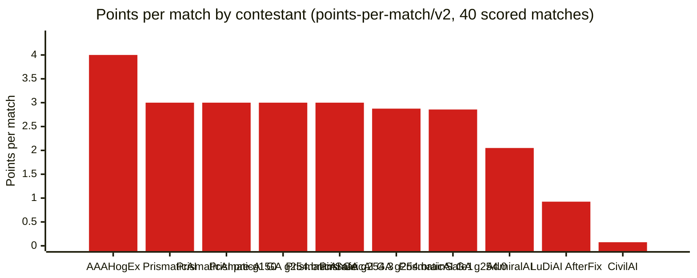
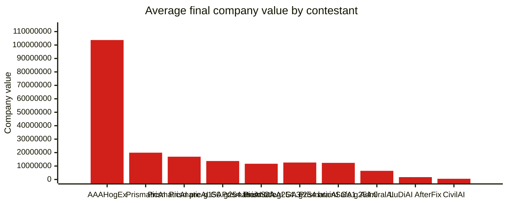
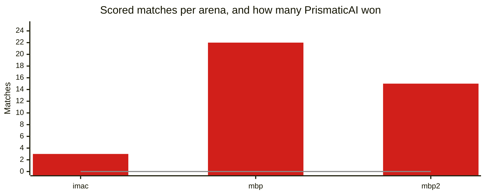

# battle-20261121T090859-24f1b986

Derived from `battle-20261121T090859-24f1b986.json` by `tools/research/ai-battle/battle.py report`; do not edit.

- Edition `24f1b98634b5daf6`: PrismaticAI and referee at `52f631b115782334f422f741a79ecabce78e58c4`, base set `opengfx-8.0.tar`
- 20-year free-for-all from 1960, map 256x256 temperate, breakdowns 1
- 40 scored match(es) on `imac` (20261119-master-gdf1e05e7d8), `mbp` (20261120-master-m17653b726e), `mbp2` (20261119-master-gdf1e05e7d8)
- Replays: 0 of 1 identical to their original on another arena

| # | Contestant | Played | Wins | Points | Points/match | Avg rank | Avg final value | Squirrel errors | Matches with anomalies |
|---|---|---|---|---|---|---|---|---|---|
| 1 | AAAHogEx | 40 | 40 | 160 | 4.0 | 1.0 | 103.7 M | 0 | 0 |
| 2 | PrismaticAI | 6 | 0 | 18 | 3.0 | 2.0 | 19.9 M | 0 | 0 |
| 3 | PrismaticAI pre-g150 | 7 | 0 | 21 | 3.0 | 2.0 | 16.9 M | 0 | 2 |
| 4 | PrismaticAI GA g254.brainSafe | 6 | 0 | 18 | 3.0 | 2.0 | 13.7 M | 0 | 0 |
| 5 | PrismaticAI GA g254.3 | 6 | 0 | 18 | 3.0 | 2.0 | 11.7 M | 0 | 0 |
| 6 | PrismaticAI GA g254.brainSafe1 | 8 | 0 | 23 | 2.875 | 2.12 | 12.6 M | 0 | 0 |
| 7 | PrismaticAI GA g254.0 | 7 | 0 | 20 | 2.857 | 2.14 | 12.4 M | 0 | 0 |
| 8 | AdmiralAI | 40 | 0 | 82 | 2.05 | 2.95 | 6.4 M | 0 | 0 |
| 9 | LuDiAI AfterFix | 40 | 0 | 37 | 0.925 | 4.08 | 1.7 M | 0 | 2 |
| 10 | CivilAI | 40 | 0 | 3 | 0.075 | 4.92 | 523.7 k | 0 | 10 |

```mermaid
---
config:
  xyChart:
    width: 900
    height: 360
  themeVariables:
    xyChart:
      plotColorPalette: "#d11f1a, #8a8a8a, #0b0b0b, #ece4d6"
---
xychart-beta
    title "Final company value per scored match: winner vs best PrismaticAI"
    x-axis ["m-0001", "m-0002", "m-0003", "m-0004", "m-0005", "m-0006", "m-0007", "m-0008", "m-0009", "m-0010", "m-0011", "m-0012", "m-0013", "m-0014", "m-0015", "m-0016", "m-0017", "m-0018", "m-0020", "m-0021", "m-0022", "m-0023", "m-0024", "m-0025", "m-0026", "m-0027", "m-0028", "m-0036", "m-0037", "m-0038", "m-0039", "m-0040", "m-0041", "m-0042", "m-0043", "m-0044", "m-0046", "m-0047", "m-0049", "m-0052"]
    %% series: Winner | Best PrismaticAI
    %% links: battle-20261121T090859-24f1b986.md?col=Match&filter=m-0001 | battle-20261121T090859-24f1b986.md?col=Match&filter=m-0002 | battle-20261121T090859-24f1b986.md?col=Match&filter=m-0003 | battle-20261121T090859-24f1b986.md?col=Match&filter=m-0004 | battle-20261121T090859-24f1b986.md?col=Match&filter=m-0005 | battle-20261121T090859-24f1b986.md?col=Match&filter=m-0006 | battle-20261121T090859-24f1b986.md?col=Match&filter=m-0007 | battle-20261121T090859-24f1b986.md?col=Match&filter=m-0008 | battle-20261121T090859-24f1b986.md?col=Match&filter=m-0009 | battle-20261121T090859-24f1b986.md?col=Match&filter=m-0010 | battle-20261121T090859-24f1b986.md?col=Match&filter=m-0011 | battle-20261121T090859-24f1b986.md?col=Match&filter=m-0012 | battle-20261121T090859-24f1b986.md?col=Match&filter=m-0013 | battle-20261121T090859-24f1b986.md?col=Match&filter=m-0014 | battle-20261121T090859-24f1b986.md?col=Match&filter=m-0015 | battle-20261121T090859-24f1b986.md?col=Match&filter=m-0016 | battle-20261121T090859-24f1b986.md?col=Match&filter=m-0017 | battle-20261121T090859-24f1b986.md?col=Match&filter=m-0018 | battle-20261121T090859-24f1b986.md?col=Match&filter=m-0020 | battle-20261121T090859-24f1b986.md?col=Match&filter=m-0021 | battle-20261121T090859-24f1b986.md?col=Match&filter=m-0022 | battle-20261121T090859-24f1b986.md?col=Match&filter=m-0023 | battle-20261121T090859-24f1b986.md?col=Match&filter=m-0024 | battle-20261121T090859-24f1b986.md?col=Match&filter=m-0025 | battle-20261121T090859-24f1b986.md?col=Match&filter=m-0026 | battle-20261121T090859-24f1b986.md?col=Match&filter=m-0027 | battle-20261121T090859-24f1b986.md?col=Match&filter=m-0028 | battle-20261121T090859-24f1b986.md?col=Match&filter=m-0036 | battle-20261121T090859-24f1b986.md?col=Match&filter=m-0037 | battle-20261121T090859-24f1b986.md?col=Match&filter=m-0038 | battle-20261121T090859-24f1b986.md?col=Match&filter=m-0039 | battle-20261121T090859-24f1b986.md?col=Match&filter=m-0040 | battle-20261121T090859-24f1b986.md?col=Match&filter=m-0041 | battle-20261121T090859-24f1b986.md?col=Match&filter=m-0042 | battle-20261121T090859-24f1b986.md?col=Match&filter=m-0043 | battle-20261121T090859-24f1b986.md?col=Match&filter=m-0044 | battle-20261121T090859-24f1b986.md?col=Match&filter=m-0046 | battle-20261121T090859-24f1b986.md?col=Match&filter=m-0047 | battle-20261121T090859-24f1b986.md?col=Match&filter=m-0049 | battle-20261121T090859-24f1b986.md?col=Match&filter=m-0052
    y-axis "Company value" 0 --> 154000000
    bar [112728139, 118626835, 118626835, 109752153, 85053722, 111965167, 109652789, 138574792, 138574792, 130240096, 122583869, 92463712, 86407021, 95551917, 95551917, 92698871, 92507570, 74895893, 88125021, 88125021, 81307197, 84631106, 120875909, 139830176, 129139022, 129139022, 138603463, 105837242, 100697968, 87825438, 87825438, 108896957, 96770451, 92291392, 98013046, 95706864, 91061939, 98218837, 76167961, 82716349]
    line [20069855, 13193266, 13193266, 13827405, 11299948, 15675385, 22267912, 10237673, 10237673, 11695806, 9182053, 21584701, 14784050, 13957924, 13957924, 14713939, 12647280, 17397557, 11386939, 11386939, 11055027, 13563973, 24340646, 19227482, 19270382, 19270382, 16838796, 22571535, 19284328, 14338018, 14338018, 17775407, 15402750, 18048240, 4559440, 4141442, 4176566, 8139009, 18393818, 10785831]
```

<!-- battle-charts:begin -->
<!-- derived from battle-20261121T090859-24f1b986.json by `battle.py render`; `battle.py check` fails when it is stale -->

<!-- battle-charts:end -->

| Seed | Original | Replay | Arenas | Identical |
|---|---|---|---|---|
| 1974850716 | m-0012 | m-0048 | imac / mbp | NO |

| Match | Arena | Seed | Winner | Value | Last | Anomalies |
|---|---|---|---|---|---|---|
| m-0001 | mbp | 344666735 | AAAHogEx | 112.7 M | CivilAI | - |
| m-0002 | mbp | 344666735 | AAAHogEx | 118.6 M | CivilAI | - |
| m-0003 | mbp | 344666735 | AAAHogEx | 118.6 M | CivilAI | - |
| m-0004 | mbp | 344666735 | AAAHogEx | 109.8 M | CivilAI | CivilAI: fleet_drop:33->11 |
| m-0005 | mbp | 344666735 | AAAHogEx | 85.1 M | LuDiAI AfterFix | - |
| m-0006 | mbp | 902473444 | AAAHogEx | 112.0 M | CivilAI | - |
| m-0007 | mbp | 902473444 | AAAHogEx | 109.7 M | LuDiAI AfterFix | LuDiAI AfterFix: fleet_drop:66->39 |
| m-0008 | mbp | 902473444 | AAAHogEx | 138.6 M | CivilAI | - |
| m-0009 | mbp | 902473444 | AAAHogEx | 138.6 M | CivilAI | - |
| m-0010 | imac | 902473444 | AAAHogEx | 130.2 M | CivilAI | - |
| m-0011 | imac | 902473444 | AAAHogEx | 122.6 M | CivilAI | - |
| m-0012 | imac | 1974850716 | AAAHogEx | 92.5 M | LuDiAI AfterFix | CivilAI: fleet_drop:15->10; LuDiAI AfterFix: no_vehicles |
| m-0013 | mbp2 | 1974850716 | AAAHogEx | 86.4 M | CivilAI | PrismaticAI pre-g150: fleet_drop:79->55 |
| m-0014 | mbp2 | 1974850716 | AAAHogEx | 95.6 M | CivilAI | CivilAI: fleet_drop:16->9 |
| m-0015 | mbp2 | 1974850716 | AAAHogEx | 95.6 M | CivilAI | CivilAI: fleet_drop:16->9 |
| m-0016 | mbp2 | 1974850716 | AAAHogEx | 92.7 M | CivilAI | CivilAI: fleet_drop:52->27 |
| m-0017 | mbp2 | 1974850716 | AAAHogEx | 92.5 M | CivilAI | - |
| m-0018 | mbp2 | 825198944 | AAAHogEx | 74.9 M | CivilAI | - |
| m-0020 | mbp2 | 825198944 | AAAHogEx | 88.1 M | CivilAI | CivilAI: fleet_drop:16->7 |
| m-0021 | mbp2 | 825198944 | AAAHogEx | 88.1 M | CivilAI | CivilAI: fleet_drop:16->7 |
| m-0022 | mbp2 | 825198944 | AAAHogEx | 81.3 M | CivilAI | - |
| m-0023 | mbp2 | 825198944 | AAAHogEx | 84.6 M | CivilAI | - |
| m-0024 | mbp2 | 1290041569 | AAAHogEx | 120.9 M | CivilAI | - |
| m-0025 | mbp2 | 1290041569 | AAAHogEx | 139.8 M | CivilAI | CivilAI: fleet_drop:17->10 |
| m-0026 | mbp2 | 1290041569 | AAAHogEx | 129.1 M | CivilAI | - |
| m-0027 | mbp2 | 1290041569 | AAAHogEx | 129.1 M | CivilAI | - |
| m-0028 | mbp2 | 1290041569 | AAAHogEx | 138.6 M | CivilAI | - |
| m-0036 | mbp | 1978583283 | AAAHogEx | 105.8 M | CivilAI | - |
| m-0037 | mbp | 1978583283 | AAAHogEx | 100.7 M | CivilAI | - |
| m-0038 | mbp | 1978583283 | AAAHogEx | 87.8 M | CivilAI | - |
| m-0039 | mbp | 1978583283 | AAAHogEx | 87.8 M | CivilAI | - |
| m-0040 | mbp | 1978583283 | AAAHogEx | 108.9 M | CivilAI | - |
| m-0041 | mbp | 1978583283 | AAAHogEx | 96.8 M | CivilAI | - |
| m-0042 | mbp | 1146027911 | AAAHogEx | 92.3 M | CivilAI | CivilAI: fleet_drop:13->7 |
| m-0043 | mbp | 1146027911 | AAAHogEx | 98.0 M | CivilAI | PrismaticAI pre-g150: fleet_drop:79->53 |
| m-0044 | mbp | 1146027911 | AAAHogEx | 95.7 M | CivilAI | - |
| m-0046 | mbp | 1146027911 | AAAHogEx | 91.1 M | CivilAI | - |
| m-0047 | mbp | 1146027911 | AAAHogEx | 98.2 M | CivilAI | - |
| m-0048 (replay) | mbp | 1974850716 | AAAHogEx | 84.5 M | LuDiAI AfterFix | LuDiAI AfterFix: no_vehicles |
| m-0049 | mbp | 1382347342 | AAAHogEx | 76.2 M | CivilAI | CivilAI: fleet_drop:58->32 |
| m-0052 | mbp | 1382347342 | AAAHogEx | 82.7 M | CivilAI | - |
