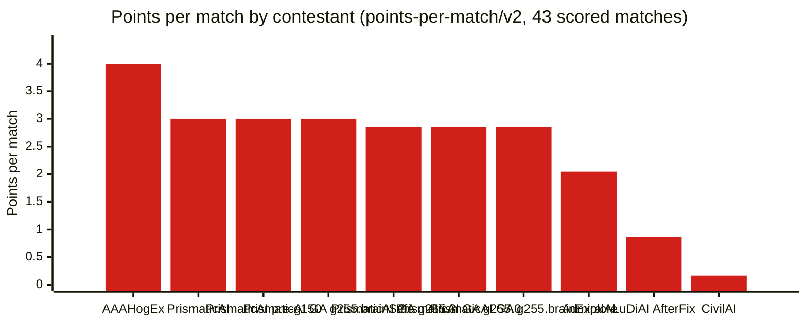
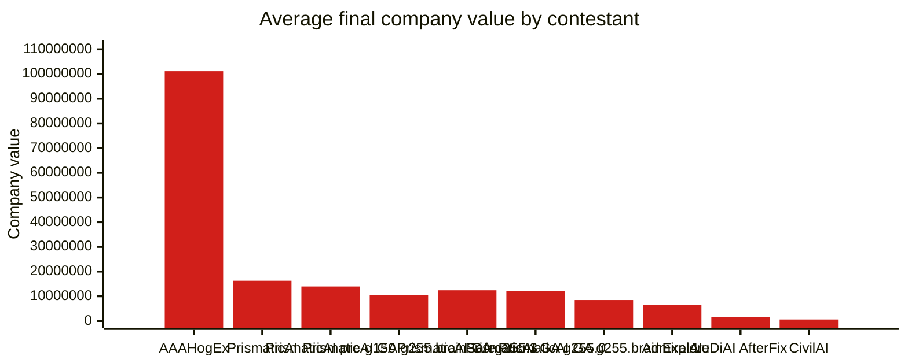
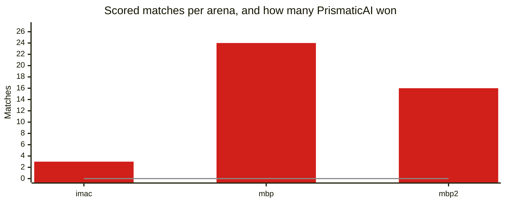

# battle-20261121T092017-77ccb142

Derived from `battle-20261121T092017-77ccb142.json` by `tools/research/ai-battle/battle.py report`; do not edit.

- Edition `77ccb1421a350785`: PrismaticAI and referee at `52f631b115782334f422f741a79ecabce78e58c4`, base set `opengfx-8.0.tar`
- 20-year free-for-all from 1960, map 256x256 temperate, breakdowns 1
- 43 scored match(es) on `imac` (20261119-master-gdf1e05e7d8), `mbp` (20261120-master-m17653b726e), `mbp2` (20261119-master-gdf1e05e7d8)
- Replays: 1 of 1 identical to their original on another arena

| # | Contestant | Played | Wins | Points | Points/match | Avg rank | Avg final value | Squirrel errors | Matches with anomalies |
|---|---|---|---|---|---|---|---|---|---|
| 1 | AAAHogEx | 43 | 43 | 172 | 4.0 | 1.0 | 101.2 M | 0 | 0 |
| 2 | PrismaticAI | 6 | 0 | 18 | 3.0 | 2.0 | 16.3 M | 0 | 0 |
| 3 | PrismaticAI pre-g150 | 8 | 0 | 24 | 3.0 | 2.0 | 14.0 M | 0 | 3 |
| 4 | PrismaticAI GA g255.brainSafe | 8 | 0 | 24 | 3.0 | 2.0 | 10.6 M | 0 | 0 |
| 5 | PrismaticAI GA g255.3 | 7 | 0 | 20 | 2.857 | 2.14 | 12.4 M | 0 | 0 |
| 6 | PrismaticAI GA g255.0 | 7 | 0 | 20 | 2.857 | 2.14 | 12.2 M | 0 | 0 |
| 7 | PrismaticAI GA g255.brainExplore | 7 | 0 | 20 | 2.857 | 2.14 | 8.5 M | 0 | 0 |
| 8 | AdmiralAI | 43 | 0 | 88 | 2.047 | 2.95 | 6.5 M | 0 | 2 |
| 9 | LuDiAI AfterFix | 43 | 0 | 37 | 0.86 | 4.14 | 1.7 M | 0 | 0 |
| 10 | CivilAI | 43 | 0 | 7 | 0.163 | 4.84 | 595.4 k | 0 | 4 |

```mermaid
---
config:
  xyChart:
    width: 900
    height: 360
  themeVariables:
    xyChart:
      plotColorPalette: "#d11f1a, #8a8a8a, #0b0b0b, #ece4d6"
---
xychart-beta
    title "Final company value per scored match: winner vs best PrismaticAI"
    x-axis ["m-0001", "m-0002", "m-0003", "m-0004", "m-0005", "m-0006", "m-0007", "m-0008", "m-0009", "m-0010", "m-0011", "m-0012", "m-0013", "m-0014", "m-0015", "m-0016", "m-0017", "m-0018", "m-0019", "m-0020", "m-0021", "m-0022", "m-0023", "m-0024", "m-0025", "m-0026", "m-0027", "m-0028", "m-0036", "m-0037", "m-0038", "m-0039", "m-0040", "m-0041", "m-0042", "m-0043", "m-0044", "m-0045", "m-0046", "m-0047", "m-0049", "m-0051", "m-0053"]
    %% series: Winner | Best PrismaticAI
    %% links: battle-20261121T092017-77ccb142.md?col=Match&filter=m-0001 | battle-20261121T092017-77ccb142.md?col=Match&filter=m-0002 | battle-20261121T092017-77ccb142.md?col=Match&filter=m-0003 | battle-20261121T092017-77ccb142.md?col=Match&filter=m-0004 | battle-20261121T092017-77ccb142.md?col=Match&filter=m-0005 | battle-20261121T092017-77ccb142.md?col=Match&filter=m-0006 | battle-20261121T092017-77ccb142.md?col=Match&filter=m-0007 | battle-20261121T092017-77ccb142.md?col=Match&filter=m-0008 | battle-20261121T092017-77ccb142.md?col=Match&filter=m-0009 | battle-20261121T092017-77ccb142.md?col=Match&filter=m-0010 | battle-20261121T092017-77ccb142.md?col=Match&filter=m-0011 | battle-20261121T092017-77ccb142.md?col=Match&filter=m-0012 | battle-20261121T092017-77ccb142.md?col=Match&filter=m-0013 | battle-20261121T092017-77ccb142.md?col=Match&filter=m-0014 | battle-20261121T092017-77ccb142.md?col=Match&filter=m-0015 | battle-20261121T092017-77ccb142.md?col=Match&filter=m-0016 | battle-20261121T092017-77ccb142.md?col=Match&filter=m-0017 | battle-20261121T092017-77ccb142.md?col=Match&filter=m-0018 | battle-20261121T092017-77ccb142.md?col=Match&filter=m-0019 | battle-20261121T092017-77ccb142.md?col=Match&filter=m-0020 | battle-20261121T092017-77ccb142.md?col=Match&filter=m-0021 | battle-20261121T092017-77ccb142.md?col=Match&filter=m-0022 | battle-20261121T092017-77ccb142.md?col=Match&filter=m-0023 | battle-20261121T092017-77ccb142.md?col=Match&filter=m-0024 | battle-20261121T092017-77ccb142.md?col=Match&filter=m-0025 | battle-20261121T092017-77ccb142.md?col=Match&filter=m-0026 | battle-20261121T092017-77ccb142.md?col=Match&filter=m-0027 | battle-20261121T092017-77ccb142.md?col=Match&filter=m-0028 | battle-20261121T092017-77ccb142.md?col=Match&filter=m-0036 | battle-20261121T092017-77ccb142.md?col=Match&filter=m-0037 | battle-20261121T092017-77ccb142.md?col=Match&filter=m-0038 | battle-20261121T092017-77ccb142.md?col=Match&filter=m-0039 | battle-20261121T092017-77ccb142.md?col=Match&filter=m-0040 | battle-20261121T092017-77ccb142.md?col=Match&filter=m-0041 | battle-20261121T092017-77ccb142.md?col=Match&filter=m-0042 | battle-20261121T092017-77ccb142.md?col=Match&filter=m-0043 | battle-20261121T092017-77ccb142.md?col=Match&filter=m-0044 | battle-20261121T092017-77ccb142.md?col=Match&filter=m-0045 | battle-20261121T092017-77ccb142.md?col=Match&filter=m-0046 | battle-20261121T092017-77ccb142.md?col=Match&filter=m-0047 | battle-20261121T092017-77ccb142.md?col=Match&filter=m-0049 | battle-20261121T092017-77ccb142.md?col=Match&filter=m-0051 | battle-20261121T092017-77ccb142.md?col=Match&filter=m-0053
    y-axis "Company value" 0 --> 170000000
    bar [129614418, 118949744, 115477591, 127256508, 128628392, 94845927, 105496151, 105687056, 111277630, 116426571, 102938000, 104284787, 103247788, 99755144, 105194177, 110602556, 82877227, 85367358, 89389723, 90453315, 50268397, 98003768, 76546554, 90961682, 81772851, 94495352, 84860842, 100345082, 81674826, 79577215, 95386187, 98801780, 137033648, 103095463, 108002826, 154186470, 136816940, 98116073, 137828438, 119302967, 80554280, 63095451, 51187934]
    line [17002533, 11667050, 10544390, 10758813, 12367170, 13527534, 16340934, 13033149, 11420137, 7034343, 15086678, 20618590, 16385825, 16599284, 12543083, 12729795, 19643653, 11492897, 11279157, 6109357, 11607742, 3423038, 5921670, 18359450, 18687367, 17719334, 12152778, 10297141, 17380506, 11208627, 9096236, 7103095, 6293066, 8832073, 16368738, 8620799, 10890520, 7975565, 8791366, 12418817, 12178208, 11317853, 12666999]
```

<!-- battle-charts:begin -->
<!-- derived from battle-20261121T092017-77ccb142.json by `battle.py render`; `battle.py check` fails when it is stale -->

<!-- battle-charts:end -->

| Seed | Original | Replay | Arenas | Identical |
|---|---|---|---|---|
| 414852912 | m-0018 | m-0048 | mbp2 / mbp | yes |

| Match | Arena | Seed | Winner | Value | Last | Anomalies |
|---|---|---|---|---|---|---|
| m-0001 | mbp | 460320015 | AAAHogEx | 129.6 M | CivilAI | - |
| m-0002 | mbp | 460320015 | AAAHogEx | 118.9 M | CivilAI | - |
| m-0003 | mbp | 460320015 | AAAHogEx | 115.5 M | CivilAI | - |
| m-0004 | mbp | 460320015 | AAAHogEx | 127.3 M | CivilAI | - |
| m-0005 | mbp | 460320015 | AAAHogEx | 128.6 M | CivilAI | - |
| m-0006 | mbp | 1667859310 | AAAHogEx | 94.8 M | CivilAI | CivilAI: no_vehicles |
| m-0007 | mbp | 1667859310 | AAAHogEx | 105.5 M | CivilAI | PrismaticAI pre-g150: fleet_drop:79->40 |
| m-0008 | mbp | 1667859310 | AAAHogEx | 105.7 M | CivilAI | - |
| m-0009 | mbp | 1667859310 | AAAHogEx | 111.3 M | CivilAI | - |
| m-0010 | imac | 1667859310 | AAAHogEx | 116.4 M | CivilAI | - |
| m-0011 | imac | 1667859310 | AAAHogEx | 102.9 M | CivilAI | - |
| m-0012 | imac | 684747914 | AAAHogEx | 104.3 M | CivilAI | - |
| m-0013 | mbp2 | 684747914 | AAAHogEx | 103.2 M | CivilAI | - |
| m-0014 | mbp2 | 684747914 | AAAHogEx | 99.8 M | CivilAI | - |
| m-0015 | mbp2 | 684747914 | AAAHogEx | 105.2 M | LuDiAI AfterFix | CivilAI: fleet_drop:41->23 |
| m-0016 | mbp2 | 684747914 | AAAHogEx | 110.6 M | LuDiAI AfterFix | AdmiralAI: fleet_drop:273->176 |
| m-0017 | mbp2 | 684747914 | AAAHogEx | 82.9 M | CivilAI | - |
| m-0018 | mbp2 | 414852912 | AAAHogEx | 85.4 M | CivilAI | - |
| m-0019 | mbp2 | 414852912 | AAAHogEx | 89.4 M | LuDiAI AfterFix | PrismaticAI pre-g150: fleet_drop:58->35 |
| m-0020 | mbp2 | 414852912 | AAAHogEx | 90.5 M | CivilAI | - |
| m-0021 | mbp2 | 414852912 | AAAHogEx | 50.3 M | CivilAI | - |
| m-0022 | mbp2 | 414852912 | AAAHogEx | 98.0 M | CivilAI | - |
| m-0023 | mbp2 | 414852912 | AAAHogEx | 76.5 M | CivilAI | - |
| m-0024 | mbp2 | 890018544 | AAAHogEx | 91.0 M | CivilAI | - |
| m-0025 | mbp2 | 890018544 | AAAHogEx | 81.8 M | LuDiAI AfterFix | - |
| m-0026 | mbp2 | 890018544 | AAAHogEx | 94.5 M | CivilAI | - |
| m-0027 | mbp2 | 890018544 | AAAHogEx | 84.9 M | LuDiAI AfterFix | CivilAI: fleet_drop:57->39 |
| m-0028 | mbp2 | 890018544 | AAAHogEx | 100.3 M | CivilAI | - |
| m-0036 | mbp | 228520516 | AAAHogEx | 81.7 M | LuDiAI AfterFix | - |
| m-0037 | mbp | 228520516 | AAAHogEx | 79.6 M | CivilAI | PrismaticAI pre-g150: fleet_drop:72->42; CivilAI: fleet_drop:110->50 |
| m-0038 | mbp | 228520516 | AAAHogEx | 95.4 M | CivilAI | - |
| m-0039 | mbp | 228520516 | AAAHogEx | 98.8 M | CivilAI | - |
| m-0040 | mbp | 228520516 | AAAHogEx | 137.0 M | CivilAI | - |
| m-0041 | mbp | 228520516 | AAAHogEx | 103.1 M | CivilAI | - |
| m-0042 | mbp | 1600607751 | AAAHogEx | 108.0 M | CivilAI | AdmiralAI: fleet_drop:305->163 |
| m-0043 | mbp | 1600607751 | AAAHogEx | 154.2 M | CivilAI | - |
| m-0044 | mbp | 1600607751 | AAAHogEx | 136.8 M | LuDiAI AfterFix | - |
| m-0045 | mbp | 1600607751 | AAAHogEx | 98.1 M | CivilAI | - |
| m-0046 | mbp | 1600607751 | AAAHogEx | 137.8 M | CivilAI | - |
| m-0047 | mbp | 1600607751 | AAAHogEx | 119.3 M | CivilAI | - |
| m-0048 (replay) | mbp | 414852912 | AAAHogEx | 85.4 M | CivilAI | - |
| m-0049 | mbp | 963330111 | AAAHogEx | 80.6 M | CivilAI | - |
| m-0051 | mbp | 963330111 | AAAHogEx | 63.1 M | CivilAI | - |
| m-0053 | mbp | 963330111 | AAAHogEx | 51.2 M | CivilAI | - |
