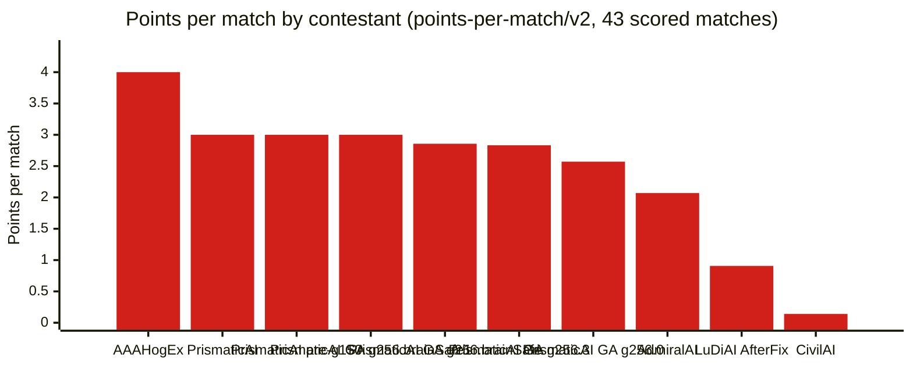
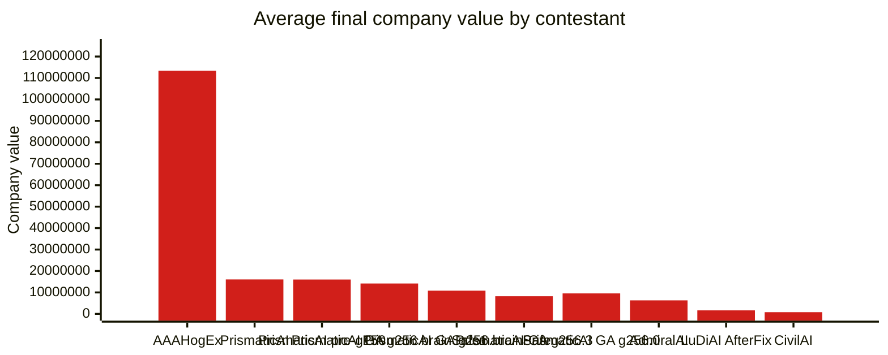
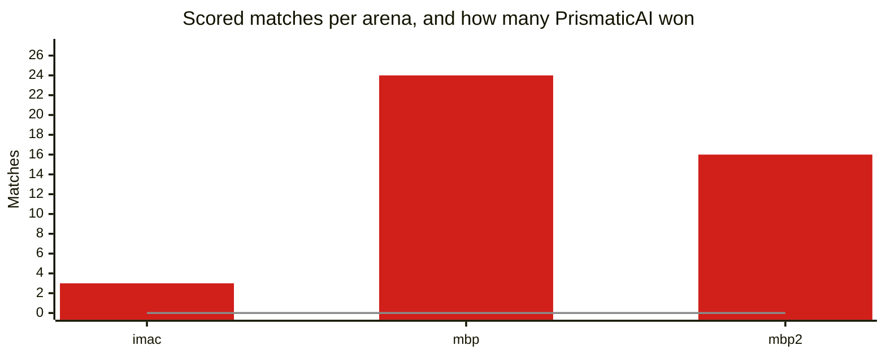

# battle-20261121T093117-2a7c39cf

Derived from `battle-20261121T093117-2a7c39cf.json` by `tools/research/ai-battle/battle.py report`; do not edit.

- Edition `2a7c39cf952c884a`: PrismaticAI and referee at `52f631b115782334f422f741a79ecabce78e58c4`, base set `opengfx-8.0.tar`
- 20-year free-for-all from 1960, map 256x256 temperate, breakdowns 1
- 43 scored match(es) on `imac` (20261119-master-gdf1e05e7d8), `mbp` (20261120-master-m17653b726e), `mbp2` (20261119-master-gdf1e05e7d8)
- Replays: 2 of 2 identical to their original on another arena

| # | Contestant | Played | Wins | Points | Points/match | Avg rank | Avg final value | Squirrel errors | Matches with anomalies |
|---|---|---|---|---|---|---|---|---|---|
| 1 | AAAHogEx | 43 | 43 | 172 | 4.0 | 1.0 | 113.4 M | 0 | 0 |
| 2 | PrismaticAI | 7 | 0 | 21 | 3.0 | 2.0 | 16.1 M | 0 | 0 |
| 3 | PrismaticAI pre-g150 | 9 | 0 | 27 | 3.0 | 2.0 | 16.0 M | 0 | 1 |
| 4 | PrismaticAI GA g256.brainSafe1 | 7 | 0 | 21 | 3.0 | 2.0 | 14.2 M | 0 | 2 |
| 5 | PrismaticAI GA g256.brainSafe | 7 | 0 | 20 | 2.857 | 2.14 | 10.8 M | 0 | 0 |
| 6 | PrismaticAI GA g256.3 | 6 | 0 | 17 | 2.833 | 2.17 | 8.2 M | 0 | 0 |
| 7 | PrismaticAI GA g256.0 | 7 | 0 | 18 | 2.571 | 2.43 | 9.6 M | 0 | 0 |
| 8 | AdmiralAI | 43 | 0 | 89 | 2.07 | 2.93 | 6.3 M | 57 | 3 |
| 9 | LuDiAI AfterFix | 43 | 0 | 39 | 0.907 | 4.09 | 1.6 M | 0 | 1 |
| 10 | CivilAI | 43 | 0 | 6 | 0.14 | 4.86 | 785.3 k | 0 | 9 |

```mermaid
---
config:
  xyChart:
    width: 900
    height: 360
  themeVariables:
    xyChart:
      plotColorPalette: "#d11f1a, #8a8a8a, #0b0b0b, #ece4d6"
---
xychart-beta
    title "Final company value per scored match: winner vs best PrismaticAI"
    x-axis ["m-0001", "m-0002", "m-0003", "m-0004", "m-0005", "m-0006", "m-0007", "m-0008", "m-0009", "m-0010", "m-0011", "m-0012", "m-0013", "m-0014", "m-0015", "m-0016", "m-0017", "m-0018", "m-0019", "m-0020", "m-0021", "m-0022", "m-0023", "m-0024", "m-0025", "m-0026", "m-0027", "m-0028", "m-0036", "m-0037", "m-0038", "m-0039", "m-0040", "m-0041", "m-0042", "m-0043", "m-0044", "m-0045", "m-0046", "m-0047", "m-0049", "m-0054", "m-0055"]
    %% series: Winner | Best PrismaticAI
    %% links: battle-20261121T093117-2a7c39cf.md?col=Match&filter=m-0001 | battle-20261121T093117-2a7c39cf.md?col=Match&filter=m-0002 | battle-20261121T093117-2a7c39cf.md?col=Match&filter=m-0003 | battle-20261121T093117-2a7c39cf.md?col=Match&filter=m-0004 | battle-20261121T093117-2a7c39cf.md?col=Match&filter=m-0005 | battle-20261121T093117-2a7c39cf.md?col=Match&filter=m-0006 | battle-20261121T093117-2a7c39cf.md?col=Match&filter=m-0007 | battle-20261121T093117-2a7c39cf.md?col=Match&filter=m-0008 | battle-20261121T093117-2a7c39cf.md?col=Match&filter=m-0009 | battle-20261121T093117-2a7c39cf.md?col=Match&filter=m-0010 | battle-20261121T093117-2a7c39cf.md?col=Match&filter=m-0011 | battle-20261121T093117-2a7c39cf.md?col=Match&filter=m-0012 | battle-20261121T093117-2a7c39cf.md?col=Match&filter=m-0013 | battle-20261121T093117-2a7c39cf.md?col=Match&filter=m-0014 | battle-20261121T093117-2a7c39cf.md?col=Match&filter=m-0015 | battle-20261121T093117-2a7c39cf.md?col=Match&filter=m-0016 | battle-20261121T093117-2a7c39cf.md?col=Match&filter=m-0017 | battle-20261121T093117-2a7c39cf.md?col=Match&filter=m-0018 | battle-20261121T093117-2a7c39cf.md?col=Match&filter=m-0019 | battle-20261121T093117-2a7c39cf.md?col=Match&filter=m-0020 | battle-20261121T093117-2a7c39cf.md?col=Match&filter=m-0021 | battle-20261121T093117-2a7c39cf.md?col=Match&filter=m-0022 | battle-20261121T093117-2a7c39cf.md?col=Match&filter=m-0023 | battle-20261121T093117-2a7c39cf.md?col=Match&filter=m-0024 | battle-20261121T093117-2a7c39cf.md?col=Match&filter=m-0025 | battle-20261121T093117-2a7c39cf.md?col=Match&filter=m-0026 | battle-20261121T093117-2a7c39cf.md?col=Match&filter=m-0027 | battle-20261121T093117-2a7c39cf.md?col=Match&filter=m-0028 | battle-20261121T093117-2a7c39cf.md?col=Match&filter=m-0036 | battle-20261121T093117-2a7c39cf.md?col=Match&filter=m-0037 | battle-20261121T093117-2a7c39cf.md?col=Match&filter=m-0038 | battle-20261121T093117-2a7c39cf.md?col=Match&filter=m-0039 | battle-20261121T093117-2a7c39cf.md?col=Match&filter=m-0040 | battle-20261121T093117-2a7c39cf.md?col=Match&filter=m-0041 | battle-20261121T093117-2a7c39cf.md?col=Match&filter=m-0042 | battle-20261121T093117-2a7c39cf.md?col=Match&filter=m-0043 | battle-20261121T093117-2a7c39cf.md?col=Match&filter=m-0044 | battle-20261121T093117-2a7c39cf.md?col=Match&filter=m-0045 | battle-20261121T093117-2a7c39cf.md?col=Match&filter=m-0046 | battle-20261121T093117-2a7c39cf.md?col=Match&filter=m-0047 | battle-20261121T093117-2a7c39cf.md?col=Match&filter=m-0049 | battle-20261121T093117-2a7c39cf.md?col=Match&filter=m-0054 | battle-20261121T093117-2a7c39cf.md?col=Match&filter=m-0055
    y-axis "Company value" 0 --> 178000000
    bar [109330024, 116413308, 119679831, 112095056, 117261774, 145113119, 124914223, 139361564, 141923039, 152052062, 110136243, 98831804, 87554375, 80793144, 80064768, 100440127, 89360663, 112084864, 109968527, 102525283, 95051142, 107521890, 117280826, 110021533, 135656752, 122340108, 150269078, 162111168, 92264900, 125542725, 115223004, 92649896, 114268470, 116553802, 131450599, 100352351, 99193769, 126556586, 116705736, 114782731, 117349910, 72620883, 91110701]
    line [23029726, 9277370, 12836267, 14289063, 9375027, 17393400, 16858822, 11668515, 14650064, 13328780, 10562216, 6293569, 15058792, 9743347, 8528749, 9840470, 8704486, 17110468, 9830701, 10029064, 7808456, 11115236, 8789065, 16110602, 16764225, 11322396, 7873281, 15059556, 23457270, 19920817, 8069554, 10874693, 20545810, 6906057, 17072457, 13454596, 6745911, 13269947, 14927740, 4924184, 10585893, 14929292, 18588110]
```

<!-- battle-charts:begin -->
<!-- derived from battle-20261121T093117-2a7c39cf.json by `battle.py render`; `battle.py check` fails when it is stale -->

<!-- battle-charts:end -->

| Seed | Original | Replay | Arenas | Identical |
|---|---|---|---|---|
| 1594428362 | m-0014 | m-0048 | mbp2 / mbp | yes |
| 1594428362 | m-0015 | m-0056 | mbp2 / mbp | yes |

| Match | Arena | Seed | Winner | Value | Last | Anomalies |
|---|---|---|---|---|---|---|
| m-0001 | mbp | 1452312681 | AAAHogEx | 109.3 M | CivilAI | - |
| m-0002 | mbp | 1452312681 | AAAHogEx | 116.4 M | CivilAI | LuDiAI AfterFix: fleet_drop:60->41; CivilAI: no_vehicles |
| m-0003 | mbp | 1452312681 | AAAHogEx | 119.7 M | CivilAI | - |
| m-0004 | mbp | 1452312681 | AAAHogEx | 112.1 M | CivilAI | - |
| m-0005 | mbp | 1452312681 | AAAHogEx | 117.3 M | CivilAI | CivilAI: no_vehicles |
| m-0006 | mbp | 1170346207 | AAAHogEx | 145.1 M | CivilAI | - |
| m-0007 | mbp | 1170346207 | AAAHogEx | 124.9 M | CivilAI | - |
| m-0008 | mbp | 1170346207 | AAAHogEx | 139.4 M | CivilAI | - |
| m-0009 | mbp | 1170346207 | AAAHogEx | 141.9 M | CivilAI | - |
| m-0010 | imac | 1170346207 | AAAHogEx | 152.1 M | CivilAI | - |
| m-0011 | imac | 1170346207 | AAAHogEx | 110.1 M | CivilAI | - |
| m-0012 | imac | 1594428362 | AAAHogEx | 98.8 M | LuDiAI AfterFix | - |
| m-0013 | mbp2 | 1594428362 | AAAHogEx | 87.6 M | CivilAI | PrismaticAI pre-g150: fleet_drop:86->55 |
| m-0014 | mbp2 | 1594428362 | AAAHogEx | 80.8 M | CivilAI | CivilAI: fleet_drop:20->11 |
| m-0015 | mbp2 | 1594428362 | AAAHogEx | 80.1 M | LuDiAI AfterFix | - |
| m-0016 | mbp2 | 1594428362 | AAAHogEx | 100.4 M | CivilAI | PrismaticAI GA g256.brainSafe1: fleet_drop:63->41; CivilAI: fleet_drop:77->40 |
| m-0017 | mbp2 | 1594428362 | AAAHogEx | 89.4 M | LuDiAI AfterFix | AdmiralAI: fleet_drop:238->132 |
| m-0018 | mbp2 | 657139665 | AAAHogEx | 112.1 M | CivilAI | - |
| m-0019 | mbp2 | 657139665 | AAAHogEx | 110.0 M | CivilAI | - |
| m-0020 | mbp2 | 657139665 | AAAHogEx | 102.5 M | CivilAI | CivilAI: fleet_drop:91->60 |
| m-0021 | mbp2 | 657139665 | AAAHogEx | 95.1 M | CivilAI | - |
| m-0022 | mbp2 | 657139665 | AAAHogEx | 107.5 M | CivilAI | - |
| m-0023 | mbp2 | 657139665 | AAAHogEx | 117.3 M | CivilAI | CivilAI: fleet_drop:84->49 |
| m-0024 | mbp2 | 1386359104 | AAAHogEx | 110.0 M | CivilAI | AdmiralAI: fleet_drop:438->260 |
| m-0025 | mbp2 | 1386359104 | AAAHogEx | 135.7 M | CivilAI | - |
| m-0026 | mbp2 | 1386359104 | AAAHogEx | 122.3 M | CivilAI | - |
| m-0027 | mbp2 | 1386359104 | AAAHogEx | 150.3 M | CivilAI | - |
| m-0028 | mbp2 | 1386359104 | AAAHogEx | 162.1 M | CivilAI | PrismaticAI GA g256.brainSafe1: fleet_drop:74->45 |
| m-0036 | mbp | 1331315282 | AAAHogEx | 92.3 M | CivilAI | CivilAI: fleet_drop:62->29 |
| m-0037 | mbp | 1331315282 | AAAHogEx | 125.5 M | CivilAI | AdmiralAI: squirrel_errors:57 |
| m-0038 | mbp | 1331315282 | AAAHogEx | 115.2 M | CivilAI | - |
| m-0039 | mbp | 1331315282 | AAAHogEx | 92.6 M | LuDiAI AfterFix | - |
| m-0040 | mbp | 1331315282 | AAAHogEx | 114.3 M | LuDiAI AfterFix | - |
| m-0041 | mbp | 1331315282 | AAAHogEx | 116.6 M | LuDiAI AfterFix | - |
| m-0042 | mbp | 805595118 | AAAHogEx | 131.5 M | CivilAI | CivilAI: fleet_drop:28->8 |
| m-0043 | mbp | 805595118 | AAAHogEx | 100.4 M | CivilAI | CivilAI: fleet_drop:22->10 |
| m-0044 | mbp | 805595118 | AAAHogEx | 99.2 M | CivilAI | - |
| m-0045 | mbp | 805595118 | AAAHogEx | 126.6 M | CivilAI | - |
| m-0046 | mbp | 805595118 | AAAHogEx | 116.7 M | CivilAI | - |
| m-0047 | mbp | 805595118 | AAAHogEx | 114.8 M | CivilAI | - |
| m-0048 (replay) | mbp | 1594428362 | AAAHogEx | 80.8 M | CivilAI | CivilAI: fleet_drop:20->11 |
| m-0049 | mbp | 1824138349 | AAAHogEx | 117.3 M | CivilAI | - |
| m-0054 | mbp | 1166769013 | AAAHogEx | 72.6 M | CivilAI | - |
| m-0055 | mbp | 1166769013 | AAAHogEx | 91.1 M | CivilAI | - |
| m-0056 (replay) | mbp | 1594428362 | AAAHogEx | 80.1 M | LuDiAI AfterFix | - |
