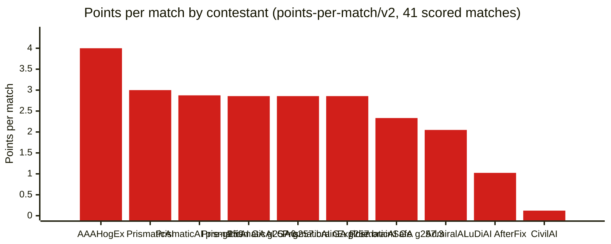
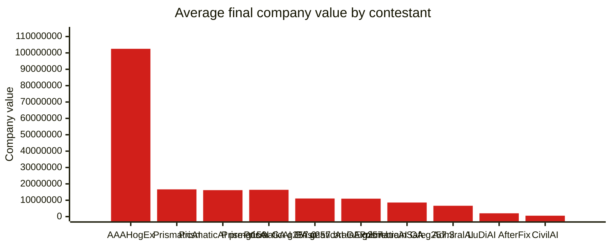
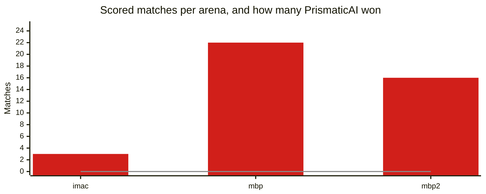

# battle-20261121T094217-f710b0e0

Derived from `battle-20261121T094217-f710b0e0.json` by `tools/research/ai-battle/battle.py report`; do not edit.

- Edition `f710b0e0e28f6aae`: PrismaticAI and referee at `52f631b115782334f422f741a79ecabce78e58c4`, base set `opengfx-8.0.tar`
- 20-year free-for-all from 1960, map 256x256 temperate, breakdowns 1
- 41 scored match(es) on `imac` (20261119-master-gdf1e05e7d8), `mbp` (20261120-master-m17653b726e), `mbp2` (20261119-master-gdf1e05e7d8)
- Replays: 0 of 1 identical to their original on another arena

| # | Contestant | Played | Wins | Points | Points/match | Avg rank | Avg final value | Squirrel errors | Matches with anomalies |
|---|---|---|---|---|---|---|---|---|---|
| 1 | AAAHogEx | 41 | 41 | 164 | 4.0 | 1.0 | 102.5 M | 0 | 0 |
| 2 | PrismaticAI | 6 | 0 | 18 | 3.0 | 2.0 | 16.6 M | 0 | 0 |
| 3 | PrismaticAI pre-g150 | 8 | 0 | 23 | 2.875 | 2.12 | 16.2 M | 0 | 3 |
| 4 | PrismaticAI GA g257.0 | 7 | 0 | 20 | 2.857 | 2.14 | 16.4 M | 0 | 2 |
| 5 | PrismaticAI GA g257.brainExplore | 7 | 0 | 20 | 2.857 | 2.14 | 11.1 M | 0 | 0 |
| 6 | PrismaticAI GA g257.brainSafe | 7 | 0 | 20 | 2.857 | 2.14 | 11.0 M | 0 | 0 |
| 7 | PrismaticAI GA g257.3 | 6 | 0 | 14 | 2.333 | 2.67 | 8.6 M | 0 | 0 |
| 8 | AdmiralAI | 41 | 0 | 84 | 2.049 | 2.95 | 6.6 M | 0 | 3 |
| 9 | LuDiAI AfterFix | 41 | 0 | 42 | 1.024 | 3.98 | 2.0 M | 0 | 0 |
| 10 | CivilAI | 41 | 0 | 5 | 0.122 | 4.88 | 562.8 k | 0 | 5 |

```mermaid
---
config:
  xyChart:
    width: 900
    height: 360
  themeVariables:
    xyChart:
      plotColorPalette: "#d11f1a, #8a8a8a, #0b0b0b, #ece4d6"
---
xychart-beta
    title "Final company value per scored match: winner vs best PrismaticAI"
    x-axis ["m-0001", "m-0002", "m-0003", "m-0004", "m-0005", "m-0006", "m-0007", "m-0008", "m-0009", "m-0010", "m-0011", "m-0012", "m-0013", "m-0014", "m-0015", "m-0016", "m-0017", "m-0018", "m-0019", "m-0020", "m-0021", "m-0022", "m-0023", "m-0024", "m-0025", "m-0026", "m-0027", "m-0028", "m-0036", "m-0037", "m-0038", "m-0039", "m-0040", "m-0041", "m-0042", "m-0043", "m-0044", "m-0045", "m-0046", "m-0047", "m-0049"]
    %% series: Winner | Best PrismaticAI
    %% links: battle-20261121T094217-f710b0e0.md?col=Match&filter=m-0001 | battle-20261121T094217-f710b0e0.md?col=Match&filter=m-0002 | battle-20261121T094217-f710b0e0.md?col=Match&filter=m-0003 | battle-20261121T094217-f710b0e0.md?col=Match&filter=m-0004 | battle-20261121T094217-f710b0e0.md?col=Match&filter=m-0005 | battle-20261121T094217-f710b0e0.md?col=Match&filter=m-0006 | battle-20261121T094217-f710b0e0.md?col=Match&filter=m-0007 | battle-20261121T094217-f710b0e0.md?col=Match&filter=m-0008 | battle-20261121T094217-f710b0e0.md?col=Match&filter=m-0009 | battle-20261121T094217-f710b0e0.md?col=Match&filter=m-0010 | battle-20261121T094217-f710b0e0.md?col=Match&filter=m-0011 | battle-20261121T094217-f710b0e0.md?col=Match&filter=m-0012 | battle-20261121T094217-f710b0e0.md?col=Match&filter=m-0013 | battle-20261121T094217-f710b0e0.md?col=Match&filter=m-0014 | battle-20261121T094217-f710b0e0.md?col=Match&filter=m-0015 | battle-20261121T094217-f710b0e0.md?col=Match&filter=m-0016 | battle-20261121T094217-f710b0e0.md?col=Match&filter=m-0017 | battle-20261121T094217-f710b0e0.md?col=Match&filter=m-0018 | battle-20261121T094217-f710b0e0.md?col=Match&filter=m-0019 | battle-20261121T094217-f710b0e0.md?col=Match&filter=m-0020 | battle-20261121T094217-f710b0e0.md?col=Match&filter=m-0021 | battle-20261121T094217-f710b0e0.md?col=Match&filter=m-0022 | battle-20261121T094217-f710b0e0.md?col=Match&filter=m-0023 | battle-20261121T094217-f710b0e0.md?col=Match&filter=m-0024 | battle-20261121T094217-f710b0e0.md?col=Match&filter=m-0025 | battle-20261121T094217-f710b0e0.md?col=Match&filter=m-0026 | battle-20261121T094217-f710b0e0.md?col=Match&filter=m-0027 | battle-20261121T094217-f710b0e0.md?col=Match&filter=m-0028 | battle-20261121T094217-f710b0e0.md?col=Match&filter=m-0036 | battle-20261121T094217-f710b0e0.md?col=Match&filter=m-0037 | battle-20261121T094217-f710b0e0.md?col=Match&filter=m-0038 | battle-20261121T094217-f710b0e0.md?col=Match&filter=m-0039 | battle-20261121T094217-f710b0e0.md?col=Match&filter=m-0040 | battle-20261121T094217-f710b0e0.md?col=Match&filter=m-0041 | battle-20261121T094217-f710b0e0.md?col=Match&filter=m-0042 | battle-20261121T094217-f710b0e0.md?col=Match&filter=m-0043 | battle-20261121T094217-f710b0e0.md?col=Match&filter=m-0044 | battle-20261121T094217-f710b0e0.md?col=Match&filter=m-0045 | battle-20261121T094217-f710b0e0.md?col=Match&filter=m-0046 | battle-20261121T094217-f710b0e0.md?col=Match&filter=m-0047 | battle-20261121T094217-f710b0e0.md?col=Match&filter=m-0049
    y-axis "Company value" 0 --> 164000000
    bar [124000828, 116689279, 127901098, 127901098, 105279809, 64332681, 64934946, 80095491, 81906318, 85229218, 85742961, 97939210, 96164029, 95939318, 101157097, 101157097, 117148589, 90782826, 108550372, 97343775, 126883825, 126883825, 86730868, 135562402, 148731712, 138168844, 122057043, 122057043, 88463597, 82583067, 92334996, 93294488, 93294488, 93933457, 85144344, 96435224, 89495802, 107600947, 107600947, 92231261, 102785478]
    line [13554406, 17143333, 11522343, 11522343, 10646612, 11971834, 19302037, 18174884, 13832736, 14606611, 6072666, 12011828, 12020805, 3230726, 4696744, 4696744, 1435922, 18928907, 18136061, 17711871, 13310934, 13310934, 15842101, 22630003, 25776872, 27042290, 19940317, 19940317, 16377711, 12804339, 13549903, 6100382, 6100382, 12641096, 17970932, 12354638, 17782241, 7354408, 7354408, 4982045, 15465222]
```

<!-- battle-charts:begin -->
<!-- derived from battle-20261121T094217-f710b0e0.json by `battle.py render`; `battle.py check` fails when it is stale -->

<!-- battle-charts:end -->

| Seed | Original | Replay | Arenas | Identical |
|---|---|---|---|---|
| 1329357284 | m-0011 | m-0048 | imac / mbp | NO |

| Match | Arena | Seed | Winner | Value | Last | Anomalies |
|---|---|---|---|---|---|---|
| m-0001 | mbp | 1114073337 | AAAHogEx | 124.0 M | CivilAI | PrismaticAI pre-g150: fleet_drop:111->68 |
| m-0002 | mbp | 1114073337 | AAAHogEx | 116.7 M | CivilAI | - |
| m-0003 | mbp | 1114073337 | AAAHogEx | 127.9 M | CivilAI | - |
| m-0004 | mbp | 1114073337 | AAAHogEx | 127.9 M | CivilAI | - |
| m-0005 | mbp | 1114073337 | AAAHogEx | 105.3 M | CivilAI | - |
| m-0006 | mbp | 1329357284 | AAAHogEx | 64.3 M | CivilAI | - |
| m-0007 | mbp | 1329357284 | AAAHogEx | 64.9 M | CivilAI | - |
| m-0008 | mbp | 1329357284 | AAAHogEx | 80.1 M | CivilAI | - |
| m-0009 | mbp | 1329357284 | AAAHogEx | 81.9 M | CivilAI | CivilAI: fleet_drop:30->16 |
| m-0010 | imac | 1329357284 | AAAHogEx | 85.2 M | CivilAI | CivilAI: fleet_drop:28->10 |
| m-0011 | imac | 1329357284 | AAAHogEx | 85.7 M | CivilAI | - |
| m-0012 | imac | 1033254718 | AAAHogEx | 97.9 M | CivilAI | - |
| m-0013 | mbp2 | 1033254718 | AAAHogEx | 96.2 M | CivilAI | CivilAI: fleet_drop:25->17 |
| m-0014 | mbp2 | 1033254718 | AAAHogEx | 95.9 M | CivilAI | PrismaticAI GA g257.0: fleet_drop:76->51 |
| m-0015 | mbp2 | 1033254718 | AAAHogEx | 101.2 M | CivilAI | - |
| m-0016 | mbp2 | 1033254718 | AAAHogEx | 101.2 M | CivilAI | - |
| m-0017 | mbp2 | 1033254718 | AAAHogEx | 117.1 M | CivilAI | - |
| m-0018 | mbp2 | 792146745 | AAAHogEx | 90.8 M | CivilAI | - |
| m-0019 | mbp2 | 792146745 | AAAHogEx | 108.6 M | LuDiAI AfterFix | PrismaticAI pre-g150: fleet_drop:95->60 |
| m-0020 | mbp2 | 792146745 | AAAHogEx | 97.3 M | CivilAI | - |
| m-0021 | mbp2 | 792146745 | AAAHogEx | 126.9 M | CivilAI | CivilAI: fleet_drop:67->35 |
| m-0022 | mbp2 | 792146745 | AAAHogEx | 126.9 M | CivilAI | CivilAI: fleet_drop:67->35 |
| m-0023 | mbp2 | 792146745 | AAAHogEx | 86.7 M | CivilAI | - |
| m-0024 | mbp2 | 267061189 | AAAHogEx | 135.6 M | CivilAI | - |
| m-0025 | mbp2 | 267061189 | AAAHogEx | 148.7 M | CivilAI | - |
| m-0026 | mbp2 | 267061189 | AAAHogEx | 138.2 M | AdmiralAI | - |
| m-0027 | mbp2 | 267061189 | AAAHogEx | 122.1 M | CivilAI | - |
| m-0028 | mbp2 | 267061189 | AAAHogEx | 122.1 M | CivilAI | - |
| m-0036 | mbp | 823395291 | AAAHogEx | 88.5 M | CivilAI | - |
| m-0037 | mbp | 823395291 | AAAHogEx | 82.6 M | CivilAI | PrismaticAI pre-g150: fleet_drop:85->50; AdmiralAI: fleet_drop:292->120 |
| m-0038 | mbp | 823395291 | AAAHogEx | 92.3 M | CivilAI | - |
| m-0039 | mbp | 823395291 | AAAHogEx | 93.3 M | CivilAI | - |
| m-0040 | mbp | 823395291 | AAAHogEx | 93.3 M | CivilAI | - |
| m-0041 | mbp | 823395291 | AAAHogEx | 93.9 M | LuDiAI AfterFix | AdmiralAI: fleet_drop:247->169 |
| m-0042 | mbp | 1765030291 | AAAHogEx | 85.1 M | CivilAI | - |
| m-0043 | mbp | 1765030291 | AAAHogEx | 96.4 M | CivilAI | - |
| m-0044 | mbp | 1765030291 | AAAHogEx | 89.5 M | CivilAI | PrismaticAI GA g257.0: fleet_drop:104->70 |
| m-0045 | mbp | 1765030291 | AAAHogEx | 107.6 M | LuDiAI AfterFix | - |
| m-0046 | mbp | 1765030291 | AAAHogEx | 107.6 M | LuDiAI AfterFix | - |
| m-0047 | mbp | 1765030291 | AAAHogEx | 92.2 M | CivilAI | AdmiralAI: fleet_drop:315->201 |
| m-0048 (replay) | mbp | 1329357284 | AAAHogEx | 86.6 M | CivilAI | - |
| m-0049 | mbp | 1541430653 | AAAHogEx | 102.8 M | CivilAI | - |
