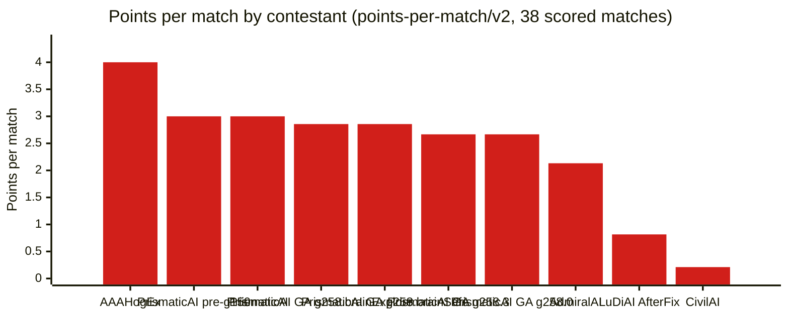
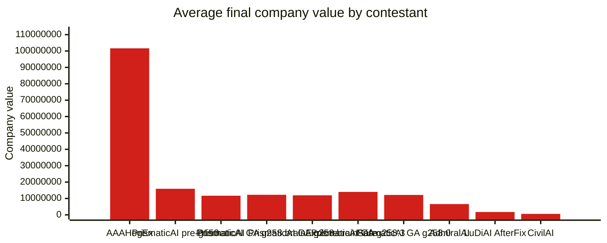
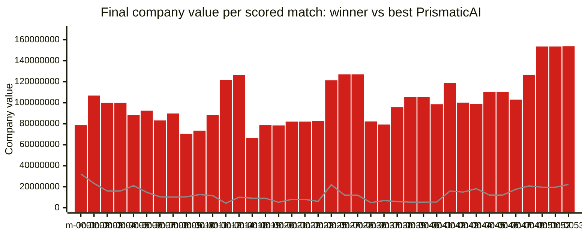
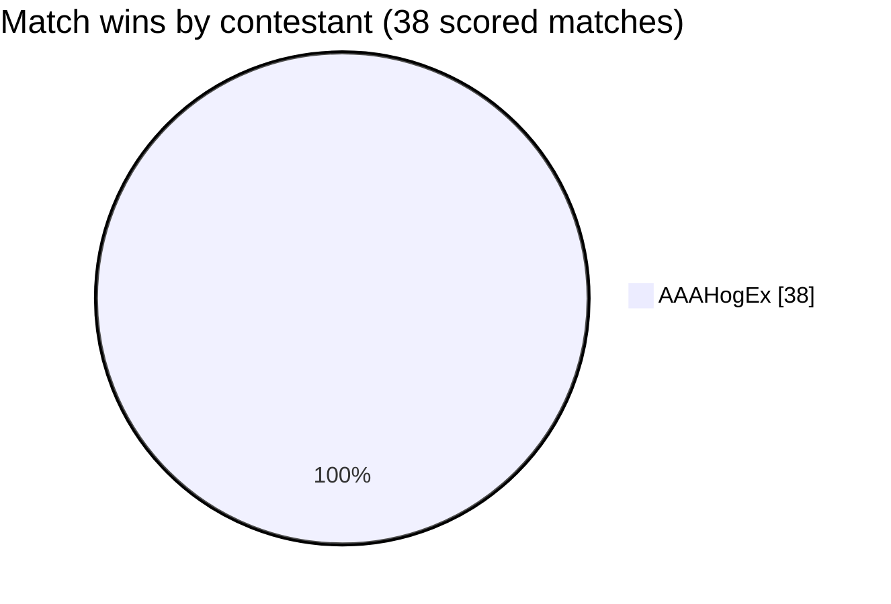
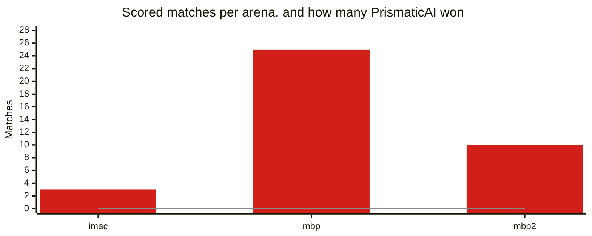

# battle-20261121T095406-264244e5

Derived from `battle-20261121T095406-264244e5.json` by `tools/research/ai-battle/battle.py report`; do not edit.

- Edition `264244e5653e1774`: PrismaticAI and referee at `52f631b115782334f422f741a79ecabce78e58c4`, base set `opengfx-8.0.tar`
- 20-year free-for-all from 1960, map 256x256 temperate, breakdowns 1
- 38 scored match(es) on `imac` (20261119-master-gdf1e05e7d8), `mbp` (20261120-master-m17653b726e), `mbp2` (20261119-master-gdf1e05e7d8)
- Replays: 0 of 0 identical to their original on another arena

| # | Contestant | Played | Wins | Points | Points/match | Avg rank | Avg final value | Squirrel errors | Matches with anomalies |
|---|---|---|---|---|---|---|---|---|---|
| 1 | AAAHogEx | 38 | 38 | 152 | 4.0 | 1.0 | 101.6 M | 0 | 0 |
| 2 | PrismaticAI pre-g150 | 6 | 0 | 18 | 3.0 | 2.0 | 15.9 M | 0 | 3 |
| 3 | PrismaticAI | 6 | 0 | 18 | 3.0 | 2.0 | 11.7 M | 0 | 0 |
| 4 | PrismaticAI GA g258.brainExplore | 7 | 0 | 20 | 2.857 | 2.14 | 12.2 M | 0 | 0 |
| 5 | PrismaticAI GA g258.brainSafe | 7 | 0 | 20 | 2.857 | 2.14 | 11.9 M | 0 | 0 |
| 6 | PrismaticAI GA g258.3 | 6 | 0 | 16 | 2.667 | 2.33 | 14.0 M | 0 | 0 |
| 7 | PrismaticAI GA g258.0 | 6 | 0 | 16 | 2.667 | 2.33 | 12.2 M | 0 | 0 |
| 8 | AdmiralAI | 38 | 0 | 81 | 2.132 | 2.87 | 6.6 M | 47 | 1 |
| 9 | LuDiAI AfterFix | 38 | 0 | 31 | 0.816 | 4.18 | 1.7 M | 0 | 0 |
| 10 | CivilAI | 38 | 0 | 8 | 0.211 | 4.79 | 589.4 k | 0 | 3 |

<!-- battle-charts:begin -->
<!-- derived from battle-20261121T095406-264244e5.json by `battle.py render`; `battle.py check` fails when it is stale -->

<!-- battle-charts:end -->

| Match | Arena | Seed | Winner | Value | Last | Anomalies |
|---|---|---|---|---|---|---|
| m-0001 | mbp | 713034946 | AAAHogEx | 78.7 M | CivilAI | - |
| m-0002 | mbp | 713034946 | AAAHogEx | 106.9 M | CivilAI | - |
| m-0003 | mbp | 713034946 | AAAHogEx | 99.9 M | CivilAI | - |
| m-0004 | mbp | 713034946 | AAAHogEx | 99.9 M | CivilAI | - |
| m-0005 | mbp | 713034946 | AAAHogEx | 88.2 M | CivilAI | - |
| m-0006 | mbp | 1924228698 | AAAHogEx | 92.5 M | CivilAI | - |
| m-0007 | mbp | 1924228698 | AAAHogEx | 83.2 M | LuDiAI AfterFix | - |
| m-0008 | mbp | 1924228698 | AAAHogEx | 89.8 M | CivilAI | - |
| m-0009 | mbp | 1924228698 | AAAHogEx | 70.4 M | CivilAI | - |
| m-0010 | imac | 1924228698 | AAAHogEx | 73.4 M | CivilAI | - |
| m-0011 | imac | 1924228698 | AAAHogEx | 88.3 M | CivilAI | - |
| m-0012 | imac | 1480839035 | AAAHogEx | 121.8 M | CivilAI | - |
| m-0014 | mbp2 | 1480839035 | AAAHogEx | 126.5 M | CivilAI | AdmiralAI: squirrel_errors:47 |
| m-0018 | mbp2 | 1445703912 | AAAHogEx | 66.6 M | CivilAI | - |
| m-0019 | mbp2 | 1445703912 | AAAHogEx | 78.8 M | CivilAI | - |
| m-0020 | mbp2 | 1445703912 | AAAHogEx | 78.4 M | CivilAI | - |
| m-0021 | mbp2 | 1445703912 | AAAHogEx | 82.1 M | CivilAI | CivilAI: fleet_drop:55->32 |
| m-0022 | mbp2 | 1445703912 | AAAHogEx | 82.1 M | CivilAI | CivilAI: fleet_drop:55->32 |
| m-0023 | mbp2 | 1445703912 | AAAHogEx | 82.6 M | LuDiAI AfterFix | - |
| m-0025 | mbp2 | 200865699 | AAAHogEx | 121.5 M | CivilAI | PrismaticAI pre-g150: fleet_drop:141->83 |
| m-0027 | mbp2 | 200865699 | AAAHogEx | 127.1 M | CivilAI | - |
| m-0028 | mbp2 | 200865699 | AAAHogEx | 127.1 M | CivilAI | - |
| m-0036 | mbp | 1294865265 | AAAHogEx | 82.2 M | CivilAI | - |
| m-0037 | mbp | 1294865265 | AAAHogEx | 79.3 M | CivilAI | PrismaticAI pre-g150: fleet_drop:85->45 |
| m-0038 | mbp | 1294865265 | AAAHogEx | 95.9 M | CivilAI | CivilAI: no_vehicles |
| m-0039 | mbp | 1294865265 | AAAHogEx | 105.6 M | CivilAI | - |
| m-0040 | mbp | 1294865265 | AAAHogEx | 105.6 M | CivilAI | - |
| m-0041 | mbp | 1294865265 | AAAHogEx | 98.6 M | CivilAI | - |
| m-0042 | mbp | 645937756 | AAAHogEx | 119.1 M | CivilAI | - |
| m-0043 | mbp | 645937756 | AAAHogEx | 100.0 M | CivilAI | PrismaticAI pre-g150: fleet_drop:119->68 |
| m-0044 | mbp | 645937756 | AAAHogEx | 98.8 M | LuDiAI AfterFix | - |
| m-0045 | mbp | 645937756 | AAAHogEx | 110.5 M | LuDiAI AfterFix | - |
| m-0046 | mbp | 645937756 | AAAHogEx | 110.5 M | LuDiAI AfterFix | - |
| m-0047 | mbp | 645937756 | AAAHogEx | 103.0 M | LuDiAI AfterFix | - |
| m-0048 | mbp | 662869324 | AAAHogEx | 126.6 M | CivilAI | - |
| m-0051 | mbp | 662869324 | AAAHogEx | 153.6 M | LuDiAI AfterFix | - |
| m-0052 | mbp | 662869324 | AAAHogEx | 153.6 M | LuDiAI AfterFix | - |
| m-0053 | mbp | 662869324 | AAAHogEx | 153.9 M | CivilAI | - |
