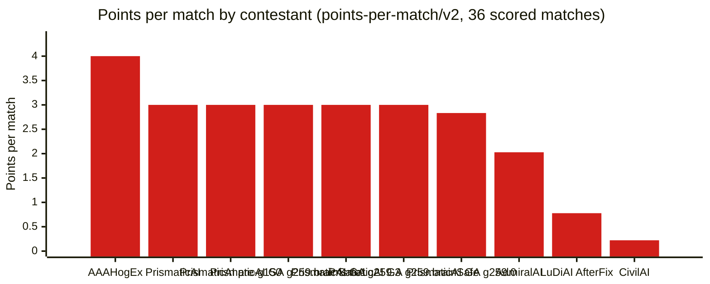
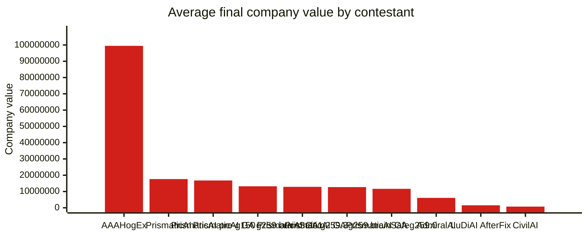
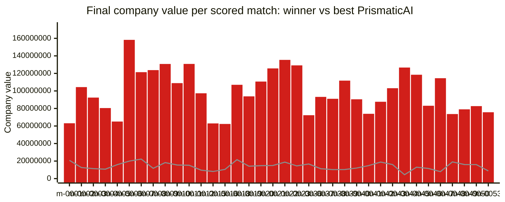
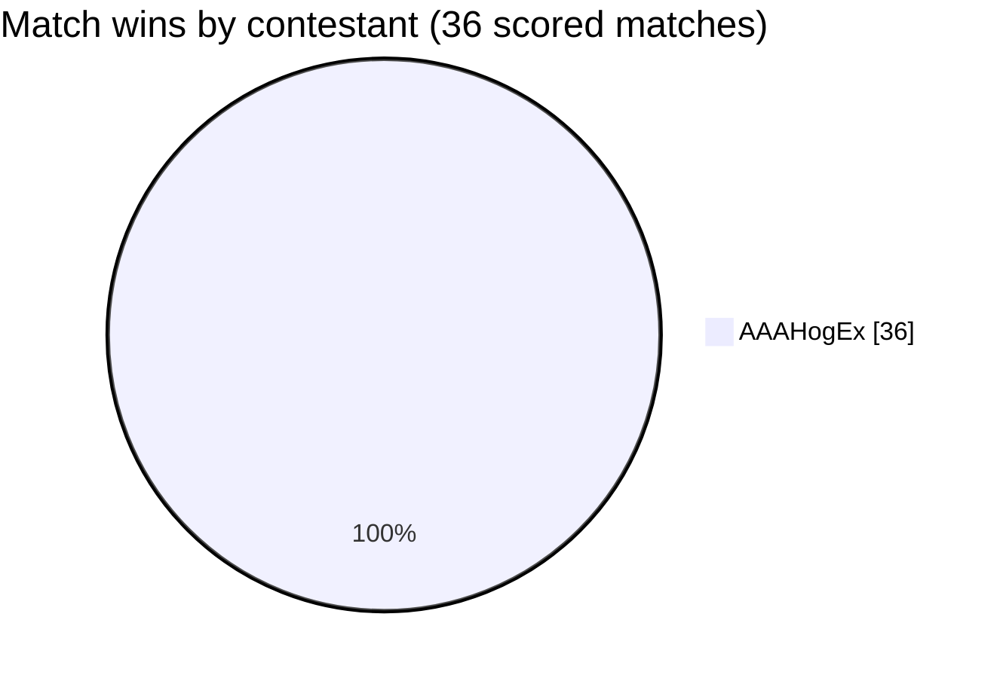
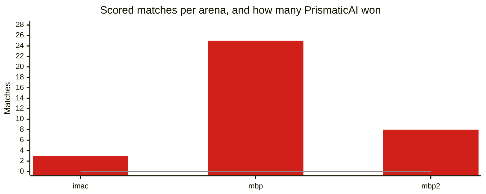

# battle-20261121T100544-7b562bd9

Derived from `battle-20261121T100544-7b562bd9.json` by `tools/research/ai-battle/battle.py report`; do not edit.

- Edition `7b562bd9d252f338`: PrismaticAI and referee at `52f631b115782334f422f741a79ecabce78e58c4`, base set `opengfx-8.0.tar`
- 20-year free-for-all from 1960, map 256x256 temperate, breakdowns 1
- 36 scored match(es) on `imac` (20261119-master-gdf1e05e7d8), `mbp` (20261120-master-m17653b726e), `mbp2` (20261119-master-gdf1e05e7d8)
- Replays: 0 of 0 identical to their original on another arena

| # | Contestant | Played | Wins | Points | Points/match | Avg rank | Avg final value | Squirrel errors | Matches with anomalies |
|---|---|---|---|---|---|---|---|---|---|
| 1 | AAAHogEx | 36 | 36 | 144 | 4.0 | 1.0 | 99.5 M | 0 | 0 |
| 2 | PrismaticAI | 6 | 0 | 18 | 3.0 | 2.0 | 17.6 M | 0 | 0 |
| 3 | PrismaticAI pre-g150 | 6 | 0 | 18 | 3.0 | 2.0 | 16.8 M | 0 | 3 |
| 4 | PrismaticAI GA g259.brainSafe1 | 6 | 0 | 18 | 3.0 | 2.0 | 13.2 M | 0 | 0 |
| 5 | PrismaticAI GA g259.3 | 6 | 0 | 18 | 3.0 | 2.0 | 12.9 M | 0 | 1 |
| 6 | PrismaticAI GA g259.brainSafe | 6 | 0 | 18 | 3.0 | 2.0 | 12.7 M | 0 | 0 |
| 7 | PrismaticAI GA g259.0 | 6 | 0 | 17 | 2.833 | 2.17 | 11.6 M | 0 | 0 |
| 8 | AdmiralAI | 36 | 0 | 73 | 2.028 | 2.97 | 6.1 M | 0 | 1 |
| 9 | LuDiAI AfterFix | 36 | 0 | 28 | 0.778 | 4.22 | 1.5 M | 0 | 1 |
| 10 | CivilAI | 36 | 0 | 8 | 0.222 | 4.78 | 720.1 k | 0 | 5 |

<!-- battle-charts:begin -->
<!-- derived from battle-20261121T100544-7b562bd9.json by `battle.py render`; `battle.py check` fails when it is stale -->

<!-- battle-charts:end -->

| Match | Arena | Seed | Winner | Value | Last | Anomalies |
|---|---|---|---|---|---|---|
| m-0001 | mbp | 334950916 | AAAHogEx | 63.1 M | CivilAI | - |
| m-0002 | mbp | 334950916 | AAAHogEx | 104.4 M | LuDiAI AfterFix | LuDiAI AfterFix: fleet_drop:45->27 |
| m-0003 | mbp | 334950916 | AAAHogEx | 92.4 M | CivilAI | CivilAI: fleet_drop:27->17 |
| m-0004 | mbp | 334950916 | AAAHogEx | 80.5 M | CivilAI | - |
| m-0005 | mbp | 334950916 | AAAHogEx | 65.1 M | CivilAI | - |
| m-0006 | mbp | 684295027 | AAAHogEx | 158.3 M | CivilAI | - |
| m-0007 | mbp | 684295027 | AAAHogEx | 121.4 M | CivilAI | - |
| m-0008 | mbp | 684295027 | AAAHogEx | 123.8 M | LuDiAI AfterFix | - |
| m-0009 | mbp | 684295027 | AAAHogEx | 130.8 M | CivilAI | - |
| m-0010 | imac | 684295027 | AAAHogEx | 108.9 M | CivilAI | - |
| m-0011 | imac | 684295027 | AAAHogEx | 130.8 M | LuDiAI AfterFix | AdmiralAI: fleet_drop:194->124 |
| m-0012 | imac | 1605382657 | AAAHogEx | 97.3 M | CivilAI | CivilAI: fleet_drop:27->11 |
| m-0015 | mbp2 | 1605382657 | AAAHogEx | 62.9 M | CivilAI | - |
| m-0016 | mbp2 | 1605382657 | AAAHogEx | 62.3 M | CivilAI | - |
| m-0018 | mbp2 | 1532968954 | AAAHogEx | 107.0 M | CivilAI | CivilAI: fleet_drop:55->28 |
| m-0019 | mbp2 | 1532968954 | AAAHogEx | 93.8 M | CivilAI | PrismaticAI pre-g150: fleet_drop:81->48 |
| m-0020 | mbp2 | 1532968954 | AAAHogEx | 110.7 M | CivilAI | - |
| m-0021 | mbp2 | 1532968954 | AAAHogEx | 125.7 M | LuDiAI AfterFix | - |
| m-0022 | mbp2 | 1532968954 | AAAHogEx | 135.4 M | CivilAI | - |
| m-0023 | mbp2 | 1532968954 | AAAHogEx | 129.2 M | LuDiAI AfterFix | - |
| m-0036 | mbp | 1162234411 | AAAHogEx | 72.3 M | CivilAI | - |
| m-0037 | mbp | 1162234411 | AAAHogEx | 93.2 M | LuDiAI AfterFix | - |
| m-0038 | mbp | 1162234411 | AAAHogEx | 91.0 M | CivilAI | - |
| m-0039 | mbp | 1162234411 | AAAHogEx | 111.8 M | CivilAI | - |
| m-0040 | mbp | 1162234411 | AAAHogEx | 90.5 M | CivilAI | - |
| m-0041 | mbp | 1162234411 | AAAHogEx | 73.9 M | CivilAI | PrismaticAI GA g259.3: fleet_drop:72->46 |
| m-0042 | mbp | 1508394499 | AAAHogEx | 87.7 M | CivilAI | - |
| m-0043 | mbp | 1508394499 | AAAHogEx | 103.1 M | CivilAI | PrismaticAI pre-g150: fleet_drop:92->42; CivilAI: fleet_drop:50->31 |
| m-0044 | mbp | 1508394499 | AAAHogEx | 126.7 M | LuDiAI AfterFix | - |
| m-0045 | mbp | 1508394499 | AAAHogEx | 118.5 M | CivilAI | - |
| m-0046 | mbp | 1508394499 | AAAHogEx | 83.1 M | CivilAI | - |
| m-0047 | mbp | 1508394499 | AAAHogEx | 114.5 M | CivilAI | - |
| m-0048 | mbp | 442667433 | AAAHogEx | 73.6 M | CivilAI | CivilAI: fleet_drop:40->18 |
| m-0049 | mbp | 442667433 | AAAHogEx | 79.0 M | CivilAI | PrismaticAI pre-g150: fleet_drop:112->73 |
| m-0050 | mbp | 442667433 | AAAHogEx | 82.7 M | CivilAI | - |
| m-0053 | mbp | 442667433 | AAAHogEx | 75.7 M | LuDiAI AfterFix | - |
