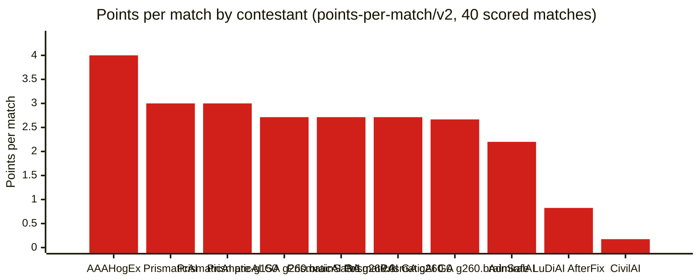
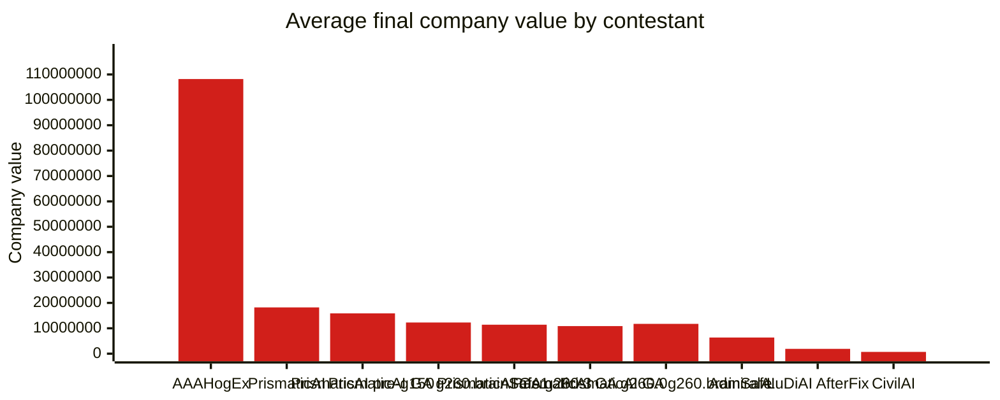
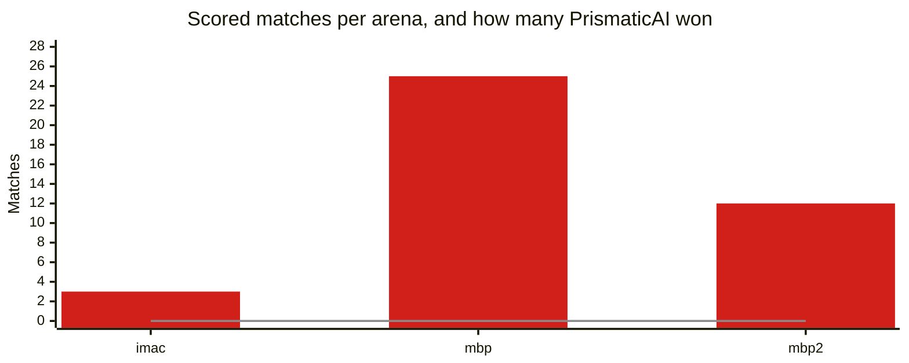

# battle-20261121T101824-16eccd97

Derived from `battle-20261121T101824-16eccd97.json` by `tools/research/ai-battle/battle.py report`; do not edit.

- Edition `16eccd97c9fbaec3`: PrismaticAI and referee at `52f631b115782334f422f741a79ecabce78e58c4`, base set `opengfx-8.0.tar`
- 20-year free-for-all from 1960, map 256x256 temperate, breakdowns 1
- 40 scored match(es) on `imac` (20261119-master-gdf1e05e7d8), `mbp` (20261120-master-m17653b726e), `mbp2` (20261119-master-gdf1e05e7d8)
- Replays: 0 of 1 identical to their original on another arena

| # | Contestant | Played | Wins | Points | Points/match | Avg rank | Avg final value | Squirrel errors | Matches with anomalies |
|---|---|---|---|---|---|---|---|---|---|
| 1 | AAAHogEx | 40 | 40 | 160 | 4.0 | 1.0 | 108.2 M | 0 | 0 |
| 2 | PrismaticAI | 7 | 0 | 21 | 3.0 | 2.0 | 18.2 M | 0 | 0 |
| 3 | PrismaticAI pre-g150 | 6 | 0 | 18 | 3.0 | 2.0 | 15.9 M | 0 | 2 |
| 4 | PrismaticAI GA g260.brainSafe1 | 7 | 0 | 19 | 2.714 | 2.29 | 12.3 M | 0 | 1 |
| 5 | PrismaticAI GA g260.3 | 7 | 0 | 19 | 2.714 | 2.29 | 11.4 M | 0 | 0 |
| 6 | PrismaticAI GA g260.0 | 7 | 0 | 19 | 2.714 | 2.29 | 10.9 M | 0 | 0 |
| 7 | PrismaticAI GA g260.brainSafe | 6 | 0 | 16 | 2.667 | 2.33 | 11.7 M | 0 | 0 |
| 8 | AdmiralAI | 40 | 0 | 88 | 2.2 | 2.8 | 6.4 M | 47 | 2 |
| 9 | LuDiAI AfterFix | 40 | 0 | 33 | 0.825 | 4.17 | 1.9 M | 0 | 0 |
| 10 | CivilAI | 40 | 0 | 7 | 0.175 | 4.83 | 694.6 k | 33 | 11 |

```mermaid
---
config:
  xyChart:
    width: 900
    height: 360
  themeVariables:
    xyChart:
      plotColorPalette: "#d11f1a, #8a8a8a, #0b0b0b, #ece4d6"
---
xychart-beta
    title "Final company value per scored match: winner vs best PrismaticAI"
    x-axis ["m-0001", "m-0002", "m-0003", "m-0004", "m-0005", "m-0006", "m-0007", "m-0008", "m-0009", "m-0010", "m-0011", "m-0012", "m-0014", "m-0015", "m-0017", "m-0018", "m-0019", "m-0020", "m-0021", "m-0022", "m-0023", "m-0024", "m-0026", "m-0028", "m-0036", "m-0037", "m-0038", "m-0039", "m-0040", "m-0041", "m-0042", "m-0043", "m-0044", "m-0045", "m-0046", "m-0047", "m-0049", "m-0052", "m-0053", "m-0054"]
    %% series: Winner | Best PrismaticAI
    %% links: battle-20261121T101824-16eccd97.md?col=Match&filter=m-0001 | battle-20261121T101824-16eccd97.md?col=Match&filter=m-0002 | battle-20261121T101824-16eccd97.md?col=Match&filter=m-0003 | battle-20261121T101824-16eccd97.md?col=Match&filter=m-0004 | battle-20261121T101824-16eccd97.md?col=Match&filter=m-0005 | battle-20261121T101824-16eccd97.md?col=Match&filter=m-0006 | battle-20261121T101824-16eccd97.md?col=Match&filter=m-0007 | battle-20261121T101824-16eccd97.md?col=Match&filter=m-0008 | battle-20261121T101824-16eccd97.md?col=Match&filter=m-0009 | battle-20261121T101824-16eccd97.md?col=Match&filter=m-0010 | battle-20261121T101824-16eccd97.md?col=Match&filter=m-0011 | battle-20261121T101824-16eccd97.md?col=Match&filter=m-0012 | battle-20261121T101824-16eccd97.md?col=Match&filter=m-0014 | battle-20261121T101824-16eccd97.md?col=Match&filter=m-0015 | battle-20261121T101824-16eccd97.md?col=Match&filter=m-0017 | battle-20261121T101824-16eccd97.md?col=Match&filter=m-0018 | battle-20261121T101824-16eccd97.md?col=Match&filter=m-0019 | battle-20261121T101824-16eccd97.md?col=Match&filter=m-0020 | battle-20261121T101824-16eccd97.md?col=Match&filter=m-0021 | battle-20261121T101824-16eccd97.md?col=Match&filter=m-0022 | battle-20261121T101824-16eccd97.md?col=Match&filter=m-0023 | battle-20261121T101824-16eccd97.md?col=Match&filter=m-0024 | battle-20261121T101824-16eccd97.md?col=Match&filter=m-0026 | battle-20261121T101824-16eccd97.md?col=Match&filter=m-0028 | battle-20261121T101824-16eccd97.md?col=Match&filter=m-0036 | battle-20261121T101824-16eccd97.md?col=Match&filter=m-0037 | battle-20261121T101824-16eccd97.md?col=Match&filter=m-0038 | battle-20261121T101824-16eccd97.md?col=Match&filter=m-0039 | battle-20261121T101824-16eccd97.md?col=Match&filter=m-0040 | battle-20261121T101824-16eccd97.md?col=Match&filter=m-0041 | battle-20261121T101824-16eccd97.md?col=Match&filter=m-0042 | battle-20261121T101824-16eccd97.md?col=Match&filter=m-0043 | battle-20261121T101824-16eccd97.md?col=Match&filter=m-0044 | battle-20261121T101824-16eccd97.md?col=Match&filter=m-0045 | battle-20261121T101824-16eccd97.md?col=Match&filter=m-0046 | battle-20261121T101824-16eccd97.md?col=Match&filter=m-0047 | battle-20261121T101824-16eccd97.md?col=Match&filter=m-0049 | battle-20261121T101824-16eccd97.md?col=Match&filter=m-0052 | battle-20261121T101824-16eccd97.md?col=Match&filter=m-0053 | battle-20261121T101824-16eccd97.md?col=Match&filter=m-0054
    y-axis "Company value" 0 --> 191000000
    bar [92006646, 96815138, 99713590, 89653580, 96815138, 116425440, 95345745, 102351840, 93009147, 91742992, 99496900, 163350614, 173805413, 153612843, 173805413, 83990149, 108792086, 99892129, 107135853, 111614902, 99892129, 75844050, 96762429, 107568602, 89465092, 107355521, 130992180, 104245809, 93887716, 85519257, 92557168, 84577703, 101267027, 114036790, 95324928, 110884504, 114306173, 134789217, 105260601, 133998642]
    line [11739118, 4360470, 6744770, 4736595, 4360470, 9720886, 7386675, 3348604, 8441694, 7723558, 4677938, 15692111, 14492723, 17280145, 14492723, 27338852, 23396019, 10245493, 15887467, 16829311, 10245493, 11647948, 10747748, 13349061, 22199516, 15533937, 11957170, 12139862, 14627641, 14012614, 26527629, 24872203, 20906295, 9944192, 18149474, 20137973, 12317474, 10512707, 11930945, 14440049]
```

<!-- battle-charts:begin -->
<!-- derived from battle-20261121T101824-16eccd97.json by `battle.py render`; `battle.py check` fails when it is stale -->

<!-- battle-charts:end -->

| Seed | Original | Replay | Arenas | Identical |
|---|---|---|---|---|
| 1375565896 | m-0010 | m-0048 | imac / mbp | NO |

| Match | Arena | Seed | Winner | Value | Last | Anomalies |
|---|---|---|---|---|---|---|
| m-0001 | mbp | 1190555753 | AAAHogEx | 92.0 M | CivilAI | CivilAI: fleet_drop:74->41 |
| m-0002 | mbp | 1190555753 | AAAHogEx | 96.8 M | CivilAI | - |
| m-0003 | mbp | 1190555753 | AAAHogEx | 99.7 M | CivilAI | - |
| m-0004 | mbp | 1190555753 | AAAHogEx | 89.7 M | CivilAI | - |
| m-0005 | mbp | 1190555753 | AAAHogEx | 96.8 M | CivilAI | - |
| m-0006 | mbp | 1375565896 | AAAHogEx | 116.4 M | CivilAI | - |
| m-0007 | mbp | 1375565896 | AAAHogEx | 95.3 M | CivilAI | CivilAI: fleet_drop:83->33 |
| m-0008 | mbp | 1375565896 | AAAHogEx | 102.4 M | CivilAI | - |
| m-0009 | mbp | 1375565896 | AAAHogEx | 93.0 M | CivilAI | AdmiralAI: fleet_drop:169->103 |
| m-0010 | imac | 1375565896 | AAAHogEx | 91.7 M | CivilAI | PrismaticAI GA g260.brainSafe1: fleet_drop:80->46 |
| m-0011 | imac | 1375565896 | AAAHogEx | 99.5 M | CivilAI | - |
| m-0012 | imac | 1813865567 | AAAHogEx | 163.4 M | LuDiAI AfterFix | - |
| m-0014 | mbp2 | 1813865567 | AAAHogEx | 173.8 M | CivilAI | CivilAI: fleet_drop:25->16 |
| m-0015 | mbp2 | 1813865567 | AAAHogEx | 153.6 M | CivilAI | - |
| m-0017 | mbp2 | 1813865567 | AAAHogEx | 173.8 M | CivilAI | CivilAI: fleet_drop:25->16 |
| m-0018 | mbp2 | 1654985269 | AAAHogEx | 84.0 M | CivilAI | - |
| m-0019 | mbp2 | 1654985269 | AAAHogEx | 108.8 M | CivilAI | PrismaticAI pre-g150: fleet_drop:72->41 |
| m-0020 | mbp2 | 1654985269 | AAAHogEx | 99.9 M | CivilAI | CivilAI: fleet_drop:29->9 |
| m-0021 | mbp2 | 1654985269 | AAAHogEx | 107.1 M | CivilAI | CivilAI: fleet_drop:44->22 |
| m-0022 | mbp2 | 1654985269 | AAAHogEx | 111.6 M | CivilAI | - |
| m-0023 | mbp2 | 1654985269 | AAAHogEx | 99.9 M | CivilAI | CivilAI: fleet_drop:29->9 |
| m-0024 | mbp2 | 799530642 | AAAHogEx | 75.8 M | CivilAI | - |
| m-0026 | mbp2 | 799530642 | AAAHogEx | 96.8 M | CivilAI | - |
| m-0028 | mbp2 | 799530642 | AAAHogEx | 107.6 M | CivilAI | CivilAI: fleet_drop:29->20 |
| m-0036 | mbp | 1669443225 | AAAHogEx | 89.5 M | CivilAI | - |
| m-0037 | mbp | 1669443225 | AAAHogEx | 107.4 M | LuDiAI AfterFix | - |
| m-0038 | mbp | 1669443225 | AAAHogEx | 131.0 M | CivilAI | - |
| m-0039 | mbp | 1669443225 | AAAHogEx | 104.2 M | CivilAI | AdmiralAI: squirrel_errors:47 |
| m-0040 | mbp | 1669443225 | AAAHogEx | 93.9 M | LuDiAI AfterFix | - |
| m-0041 | mbp | 1669443225 | AAAHogEx | 85.5 M | CivilAI | - |
| m-0042 | mbp | 406872303 | AAAHogEx | 92.6 M | CivilAI | - |
| m-0043 | mbp | 406872303 | AAAHogEx | 84.6 M | CivilAI | CivilAI: fleet_drop:39->9 |
| m-0044 | mbp | 406872303 | AAAHogEx | 101.3 M | CivilAI | - |
| m-0045 | mbp | 406872303 | AAAHogEx | 114.0 M | CivilAI | - |
| m-0046 | mbp | 406872303 | AAAHogEx | 95.3 M | CivilAI | - |
| m-0047 | mbp | 406872303 | AAAHogEx | 110.9 M | CivilAI | CivilAI: fleet_drop:56->34 |
| m-0048 (replay) | mbp | 1375565896 | AAAHogEx | 88.7 M | CivilAI | PrismaticAI GA g260.brainSafe1: fleet_drop:78->43 |
| m-0049 | mbp | 169823264 | AAAHogEx | 114.3 M | LuDiAI AfterFix | PrismaticAI pre-g150: fleet_drop:116->55 |
| m-0052 | mbp | 169823264 | AAAHogEx | 134.8 M | LuDiAI AfterFix | - |
| m-0053 | mbp | 169823264 | AAAHogEx | 105.3 M | LuDiAI AfterFix | - |
| m-0054 | mbp | 1245914308 | AAAHogEx | 134.0 M | LuDiAI AfterFix | CivilAI: squirrel_errors:33 |
